# 2026-11-09 手办新品

共 150 件（HPOI 73 · Good Smile 官网 40 · HLJ 37）。点名称打开原页面。

## HPOI（73）

| 图 | 商品 | 价格 | 发售 |
|---|---|---|---|
| 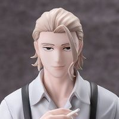 | **[STRAVENTO 神乐钵 柴登吾](https://www.hpoi.net/hobby/139055)** TVアニメ『カグラバチ』 STRAVENTO 柴登吾 CyberAgent · 神乐钵（动画） · 柴登吾 比例人形 · STRAVENTO | — | 2027-09 |
|  | **[Diorama系列 王者荣耀 沧海之曜 大乔](https://www.hpoi.net/hobby/139051)** Diorama系列 王者荣耀 「沧海之曜 大乔」 Myethos · 王者荣耀 · 大乔 比例人形 · Diorama系列 | 459 元 | 2027-09 |
| 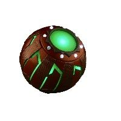 | **[漫威传奇系列 蜘蛛侠：英雄无归 绿魔 电动南瓜炸弹](https://www.hpoi.net/hobby/139048)** マーベル・レジェンド・シリーズ スパイダーマン：ノー・ウェイ・ホーム グリーン・ゴブリン エレクトロニック・パンプキン 孩之宝 · 蜘蛛侠：英雄无归 配件 · 漫威传奇系列 | 7,480 日元 含税，314元 | 2026-10 |
|  | **[漫威传奇系列 无限传奇 《复仇者联盟：终局之战》钢铁侠 Mark85 电动头盔](https://www.hpoi.net/hobby/139043)** マーベル・レジェンド・シリーズ インフィニティ・サーガ 『アベンジャーズ/エンドゲーム』 アイアンマン・マークLXXXV エレクトロニックヘルメット 孩之宝 · 复仇者联盟4：终局之战 · 钢铁侠 配件 · 漫威传奇系列 · 1/1 | 20,460 日元 含税，861元 | 2026-10 |
|  | **[威传奇系列 《美国队长》 美国队长：无畏新世界 盾牌](https://www.hpoi.net/hobby/139042)** マーベル・レジェンド・シリーズ 『キャプテン・アメリカ』 キャプテン・アメリカ:ブレイブ・ニュー・ワールド シールド 孩之宝 · 美国队长 配件 · 漫威传奇系列 | 20,460 日元 含税，861元 | 2026-10 |
| 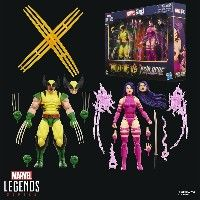 | **[漫威传奇系列 漫威游戏 金刚狼 VS 灵蝶](https://www.hpoi.net/hobby/139040)** マーベル・レジェンド・シリーズ マーベル・ゲームズ ウルヴァリン VS サイロック 孩之宝 · 漫威 · 灵蝶、金刚狼 比例人形 · 漫威传奇系列 | 12,320 日元 含税，518元 | 2026-12 |
|  | **[AFORCE×DRAGON HORSE 不死者之王 LIKE 湯 盲盒](https://www.hpoi.net/hobby/139036)** AFORCE×DRAGON HORSE オーバーロード トレーディングフィギュア LIKE湯 Dragon Horse · OVERLORD · 夏乌拉、安兹·乌尔·恭、夏提雅・布拉德弗伦、仓助、雅儿贝德 Q版人形 | 1,320 日元 | 2026-12 |
|  | **[Melty Princess More 不时用俄语小声说真心话的邻桌艾莉同学 掌中艾莉](https://www.hpoi.net/hobby/139034)** Melty Princess More 『時々ボソッとロシア語でデレる隣のアーリャさん』 てのひらアーリャ MegaHouse · 不时用俄语小声说真心话的邻桌艾莉同学 · 艾莉莎·米哈伊罗夫纳·九条（艾莉） 比例人形 · Melty Princess | — | 未知 |
|  | **[BiCute Pure CODE GEASS 反叛的鲁路修 C.C.](https://www.hpoi.net/hobby/139033)** BiCute Pure Figure コードギアス 反逆のルルーシュ ーC.C.ー FuRyu · CODE GEASS 反叛的鲁路修 · C.C. 比例人形 · BiCute Pure | — | 2027-04 |
|  | **[Desktop Cute 出包王女DARKNESS 娜娜～旗袍～ 新装版](https://www.hpoi.net/hobby/139032)** To LOVEる-とらぶる-ダークネス Desktop Cute フィギュア ナナ～チャイナドレスver.～Renewal TAiTO · 出包王女DARKNESS · 娜娜·阿丝达·戴比路克 比例人形 · Desktop Cute | — | 2027-04 |
| 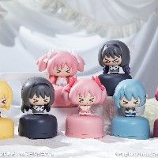 | **[魔法少女小圆 剧场版 \[前篇\] 起始的物语 / \[后篇\] 永远的物语 摇头摆件 盲盒](https://www.hpoi.net/hobby/139030)** 魔法少女小圆 剧场版 \[前篇\] 起始的物语 / \[后篇\] 永远的物语 摇头摆件 盲盒 Aniplex上海 · 魔法少女小圆 剧场版 \[后篇\] 永远的物语、魔法少女小圆 剧场版 \[前篇\] 起始的物语 Q版人形 | 99 元 | 2027-09 |
| 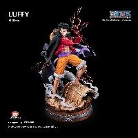 | **[钻石路飞](https://www.hpoi.net/hobby/139028)** 钻石路飞 Tsume 比例人形 · 1/4 | 6,900 元 | 2026-12 |
|  | **[第五人格 稀世珍藏系列](https://www.hpoi.net/hobby/139013)** 第五人格 稀世珍藏系列 泡泡玛特 · 第五人格 比例人形 | 79 元 | 2026-10 |
| 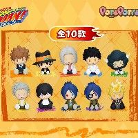 | **[POTEPOTTE-R 家庭教师 HITMAN REBORN! 盲盒](https://www.hpoi.net/hobby/139002)** POTEPOTTE-R 家庭教师 HITMAN REBORN! 盲盒 万代南梦宫（上海） · 家庭教师 · 沢田家康、库洛姆·髑髅、蓝波、山本武、里包恩、六道骸、狱寺隼人、泽田纲吉、云雀恭弥、屉川了平 Q版人形 · POTEPOTTE-R | 59 元 | 2026-12 |
| 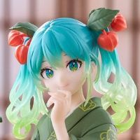 | **[压泡面 初音未来 Flower Fairy 酸浆 异色版](https://www.hpoi.net/hobby/139068)** 初音ミク ぬーどるストッパーフィギュア「初音ミク Flower Fairy-ほおずき-」 FuRyu · piapro · 初音未来 比例人形 · 泡面压 | — | 2027-01 |
|  | **[VIBRATION STARS 神乐钵 六平千矿](https://www.hpoi.net/hobby/139067)** VIBRATION STARS TVアニメ『カグラバチ』 六平 千鉱 眼镜厂 · 神乐钵（动画） · 六平千矿 比例人形 · VIBRATION STARS | — | 2027-05 |
|  | **[滑板男孩 可动人偶【黑色/橙色】](https://www.hpoi.net/hobby/139066)** 1/6 Skater boy 滑板男孩 可动人偶【黑色/橙色】 Trickyman12 比例人形 · 1/6 | 360 元 | 2026-12 |
|  | **[压泡面 全职猎人 库哔](https://www.hpoi.net/hobby/139065)** HUNTER×HUNTER コルトピぬーどるストッパーフィギュア FuRyu · 全职猎人 · 库哔 比例人形 · 泡面压 | — | 2027-05 |
|  | **[压泡面 全职猎人 妮翁‧诺斯拉](https://www.hpoi.net/hobby/139064)** HUNTER×HUNTER ネオンぬーどるストッパーフィギュア FuRyu · 全职猎人 · 妮翁‧诺斯拉 比例人形 · 泡面压 | — | 2027-04 |
| 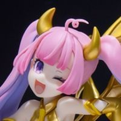 | **[景品收藏 麻将格斗少女 三元·小恋爱 魅魔啦啦队COS 黄金配色版](https://www.hpoi.net/hobby/139062)** 『麻雀ファイトガール』フィギュアコレクション ミツモト・ダイア サキュバスチアコス ゴールデンVer. 科乐美 · 麻将格斗少女 比例人形 · 科乐美景品收藏 | — | 2027-03 |
|  | **[《龙之宝藏》哥布林 打劫包 狂战士打劫包](https://www.hpoi.net/hobby/139061)** 《龙之宝藏》哥布林 打劫包 狂战士打劫包 鬼斧玩具 · 哥布林 配件 | 199 元 | 2027-06 |
| 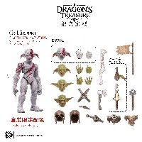 | **[《龙之宝藏》哥布林 打劫包 狂战士打劫包](https://www.hpoi.net/hobby/139060)** 《龙之宝藏》哥布林 打劫包 狂战士打劫包 配件 | 219 元 | 2027-06 |
| 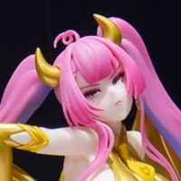 | **[景品收藏 麻将格斗少女 三元·大恋爱 魅魔啦啦队COS 黄金配色版](https://www.hpoi.net/hobby/139059)** 『麻雀ファイトガール』フィギュアコレクション ミンモト・ダイア サキュバスチアコス ゴールデンVer. 科乐美 · 麻将格斗少女 比例人形 · 科乐美景品收藏 | — | 2027-03 |
| 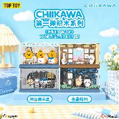 | **[吉伊卡哇 场景积木 第一弹](https://www.hpoi.net/hobby/139058)** 吉伊卡哇 场景积木 第一弹 Top Toy · 吉伊卡哇 · 小八/哈奇喵、奥德、吉伊、乌萨奇 场景 | 149 元 | 2026-10 |
| 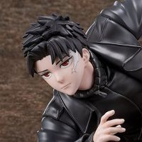 | **[STRAVENTO 神乐钵 六平千矿（南梦宫限定）](https://www.hpoi.net/hobby/139056)** TVアニメ『カグラバチ』 STRAVENTO 六平 千鉱（ナムコ限定） CyberGoods · 神乐钵（动画） · 六平千矿 比例人形 · STRAVENTO | — | 2027-04 |
|  | **[不良JK·黑色三重奏](https://www.hpoi.net/hobby/139069)** 新世代 New Generation（NG）不良JK·黑色三重奏 蜗之壳SnailShell 比例人形 · 1/12 | — | 未知 |

旧品补录 17 件：HPOI 新收录、但早已发售的老商品

| 图 | 商品 | 价格 | 发售 |
|---|---|---|---|
| 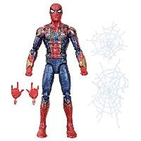 | **[漫威传奇 漫威 钢铁蜘蛛侠](https://www.hpoi.net/hobby/139050)** マーベル マーベル・レジェンド アイアン・スパイダー 孩之宝 · 复仇者联盟4：终局之战、漫威无限传奇、漫威 · 蜘蛛侠（彼得·帕克）、钢铁蜘蛛侠 比例人形 · 漫威传奇系列 · 旧品补录 | 4,800 日元 含税，202元 | 2024-07 |
|  | **[THE MONSTERS×海绵宝宝系列](https://www.hpoi.net/hobby/139047)** THE MONSTERS×海绵宝宝系列 泡泡玛特 Q版人形 · 旧品补录 | 69 元 | 2021-04 |
|  | **[海绵宝宝 X LABUBU](https://www.hpoi.net/hobby/139045)** 海绵宝宝 X LABUBU 泡泡玛特 比例人形 · 旧品补录 | 599 元 | 2021-04 |
|  | **[MOLLY蒸汽朋克动物机车系列](https://www.hpoi.net/hobby/139041)** MOLLY蒸汽朋克动物机车系列 泡泡玛特 Q版人形 · 旧品补录 | 99 元 | 2022-01 |
| 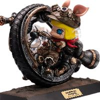 | **[MOLLY蒸汽朋克独轮风暴小猪](https://www.hpoi.net/hobby/139039)** MOLLY蒸汽朋克独轮风暴小猪 末那工作室 比例人形 · 旧品补录 | 2,899 元 | 2022-01 |
| 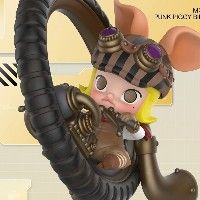 | **[MOLLY蒸汽朋克机车小猪](https://www.hpoi.net/hobby/139037)** MOLLY蒸汽朋克机车小猪 泡泡玛特 Q版人形 · 旧品补录 | 199 元 | 2022-05 |
|  | **[漫奇艾斯 火之意志](https://www.hpoi.net/hobby/139029)** 漫奇艾斯 火之意志 比例人形 · 1/6 · 旧品补录 | 4,280 元 | 2025-08 |
|  | **[蒸汽朋克动物系列](https://www.hpoi.net/hobby/139027)** 蒸汽朋克动物系列 泡泡玛特 生物/幻灵 · 旧品补录 | 59 元 | 2020-07 |
| 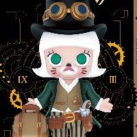 | **[Molly蒸汽朋克系列](https://www.hpoi.net/hobby/139026)** Molly蒸汽朋克系列 泡泡玛特 比例人形 · 旧品补录 | 69 元 | 2020-06 |
|  | **[飞天小女警 派对惊喜系列](https://www.hpoi.net/hobby/139023)** 飞天小女警 派对惊喜系列 泡泡玛特 · 飞天小女警 Q版人形 · 旧品补录 | 69 元 | 2025-10 |
| 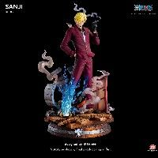 | **[钻石山治](https://www.hpoi.net/hobby/139011)** 钻石山治 Tsume 比例人形 · 1/4 · 旧品补录 | 6,600 元 | 2026-01 |
|  | **[POTEPOTTE-R 银魂 盲盒 第二弹](https://www.hpoi.net/hobby/139000)** POTEPOTTE-R 银魂 盲盒 第二弹 万代南梦宫（上海） · 银魂 · 神乐、神威、冲田总悟、桂小太郎、坂田银时、高杉晋助、志村新八、坂本辰马、土方十四郎 Q版人形 · POTEPOTTE-R · 旧品补录 | 59 元 | 2026-07 |
| 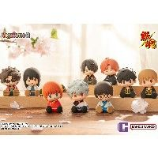 | **[POTEPOTTE-R 银魂 盲盒](https://www.hpoi.net/hobby/138999)** POTEPOTTE-R 银魂 盲盒 万代南梦宫（上海） · 银魂 · 坂本辰马、冲田总悟、桂小太郎、坂田银时、高杉晋助、志村新八、土方十四郎、神乐、神威 Q版人形 · POTEPOTTE-R · 旧品补录 | 59 元 | 2025-02 |
| 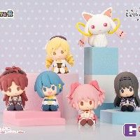 | **[POTEPOTTE-R 魔法少女小圆 剧场版［新篇］叛逆的物语 盲盒](https://www.hpoi.net/hobby/138998)** POTEPOTTE-R 魔法少女小圆 剧场版［新篇］叛逆的物语 盲盒 万代南梦宫（上海） · 魔法少女小圆、魔法少女小圆、魔法少女小圆 剧场版 \[新篇\] 叛逆的物语 · 丘比、鹿目圆、巴麻美、晓美焰、佐仓杏子、美树沙耶香 Q版人形 · POTEPOTTE-R · 旧品补录 | 59 元 | 2026-01 |
|  | **[POTEPOTTE-R 3年Z班银八老师 盲盒](https://www.hpoi.net/hobby/138997)** POTEPOTTE-R 3年Z班银八老师 盲盒 万代南梦宫（上海） · 3年Z班的银八老师 · 猿飞菖蒲、神乐、神威、冲田总悟、桂小太郎、坂田银时、高杉晋助、志村新八、土方十四郎 Q版人形 · POTEPOTTE-R · 旧品补录 | 59 元 | 2026-04 |
| 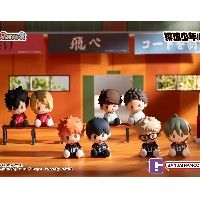 | **[POTEPOTTE-R 排球少年!! 盲盒](https://www.hpoi.net/hobby/138994)** POTEPOTTE-R 排球少年!! 盲盒 万代南梦宫（上海） · 排球少年!! · 月岛萤、山口忠、黑尾铁朗、赤苇京治、及川彻、日向翔阳、影山飞雄、孤爪研磨 Q版人形 · POTEPOTTE-R · 旧品补录 | 59 元 | 2025-11 |
|  | **[景品收藏 麻将格斗少女 三元·小恋爱 魅魔啦啦队COS 限定配色](https://www.hpoi.net/hobby/139063)** 麻雀ファイトガール フィギュアコレクション ミツモト・ココア サキュバスチアコス(コナクレ限定カラー) 科乐美 · 麻将格斗少女 比例人形 · 科乐美景品收藏 · 旧品补录 | — | 2026-03 |

成人向 30 件：只记录文字和链接，不保存图片

| 图 | 商品 | 价格 | 发售 |
|---|---|---|---|
|  | **[碧蓝航线 柴郡 抱枕版](https://www.hpoi.net/hobby/138886)** 碧蓝航线 柴郡 抱枕Ver. AniGame · 碧蓝航线 · 柴郡 比例人形 · 1/7 · 成人向 | 328 元 | 2027-08 |
|  | **[碧蓝航线 救救我指挥官君 - 手机支架（圣路易斯）](https://www.hpoi.net/hobby/137899)** アズールレーン 助けて指揮官くん -スマホスタンド(セントルイス) Yostar · 碧蓝航线 · 圣路易斯 比例人形 · 成人向 | 6,500 日元 含税，273元 | 2027-02 |
|  | **[胜利女神：新的希望 灰姑娘 水晶女仆](https://www.hpoi.net/hobby/137518)** 勝利の女神: NIKKE シンデレラ- グラスカーテシ－ 良笑塑美 · 胜利女神：新的希望 · 灰姑娘 比例人形 · 成人向 | — | 未知 |
|  | **[PINK](https://www.hpoi.net/hobby/137401)** PINK 比例人形 · 1/4 · 成人向 | 3,680 元 | 2025年第四季度 |
|  | **[精灵女仆 莉莉耶](https://www.hpoi.net/hobby/137294)** 精灵女仆 莉莉耶 光帧工坊 比例人形 · 1/12 · 成人向 | — | 未知 |
|  | **[沐珠仙子系列01 紫霞](https://www.hpoi.net/hobby/137236)** 沐珠仙子系列01 紫霞 老王捏妹 比例人形 · 1/5 · 成人向 | 1,688 元 | 2027年第一季度 |
|  | **[Erika/艾莉卡](https://www.hpoi.net/hobby/137061)** Erika/艾莉卡 比例人形 · 成人向 | — | 未知 |
|  | **[换装时间 茉莉 魔女 异色版](https://www.hpoi.net/hobby/136726)** 换装时间 茉莉 魔女 异色版 ABILU 比例人形 · 1/4 · 成人向 | — | 2026-10 |
|  | **[换装时间 茉莉 护士 异色版](https://www.hpoi.net/hobby/136725)** 换装时间 茉莉 护士 异色版 ABILU 比例人形 · 1/4 · 成人向 | — | 2026-10 |
|  | **[教廷 神谕修女](https://www.hpoi.net/hobby/136460)** 《教廷》系列第五款神谕修女 ACY STUDIO 比例人形 · 1/4 · 成人向 | 3,080 元 | 2026年第四季度 |
|  | **[教廷 教皇](https://www.hpoi.net/hobby/136459)** 《教廷》系列第四款教皇 ACY STUDIO 比例人形 · 1/4 · 成人向 | 3,280 元 | 2026年第四季度 |
|  | **[Purple Cyber](https://www.hpoi.net/hobby/136363)** Purple Cyber Cast Design 比例人形 · 1/4 · 成人向 | 2,580 元 | 2027年第二季度 |
|  | **[血刈-丝卡蕾](https://www.hpoi.net/hobby/136277)** 血刈-丝卡蕾 融幻模玩 比例人形 · 成人向 | — | 未知 |
|  | **[碧蓝航线 信浓 相融一梦](https://www.hpoi.net/hobby/136159)** アズールレーン 信濃 溶け合う夢に相擁すVer. AniGame · 碧蓝航线 · 鵗（信浓） 比例人形 · 成人向 | — | 未知 |
|  | **[胜利女神：新的希望 格丽特](https://www.hpoi.net/hobby/136148)** 勝利の女神：NIKKE グレーテル MiraiMira · 胜利女神：新的希望 比例人形 · 1/7 · 成人向 | — | 未知 |
|  | **[胜利女神：新的希望 汉赛尔](https://www.hpoi.net/hobby/136147)** 勝利の女神：NIKKE ヘンゼル MiraiMira · 胜利女神：新的希望 比例人形 · 1/7 · 成人向 | — | 未知 |
|  | **[XStellar 一骑当千 关羽云长](https://www.hpoi.net/hobby/136136)** 一騎当千 XStellar ‐関羽雲長‐ 世嘉 · 一骑当千 · 关羽云长 比例人形 · XStellar · 成人向 | — | 2027-03 |
|  | **[柴郡猫Mika 恶魔](https://www.hpoi.net/hobby/136056)** チェシャ猫 Mika 恶魔ver. SIKI ANIM 比例人形 · 1/4 · 成人向 | — | 未知 |
|  | **[BlissAxis 最后的起源 树精 地球的丰饶：迪恩德尔裙](https://www.hpoi.net/hobby/136017)** BlissAxis ラストオリジン ドリアード 大地の豊穣：ディアンドル KEYAKI Hobby · 最后的起源 比例人形 · BlissAxis · 1/7 · 成人向 | — | 未知 |
|  | **[尸姬之梦 尸姬大人](https://www.hpoi.net/hobby/135949)** 『屍姫の夢』 屍姫様 Athena:X 比例人形 · 1/6 · 成人向 | — | 未知 |
|  | **[Dolce Rosa 罗丝酱](https://www.hpoi.net/hobby/135903)** Dolce Rosa ローズちゃん Athena:X 比例人形 · 1/6 · 成人向 | — | 未知 |
|  | **[阿努比斯](https://www.hpoi.net/hobby/135713)** 阿努比斯 ABILU 比例人形 · 1/4 · 成人向 | — | 未知 |
|  | **[GALACTIC 西游记 猪八戒](https://www.hpoi.net/hobby/135707)** GALACTIC 西游记 猪八戒 Otherwhere 比例人形 · GALACTIC · 1/12 · 成人向 | — | 未知 |
|  | **[GALACTIC 西游记 孙悟空](https://www.hpoi.net/hobby/135705)** GALACTIC 西游记 孙悟空 Otherwhere 比例人形 · GALACTIC · 1/12 · 成人向 | — | 未知 |
|  | **[GALACTIC 西游记 二郎神](https://www.hpoi.net/hobby/135704)** GALACTIC 西游记 二郎神 Otherwhere 比例人形 · GALACTIC · 1/12 · 成人向 | — | 未知 |
|  | **[GALACTIC 巴斯特 比基尼](https://www.hpoi.net/hobby/135703)** GALACTIC 巴斯特 比基尼 Otherwhere 比例人形 · GALACTIC · 1/12 · 成人向 | — | 未知 |
|  | **[绯色恋语](https://www.hpoi.net/hobby/135691)** PINK SIKI ANIM 比例人形 · 1/6 · 成人向 | — | 未知 |
|  | **[索菲亚 海边假日](https://www.hpoi.net/hobby/135679)** 索菲亚 海边假日Ver MAGI ARTS · 索菲亚·F·希琳 比例人形 · 1/4 · 成人向 | — | 未知 |
|  | **[闪乱神乐 鸨](https://www.hpoi.net/hobby/135674)** 闪乱神乐 鸨 MAGI ARTS · 闪乱神乐 比例人形 · 成人向 | — | 未知 |
|  | **[闪乱神乐 雪泉](https://www.hpoi.net/hobby/135673)** 闪乱神乐 雪泉 MAGI ARTS · 闪乱神乐 · 雪泉 比例人形 · 成人向 | — | 未知 |

## Good Smile 官网（40）

| 图 | 商品 | 价格 | 发售 |
|---|---|---|---|
|  | **[POP UP PARADE アスナ（応援団） L size](https://www.goodsmile.com/ja/product/1143803)** グッドスマイルカンパニー · ブルーアーカイブ -Blue Archive- POP UP PARADE L size · ノンスケール · 预订中 | 9,800 日元 | 未定 截订 2026-12-09 |
| 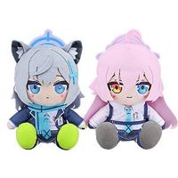 | **[ちょこぷに ぬいぐるみ シロコ/ホシノ](https://www.goodsmile.com/ja/product/60773)** グッドスマイルカンパニー · ブルーアーカイブ -Blue Archive- ぬいぐるみ · 预订中 · 五次再贩 | 4,950 日元 | 未定 截订 2026-12-09 |
|  | **[ちょこぷに ぬいぐるみ ノノミ/セリカ/アヤネ](https://www.goodsmile.com/ja/product/60876)** グッドスマイルカンパニー · ブルーアーカイブ -Blue Archive- ぬいぐるみ · 预订中 · 三次再贩 | 4,950 日元 | 未定 截订 2026-12-09 |
| 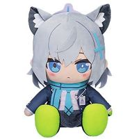 | **[ちょこぷに おおきな40cmぬいぐるみ シロコ](https://www.goodsmile.com/ja/product/61335)** グッドスマイルカンパニー · ブルーアーカイブ -Blue Archive- ぬいぐるみ · 预订中 · 再贩 | 18,700 日元 | 未定 截订 2026-12-09 |
|  | **[ちょこぷに おおきな40cmぬいぐるみ ホシノ](https://www.goodsmile.com/ja/product/61291)** グッドスマイルカンパニー · ブルーアーカイブ -Blue Archive- ぬいぐるみ · 预订中 · 再贩 | 18,700 日元 | 未定 截订 2026-12-09 |
|  | **[ちょこぷに おおきな40cmぬいぐるみ ノノミ](https://www.goodsmile.com/ja/product/61710)** グッドスマイルカンパニー · ブルーアーカイブ -Blue Archive- ぬいぐるみ · 预订中 · 再贩 | 18,700 日元 | 未定 截订 2026-12-09 |
|  | **[ちょこぷに おおきな40cmぬいぐるみ セリカ](https://www.goodsmile.com/ja/product/61895)** グッドスマイルカンパニー · ブルーアーカイブ -Blue Archive- ぬいぐるみ · 预订中 · 再贩 | 18,700 日元 | 未定 截订 2026-12-09 |
|  | **[ちょこぷに おおきな40cmぬいぐるみ アヤネ](https://www.goodsmile.com/ja/product/1136235)** グッドスマイルカンパニー · ブルーアーカイブ -Blue Archive- ぬいぐるみ · 预订中 · 再贩 | 18,700 日元 | 未定 截订 2026-12-09 |
|  | **[ぬいぐるみ 牧瀬紅莉栖](https://www.goodsmile.com/ja/product/61697)** グッドスマイルカンパニー · STEINS;GATE ぬいぐるみ · 预订中 · 再贩 | 4,400 日元 | 未定 截订 2026-12-09 |
|  | **[くりぱん ぬいぐるみ 超絶最かわてんしちゃん/あめちゃん/かちぇ/パープル・ロリポップ/獄薔薇美血華/禰󠄀智禍さま](https://www.goodsmile.com/ja/product/1144965)** グッドスマイルカンパニー · TVアニメ『NEEDY GIRL OVERDOSE』 ぬいぐるみ · 预订中 | 4,950 日元 | 未定 截订 2026-12-09 |
| 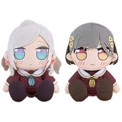 | **[くりぱん ぬいぐるみ セラス 柳田 リリエンフェルト/桂城 泉](https://www.goodsmile.com/ja/product/1141695)** グッドスマイルカンパニー · ラブライブ！蓮ノ空女学院スクールアイドルクラブ ぬいぐるみ · 预订中 | 4,400 日元 | 未定 截订 2026-12-16 |
|  | **[白鳳](https://www.goodsmile.com/ja/product/1144170)** グッドスマイルアーツ上海 · アズールレーン スケールフィギュア · 1/7 · 预订中 | 32,000 日元 | 未定 截订 2026-12-23 |
|  | **[牧瀬紅莉栖 白衣バニーVer.](https://www.goodsmile.com/ja/product/1141788)** グッドスマイルアーツ上海 · STEINS;GATE スケールフィギュア · 1/7 · 预订中 | 22,800 日元 | 未定 截订 2026-12-16 |
|  | **[モダニア-セカンド・アフェクション](https://www.goodsmile.com/ja/product/1138207)** グッドスマイルアーツ上海 · 勝利の女神：NIKKE スケールフィギュア · 1/7 · 预订中 · 再贩 | 26,800 日元 | 未定 截订 2026-12-23 |
|  | **[Qset 錦木千束 チンアナゴVer.](https://www.goodsmile.com/ja/product/12709)** グッドスマイルアーツ上海 · リコリス・リコイル ノンスケールフィギュア · ノンスケール · 预订中 · 再贩 | 3,900 日元 | 未定 截订 2026-12-23 |
| 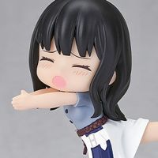 | **[Qset 井ノ上たきな さかなVer.](https://www.goodsmile.com/ja/product/12711)** グッドスマイルアーツ上海 · リコリス・リコイル ノンスケールフィギュア · ノンスケール · 预订中 · 再贩 | 3,900 日元 | 未定 截订 2026-12-23 |
| 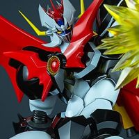 | **[BLAZE マジンカイザー（オリジナル版）](https://www.goodsmile.com/ja/product/1142656)** エンバートイズ · マジンカイザー（原作版） アクションフィギュア · ノンスケール · 预订中 · 再贩 | 39,600 日元 | 未定 截订 2026-12-09 |
| 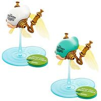 | **[GOLD FISH 白練-SHIRONERI- / 青磁-SEIJI-](https://www.goodsmile.com/ja/product/1141072)** MODEL SQUAD · IMAGINARY DEVICE #01 プラスチックモデル · 预订中 | 2,970 日元 | 未定 截订 2026-12-02 |
|  | **[超巡！超条先輩 警察手帳風アクリルスタンド 超条 巡/一本木直/ローボくん/犬養由基/恵那院肇](https://www.goodsmile.com/ja/product/1147129)** ジュウロクホウイ · TVアニメ『超巡！超条先輩』 その他（グッズ） · 预订中 | 990 日元 | 未定 截订 2026-11-25 |
|  | **[超巡！超条先輩 プラモデル風アクリルキーホルダー 超条 巡/一本木直/ローボくん/犬養由基/恵那院肇](https://www.goodsmile.com/ja/product/1147128)** ジュウロクホウイ · TVアニメ『超巡！超条先輩』 その他（グッズ） · 预订中 | 990 日元 | 未定 截订 2026-11-25 |
|  | **[ねんどろいど 博麗霊夢 神を降ろす祈祷師Ver.](https://www.goodsmile.com/ja/product/1143933)** グッドスマイルカンパニー · 東方LostWord ねんどろいど · ノンスケール · 预订中 · 附特典 | 6,800 日元 | 未定 截订 2026-12-16 |
|  | **[ねんどろいど ヨツユ](https://www.goodsmile.com/ja/product/1142176)** グッドスマイルカンパニー · ファイナルファンタジーXIV ねんどろいど · ノンスケール · 预订中 · 附特典 | 7,900 日元 | 未定 截订 2026-12-16 |
|  | **[ねんどろいど バター](https://www.goodsmile.com/ja/product/1144805)** グッドスマイルカンパニー · トリッカル・もちもちほっペ大作戦 ねんどろいど · ノンスケール · 预订中 · 附特典 | 6,800 日元 | 未定 截订 2026-12-16 |
|  | **[ねんどろいど ローレン・イロアス](https://www.goodsmile.com/ja/product/1138998)** グッドスマイルカンパニー · にじさんじ ねんどろいど · ノンスケール · 预订中 · 附特典 | 7,500 日元 | 未定 截订 2026-11-30 |
| 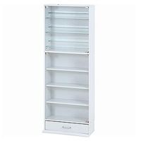 | **[ねんどろいど×不二貿易 フィギュアコレクションケース](https://www.goodsmile.com/ja/product/1146651)** 不二貿易株式会社 その他 · 官网限定 · 不可同捆 | 23,500 日元 | 未定 |
| 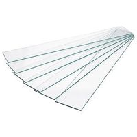 | **[ねんどろいど×不二貿易 フィギュアコレクションケース ガラス棚板６枚セット](https://www.goodsmile.com/ja/product/1146652)** 不二貿易株式会社 その他 · 官网限定 · 不可同捆 | 6,400 日元 | 未定 |
| 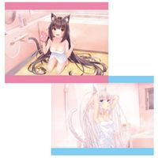 | **[ネコぱら セカイコネクト B2タペストリー ショコラ バスタイムVer./バニラ バスタイムVer.](https://www.goodsmile.com/ja/product/1146774)** グッドスマイルカンパニー · ネコぱら セカイコネクト タペストリー · 官网限定 | 3,000 日元 | 未定 |
|  | **[ねんどろいど 初音ミク マジカルミライ 2025Ver.](https://www.goodsmile.com/ja/product/1138612)** グッドスマイルカンパニー · キャラクター・ボーカル・シリーズ01 初音ミク ねんどろいど · ノンスケール · 官网限定 · 受注 | 8,000 日元 | 未定 |
|  | **[ねんどろいど 初音ミク マジカルミライ 2016Ver.](https://www.goodsmile.com/ja/product/3668)** グッドスマイルカンパニー · キャラクター・ボーカル・シリーズ01 初音ミク ねんどろいど · ノンスケール · 官网限定 · 再贩受注 | 6,900 日元 | 未定 |
|  | **[ねんどろいど 初音ミク マジカルミライ 2017Ver.](https://www.goodsmile.com/ja/product/5200)** グッドスマイルカンパニー · キャラクター・ボーカル・シリーズ01 初音ミク ねんどろいど · ノンスケール · 官网限定 · 再贩 | 7,500 日元 | 未定 |
| 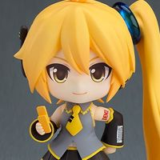 | **[ねんどろいど 亞北ネル フェイスメーカーコラボ・表情パーツセット](https://www.goodsmile.com/ja/product/1146032)** グッドスマイルカンパニー · 亞北ネル ねんどろいど · ノンスケール · 官网限定 · 附特典 | 12,450 日元 | 未定 |
|  | **[ねんどろいど 弱音ハク フェイスメーカーコラボ・表情パーツセット](https://www.goodsmile.com/ja/product/1146033)** グッドスマイルカンパニー · 弱音ハク ねんどろいど · ノンスケール · 官网限定 · 附特典 | 12,450 日元 | 未定 |
| 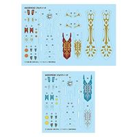 | **[MODEROID ゴルドリーオ＆ジルバティーガ用水転写マーキングデカール](https://www.goodsmile.com/ja/product/1145650)** グッドスマイルカンパニー · ナイツ＆マジック MODEROID · 官网限定 | 2,800 日元 | 未定 |
| 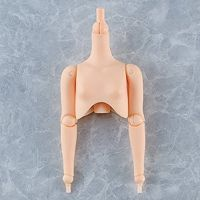 | **[Harmonia bloom option care parts (Upper body)](https://www.goodsmile.com/ja/product/1144944)** グッドスマイルカンパニー · Harmonia bloom Harmonia bloom · ノンスケール · 官网限定 | 3,500 日元 | 未定 |
| 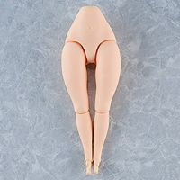 | **[Harmonia bloom option care parts (Lower body)](https://www.goodsmile.com/ja/product/1144946)** グッドスマイルカンパニー · Harmonia bloom Harmonia bloom · ノンスケール · 官网限定 | 4,500 日元 | 未定 |
| 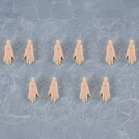 | **[Harmonia bloom option care parts (Hands)](https://www.goodsmile.com/ja/product/1144948)** グッドスマイルカンパニー · Harmonia bloom Harmonia bloom · ノンスケール · 官网限定 | 2,500 日元 | 未定 |
| 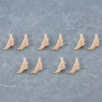 | **[Harmonia bloom option care parts (Feet)](https://www.goodsmile.com/ja/product/1144950)** グッドスマイルカンパニー · Harmonia bloom Harmonia bloom · ノンスケール · 官网限定 | 2,500 日元 | 未定 |
| 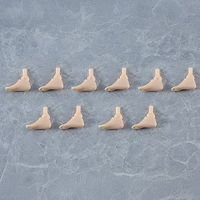 | **[Harmonia bloom option care parts (Feet-Flat)](https://www.goodsmile.com/ja/product/1145638)** グッドスマイルカンパニー · Harmonia bloom Harmonia bloom · 官网限定 | 2,500 日元 | 未定 |
| 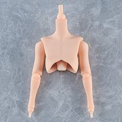 | **[Harmonia bloom option care parts root (Upper body)](https://www.goodsmile.com/ja/product/1144945)** グッドスマイルカンパニー · Harmonia bloom Harmonia bloom · ノンスケール · 官网限定 | 3,500 日元 | 未定 |
| 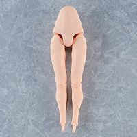 | **[Harmonia bloom option care parts root (Lower body)](https://www.goodsmile.com/ja/product/1144947)** グッドスマイルカンパニー · Harmonia bloom Harmonia bloom · ノンスケール · 官网限定 | 4,500 日元 | 未定 |

## HLJ（37）

| 图 | 商品 | 价格 | 发售 |
|---|---|---|---|
| 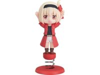 | **[Qset Chisato Nishikigi: Eel Ver. (Lycoris Recoil) (Rerelease)](https://www.hlj.com/qset-chisato-nishikigi-eel-ver-lycoris-recoil-rerelease-gsc80708)** Good Smile Company · Lycoris Recoil 预订中 · 再贩 | 3,545 日元 | 2027-05 |
| 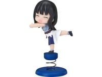 | **[Qset Takina Inoue: Fish Ver. (Lycoris Recoil) (Rerelease)](https://www.hlj.com/qset-takina-inoue-fish-ver-lycoris-recoil-rerelease-gsc80709)** Good Smile Company · Lycoris Recoil 预订中 · 再贩 | 3,545 日元 | 2027-05 |
| 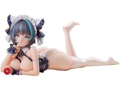 | **[1/7 Azur Lane: Cheshire Hugging Pillow Ver.](https://www.hlj.com/1-7-scale-azur-lane-cheshire-hugging-pillow-ver-age18099)** AniGame · Azur Lane 1/7 · 预订中 | 11,000 日元 | 2027-09 |
| 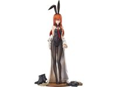 | **[1/7 STEINS;GATE: Kurisu Makise: Lab Coat Bunny Ver.](https://www.hlj.com/1-7-scale-steins-gate-kurisu-makise-lab-coat-bunny-ver-gsc80660)** Good Smile Company · Steins;Gate 1/7 · 预订中 | 20,727 日元 | 2027-11 |
| 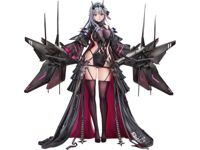 | **[1/7 GODDESS OF VICTORY: NIKKE: Modernia - Second Affection (Rerelease)](https://www.hlj.com/1-7-scale-goddess-of-victory-nikke-modernia-second-affection-rerelease-gsc80589)** Good Smile Company · Goddess of Victory: Nikke 1/7 · 预订中 · 再贩 | 24,364 日元 | 2027-07 |
| 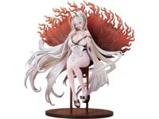 | **[1/7 Azur Lane: Hakuhou](https://www.hlj.com/1-7-scale-azur-lane-hakuhou-gsc80663)** Good Smile Company · Azur Lane 1/7 · 预订中 | 29,091 日元 | 2028-03 |
| 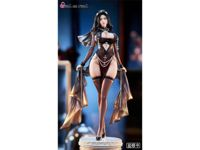 | **[1/6 Real on real: Dark Sister](https://www.hlj.com/1-6-scale-real-on-real-dark-sister-bpd43013)** BearPanda · Real on real 1/6 · 预订中 | 11,400 日元 | 2027-08 |
| 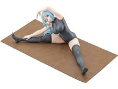 | **[1/7 Linka Casual Wear Ver. (Magic Repo Man : Dumped by My Party, I&amp;#x27;ll Cash In With a Cute Support Fairy to Become the Strongest!)](https://www.hlj.com/1-7-scale-linka-casual-wear-ver-magic-repo-man-dumped-by-my-party-i-ll-cash-in-with-a-cute-support-fairy-to-become-the-strongest-kbypv-436)** Kotobukiya · Magic Repo Man 1/7 · 预订中 | 16,000 日元 | 2027-06 |
| 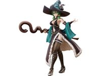 | **[1/4 Unicorn Overlord: Yahna \[Class: Sorceress\]](https://www.hlj.com/1-4-scale-unicorn-overlord-yahna-class-sorceress-fre51532)** Freeing · Unicorn Overlord 1/4 · 预订中 | 50,000 日元 | 2027-05 |
| 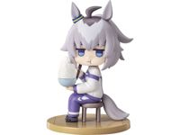 | **[Mini Memory Simple Oguri (Umamusume: Cinderella Gray)](https://www.hlj.com/mini-memory-simple-oguri-umamusume-cinderella-gray-gsc58994)** Good Smile Company · Uma Musume Pretty Derby 预订中 | 3,545 日元 | 2027-05 |
| 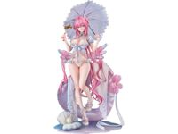 | **[1/7 GODDESS OF VICTORY: NIKKE: Dorothy: Serendipity](https://www.hlj.com/1-7-scale-goddess-of-victory-nikke-dorothy-serendipity-gsc80457)** Good Smile Company · Goddess of Victory: Nikke 1/7 · 预订中 | 27,182 日元 | 2027-12 |
|  | **[1/3 Food Wars! Shokugeki no Soma: Rindo Kobayashi: Bunny Ver.](https://www.hlj.com/1-3-scale-food-wars-shokugeki-no-soma-rindo-kobayashi-bunny-ver-fre51539)** Freeing · Shokugeki no Soma 1/3 · 预订中 | 70,000 日元 | 2027-06 |
| 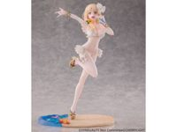 | **[1/7 SYNDUALITY Noir: Ciel Swimsuit ver.](https://www.hlj.com/1-7-scale-synduality-noir-ciel-swimsuit-ver-chl14001)** Cherrylight · Synduality 1/7 · 预订中 | 18,000 日元 | 2027-11 |
|  | **[1/7 SYNDUALITY Noir: Ciel Swimsuit ver. Deluxe Edition](https://www.hlj.com/1-7-scale-synduality-noir-ciel-swimsuit-ver-deluxe-edition-chl14002)** Cherrylight · Synduality 1/7 · 预订中 | 21,000 日元 | 2027-11 |
|  | **[Piapro Characters: YR-100 Yurayura Head Luka](https://www.hlj.com/piapro-characters-yr-100-yurayura-head-luka-mlt08602)** Max Limited · Vocaloid 预订中 | 2,000 日元 | 2027-03 |
|  | **[Piapro Characters: YR-101 Yurayura Head MEIKO](https://www.hlj.com/piapro-characters-yr-101-yurayura-head-meiko-mlt08603)** Max Limited · Vocaloid 预订中 | 2,000 日元 | 2027-03 |
|  | **[1/7 Stella Sora: Noya](https://www.hlj.com/1-7-scale-stella-sora-noya-hsa33105)** Hobby sakura · Stella Sora 1/7 · 预订中 | 26,000 日元 | 2027-09 |
|  | **[One Piece Archive Collection Dr. Vegapunk PUNK04 Pythagoras](https://www.hlj.com/one-piece-archive-collection-dr-vegapunk-punk04-pythagoras-plx89153)** Plex · One Piece 预订中 | 30,000 日元 | 2027-04 |
|  | **[1/7 Stella Sora: Noya Deluxe Edition](https://www.hlj.com/1-7-scale-stella-sora-noya-deluxe-edition-hsa33106)** Hobby sakura · Stella Sora 1/7 · 预订中 | 28,000 日元 | 2027-09 |
|  | **[Piapro Characters: YR-102 Yurayura Head KAITO](https://www.hlj.com/piapro-characters-yr-102-yurayura-head-kaito-mlt08604)** Max Limited · Vocaloid 预订中 | 2,000 日元 | 2027-03 |
|  | **[MEGA CAT PROJECT Naruto Nyantomo Big na Nyaruto! REBOOT Naruto Uzumaki (Reissue)](https://www.hlj.com/mega-cat-project-naruto-nyantomo-big-na-nyaruto-reboot-naruto-uzumaki-reissue-meg85410)** MegaHouse · Naruto 预订中 | 4,000 日元 | 2027-06 |
|  | **[Look Up Touken Ranbu ONLINE Shokudaikiri Mitsutada](https://www.hlj.com/look-up-touken-ranbu-online-shokudaikiri-mitsutada-meg85481)** MegaHouse · Touken Ranbu 预订中 | 4,600 日元 | 2027-07 |
|  | **[Look Up HUNTER x HUNTER Hyskoa](https://www.hlj.com/look-up-hunter-x-hunter-hyskoa-meg85383)** MegaHouse · Hunter x Hunter 预订中 | 4,200 日元 | 2027-05 |
|  | **[G.E.M. Series Gintama Tenohira Kagura-chan](https://www.hlj.com/g-e-m-series-gintama-tenohira-kagura-chan-meg85458)** MegaHouse · Gintama 预订中 | 7,500 日元 | 2027-05 |
|  | **[Look Up Danganronpa: Trigger Happy Havoc Junko Enoshima](https://www.hlj.com/look-up-danganronpa-trigger-happy-havoc-junko-enoshima-meg85393)** MegaHouse · Danganronpa 预订中 | 4,500 日元 | 2027-06 |
|  | **[Look Up Honkai: Star Rail The Herta](https://www.hlj.com/look-up-honkai-star-rail-the-herta-meg85275)** MegaHouse · Honkai: Star Rail 预订中 | 5,900 日元 | 2027-09 |
|  | **[Look Up Danganronpa: Trigger Happy Havoc Makoto Naegi](https://www.hlj.com/look-up-danganronpa-trigger-happy-havoc-makoto-naegi-meg85392)** MegaHouse · Danganronpa 预订中 | 4,500 日元 | 2027-06 |
|  | **[MEGA CAT PROJECT Naruto Nyantomo Big na Nyaruto! REBOOT Kakashi Hatake (Reissue)](https://www.hlj.com/mega-cat-project-naruto-nyantomo-big-na-nyaruto-reboot-kakashi-hatake-reissue-meg85412)** MegaHouse · Naruto 预订中 | 4,000 日元 | 2027-06 |
|  | **[MEGA CAT PROJECT Naruto Nyantomo Big na Nyaruto! REBOOT Sasuke Uchiha (Reissue)](https://www.hlj.com/mega-cat-project-naruto-nyantomo-big-na-nyaruto-reboot-sasuke-uchiha-reissue-meg85411)** MegaHouse · Naruto 预订中 | 4,000 日元 | 2027-06 |
|  | **[G.E.M. Series Gintama Tenohira Katsura-san](https://www.hlj.com/g-e-m-series-gintama-tenohira-katsura-san-meg85459)** MegaHouse · Gintama 预订中 | 7,500 日元 | 2027-05 |
|  | **[MEGA CAT PROJECT Naruto Nyantomo Big na Nyaruto! REBOOT Itachi Uchiha (Reissue)](https://www.hlj.com/mega-cat-project-naruto-nyantomo-big-na-nyaruto-reboot-itachi-uchiha-reissue-meg85413)** MegaHouse · Naruto 预订中 | 4,000 日元 | 2027-06 |
|  | **[Look Up The Prince of Tennis II Ryoma Echizen Japan Representative Ver.](https://www.hlj.com/look-up-the-prince-of-tennis-ii-ryoma-echizen-japan-representative-ver-meg85439)** MegaHouse · The Prince of Tennis 预订中 | 4,200 日元 | 2027-07 |
|  | **[Look Up Honkai: Star Rail Kafka](https://www.hlj.com/look-up-honkai-star-rail-kafka-meg85274)** MegaHouse · Honkai: Star Rail 预订中 | 5,900 日元 | 2027-09 |
|  | **[1/6 Nymph (Heaven&amp;#x27;s Lost Property Forte) (Reissue)](https://www.hlj.com/1-6-scale-nymph-heaven-s-lost-property-forte-reissue-kbypv-518)** Kotobukiya · Heaven's Lost Property 1/6 · 预订中 | 12,000 日元 | 2027-06 |
|  | **[Look Up ONE PIECE Koby](https://www.hlj.com/look-up-one-piece-koby-meg85405)** MegaHouse · One Piece 预订中 | 4,400 日元 | 2027-06 |
|  | **[Look Up Touken Ranbu ONLINE Tsurumaru Kuninaga](https://www.hlj.com/look-up-touken-ranbu-online-tsurumaru-kuninaga-meg85483)** MegaHouse · Touken Ranbu 预订中 | 4,600 日元 | 2027-07 |
|  | **[Look Up HUNTER x HUNTER Chrollo](https://www.hlj.com/look-up-hunter-x-hunter-chrollo-meg85384)** MegaHouse · Hunter x Hunter 预订中 | 4,200 日元 | 2027-05 |
