# 2026-11-11 手办新品

共 49 件（HPOI 31 · Good Smile 官网 18）。点名称打开原页面。

## HPOI（31）

| 图 | 商品 | 价格 | 发售 |
|---|---|---|---|
| 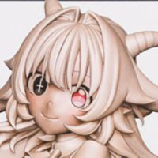 | **[酒鬼女神的酒诡 梵·醺儿](https://www.hpoi.net/hobby/139168)** PUKEY GODDESS SHOT TRICK ファム・スール Bell Fine · 酒鬼女神的酒诡 比例人形 · 1/6 | — | 未知 |
| 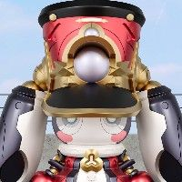 | **[Huggy Good Smile 崩坏：星穹铁道 合金机铠·帕姆王](https://www.hpoi.net/hobby/139166)** Huggy Good Smile 合金机铠·帕姆王 崩坏：星穹铁道 良笑 · 崩坏：星穹铁道 · 帕姆 Q版人形 · Huggy Good Smile | 89 元 | 2027-07 |
| 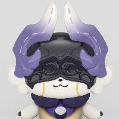 | **[Huggy Good Smile 崩坏：星穹铁道 奇美古士](https://www.hpoi.net/hobby/139164)** Huggy Good Smile 奇美古士 崩坏：星穹铁道 良笑 · 崩坏：星穹铁道 · 来古士 Q版人形 · Huggy Good Smile | 89 元 | 2027-06 |
| 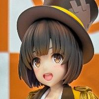 | **[GROW UP SHOW ～向日葵马戏团～ 鹤卷瑞佳](https://www.hpoi.net/hobby/139163)** グロウアップショウ ～ひまわりのサーカス団～ 鶴巻瑞佳 良笑 · Grow Up Show ～向日葵马戏团～ · 鹤卷瑞佳 比例人形 | — | 未知 |
| 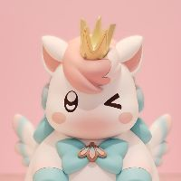 | **[Huggy Good Smile 崩坏：星穹铁道 小伊卡](https://www.hpoi.net/hobby/139161)** Huggy Good Smile 崩坏：星穹铁道 小伊卡 良笑 · 崩坏：星穹铁道 生物/幻灵 · Huggy Good Smile | 89 元 | 2027-07 |
|  | **[TMS197《星球大战：摩尔-暗影之王》十一弟](https://www.hpoi.net/hobby/139160)** TMS197《星球大战：摩尔-暗影之王》十一弟 Hot Toys · 星球大战、摩尔-暗影之王 比例人形 · 电视杰作系列 | 1,580 元 | 2027年第四季度 |
| 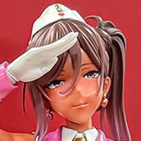 | **[兽魂战队 樱间千咲 日晒色（暂称）](https://www.hpoi.net/hobby/139157)** 獣魂戦隊ジュウソルジャー 桜間千咲 (仮)日焼け ver. Q-six 比例人形 · 1/5 | — | 未知 |
|  | **[天祈 Sweet♡injection](https://www.hpoi.net/hobby/139153)** 天祈 Sweet♡injection Ver. NOCTURNAS 比例人形 | — | 未知 |
| 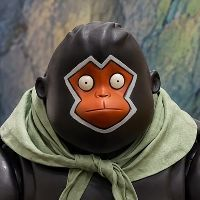 | **[浪浪山小妖怪 猩猩怪](https://www.hpoi.net/hobby/139152)** 浪浪山小妖怪 猩猩怪 维托艾斯 比例人形 | — | 未知 |
| 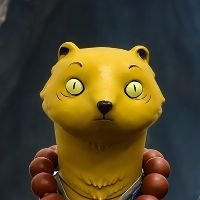 | **[浪浪山小妖怪 黄鼠狼精](https://www.hpoi.net/hobby/139151)** 浪浪山小妖怪-黄鼠狼精 维托艾斯 比例人形 | — | 未知 |
|  | **[浪浪山小妖怪 蛤蟆精](https://www.hpoi.net/hobby/139149)** 浪浪山小妖怪-蛤蟆精 维托艾斯 比例人形 | — | 未知 |
| 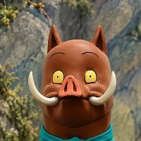 | **[浪浪山小妖怪 小猪妖](https://www.hpoi.net/hobby/139148)** 浪浪山小妖怪-小猪妖 维托艾斯 比例人形 | — | 未知 |
| 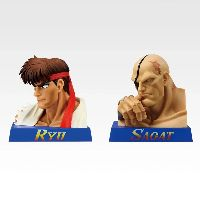 | **[一番赏 街头霸王 ～去会见比我更强的家伙～ D奖 精选手办](https://www.hpoi.net/hobby/139145)** 一番くじ ストリートファイター ～俺より強い奴に会いに行く～D賞 セレクトフィギュア BANDAI SPIRITS · 街霸 · 隆、沙加特 比例人形 · 一番赏、一番赏 街头霸王 ～去会见比我更强的家伙～ | — | 2026-11 |
| 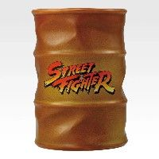 | **[一番赏 街头霸王 ～去会见比我更强的家伙～ C奖 油桶造型茶杯](https://www.hpoi.net/hobby/139144)** 一番くじ ストリートファイター ～俺より強い奴に会いに行く～ C賞 ドラム缶風湯呑 BANDAI SPIRITS · 街霸 配件 · 一番赏、一番赏 街头霸王 ～去会见比我更强的家伙～ | — | 2026-11 |
|  | **[一番赏 街头霸王 ～去会见比我更强的家伙～ B奖 嘉米 MASTERLISE](https://www.hpoi.net/hobby/139143)** 一番くじ ストリートファイター ～俺より強い奴に会いに行く～ B賞 キャミィ MASTERLISE BANDAI SPIRITS · 街霸 · 嘉米·怀特 比例人形 · 一番赏、一番赏 街头霸王 ～去会见比我更强的家伙～ | — | 2026-11 |
| 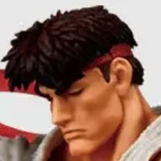 | **[一番赏 街头霸王 ～去会见比我更强的家伙～ A奖 隆 MASTERLISE](https://www.hpoi.net/hobby/139142)** 一番くじ ストリートファイター ～俺より強い奴に会いに行く～ A賞 リュウ MASTERLISE BANDAI SPIRITS · 街霸 · 隆 比例人形 · 一番赏 街头霸王 ～去会见比我更强的家伙～ | — | 2026-11 |
|  | **[一番赏 一拳超人 -英雄协会vs怪人协会- 最终奖 战栗的龙卷 MASTERLISE](https://www.hpoi.net/hobby/139141)** 一番くじ ワンパンマン -ヒーロー協会vs怪人協会- ラストワン賞 戦慄のタツマキ MASTERLISE BANDAI SPIRITS · 一拳超人 · 战栗的龙卷 比例人形 · 一番赏、一番赏 一拳超人 -英雄协会vs怪人协会- | — | 2027-03 |
|  | **[一番赏 一拳超人 -英雄协会vs怪人协会- B奖 饿狼 MASTERLISE](https://www.hpoi.net/hobby/139140)** 一番くじ ワンパンマン -ヒーロー協会vs怪人協会- B賞 ガロウ MASTERLISE BANDAI SPIRITS · 一拳超人 · 饿狼 比例人形 · 一番赏、一番赏 一拳超人 -英雄协会vs怪人协会- | — | 2027-03 |
|  | **[一番赏 一拳超人 -英雄协会vs怪人协会- A奖 埼玉 MASTERLISE](https://www.hpoi.net/hobby/139139)** 一番くじ ワンパンマン -ヒーロー協会vs怪人協会- A賞 サイタマ MASTERLISE BANDAI SPIRITS · 一拳超人 · 埼玉 比例人形 · 一番赏、一番赏 一拳超人 -英雄协会vs怪人协会- | — | 2027-03 |
|  | **[崩坏：星穹铁道 不死途](https://www.hpoi.net/hobby/139121)** 崩坏：星穹铁道 不死途 换装可动人偶 PICCODO ACTION DOLL · 崩坏：星穹铁道 · 不死途 Q版人形 | 488 元 | 2027-08 |
| 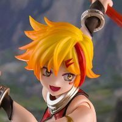 | **[西游姬系列 孙悟空](https://www.hpoi.net/hobby/139119)** 《西游姬》系列1:12超可动人偶《孙悟空》 玩朝玩具 · 孙悟空 比例人形 · 1/12 | 268 元 | 2027年第一季度 |
| 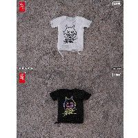 | **[SNAIL SHELL 恶魔低语系列 印花破洞T恤(黑/白色)](https://www.hpoi.net/hobby/139118)** SNAIL SHELL 「恶魔低语」系列 印花破洞T恤(黑/白色) 蜗之壳SnailShell 配件 · 1/12 | 89 元 | 2027-06 |
|  | **[粘土人 明日方舟：终末地 洁尔佩塔](https://www.hpoi.net/hobby/139117)** 粘土人 明日方舟：终末地 洁尔佩塔 良笑塑美 · 明日方舟：终末地 · 洁尔佩塔 Q版人形 · 粘土人 | 369 元 | 2027-07 |
|  | **[S.H.Figuarts 水手金星 -全新造型版-](https://www.hpoi.net/hobby/139115)** S.H.Figuarts セーラーヴィーナス -New Model Edition- BANDAI SPIRITS · 美少女战士 · 爱野美奈子 / 水兵金星 比例人形 · S.H.Figuarts | — | 未知 |
|  | **[S.H.Figuarts 水手木星 -全新造型版-](https://www.hpoi.net/hobby/139114)** S.H.Figuarts セーラージュピター -New Model Edition- BANDAI SPIRITS · 美少女战士 · 木野真琴 / 水兵木星 比例人形 · S.H.Figuarts | — | 未知 |
|  | **[S.H.Figuarts 水手火星 -全新造型版-](https://www.hpoi.net/hobby/139113)** S.H.Figuarts セーラーマーズ -New Model Edition- BANDAI SPIRITS · 美少女战士 · 火野丽 / 水兵火星 比例人形 · S.H.Figuarts | — | 未知 |
|  | **[S.H.Figuarts 水手水星 -全新造型版-](https://www.hpoi.net/hobby/139112)** S.H.Figuarts セーラーマーキュリー -New Model Edition- BANDAI SPIRITS · 美少女战士 · 水野亚美 / 水兵水星 比例人形 · S.H.Figuarts | — | 未知 |

旧品补录 3 件：HPOI 新收录、但早已发售的老商品

| 图 | 商品 | 价格 | 发售 |
|---|---|---|---|
| 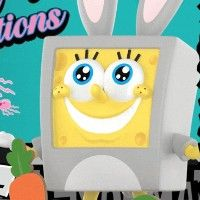 | **[海绵宝宝 人生转场系列](https://www.hpoi.net/hobby/139138)** 海绵宝宝 人生转场系列 泡泡玛特 · 海绵宝宝 Q版人形 · 旧品补录 | 69 元 | 2023-08 |
|  | **[海绵宝宝 睡衣派对系列](https://www.hpoi.net/hobby/139132)** 海绵宝宝 睡衣派对系列 泡泡玛特 · 海绵宝宝 Q版人形 · 旧品补录 | 59 元 | 2022-04 |
| 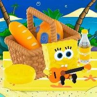 | **[海绵宝宝 野餐派对系列](https://www.hpoi.net/hobby/139130)** 海绵宝宝 野餐派对系列 泡泡玛特 · 海绵宝宝 Q版人形 · 旧品补录 | 69 元 | 2021-12 |

成人向 1 件：只记录文字和链接，不保存图片

| 图 | 商品 | 价格 | 发售 |
|---|---|---|---|
|  | **[贪婪魅魔小姐 灰色版](https://www.hpoi.net/hobby/139120)** 欲張りサキュバスさん グレーVer Skin Studio 比例人形 · 1/4 · 成人向 | — | 未知 |

## Good Smile 官网（18）

| 图 | 商品 | 价格 | 发售 |
|---|---|---|---|
|  | **[ねんどろいど ナヒーダ](https://www.goodsmile.com/ja/product/1144089)** グッドスマイルカンパニー · 原神 ねんどろいど · ノンスケール · 预订中 · 附特典 | 7,900 日元 | 未定 截订 2027-01-20 |
| 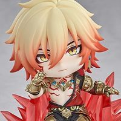 | **[ねんどろいど モーディス](https://www.goodsmile.com/ja/product/1144124)** グッドスマイルカンパニー · 崩壊：スターレイル ねんどろいど · ノンスケール · 预订中 · 附特典 | 7,900 日元 | 未定 截订 2026-12-23 |
| 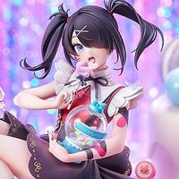 | **[あめちゃん Candy Ver.](https://www.goodsmile.com/ja/product/1144133)** グッドスマイルアーツ上海 · NEEDY GIRL OVERDOSE スケールフィギュア · 1/7 · 预订中 | 22,000 日元 | 未定 截订 2026-12-16 |
| 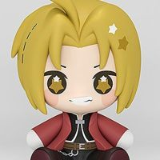 | **[Huggy Good Smile エドワード・エルリック](https://www.goodsmile.com/ja/product/1147332)** グッドスマイルアーツ上海 · 鋼の錬金術師 FULLMETAL ALCHEMIST その他フィギュア · 预订中 | 1,800 日元 | 未定 截订 2026-12-23 |
| 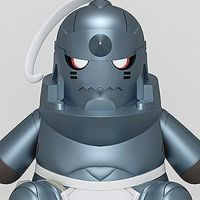 | **[Huggy Good Smile アルフォンス・エルリック](https://www.goodsmile.com/ja/product/1147333)** グッドスマイルアーツ上海 · 鋼の錬金術師 FULLMETAL ALCHEMIST その他フィギュア · 预订中 | 1,800 日元 | 未定 截订 2026-12-23 |
| 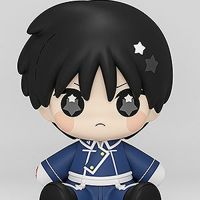 | **[Huggy Good Smile ロイ・マスタング](https://www.goodsmile.com/ja/product/1147334)** グッドスマイルアーツ上海 · 鋼の錬金術師 FULLMETAL ALCHEMIST その他フィギュア · 预订中 | 1,800 日元 | 未定 截订 2026-12-23 |
|  | **[ダンダダン - ブラインドボックス ビニールぬいぐるみ ターボババア てるてる坊主](https://www.goodsmile.com/ja/product/1138950)** SUNRISEPOP · ダンダダン トレーディング・カプセル（グッズ） · 预订中 | 3,113 日元 | 未定 截订 2026-12-09 |
| 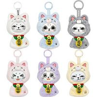 | **[【BOX】ダンダダン - ブラインドボックス ビニールぬいぐるみ ターボババア てるてる坊主セット（6個入）](https://www.goodsmile.com/ja/product/1138951)** SUNRISEPOP · ダンダダン トレーディング・カプセル（グッズ） · 预订中 | 18,678 日元 | 未定 截订 2026-12-09 |
| 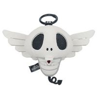 | **[呪術廻戦 - ぬいぐるみ -コガネ](https://www.goodsmile.com/ja/product/1138947)** SUNRISEPOP · 呪術廻戦 ぬいぐるみ · 预订中 | 2,156 日元 | 未定 截订 2026-12-09 |
| 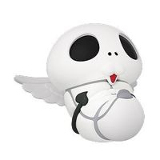 | **[呪術廻戦 - ナイトライト コガネ](https://www.goodsmile.com/ja/product/1138948)** SUNRISEPOP · 呪術廻戦 その他フィギュア · ノンスケール · 预订中 | 3,355 日元 | 未定 截订 2026-12-09 |
| 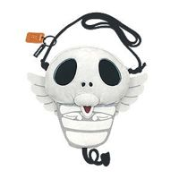 | **[呪術廻戦 - バッグ コガネ](https://www.goodsmile.com/ja/product/1138949)** SUNRISEPOP · 呪術廻戦 その他（グッズ） · 预订中 | 3,113 日元 | 未定 截订 2026-12-09 |
|  | **[呪術廻戦 - PUボールブラインドボックス](https://www.goodsmile.com/ja/product/1138945)** SUNRISEPOP · 呪術廻戦 トレーディング・カプセル（グッズ） · ノンスケール · 预订中 | 1,672 日元 | 未定 截订 2026-12-09 |
| 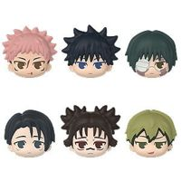 | **[【BOX】呪術廻戦 - PUボールブラインドボックスセット（6個入）](https://www.goodsmile.com/ja/product/1138946)** SUNRISEPOP · 呪術廻戦 トレーディング・カプセル（グッズ） · ノンスケール · 预订中 | 10,032 日元 | 未定 截订 2026-12-09 |
| 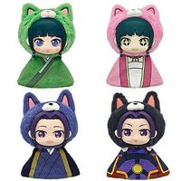 | **[薬屋のひとりごと - ブラインドボックス ビニールぬいぐるみ てるてる坊主](https://www.goodsmile.com/ja/product/1138952)** SUNRISEPOP · 薬屋のひとりごと トレーディング・カプセル（グッズ） · 预订中 | 3,113 日元 | 未定 截订 2026-12-09 |
|  | **[【BOX】薬屋のひとりごと - ブラインドボックス ビニールぬいぐるみ てるてる坊主セット（4個入）](https://www.goodsmile.com/ja/product/1138953)** SUNRISEPOP · 薬屋のひとりごと トレーディング・カプセル（グッズ） · 预订中 | 12,452 日元 | 未定 截订 2026-12-09 |
| 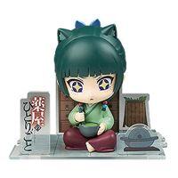 | **[薬屋のひとりごと - フィギュアシット - 猫猫](https://www.goodsmile.com/ja/product/1139311)** SUNRISEPOP · 薬屋のひとりごと その他フィギュア · ノンスケール · 预订中 · 再贩 | 5,500 日元 | 未定 截订 2026-12-09 |
| 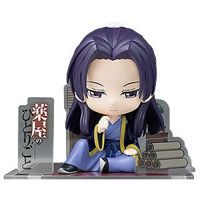 | **[薬屋のひとりごと - フィギュアシット - 壬氏](https://www.goodsmile.com/ja/product/1139312)** SUNRISEPOP · 薬屋のひとりごと その他フィギュア · ノンスケール · 预订中 · 再贩 | 5,500 日元 | 未定 截订 2026-12-09 |
| 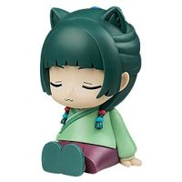 | **[薬屋のひとりごと - ナイトライト - 猫猫](https://www.goodsmile.com/ja/product/1139313)** SUNRISEPOP · 薬屋のひとりごと その他フィギュア · ノンスケール · 预订中 · 再贩 | 5,500 日元 | 未定 截订 2026-12-09 |
