# 2026-11-12 手办新品

共 104 件（HPOI 6 · Good Smile 官网 19 · HLJ 9 · Sofmap 60 · Solaris Japan 10）。点名称打开原页面。

## HPOI（6）

| 图 | 商品 | 价格 | 发售 |
|---|---|---|---|
| 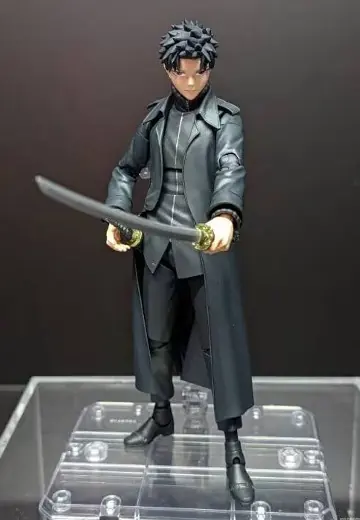 | **[S.H.Figuarts 神乐钵 六平千矿](https://www.hpoi.net/hobby/139230)** S.H.Figuarts カグラバチ 六平千鉱 BANDAI SPIRITS · 神乐钵（动画） · 六平千矿 比例人形 · S.H.Figuarts | — | 未知 |
| 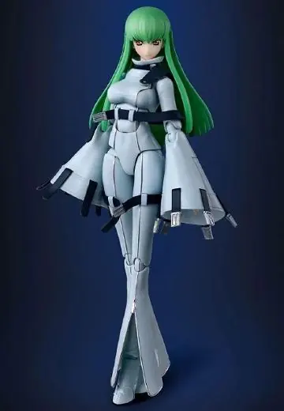 | **[S.H.Figuarts CODE GEASS 反叛的鲁路修 C.C.](https://www.hpoi.net/hobby/139222)** S.H.Figuarts コードギアス 反逆のルルーシュ C.C. BANDAI SPIRITS · CODE GEASS 反叛的鲁路修 · C.C. 比例人形 · S.H.Figuarts | 9,900 日元 含税，413元 | 2027-07 |
|  | **[火影忍者](https://www.hpoi.net/hobby/139214)** 火影忍者 比例人形 | — | 未知 |
| 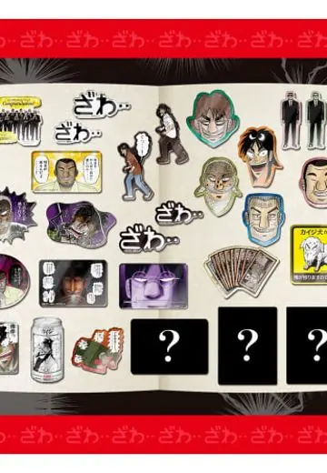 | **[食玩 名场面录 赌博默示录～嘈杂角色磁贴篇～](https://www.hpoi.net/hobby/139257)** 食玩 名場面録カイジ~ざわつくキャラマグネッツ編~ 万代 · 赌博默示录 盒蛋/扭蛋 · 万代食玩 | 3,680 日元 含税，153元 | 2027-02 |
|  | **[伊莉丝](https://www.hpoi.net/hobby/139239)** 伊莉丝 比例人形 | — | 未知 |

旧品补录 1 件：HPOI 新收录、但早已发售的老商品

| 图 | 商品 | 价格 | 发售 |
|---|---|---|---|
| 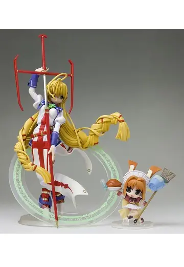 | **[普莉希娅](https://www.hpoi.net/hobby/139223)** プリズム・アーク プリーシア（フィーリアセットVer.） 1/8 完成品フィギュア SolidTheater 比例人形 · 1/8 · 旧品补录 | 7,678 日元 | 2006-11 |

## Good Smile 官网（19）

| 图 | 商品 | 价格 | 发售 |
|---|---|---|---|
| 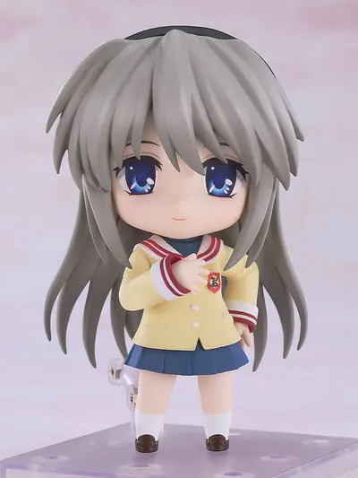 | **[ねんどろいど 坂上智代](https://www.goodsmile.com/ja/product/1145327)** グッドスマイルカンパニー · CLANNAD ねんどろいど · ノンスケール · 预订中 · 附特典 | 6,800 日元 | 未定 截订 2026-12-23 |
| 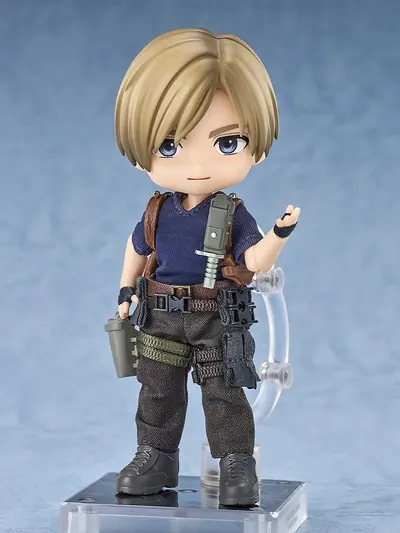 | **[ねんどろいどどーる レオン・S・ケネディ](https://www.goodsmile.com/ja/product/1138061)** グッドスマイルカンパニー · バイオハザード RE:4 ねんどろいどシリーズ · ノンスケール · 预订中 | 9,800 日元 | 未定 截订 2026-12-23 |
| 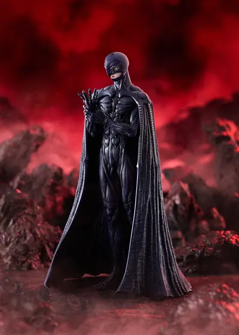 | **[POP UP PARADE フェムト L size](https://www.goodsmile.com/ja/product/1142352)** グッドスマイルカンパニー · ベルセルク POP UP PARADE · ノンスケール · 预订中 | 8,800 日元 | 未定 截订 2026-12-09 |
| 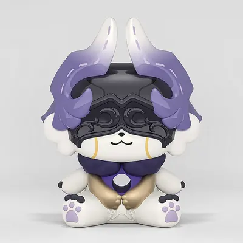 | **[Huggy Good Smile キメライコス](https://www.goodsmile.com/ja/product/1146929)** グッドスマイルカンパニー · 崩壊：スターレイル その他フィギュア · 预订中 | 1,800 日元 | 未定 截订 2026-12-23 |
| 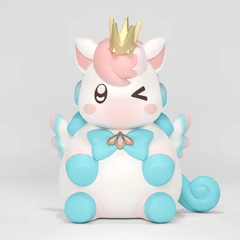 | **[Huggy Good Smile イカルン](https://www.goodsmile.com/ja/product/1147413)** グッドスマイルカンパニー · 崩壊：スターレイル その他フィギュア · 预订中 | 1,800 日元 | 未定 截订 2026-12-23 |
| 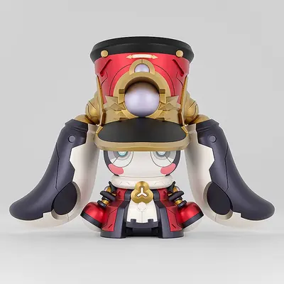 | **[Huggy Good Smile 合金メカヨロイ・パムキング](https://www.goodsmile.com/ja/product/1147414)** グッドスマイルカンパニー · 崩壊：スターレイル その他フィギュア · 预订中 | 1,800 日元 | 未定 截订 2026-12-23 |
| 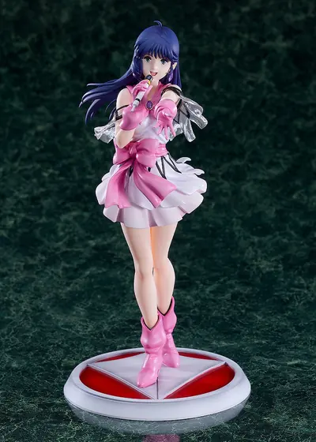 | **[PLAMAX リン・ミンメイ](https://www.goodsmile.com/ja/product/1147167)** マックスファクトリー · 超時空要塞マクロス 愛・おぼえていますか MAX FACTORY · ノンスケール · 预订中 | 7,920 日元 | 未定 截订 2026-12-23 |
| 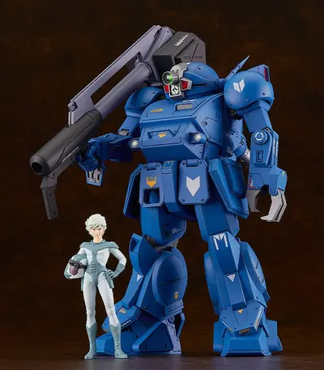 | **[PLAMAX SV-01 1/24 Scale X・ATH-02 ストライクドッグ](https://www.goodsmile.com/ja/product/12353)** マックスファクトリー · 装甲騎兵ボトムズ MAX FACTORY · 1/24 · 预订中 · 二次再贩 | 8,800 日元 | 2027-04 截订 2026-12-23 |
| 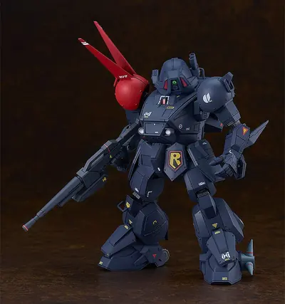 | **[PLAMAX SV-03 1/24 Scale X・ATH-P-RSC ブラッドサッカー](https://www.goodsmile.com/ja/product/60105)** マックスファクトリー · 装甲騎兵ボトムズ MAX FACTORY · 1/24 · 预订中 · 再贩 | 8,800 日元 | 2027-04 截订 2026-12-23 |
| 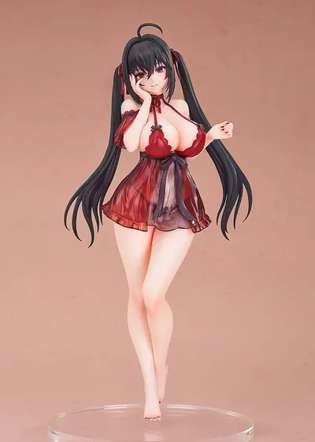 | **[LessMore 大鳳 交流宿舎ver.](https://www.goodsmile.com/ja/product/1144118)** グッドスマイルアーツ上海 · アズールレーン スケールフィギュア · 1/8 · 预订中 | 8,500 日元 | 未定 截订 2026-12-23 |
| 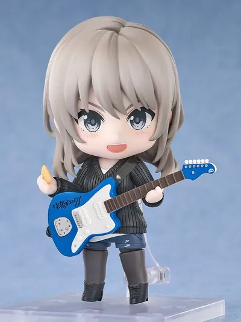 | **[ねんどろいど 河原木桃香](https://www.goodsmile.com/ja/product/1144129)** グッドスマイルアーツ上海 · ガールズバンドクライ ねんどろいど · ノンスケール · 预订中 · 附特典 | 7,200 日元 | 未定 截订 2026-12-23 |
|  | **[ねんどろいど キャプテン・プライス](https://www.goodsmile.com/ja/product/1146773)** グッドスマイルアーツ上海 · Call of Duty ねんどろいど · ノンスケール · 预订中 | 8,600 日元 | 未定 截订 2026-12-16 |
| 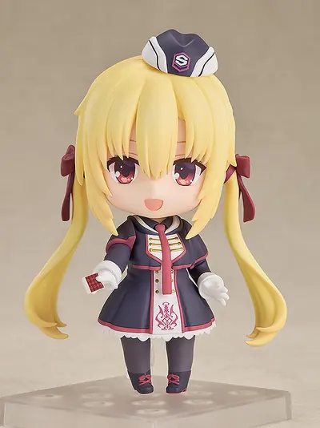 | **[ねんどろいど 在原七海](https://www.goodsmile.com/ja/product/56810)** グッドスマイルアーツ上海 · RIDDLE JOKER ねんどろいど · ノンスケール · 预订中 · 再贩 · 附特典 | 6,800 日元 | 2027-05 截订 2026-12-23 |
| 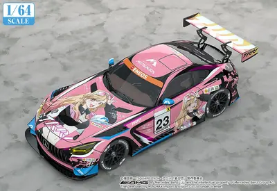 | **[1/64 TKRI松永建設AMG GT3 2026Ver.](https://www.goodsmile.com/ja/product/1145497)** グッドスマイルレーシング · TVアニメ「その着せ替え人形は恋をする」Season 2 ミニカー · 1/64 · 预订中 | 4,950 日元 | 未定 截订 2026-12-02 |
| 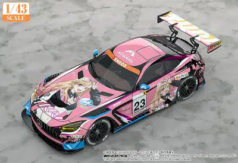 | **[1/43 TKRI松永建設AMG GT3 2026Ver.](https://www.goodsmile.com/ja/product/1145498)** グッドスマイルレーシング · TVアニメ「その着せ替え人形は恋をする」Season 2 ミニカー · 1/43 · 预订中 | 22,000 日元 | 未定 截订 2026-12-02 |
| 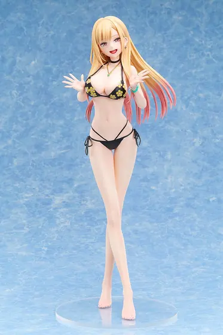 | **[喜多川海夢 水着Ver.](https://www.goodsmile.com/ja/product/1147075)** FREEing · TVアニメ「その着せ替え人形（ビスク・ドール）は恋をする」 スケールフィギュア · 1/4 · 预订中 | 33,000 日元 | 未定 截订 2027-01-06 |
|  | **[すーぱーそに子【セクシーパティシエ Ver.】](https://www.goodsmile.com/ja/product/1147367)** ウェーブ · すーぱーそに子 スケールフィギュア · 1/7 · 预订中 | 23,800 日元 | 未定 截订 2027-02-17 |
| 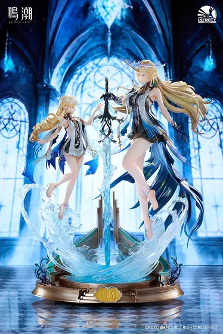 | **[Infinity Studio 『鳴潮』 フルールドリス&amp;カルテジア スタチューセット](https://www.goodsmile.com/ja/product/1138954)** Infinity Studio · 鳴潮 ポリストーンスタチュー · 预订中 · 附特典 · 不可同捆 | 148,000 日元 | 未定 截订 2026-12-23 |
| 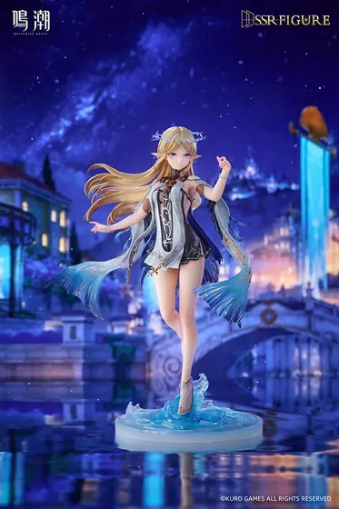 | **[SSR FIGURE 『鳴潮』 カルテジア 1/6 完成品フィギュア](https://www.goodsmile.com/ja/product/1138939)** SSR FIGURE · 鳴潮 スケールフィギュア · 1/6 · 预订中 · 附特典 | 26,500 日元 | 未定 截订 2026-12-23 |

## HLJ（9）

| 图 | 商品 | 价格 | 发售 |
|---|---|---|---|
| 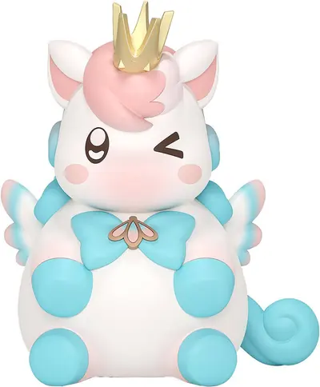 | **[Huggy Good Smile Little Ica (Honkai: Star Rail)](https://www.hlj.com/huggy-good-smile-little-ica-honkai-star-rail-gsc59671)** Good Smile Company · Honkai: Star Rail 预订中 | 1,636 日元 | 2027-07 |
|  | **[1/8 Azur Lane: LessMore Taihou: Private Quarters Ver.](https://www.hlj.com/1-8-scale-azur-lane-lessmore-taihou-private-quarters-ver-gsc80733)** Good Smile Company · Azur Lane 1/8 · 预订中 | 7,727 日元 | 2027-09 |
| 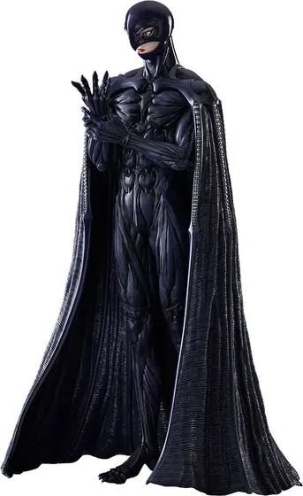 | **[POP UP PARADE Femto L size (Berserk)](https://www.hlj.com/pop-up-parade-femto-l-size-berserk-gsc59667)** Good Smile Company · Berserk 预订中 | 8,000 日元 | 2027-07 |
| 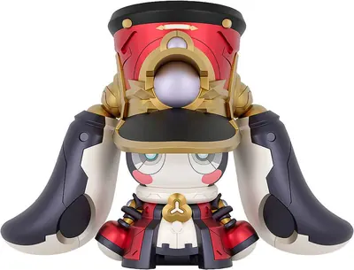 | **[Huggy Good Smile Alloy Mechatron: King Pom-Pom (Honkai: Star Rail)](https://www.hlj.com/huggy-good-smile-alloy-mechatron-king-pom-pom-honkai-star-rail-gsc59672)** Good Smile Company · Honkai: Star Rail 预订中 | 1,636 日元 | 2027-07 |
| 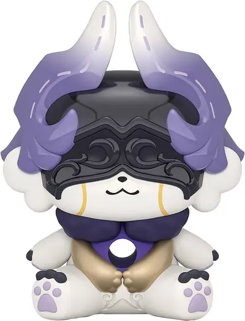 | **[Huggy Good Smile Chigus (Honkai: Star Rail)](https://www.hlj.com/huggy-good-smile-chigus-honkai-star-rail-gsc59670)** Good Smile Company · Honkai: Star Rail 预订中 | 1,636 日元 | 2027-06 |
| 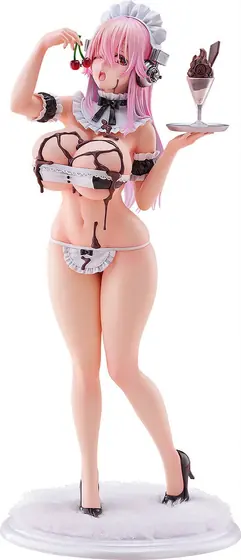 | **[1/7 Super Sonico \[Sexy Patissier Ver.\]](https://www.hlj.com/1-7-scale-super-sonico-sexy-patissier-ver-wav71200)** Wave · Super Sonico 1/7 · 预订中 | 21,636 日元 | 2027-12 |
| 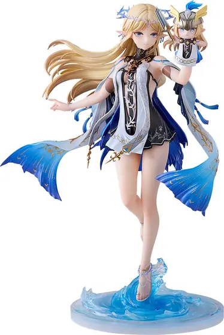 | **[1/6 SSR FIGURE Wuthering Waves: Cartethyia](https://www.hlj.com/1-6-scale-ssr-figure-wuthering-waves-cartethyia-iso54015)** Infinity Studio · Wuthering Waves 1/6 · 预订中 | 24,091 日元 | 2028-02 |
| 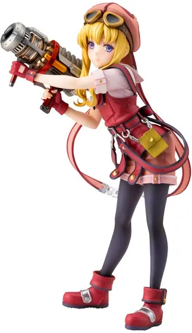 | **[1/8 Tita Russell (The Legend of Heroes: Trails in the Sky the 1st)](https://www.hlj.com/1-8-scale-tita-russell-the-legend-of-heroes-trails-in-the-sky-the-1st-kbypv-450)** Kotobukiya · The Legend of Heroes: Trails in the Sky 1/8 · 预订中 | 21,000 日元 | 2027-06 |
|  | **[1/4 My Dress-Up Darling: Marin Kitagawa Swimsuit Ver.](https://www.hlj.com/1-4-scale-my-dress-up-darling-marin-kitagawa-swimsuit-ver-fre51535)** Freeing · My Dress-Up Darling 1/4 · 预订中 | 30,000 日元 | 2027-05 |

## Sofmap（60）

| 图 | 商品 | 价格 | 发售 |
|---|---|---|---|
| 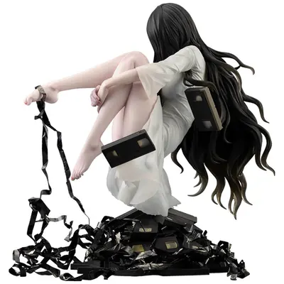 | **[【再販】塗装済み完成品 1/7 HORROR美少女 貞子](https://a.sofmap.com/product_detail.aspx?sku=102382402)** コトブキヤ その他 フィギュア · 1/7 · 预订中 · 再贩 | 19,800 日元 | 2027-05 |
| 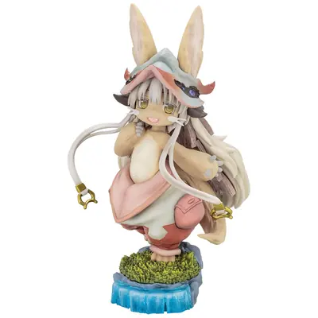 | **[【再販】塗装済み完成品 劇場シリーズ\[第一部\] メイドインアビス 目覚める神秘 ナナチ](https://a.sofmap.com/product_detail.aspx?sku=102427777)** コトブキヤ スケールフィギュア · 预订中 · 再贩 | 12,100 日元 | 2027-08 |
| 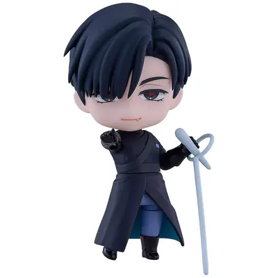 | **[ねんどろいど ALIEN STAGE イヴァン](https://a.sofmap.com/product_detail.aspx?sku=102433283)** グッドスマイルカンパニー ねんどろいど · 预订中 | 6,300 日元 | 2027-04 |
| 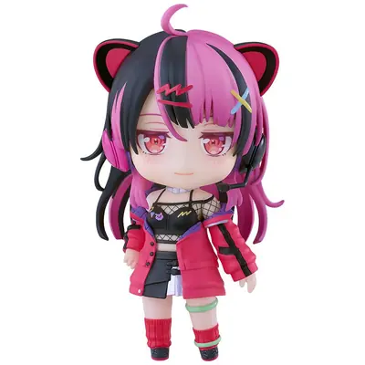 | **[ねんどろいど BanG Dream！ 千石ユノ](https://a.sofmap.com/product_detail.aspx?sku=102433319)** グッドスマイルカンパニー ねんどろいど · 预订中 | 7,900 日元 | 2027-04 |
| 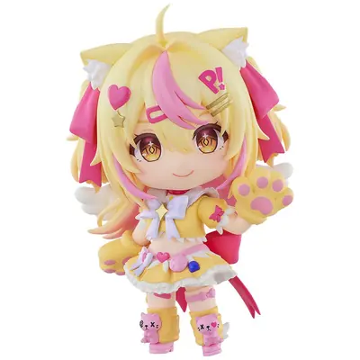 | **[ねんどろいど P丸様。](https://a.sofmap.com/product_detail.aspx?sku=102433488)** グッドスマイルカンパニー ねんどろいど · 预订中 | 7,900 日元 | 2027-04 |
| 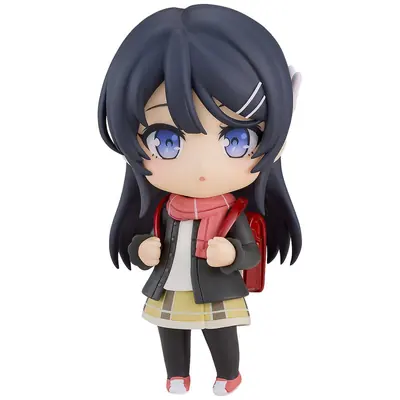 | **[ねんどろいど 『青春ブタ野郎』シリーズ ランドセルガール](https://a.sofmap.com/product_detail.aspx?sku=102433282)** グッドスマイルカンパニー ねんどろいど · 预订中 | 6,800 日元 | 2027-07 |
| 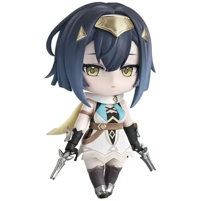 | **[ねんどろいど ステラソラ コハク](https://a.sofmap.com/product_detail.aspx?sku=102433458)** グッドスマイルアーツ上海 预订中 | 8,900 日元 | 未定 |
| 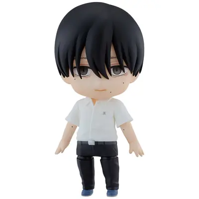 | **[ねんどろいど 光が死んだ夏 よしき](https://a.sofmap.com/product_detail.aspx?sku=102433479)** オランジュルージュ 预订中 | 6,600 日元 | 未定 |
| 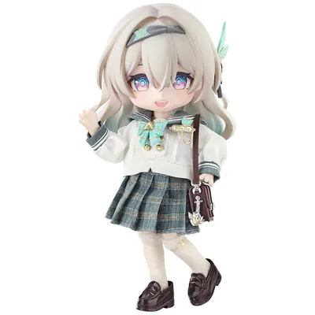 | **[ねんどろいどどーる 崩壊：スターレイル ホタル 春の贈り物Ver.](https://a.sofmap.com/product_detail.aspx?sku=102433320)** グッドスマイルカンパニー 预订中 | 9,400 日元 | 未定 |
| 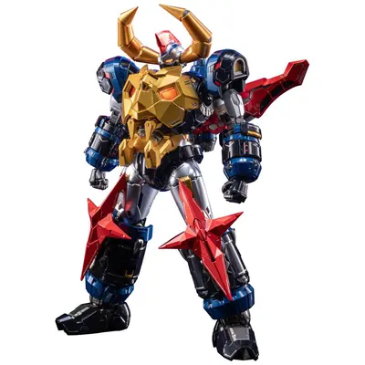 | **[塗装済み可動フィギュア ガイキング LEGEND OF DAIKU-MARYU 匠心級・大空魔竜ガイキング](https://a.sofmap.com/product_detail.aspx?sku=102380114)** コトブキヤ 预订已满 | 23,100 日元 | 未定 |
| 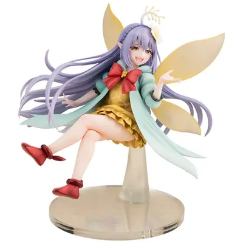 | **[塗装済み完成品 1/1 貸した魔力は【リボ払い】で強制徴収 エムピー](https://a.sofmap.com/product_detail.aspx?sku=102382484)** コトブキヤ 1/1 · 预订中 | 22,000 日元 | 未定 |
| 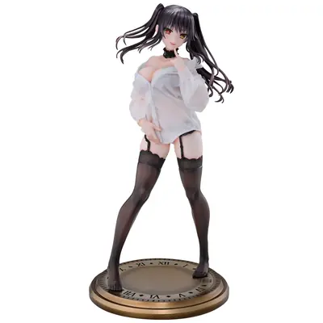 | **[塗装済み完成品 1/4 Re▼Dress デート・ア・ライブV 時崎狂三 YシャツVer.](https://a.sofmap.com/product_detail.aspx?sku=102433321)** メディコスエンタテイメント 1/4 · 预订中 | 26,950 日元 | 未定 |
| 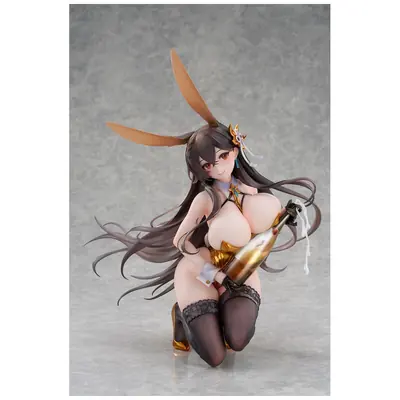 | **[塗装済み完成品 1/4 アズールレーン 筑摩 ～プレミアム・エクスチェンジver.～](https://a.sofmap.com/product_detail.aspx?sku=102433389)** アルファマックス 1/4 · 预订中 | 39,600 日元 | 未定 |
| 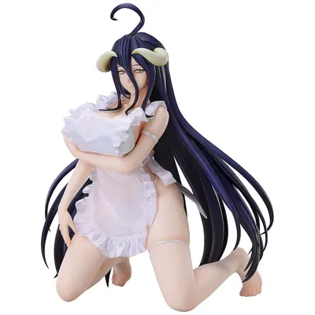 | **[塗装済み完成品 1/4 オーバーロード アルベド エプロンVer.](https://a.sofmap.com/product_detail.aspx?sku=102433390)** フリーイング 1/4 · 预订中 | 39,600 日元 | 未定 |
| 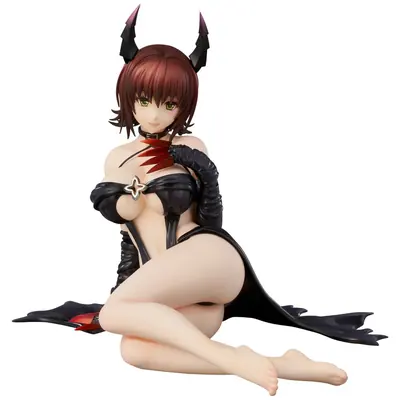 | **[塗装済み完成品 1/6 To LOVEる-とらぶる- ダークネス 御門涼子 ダークネスver. リニューアルパッケージ版](https://a.sofmap.com/product_detail.aspx?sku=102433516)** ユニオンクリエイティブ 1/6 · 预订中 | 19,800 日元 | 未定 |
| 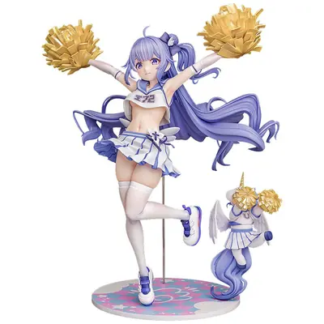 | **[塗装済み完成品 1/6 アズールレーン チャンピオン・オブ・ユニコーン](https://a.sofmap.com/product_detail.aspx?sku=102433273)** ファットカンパニー 1/6 · 预订中 | 28,800 日元 | 未定 |
| 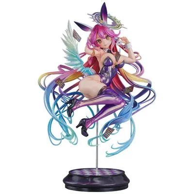 | **[塗装済み完成品 1/6 ノーゲーム・ノーライフ ジブリール バニーVer.](https://a.sofmap.com/product_detail.aspx?sku=102433274)** ファットカンパニー 1/6 · 预订中 | 34,800 日元 | 未定 |
| 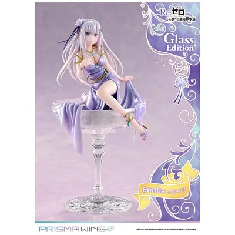 | **[塗装済み完成品 1/7 PRISMA WING Re：ゼロから始める異世界生活 エミリア グラスエディション](https://a.sofmap.com/product_detail.aspx?sku=102380107)** プライム１スタジオ 1/7 · 预订中 | 32,890 日元 | 未定 |
| 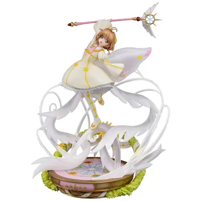 | **[塗装済み完成品 1/7 アニメ『カードキャプターさくら クリアカード編』 木之本桜 -soar-](https://a.sofmap.com/product_detail.aspx?sku=102433491)** PROOF 1/7 · 预订中 | 39,600 日元 | 未定 |
| 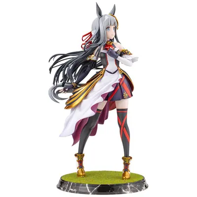 | **[塗装済み完成品 1/7 ウマ娘 プリティーダービー クロノジェネシス](https://a.sofmap.com/product_detail.aspx?sku=102427790)** コトブキヤ 1/7 · 预订中 | 23,100 日元 | 未定 |
| 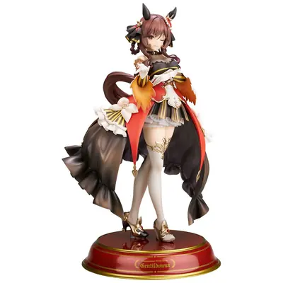 | **[塗装済み完成品 1/7 ウマ娘 プリティーダービー ジェンティルドンナ](https://a.sofmap.com/product_detail.aspx?sku=102433499)** アルター 1/7 · 预订中 | 29,480 日元 | 未定 |
| 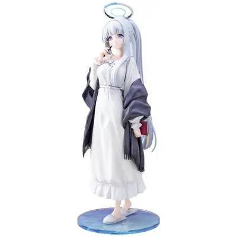 | **[塗装済み完成品 1/7 ブルーアーカイブ -Blue Archive- ノア（パジャマ）](https://a.sofmap.com/product_detail.aspx?sku=102433524)** コトブキヤ 1/7 · 预订中 | 19,800 日元 | 未定 |
|  | **[塗装済み完成品 1/7 ユミアのアトリエ ～追憶の錬金術士と幻創の地～ ユミア・リースフェルト お天気雨Ver.](https://a.sofmap.com/product_detail.aspx?sku=102382401)** コトブキヤ 1/7 · 预订中 | 24,200 日元 | 未定 |
|  | **[塗装済み完成品 1/7 魔法騎士レイアース 龍咲海](https://a.sofmap.com/product_detail.aspx?sku=102433385)** コトブキヤ 1/7 · 预订中 | 24,860 日元 | 未定 |
|  | **[塗装済み完成品 1/8 きみが死ぬまで恋をしたい シーナ＆ミミ](https://a.sofmap.com/product_detail.aspx?sku=102433386)** コトブキヤ 1/8 · 预订中 | 33,000 日元 | 未定 |
|  | **[塗装済み完成品 OSHI WORKS 零 ～紅い蝶～ REMAKE 天倉澪・天倉繭](https://a.sofmap.com/product_detail.aspx?sku=102433539)** コトブキヤ 预订中 | 19,800 日元 | 未定 |
|  | **[塗装済み完成品 モンスター娘のいる日常 ミーア](https://a.sofmap.com/product_detail.aspx?sku=102433322)** メディコスエンタテイメント 预订中 | 20,900 日元 | 未定 |
|  | **[塗装済み完成品 家庭教師ヒットマンREBORN！ 沢田綱吉＆リボーン](https://a.sofmap.com/product_detail.aspx?sku=102433267)** PROOF 预订中 | 29,700 日元 | 未定 |
|  | **[塗装済み完成品 家庭教師ヒットマンREBORN！ 雲雀恭弥](https://a.sofmap.com/product_detail.aspx?sku=102433536)** PROOF 预订中 | 24,200 日元 | 未定 |
|  | **[1/1 ライフスケールマスターライン その着せ替え人形（ビスク・ドール）は恋をする 喜多川海夢 ※キャンセル不可](https://a.sofmap.com/product_detail.aspx?sku=102435701)** プライム１スタジオ 1/1 · 预订中 | 1,320,000 日元 | 未定 |
|  | **[1/12 アクションフィギュア pocket art PA014 金吾前衛](https://a.sofmap.com/product_detail.aspx?sku=102383815)** HASUKI 1/12 · 预订中 | 13,200 日元 | 未定 |
|  | **[1/12 塗装済み可動フィギュア あの人](https://a.sofmap.com/product_detail.aspx?sku=102435715)** ダイキ工業 1/12 · 预订中 | 18,700 日元 | 未定 |
|  | **[1/6 ハピネスクローバー 乙女の祈り/ゆかり](https://a.sofmap.com/product_detail.aspx?sku=102435765)** アゾンインターナショナル 1/6 · 预订中 | 20,900 日元 | 未定 |
|  | **[4.5ちゃん 初音ミク 狼ver.](https://a.sofmap.com/product_detail.aspx?sku=102433899)** FuRyu(フリュー) 预订中 | 3,300 日元 | 未定 |
|  | **[OSHI WORKS Mini ヱヴァンゲリヲン新劇場版 式波・アスカ・ラングレー](https://a.sofmap.com/product_detail.aspx?sku=102433962)** コトブキヤ 预订中 | 1,980 日元 | 未定 |
|  | **[OSHI WORKS Mini ヱヴァンゲリヲン新劇場版 綾波レイ](https://a.sofmap.com/product_detail.aspx?sku=102433985)** コトブキヤ 预订中 | 1,980 日元 | 未定 |
|  | **[PalVerse（パルバース） 龍が如く【単品】](https://a.sofmap.com/product_detail.aspx?sku=102433892)** ブシロードクリエイティブ 预订中 | 1,210 日元 | 未定 |
|  | **[Pookie Boo BonBon Swing ORIENTAL ROMANTICA Ver.2.0](https://a.sofmap.com/product_detail.aspx?sku=102433896)** アゾンインターナショナル 预订已满 | 25,300 日元 | 未定 |
|  | **[TENITOL 初音ミク UWAふわふわ可愛い笑顔バッグ～ねこ～](https://a.sofmap.com/product_detail.aspx?sku=102433979)** FuRyu(フリュー) 预订中 | 6,600 日元 | 未定 |
|  | **[TENITOL 初音ミク UWA超デカふわふわ可愛い笑顔バッグ\[mini\]](https://a.sofmap.com/product_detail.aspx?sku=102433869)** FuRyu(フリュー) 预订中 | 3,300 日元 | 未定 |
|  | **[ウルトラディテールフィギュア No.994 UDF Care Bears（TM） Birthday Bear](https://a.sofmap.com/product_detail.aspx?sku=102433873)** メディコムトイ 预订中 | 1,650 日元 | 未定 |
|  | **[ウルトラディテールフィギュア No.995 UDF Care Bears（TM） Togetherness Bear](https://a.sofmap.com/product_detail.aspx?sku=102433874)** メディコムトイ 预订中 | 1,650 日元 | 未定 |
|  | **[ウルトラディテールフィギュア No.996 UDF Care Bears（TM） Bedtime Bear](https://a.sofmap.com/product_detail.aspx?sku=102433875)** メディコムトイ 预订中 | 1,650 日元 | 未定 |
|  | **[ウルトラディテールフィギュア No.997 UDF Care Bears（TM） Tenderheart Bear](https://a.sofmap.com/product_detail.aspx?sku=102433868)** メディコムトイ 预订中 | 1,650 日元 | 未定 |
|  | **[ウルトラディテールフィギュア No.998 UDF Care Bears（TM） Secret Bear](https://a.sofmap.com/product_detail.aspx?sku=102433974)** メディコムトイ 预订中 | 1,650 日元 | 未定 |
|  | **[サアラズ ア・ラ・モード LYCEE（リセ） Sweet Days YUKATA Collection～ブラックヘア～](https://a.sofmap.com/product_detail.aspx?sku=102433895)** アゾンインターナショナル 预订已满 | 16,500 日元 | 未定 |
|  | **[マフェックス No.336 MAFEX DAREDEVIL（DAREDEVIL：BORN AGAIN）](https://a.sofmap.com/product_detail.aspx?sku=102433947)** メディコムトイ 预订中 | 14,080 日元 | 未定 |
|  | **[マフェックス No.337 MAFEX PUNISHER（DAREDEVIL：BORN AGAIN）](https://a.sofmap.com/product_detail.aspx?sku=102433876)** メディコムトイ 预订中 | 14,080 日元 | 未定 |
|  | **[マフェックス No.338 MAFEX THE FLASH（BATMAN SUIT Ver.）](https://a.sofmap.com/product_detail.aspx?sku=102433877)** メディコムトイ 预订中 | 14,080 日元 | 未定 |
|  | **[塗装済み完成品 1/5 スク水部 里野なずな](https://a.sofmap.com/product_detail.aspx?sku=102433897)** FOTSJAPAN 1/5 · 预订中 | 26,180 日元 | 未定 |
|  | **[塗装済み完成品 1/6 Angel Beats！ 立華かなで](https://a.sofmap.com/product_detail.aspx?sku=102433966)** MAGIARTS 1/6 · 预订中 | 28,600 日元 | 未定 |
|  | **[塗装済み完成品 1/6 デート・ア・ライブV 鳶一折紙 精霊ver.](https://a.sofmap.com/product_detail.aspx?sku=102435718)** ユニオンクリエイティブ 1/6 · 预订中 | 33,000 日元 | 未定 |
|  | **[塗装済み完成品 1/7 アイドルマスター シンデレラガールズ 橘ありす\[シーサイド・メモリー\]＋](https://a.sofmap.com/product_detail.aspx?sku=102433902)** ピーエムオフィスエー 1/7 · 预订中 | 22,000 日元 | 未定 |
|  | **[塗装済み完成品 1/7 アークナイツ スルト 超然たる前奏曲VER.](https://a.sofmap.com/product_detail.aspx?sku=102433946)** MYETHOS 1/7 · 预订中 | 34,320 日元 | 未定 |
|  | **[塗装済み完成品 1/7 ウマ娘 プリティーダービー ハルウララ\[初うらら♪さくさくら\]Ver.](https://a.sofmap.com/product_detail.aspx?sku=102424407)** クレーネル 1/7 · 预订中 | 28,600 日元 | 未定 |
|  | **[塗装済み完成品 1/7 ゼンレスゾーンゼロ 浮波柚葉](https://a.sofmap.com/product_detail.aspx?sku=102384111)** APEXTOYS 1/7 · 预订中 | 29,150 日元 | 未定 |
|  | **[塗装済み完成品 1/7 テイルズ オブ アライズ シオン](https://a.sofmap.com/product_detail.aspx?sku=102424444)** アミアミ 1/7 · 预订中 | 39,600 日元 | 未定 |
|  | **[塗装済み完成品 1/8 Gift＋ アークナイツ：エンドフィールド ペリカ 晴れの日のお誘いVER.](https://a.sofmap.com/product_detail.aspx?sku=102433858)** MYETHOS 1/8 · 预订中 | 8,580 日元 | 未定 |
|  | **[塗装済み完成品 1/8 Gift＋ 原神 サンドローネ・鏡水の解明Ver.](https://a.sofmap.com/product_detail.aspx?sku=102433861)** MYETHOS 1/8 · 预订中 | 9,900 日元 | 未定 |
|  | **[塗装済み完成品 1/8 Gift＋ 原神 八重神子・煌めく夜の宴Ver.](https://a.sofmap.com/product_detail.aspx?sku=102433860)** MYETHOS 1/8 · 预订中 | 9,900 日元 | 未定 |

## Solaris Japan（10）

| 图 | 商品 | 价格 | 发售 |
|---|---|---|---|
|  | **[To LOVEru Darkness - Kotegawa Yui - Desktop Cute - Chinese Dress Ver., Renewal (Taito)](https://solarisjapan.com/products/to-loveru-darkness-kotegawa-yui-desktop-cute-chinese-dress-ver-renewal-taito)** Taito · To LOVEru Darkness Prize | 0 美元 | 2026-11 |
|  | **[Steins;Gate - Makise Kurisu - 1/7 - Lab Coat Bunny Ver. (Good Smile Arts Shanghai, Good Smile Company)](https://solarisjapan.com/products/steins-gate-makise-kurisu-1-7-lab-coat-bunny-ver-good-smile-arts-shanghai-good-smile-company)** Good Smile Arts Shanghai · Steins;Gate · Kurisu Makise 1/7 · 预订中 | 142 美元 | 2027-11 |
|  | **[Azur Lane - Hakuhou - 1/7 (Good Smile Arts Shanghai, Good Smile Company)](https://solarisjapan.com/products/azur-lane-hakuhou-1-7-good-smile-arts-shanghai-good-smile-company)** Good Smile Arts Shanghai · Azur Lane · Hakuhou 1/7 · 预订中 | 200 美元 | 2028-03 |
|  | **[Goddess of Victory: Nikke - Modernia - 1/7 - Second Affection - 2027 Re-release (Good Smile Arts Shanghai, Good Smile Company)](https://solarisjapan.com/products/goddess-of-victory-nikke-modernia-1-7-second-affection-2027-re-release-good-smile-arts-shanghai-good-smile-company)** Good Smile Arts Shanghai · Goddess of Victory: Nikke · Modernia 1/7 · 预订中 | 167 美元 | 2027-07 |
|  | **[Blue Archive - Ichinose Asuna - Pop Up Parade - Cheer Squad, L (Good Smile Company)](https://solarisjapan.com/products/blue-archive-ichinose-asuna-pop-up-parade-cheer-squad-l-good-smile-company)** Good Smile Company · Blue Archive · Ichinose Asuna 预订中 | 52 美元 | 2027-06 |
|  | **[Azur Lane - Cheshire - 1/7 - Dakimakura Ver. (AniGame)](https://solarisjapan.com/products/azur-lane-cheshire-1-7-dakimakura-ver-anigame)** AniGame · Azur Lane · Cheshire 1/7 · 预订中 · 成人向 | 72 美元 | 2027-09 |
|  | **[Original - Odoriko Ion - 1/4 - Female Ver. (Insight)](https://solarisjapan.com/products/original-odoriko-ion-1-4-female-ver-insight)** Insight · Original 1/4 · 预订中 · 成人向 | 245 美元 | 2027-03 |
|  | **[Original - Odoriko Ion - 1/6 - Female Ver. (Insight)](https://solarisjapan.com/products/original-odoriko-ion-1-6-female-ver-insight)** Insight · Original 1/6 · 预订中 · 成人向 | 134 美元 | 2027-03 |
|  | **[Original - Nikukan Bishounen - Odoriko Ion - 1/4 - 2027 Re-release (Insight)](https://solarisjapan.com/products/original-nikukan-bishounen-odoriko-ion-1-4-2027-re-release-insight)** Insight · Original 1/4 · 预订中 · 成人向 | 245 美元 | 2027-03 |
|  | **[Original - Nikukan Bishounen - Odoriko Ion - 1/6 - 2027 Re-release (Insight)](https://solarisjapan.com/products/original-nikukan-bishounen-odoriko-ion-1-6-2027-re-release-insight)** Insight · Original 1/6 · 预订中 · 成人向 | 134 美元 | 2027-03 |
