# 2026-11-13 手办新品

共 22 件（HPOI 15 · HLJ 2 · Solaris Japan 5）。点名称打开原页面。

## HPOI（15）

| 图 | 商品 | 价格 | 发售 |
|---|---|---|---|
| 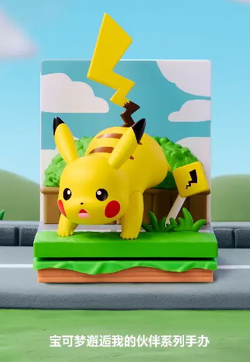 | **[宝可梦邂逅我的伙伴系列](https://www.hpoi.net/hobby/139307)** 宝可梦邂逅我的伙伴系列 泡泡玛特 · 宝可梦 · 皮卡丘、杰尼龟、胖丁、可达鸭、耿鬼、伊布、新叶喵、呆火鳄、润水鸭 生物/幻灵 | 69 元 | 2026-10 |
| 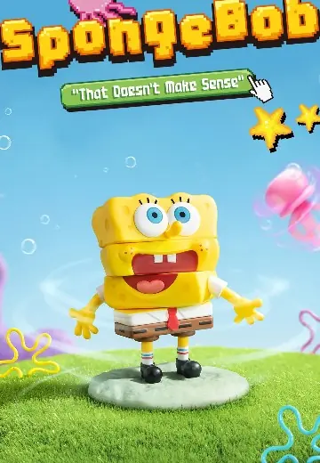 | **[海绵宝宝“这不科学”系列](https://www.hpoi.net/hobby/139306)** 海绵宝宝“这不科学”系列 泡泡玛特 · 海绵宝宝 Q版人形 | 69 元 | 2026-09 |
| 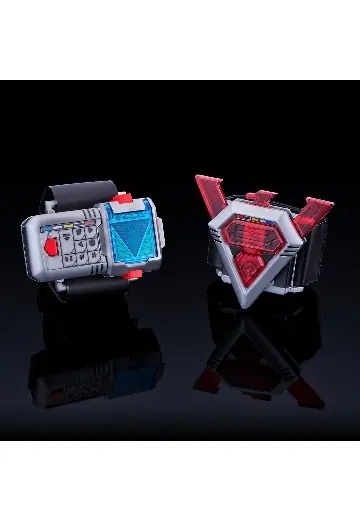 | **[十字转换器 -MEMORIAL EDITION-](https://www.hpoi.net/hobby/139302)** 鸟人战队喷射人 十字转换器 -MEMORIAL EDITION- 万代 比例人形 | 16,500 日元 PB限定，含税，688元 | 2027-04 |
| 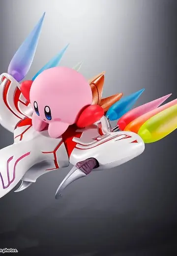 | **[超合金 星之卡比 &amp; 龙骑士（Dragoon）](https://www.hpoi.net/hobby/139299)** 超合金 カービィ＆ドラグーン 万代 · 星之卡比 · 龙骑士·杰法、卡比、龙骑士 生物/幻灵 · 超合金 | 19,800 日元 含税，826元 | 2027-05 |
| 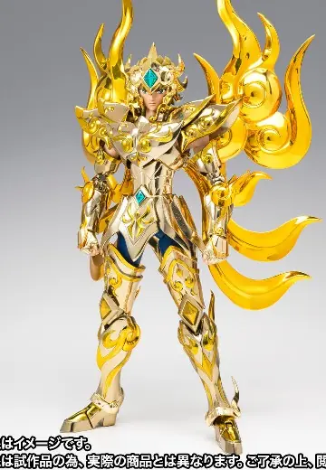 | **[圣斗士圣衣神话EX 狮子座艾欧里亚（神圣衣）EX METAL版](https://www.hpoi.net/hobby/139295)** 聖闘士聖衣神話EX レオアイオリア（神聖衣）-EX METAL EDITION- BANDAI SPIRITS · 圣斗士星矢 黄金魂 -soul of gold- · 艾欧里亚 比例人形 · 圣斗士圣衣神话EX | 26,400 日元 含税，1102元 | 2027-04 |
| 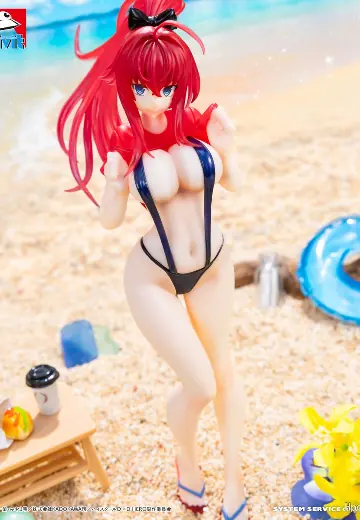 | **[Vivit 恶魔高中D×D HERO 莉雅丝·吉蒙里](https://www.hpoi.net/hobby/139293)** Vivit フィギュア ハイスクールD×D HERO リアス・グレモリー System Service · 恶魔高中D×D HERO · 莉雅丝·吉蒙里 比例人形 · Vivit | — | 2026-11 |
| 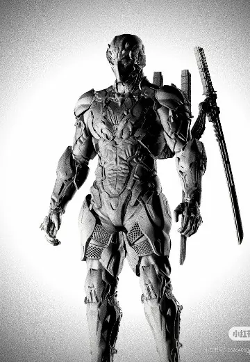 | **[玄刃](https://www.hpoi.net/hobby/139286)** 玄刃 驰野工作室 比例人形 | — | 未知 |
| 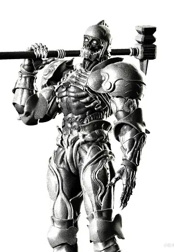 | **[代号骸骨骑士](https://www.hpoi.net/hobby/139285)** 代号骸骨骑士 驰野工作室 比例人形 | — | 未知 |
| 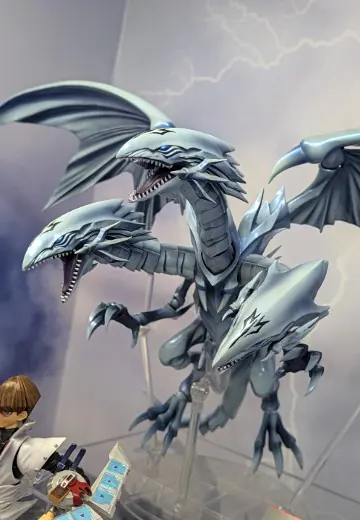 | **[S.H.MonsterArts 青眼究极龙](https://www.hpoi.net/hobby/139282)** S.H.MonsterArts 青眼の究極竜 BANDAI SPIRITS · 游戏王 · 青眼究极龙 生物/幻灵 · S.H.MonsterArts | — | 未知 |
| 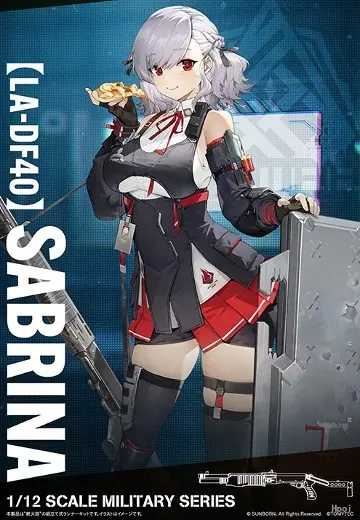 | **[小军械库 LADF40 少女前线2：追放 塞布丽娜 (SPAS-12)](https://www.hpoi.net/hobby/139279)** LittleArmory リトルアーモリー LADF40 ドールズフロントライン2 サブリナ TOMYTEC · 少女前线2：追放 配件 · 小军械库 · 1/12 | 2,640 日元 含税，110元 | 2027-03 |
| 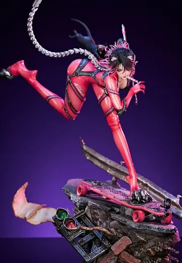 | **[YT-Cat](https://www.hpoi.net/hobby/139278)** 1/4比例雕像YT-Cat TriEagles 比例人形 · 1/4 | — | 2027年第四季度 |
|  | **[希安酱 坐姿](https://www.hpoi.net/hobby/139277)** シアンちゃん おすわりver. Insight 比例人形 | — | 未知 |

旧品补录 3 件：HPOI 新收录、但早已发售的老商品

| 图 | 商品 | 价格 | 发售 |
|---|---|---|---|
|  | **[海绵宝宝好朋友系列](https://www.hpoi.net/hobby/139305)** 海绵宝宝好朋友系列 泡泡玛特 · 海绵宝宝 Q版人形 · 旧品补录 | 69 元 | 2025-04 |
| 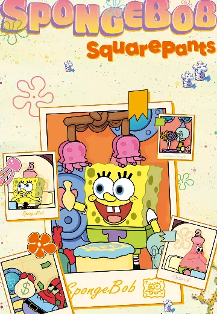 | **[海绵宝宝 狂欢周年庆系列场景](https://www.hpoi.net/hobby/139304)** 海绵宝宝 狂欢周年庆系列场景 泡泡玛特 · 海绵宝宝 Q版人形 · 旧品补录 | 69 元 | 2024-08 |
| 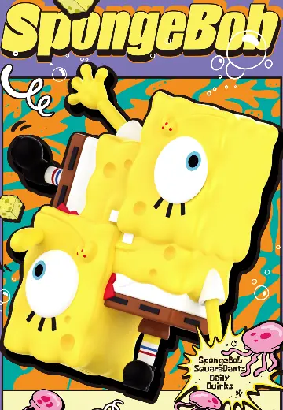 | **[海绵宝宝搞怪系列](https://www.hpoi.net/hobby/139303)** 海绵宝宝搞怪系列 泡泡玛特 · 海绵宝宝 Q版人形 · 旧品补录 | 69 元 | 2024-06 |

## HLJ（2）

| 图 | 商品 | 价格 | 发售 |
|---|---|---|---|
| 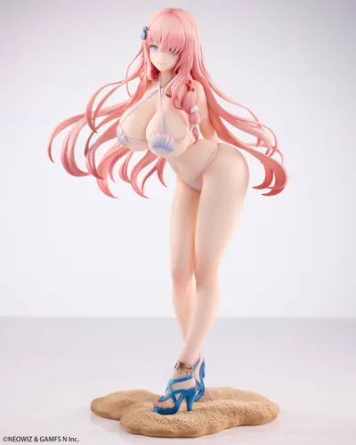 | **[1/7 Brown Dust 2: Bikini Agent Sylvia](https://www.hlj.com/1-7-scale-brown-dust-2-bikini-agent-sylvia-hsa33111)** Hobby sakura · Brown Dust 1/7 · 预订中 | 23,000 日元 | 2027-09 |
| 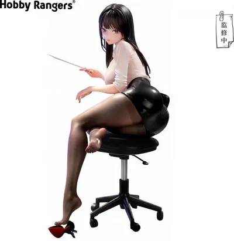 | **[1/6 Defenseless Underclassman Saemi-chan Illustrated by SAEU](https://www.hlj.com/1-6-scale-defenseless-underclassman-saemi-chan-illustrated-by-saeu-hoa74000)** HobbyRangers · Original Character 1/6 · 预订中 | 9,000 日元 | 2027-08 |

## Solaris Japan（5）

| 图 | 商品 | 价格 | 发售 |
|---|---|---|---|
|  | **[SoniComi (Super Sonico) - Sonico - Dream Tech - 1/7 - Sexy Patissiere Ver. (Wave)](https://solarisjapan.com/products/sonicomi-super-sonico-sonico-dream-tech-1-7-sexy-patissiere-ver-wave)** Wave · SoniComi (Super Sonico) · Super Sonico 1/7 · 预订中 · 成人向 | 143 美元 | 2027-12 |
| 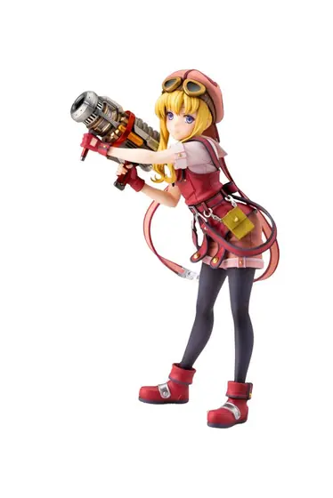 | **[Sora no Kiseki the 1st - Tita Russell - 1/8 (Kotobukiya)](https://solarisjapan.com/products/sora-no-kiseki-the-1st-tita-russell-1-8-kotobukiya)** Kotobukiya · Sora no Kiseki the 1st · Tita Russell 1/8 · 预订中 | 132 美元 | 2027-06 |
| 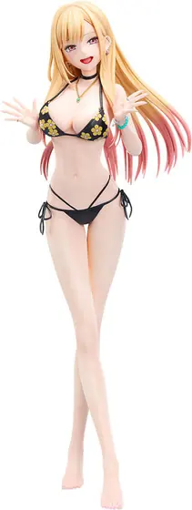 | **[Sono Bisque Doll wa Koi o Suru - Kitagawa Marin - B-style - 1/4 - Swimsuit Ver. (FREEing)](https://solarisjapan.com/products/sono-bisque-doll-wa-koi-o-suru-kitagawa-marin-b-style-1-4-swimsuit-ver-freeing)** FREEing · Sono Bisque Doll wa Koi o Suru · Marin Kitagawa 1/4 · 预订中 | 198 美元 | 2027-05 |
| 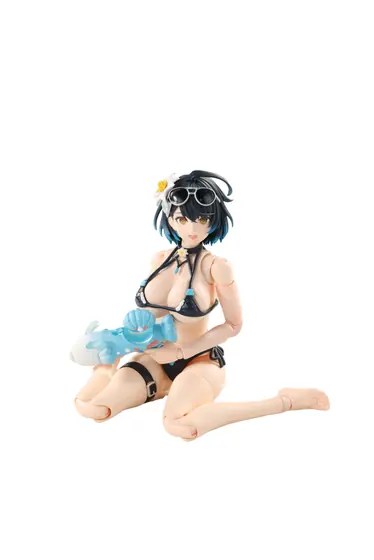 | **[Stellar Radiance: Sora Wa Dare No Tame Ni Hareru No ka - 1/12 - Deluxe Edition (ZERO DISTANCE)](https://solarisjapan.com/products/stellar-radiance-sora-wa-dare-no-tame-ni-hareru-no-ka-1-12-deluxe-edition-zero-distance)** ZERO DISTANCE · Stellar Radiance: Sora Wa Dare No Tame Ni Hareru No ka Action · 1/12 · 预订中 | 72 美元 | 2027-06 |
| 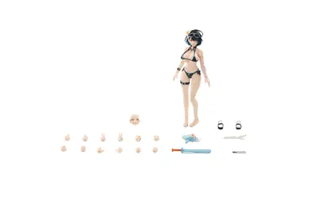 | **[Stellar Radiance: Sora Wa Dare No Tame Ni Hareru No ka - 1/12 (ZERO DISTANCE)](https://solarisjapan.com/products/stellar-radiance-sora-wa-dare-no-tame-ni-hareru-no-ka-1-12-zero-distance)** ZERO DISTANCE · Stellar Radiance: Sora Wa Dare No Tame Ni Hareru No ka Action · 1/12 · 预订中 | 66 美元 | 2027-06 |
