# 2026-11-14 手办新品

共 83 件（HPOI 33 · Good Smile 官网 19 · HLJ 8 · Solaris Japan 23）。点名称打开原页面。

## HPOI（33）

| 图 | 商品 | 价格 | 发售 |
|---|---|---|---|
| 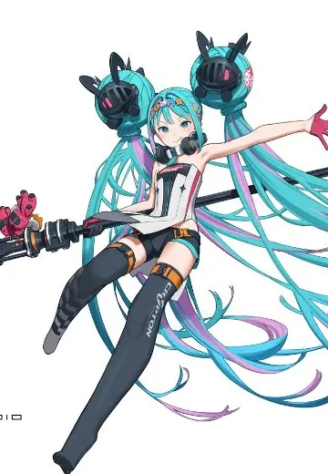 | **[赛车初音 2026](https://www.hpoi.net/hobby/139425)** レーシングミク 2026 Prime 1 Studio · 初音未来 比例人形 · 1/5 | — | 未知 |
| 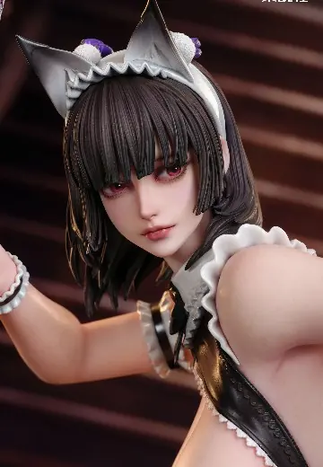 | **[斩鬼侍剑女仆 绯红Beni](https://www.hpoi.net/hobby/139423)** 聚魂社-斩鬼侍剑女仆 绯红Beni 聚魂社 比例人形 · 1/4 | 2,480 元 | 2027-09 |
| 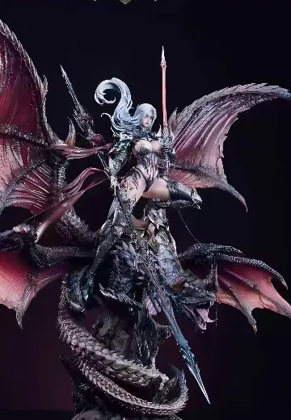 | **[驯龙系列 龙骑士-希露德](https://www.hpoi.net/hobby/139413)** 聚魂社 驯龙系列第三款 龙骑士-希露德 聚魂社 比例人形 · 1/4 · 成人向 | 5,580 元 | 2027-06 |
| 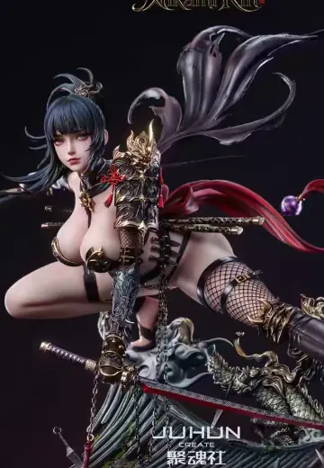 | **[女忍 三上凛Mikami Rin](https://www.hpoi.net/hobby/139404)** 聚魂社 女忍 三上凛Mikami Rin 聚魂社 比例人形 · 1/4 · 成人向 | 3,780 元 | 2027-06 |
| 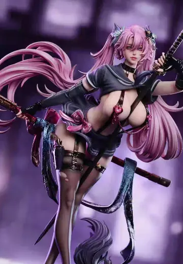 | **[斩鬼少女月袂 Aya](https://www.hpoi.net/hobby/139402)** 聚魂社-斩鬼少女月袂 Aya 聚魂社 比例人形 · 1/4 | 2,580 元 | 未知 |
|  | **[肉感美少年 伪娘兔男郎 音恵留君](https://www.hpoi.net/hobby/139373)** 肉感美少年 男の娘バニー のえるくん Insight 比例人形 · 1/5 | 26,180 日元 含税，1092元 | 2027-05 |
| 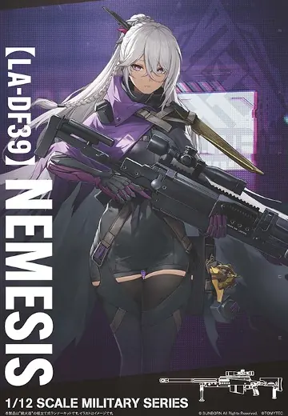 | **[小军械库 LADF39 少女前线2：追放 纳美西丝（SAN511）](https://www.hpoi.net/hobby/139367)** LittleArmory LADF39 ドールズフロントライン2 ネメシス TOMYTEC · 少女前线2：追放 配件 · 小军械库 · 1/12 | 3,080 日元 含税，128元 | 2027-02 |
|  | **[乐园追放 心之共鸣 加百列](https://www.hpoi.net/hobby/139364)** 乐园追放 心之共鸣 「Gabriel」 青时雨 · 乐园追放 心之共鸣 · 加百列 比例人形 | — | 未知 |
| 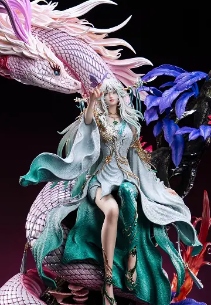 | **[光阴之外 灵儿](https://www.hpoi.net/hobby/139362)** 十月梧桐工作室X《光阴之外》灵儿 十月梧桐工作室 比例人形 · 1/4 | 4,680 元 | 2027年第二季度 |
|  | **[洗碗姬](https://www.hpoi.net/hobby/139355)** 洗碗姬 DOKIMAX 比例人形 · 1/6 | — | 未知 |
| 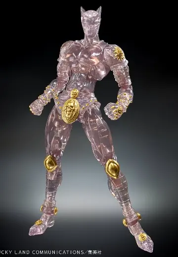 | **[JOJO 的奇妙冒险 第 4 部 超像可动「杀手皇后 Ver. CLEAR &amp; GOLD」](https://www.hpoi.net/hobby/139354)** ジョジョの奇妙な冒険 第4部 超像可動「キラークイーン Ver. CLEAR &amp; GOLD」 MEDICOS-E · JOJO的奇妙冒险 · 杀手皇后 比例人形 · 超像可动 | — | 未知 |
| 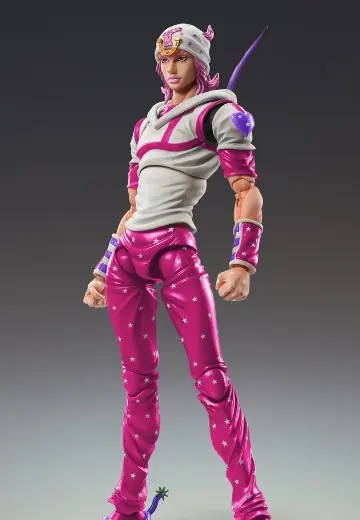 | **[JOJO 的奇妙冒险 超像可动「乔尼・乔斯达 Third（WF2027W 限定商品）」](https://www.hpoi.net/hobby/139353)** ジョジョの奇妙な冒険 超像可動「ジョニィ・ジョースター・サード（WF2027W限定商品）」 MEDICOS-E · JOJO的奇妙冒险 · 乔尼・乔斯达 比例人形 · 超像可动 | — | 2026-10 |
| 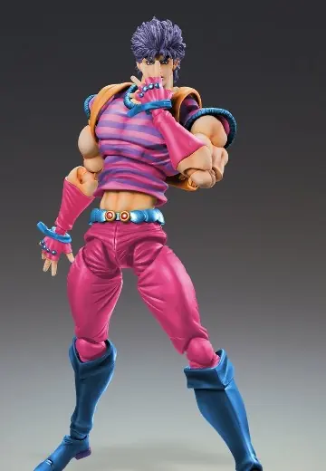 | **[JOJO 的奇妙冒险 第 1 部 超像可动「乔纳森・乔斯达 Third（WF2027W 限定）](https://www.hpoi.net/hobby/139352)** ジョジョの奇妙な冒険 第1部 超像可動「ジョナサン・ジョースター・サード（WF2027W限定商品）」 MEDICOS-E · JOJO的奇妙冒险 · 乔纳森·乔斯达 比例人形 · 超像可动 | — | 2026-10 |
| 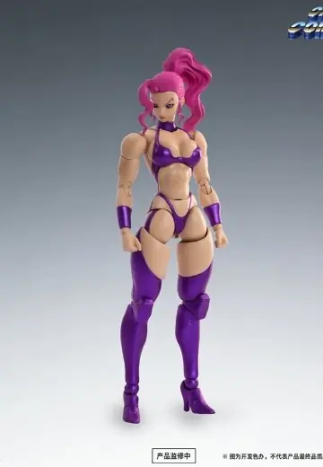 | **[上尉命令 FIGLITE 卡罗尔](https://www.hpoi.net/hobby/139348)** キャプテンコマンドー FIGLITE キャロル 1/12 52TOYS 比例人形 · 1/12 | 7,480 日元 日本地区，含税，312元 | 2027-01 |
| 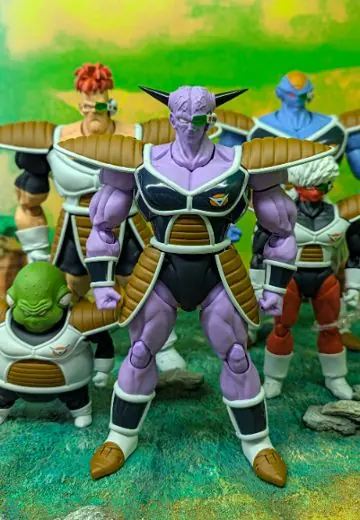 | **[S.H.Figuarts 基纽特战队](https://www.hpoi.net/hobby/139346)** S.H.Figuarts ギニュー特戦队 BANDAI SPIRITS · 龙珠Z · 基纽、吉斯、巴达、利库姆、古鲁多 比例人形 · S.H.Figuarts | — | 未知 |
| 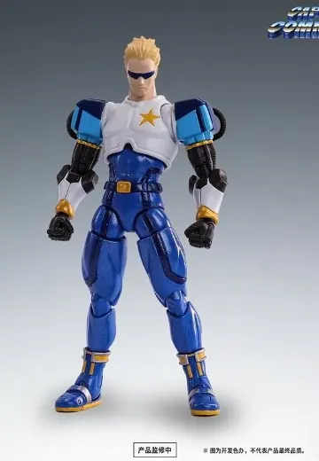 | **[上尉命令 FIGLITE 上尉](https://www.hpoi.net/hobby/139344)** キャプテンコマンドー FIGLITE キャプテン 1/12 52TOYS 比例人形 · 1/12 | 7,480 日元 日本地区，含税，312元 | 2027-01 |
| 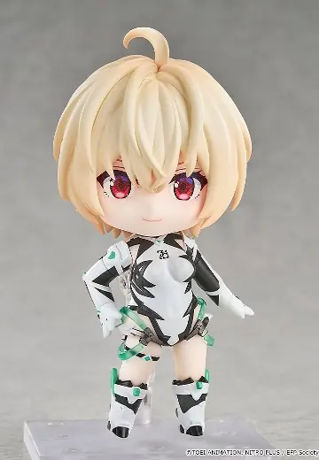 | **[粘土人#3206 乐园追放 心之共鸣 加百列](https://www.hpoi.net/hobby/139343)** ねんどろいど 楽園追放 心のレゾナンス ガブリエル 良笑塑美 · 乐园追放 心之共鸣 · 加百列 Q版人形 · 粘土人 | 6,900 日元 含税，287元 | 2027-05 |
| 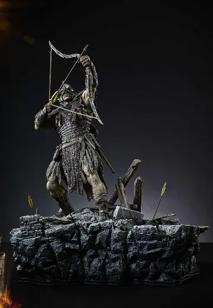 | **[稀有主线 指环王：双塔 乌鲁克族弓箭手](https://www.hpoi.net/hobby/139342)** プレミアムマスターライン ロード・オブ・ザ・リング～二つの塔～ ウルク＝ハイ・アーチャー Prime 1 Studio · 指环王：双塔奇兵 比例人形 · 稀有主线 · 1/4 | 154,990 日元 含税，6468元 | 2028-07 |
| 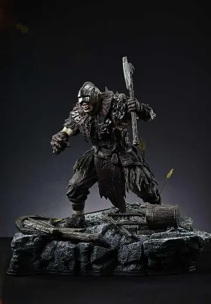 | **[稀有主线 指环王：双塔 奥克斧战士](https://www.hpoi.net/hobby/139341)** プレミアムマスターライン ロード・オブ・ザ・リング～二つの塔～ オーク・アックスマン Prime 1 Studio · 指环王：双塔奇兵 比例人形 · 稀有主线 · 1/4 | 154,990 日元 含税，6468元 | 2028-07 |
|  | **[无职转生3 ～到了异世界就拿出真本事～ Q版手办系列（暂称）](https://www.hpoi.net/hobby/139340)** 無職転生Ⅲ ～異世界行ったら本気だす～ 無職転生 デフォルメ フィギュアシリーズ（暂称） Hobby·sakura · 无职转生～到了异世界就拿出真本事～ · 爱莎·格雷拉特、诺伦·格雷拉特、洛琪希·米格路迪亚、艾莉丝·伯雷亚斯·格雷拉特、希露菲叶特·格雷拉特、卢迪乌斯·格雷拉特 Q版人形 | — | 未知 |
| 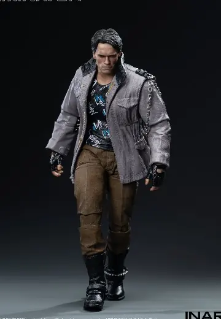 | **[终结者 T-800 痞子造型](https://www.hpoi.net/hobby/139339)** 《终结者》-T-800痞子造型可动人偶 INART Action · 终结者 · T-800 比例人形 · 1/12 | 528 元 | 2027-03 |
| 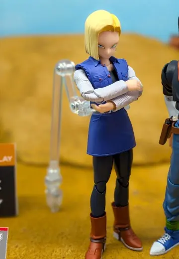 | **[S.H.Figuarts 人造人18号](https://www.hpoi.net/hobby/139338)** S.H.Figuarts 人造人間18号 BANDAI SPIRITS · 龙珠 · 人造人18号 比例人形 · S.H.Figuarts | — | 未知 |
| 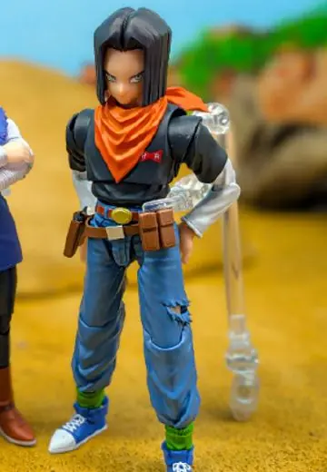 | **[S.H.Figuarts 人造人17号](https://www.hpoi.net/hobby/139337)** S.H.Figuarts 人造人間17号 BANDAI SPIRITS · 龙珠 · 人造人17号 比例人形 · S.H.Figuarts | — | 未知 |
| 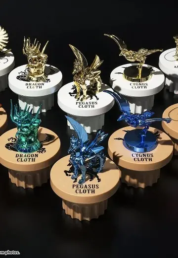 | **[圣斗士星矢 圣斗士圣衣神话 APPENDIX 青铜圣衣](https://www.hpoi.net/hobby/139333)** 聖闘士星矢 聖闘士聖衣神話APPENDIX 青銅聖衣オブジェ BANDAI SPIRITS · 圣斗士星矢 比例人形 · 圣斗士圣衣神话、圣斗士圣衣神话APPENDIX | 1,650 日元 含税，68元 | 2026-11 |
| 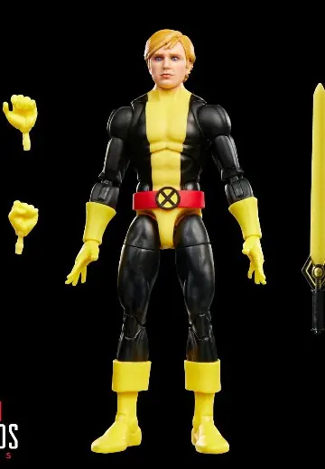 | **[漫威传奇系列 漫威漫画 非凡 X 战警 密码（Cypher）【乐天 Books 限定】](https://www.hpoi.net/hobby/139331)** マーベル・レジェンド マーベルコミックス アンキャニィX-MEN サイファー【楽天ブックス限定】 孩之宝 · X战警 比例人形 · 漫威传奇系列 | 4,888 日元 含税，204元 | 2026-10 |
| 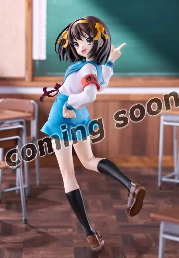 | **[凉宫春日的忧郁 凉宫春日](https://www.hpoi.net/hobby/139329)** TVアニメ「涼宮ハルヒの憂鬱」 涼宮ハルヒ F:NEX · 凉宫春日的忧郁 · 凉宫春日 比例人形 · 1/7 | — | 未知 |
| 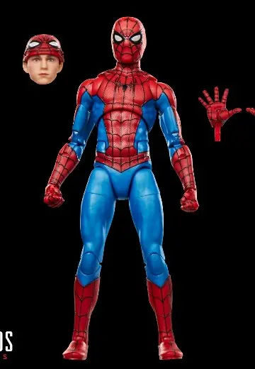 | **[漫威传奇系列 漫威 蜘蛛侠 《蜘蛛侠：英雄无归》【乐天 Books 限定】](https://www.hpoi.net/hobby/139328)** マーベル マーベル・レジェンド スパイダーマン スパイダーマン:ノー・ウェイ・ホーム【楽天ブックス限定】 孩之宝 · 漫威、蜘蛛侠：英雄无归 · 蜘蛛侠（彼得·帕克） 比例人形 · 漫威传奇系列 | 4,888 日元 含税，204元 | 2026-10 |
|  | **[Lucrea hololive 星街彗星 "Once Upon a Stellar" 巡演服装](https://www.hpoi.net/hobby/139326)** MegaHouse | — | 未知 |
| 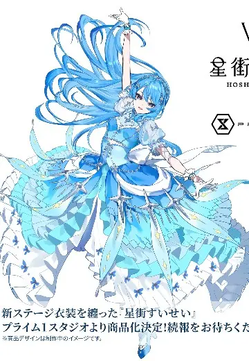 | **[hololive 星街彗星 新舞台服装](https://www.hpoi.net/hobby/139324)** hololive 星街すいせい 新ステージ衣装 Prime 1 Studio · hololive · 星街彗星 比例人形 | — | 未知 |
| 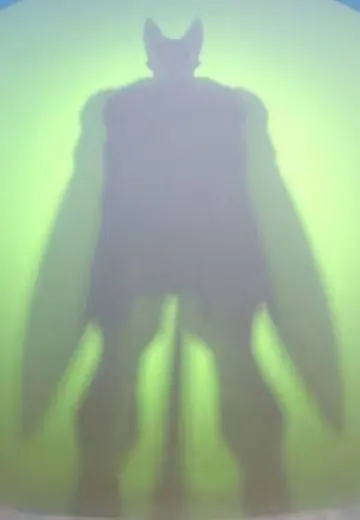 | **[S.H.Figuarts 沙鲁完全体](https://www.hpoi.net/hobby/139312)** S.H.Figuarts セル完全体 BANDAI SPIRITS · 龙珠 · 沙鲁 比例人形 · S.H.Figuarts | — | 未知 |

旧品补录 3 件：HPOI 新收录、但早已发售的老商品

| 图 | 商品 | 价格 | 发售 |
|---|---|---|---|
| 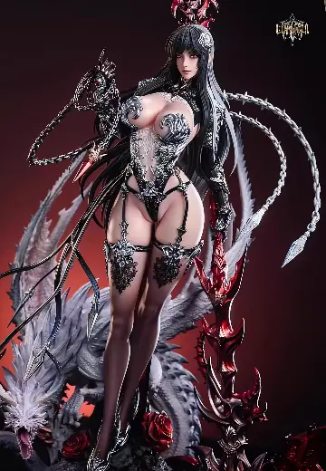 | **[驯龙系列 驯龙女祭司露米娜](https://www.hpoi.net/hobby/139412)** 聚魂社 驯龙系列第二款 驯龙女祭司露米娜 比例人形 · 1/4 · 旧品补录 · 成人向 | 4,380 元 | 2026-06 |
| 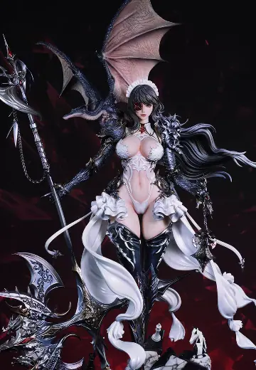 | **[驯龙系列 驯龙女王/女仆艾薇儿](https://www.hpoi.net/hobby/139409)** 聚魂社 驯龙系列第一款 驯龙女王/女仆艾薇儿 聚魂社 比例人形 · 1/4 · 旧品补录 · 成人向 | 3,880 元 | 2025-05 |
| 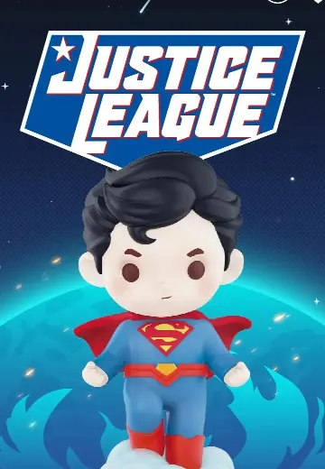 | **[DC正义联盟系列](https://www.hpoi.net/hobby/139375)** DC正义联盟系列 泡泡玛特 · 正义联盟 Q版人形 · 旧品补录 | 59 元 | 2021-09 |

## Good Smile 官网（19）

| 图 | 商品 | 价格 | 发售 |
|---|---|---|---|
| 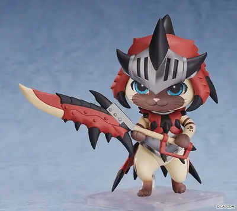 | **[ねんどろいど アイルー リオレウス装備Ver. DX](https://www.goodsmile.com/ja/product/1140800)** グッドスマイルカンパニー · 「モンスターハンター」シリーズ ねんどろいど · ノンスケール · 预订中 | 9,700 日元 | 未定 截订 2026-12-23 |
| 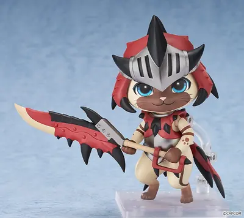 | **[ねんどろいど アイルー リオレウス装備Ver.](https://www.goodsmile.com/ja/product/1140801)** グッドスマイルカンパニー · 「モンスターハンター」シリーズ ねんどろいど · ノンスケール · 预订中 | 7,900 日元 | 未定 截订 2026-12-23 |
| 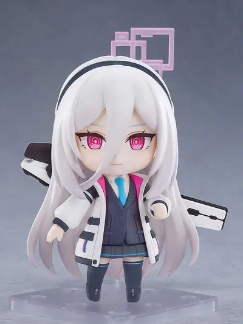 | **[ねんどろいど 天童ケイ](https://www.goodsmile.com/ja/product/1143941)** グッドスマイルカンパニー · ブルーアーカイブ -Blue Archive- ねんどろいど · ノンスケール · 预订中 · 附特典 | 7,800 日元 | 未定 截订 2026-12-23 |
| 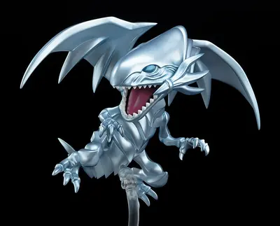 | **[ねんどろいど 青眼の白龍](https://www.goodsmile.com/ja/product/1141653)** グッドスマイルカンパニー · 遊☆戯☆王デュエルモンスターズ ねんどろいど · ノンスケール · 预订中 · 附特典 | 8,900 日元 | 未定 截订 2026-12-16 |
| 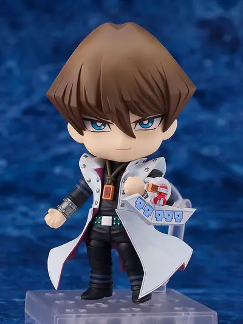 | **[ねんどろいど 海馬瀬人](https://www.goodsmile.com/ja/product/35762)** グッドスマイルカンパニー · 遊☆戯☆王デュエルモンスターズ ねんどろいど · ノンスケール · 预订中 · 再贩 · 附特典 | 7,400 日元 | 2027-03 截订 2026-12-16 |
| 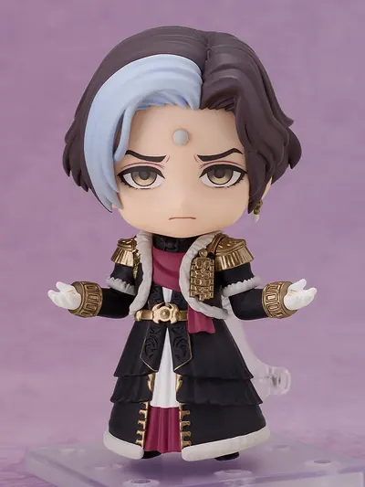 | **[ねんどろいど エメトセルク](https://www.goodsmile.com/ja/product/1142376)** グッドスマイルカンパニー · ファイナルファンタジーXIV ねんどろいど · ノンスケール · 预订中 · 附特典 | 7,900 日元 | 未定 截订 2026-12-23 |
| 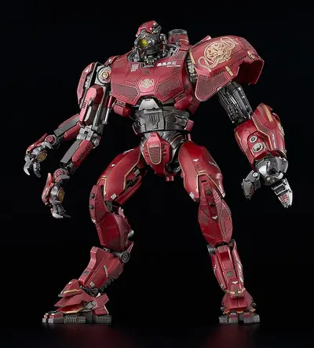 | **[MODEROID クリムゾン・タイフーン](https://www.goodsmile.com/ja/product/1143766)** グッドスマイルカンパニー · パシフィック・リム MODEROID · ノンスケール · 预订中 | 12,000 日元 | 未定 截订 2026-12-16 |
| 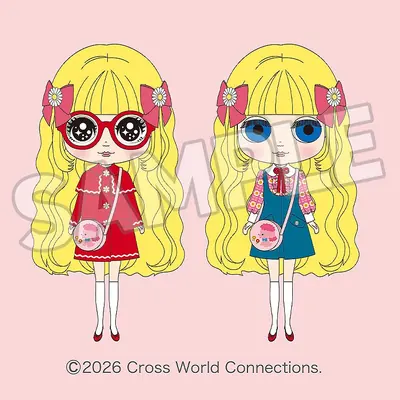 | **[ブライス カワイイショウワシェリー](https://www.goodsmile.com/ja/product/1144875)** グッドスマイルカンパニー · Blythe Blythe · 预订中 | 24,800 日元 | 未定 截订 2026-12-02 |
| 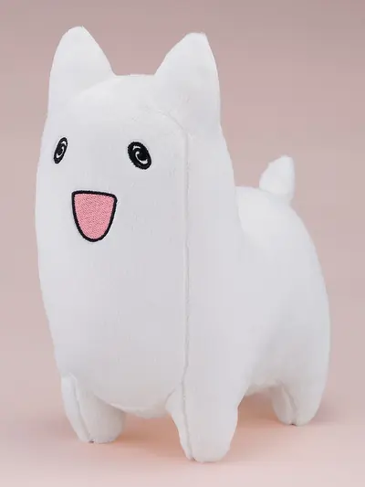 | **[どんぐりぬいぐるみ](https://www.goodsmile.com/ja/product/1144087)** グッドスマイルカンパニー · 追放されたチート付与魔術師は気ままなセカンドライフを謳歌する。 ～俺は武器だけじゃなく、あらゆるものに『強化ポイント』を付与できるし、俺の意思でいつでも効果を解除できるけど、残った人たち大丈夫？～ ぬいぐるみ · 预订中 · 再贩 | 4,400 日元 | 2027-05 截订 2026-12-09 |
| 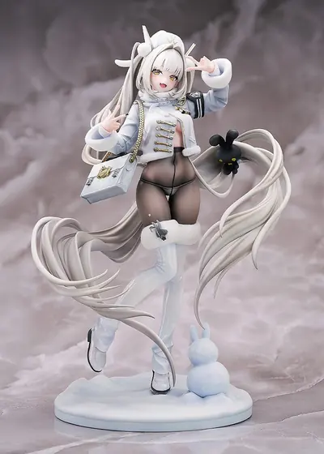 | **[ブラン - フォーチュンエクスプレス](https://www.goodsmile.com/ja/product/1144476)** グッドスマイルアーツ上海 · 勝利の女神：NIKKE スケールフィギュア · 1/7 · 预订中 | 26,400 日元 | 未定 截订 2026-12-23 |
| 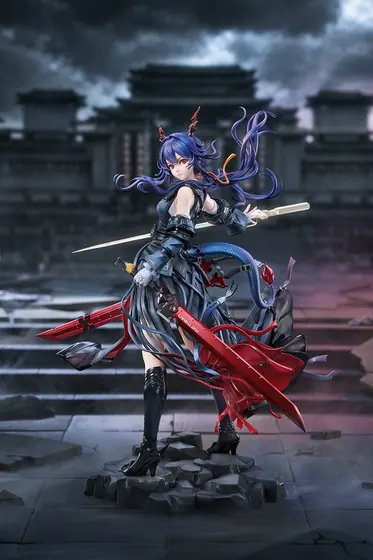 | **[赤刃明霄チェン 昇進段階2VER.](https://www.goodsmile.com/ja/product/1144116)** グッドスマイルアーツ上海 · アークナイツ スケールフィギュア · 1/7 · 预订中 · 附特典 | 31,900 日元 | 未定 截订 2026-12-23 |
| 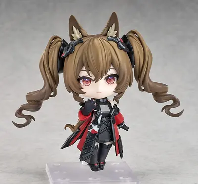 | **[ねんどろいど ギルベルタ](https://www.goodsmile.com/ja/product/1144115)** グッドスマイルアーツ上海 · アークナイツ：エンドフィールド ねんどろいど · ノンスケール · 预订中 · 附特典 | 8,900 日元 | 未定 截订 2026-12-23 |
| 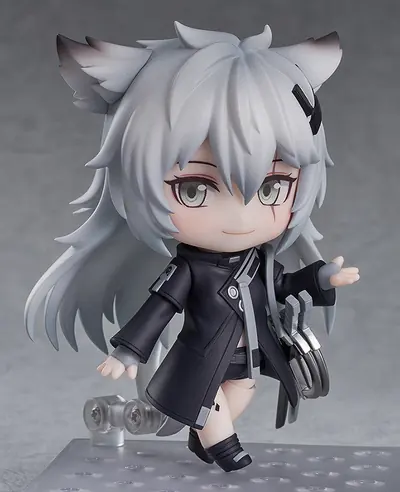 | **[ねんどろいど ラップランド](https://www.goodsmile.com/ja/product/8725)** グッドスマイルアーツ上海 · アークナイツ ねんどろいど · ノンスケール · 预订中 · 再贩 | 7,800 日元 | 2027-05 截订 2026-12-23 |
| 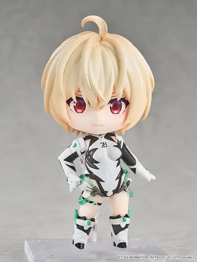 | **[ねんどろいど ガブリエル](https://www.goodsmile.com/ja/product/1138622)** グッドスマイルアーツ上海 · 楽園追放 心のレゾナンス ねんどろいど · ノンスケール · 预订中 | 6,900 日元 | 未定 截订 2027-01-06 |
| 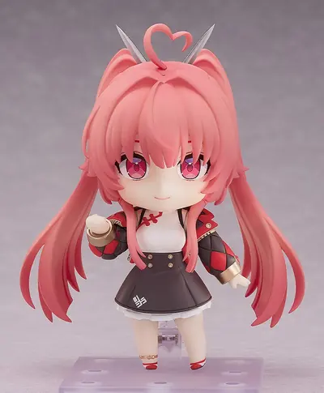 | **[ねんどろいど メイリン](https://www.goodsmile.com/ja/product/1145394)** グッドスマイルアーツ上海 · カオスゼロナイトメア ねんどろいど · ノンスケール · 预订中 | 8,900 日元 | 未定 截订 2026-12-23 |
| 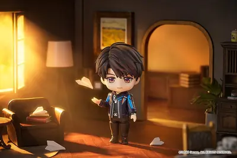 | **[ねんどろいど マヒル](https://www.goodsmile.com/ja/product/1142465)** グッドスマイルアーツ上海 · 恋と深空 ねんどろいど · ノンスケール · 预订中 · 附特典 | 7,200 日元 | 未定 截订 2026-12-16 |
| 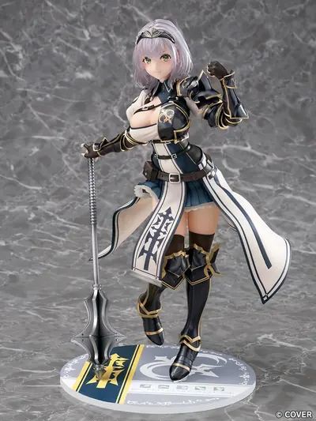 | **[白銀ノエル](https://www.goodsmile.com/ja/product/12988)** ファット・カンパニー · ホロライブプロダクション スケールフィギュア · 1/7 · 预订中 · 再贩 | 29,800 日元 | 2027-06 截订 2027-01-13 |
| 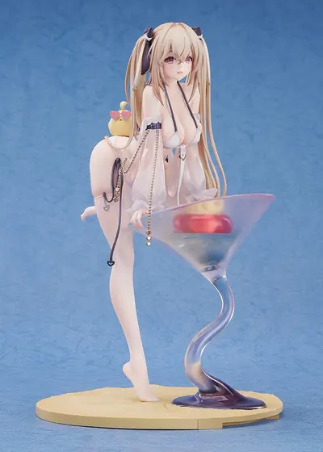 | **[アンカレッジ 艦船との一杯](https://www.goodsmile.com/ja/product/1144162)** ルミナスボックス · アズールレーン スケールフィギュア · 1/6 · 预订中 | 27,400 日元 | 未定 截订 2026-12-23 |
| 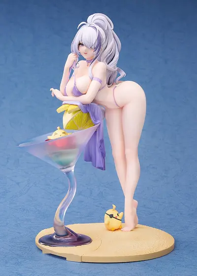 | **[雲仙 艦船との一杯](https://www.goodsmile.com/ja/product/1144161)** ルミナスボックス · アズールレーン スケールフィギュア · 1/6 · 预订中 | 27,400 日元 | 未定 截订 2026-12-23 |

## HLJ（8）

| 图 | 商品 | 价格 | 发售 |
|---|---|---|---|
| 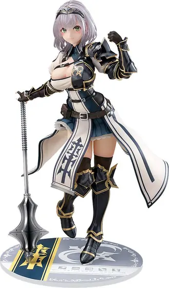 | **[1/7 hololive production: Shirogane Noel (Rerelease)](https://www.hlj.com/1-7-scale-hololive-production-shirogane-noel-rerelease-pht96853)** Phat Company · hololive production 1/7 · 预订中 · 再贩 | 27,091 日元 | 2027-06 |
| 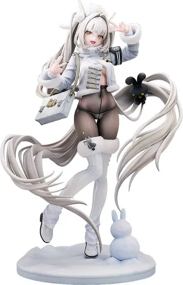 | **[1/7 GODDESS OF VICTORY: NIKKE: Blanc - Fortune Express](https://www.hlj.com/1-7-scale-goddess-of-victory-nikke-blanc-fortune-express-gsc80735)** Good Smile Company · Goddess of Victory: Nikke 1/7 · 预订中 | 24,000 日元 | 2027-12 |
| 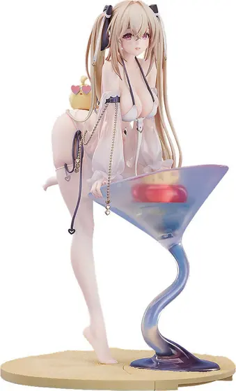 | **[1/6 Azur Lane: Anchorage: A Drink with a Ship](https://www.hlj.com/1-6-scale-azur-lane-anchorage-a-drink-with-a-ship-lmx37040)** Luminous Box · Azur Lane 1/6 · 预订中 | 24,909 日元 | 2027-12 |
|  | **[1/7 Yosuga no Sora: Sora Kasugano -Elegant China Style-](https://www.hlj.com/1-7-scale-yosuga-no-sora-sora-kasugano-elegant-china-style-alt20848)** Alter · Yosuga no Sora 1/7 · 预订中 | 24,800 日元 | 2027-10 |
|  | **[1/6 Magical Girl Mitsuki Illustrated by Chon](https://www.hlj.com/1-6-scale-magical-girl-mitsuki-illustrated-by-chon-esu72011)** EUSUN · Original Character 1/6 · 预订中 | 18,000 日元 | 2027-12 |
|  | **[1/6 Azur Lane: Unzen: A Drink with a Ship](https://www.hlj.com/1-6-scale-azur-lane-unzen-a-drink-with-a-ship-lmx37039)** Luminous Box · Azur Lane 1/6 · 预订中 | 24,909 日元 | 2027-12 |
|  | **[1/7 Arknights: Ch'en the Dawnstreak: Elite 2 Ver.](https://www.hlj.com/1-7-scale-arknights-ch-en-the-dawnstreak-elite-2-ver-gsc80664)** Good Smile Company · Arknights 1/7 · 预订中 | 29,000 日元 | 2028-03 |
|  | **[1/6 My Dress-Up Darling Season 2: Marin Kitagawa Arisa Izayoi Ver.](https://www.hlj.com/1-6-scale-my-dress-up-darling-season-2-marin-kitagawa-arisa-izayoi-ver-bef96043)** Bellfine · My Dress-Up Darling 1/6 · 预订中 | 26,000 日元 | 2027-02 |

## Solaris Japan（23）

| 图 | 商品 | 价格 | 发售 |
|---|---|---|---|
|  | **[Bishoujo Senshi Sailor Moon - Neo Queen Serenity - Figuarts ZERO - Figuarts Zero Chouette (Bandai Spirits) \[Shop Exclusive\]](https://solarisjapan.com/products/bishoujo-senshi-sailor-moon-neo-queen-serenity-figuarts-zero-figuarts-zero-chouette-bandai-spirits-shop-exclusive)** Bandai Spirits · Bishoujo Senshi Sailor Moon · Neo Queen Serenity Prize | 0 美元 | 2027-06 |
|  | **[Sousou no Frieren - Frieren - Luminasta - Kuon no Aijou (Sega Fave)](https://solarisjapan.com/products/sousou-no-frieren-frieren-luminasta-kuon-no-aijou-sega-fave)** Sega Fave · Sousou no Frieren Prize | 0 美元 | 2026-11 |
|  | **[Sousou no Frieren - Himmel - Luminasta - Kuon no Aijou (Sega Fave)](https://solarisjapan.com/products/sousou-no-frieren-himmel-luminasta-kuon-no-aijou-sega-fave)** Sega Fave · Sousou no Frieren Prize | 0 美元 | 2026-11 |
|  | **[Rockman.exe - Glaga - Rockman.EXE - Luminasta (Sega Fave)](https://solarisjapan.com/products/rockman-exe-glaga-rockman-exe-luminasta-sega-fave)** Sega Fave · Rockman.exe Prize · 现货 | 42 美元 | 2026-11 |
|  | **[One Piece - Loki - DXF Posing Figure (Bandai Namco Amusement, Bandai Spirits)](https://solarisjapan.com/products/one-piece-loki-dxf-posing-figure-bandai-namco-amusement-bandai-spirits)** Bandai Spirits · One Piece Prize | 0 美元 | 2026-11 |
|  | **[Street Fighter - Chun-Li - Grandista - Outfit 2 (Bandai Spirits)](https://solarisjapan.com/products/street-fighter-chun-li-grandista-outfit-2-bandai-spirits)** Bandai Spirits · Street Fighter Prize · 现货 | 36 美元 | 2026-11 |
|  | **[One Piece - Nico Robin - Glitter &amp; Glamours - Elbaph Style (Bandai Spirits)](https://solarisjapan.com/products/one-piece-nico-robin-glitter-glamours-elbaph-style-bandai-spirits)** Bandai Spirits · One Piece Prize · 现货 | 29 美元 | 2026-11 |
|  | **[Hunter × Hunter - Kuroro Lucilfer - Grandista (Bandai Spirits)](https://solarisjapan.com/products/hunter-x-hunter-kuroro-lucilfer-grandista-bandai-spirits)** Bandai Spirits · Hunter × Hunter Prize · 现货 | 35 美元 | 2026-11 |
|  | **[Sousou no Frieren - Frieren - Luminasta - Sega UFO Catcher Online - Magic of Halloween, Clear (Sega Fave)](https://solarisjapan.com/products/sousou-no-frieren-frieren-luminasta-sega-ufo-catcher-online-magic-of-halloween-clear-sega-fave)** Sega Fave · Sousou no Frieren Prize | 0 美元 | 2026-11 |
|  | **[Sousou no Frieren - Fern - Luminasta - Sega UFO Catcher Online - Magic of Halloween, Clear (Sega Fave)](https://solarisjapan.com/products/sousou-no-frieren-fern-luminasta-sega-ufo-catcher-online-magic-of-halloween-clear-sega-fave)** Sega Fave · Sousou no Frieren Prize | 0 美元 | 2026-11 |
|  | **[Piapro Characters - Hatsune Miku - Muchute - Park Date (FuRyu)](https://solarisjapan.com/products/piapro-characters-hatsune-miku-muchute-park-date-furyu)** FuRyu · Piapro Characters Prize · 现货 | 33 美元 | 2026-11 |
|  | **[Date A Live V - Tokisaki Kurumi - BiCute Pure (FuRyu)](https://solarisjapan.com/products/date-a-live-v-tokisaki-kurumi-bicute-pure-furyu)** FuRyu · Date A Live V Prize | 0 美元 | 2026-11 |
|  | **[Wuthering Waves - Cartethyia - SSR Figure - 1/6 (Infinity Studio)](https://solarisjapan.com/products/wuthering-waves-cartethyia-ssr-figure-1-6-infinity-studio)** Infinity Studio · Wuthering Waves · Cartethyia 1/6 · 预订中 | 152 美元 | 2028-02 |
|  | **[Azur Lane - Taihou - LessMore - 1/8 - Private Quarters Ver. (Good Smile Arts Shanghai, Good Smile Company)](https://solarisjapan.com/products/azur-lane-taihou-lessmore-1-8-private-quarters-ver-good-smile-arts-shanghai-good-smile-company)** Good Smile Company · Azur Lane · Taihou 1/8 · 预订中 | 52 美元 | 2027-09 |
|  | **[Berserk - Femto - Pop Up Parade - L (Good Smile Company)](https://solarisjapan.com/products/berserk-femto-pop-up-parade-l-good-smile-company)** Good Smile Company · Berserk · Femto 预订中 | 46 美元 | 2027-07 |
|  | **[Brown Dust II - Sylvia - 1/7 - Bikini Agent (Hobby Sakura)](https://solarisjapan.com/products/brown-dust-ii-sylvia-1-7-bikini-agent-hobby-sakura)** Hobby sakura · Brown Dust II · Sylvia 1/7 · 预订中 · 成人向 | 148 美元 | 2027-09 |
|  | **[Youkoso! Sukebe Elf no Mori e - Evelyn Celebrían - 1/5 (Mouse Unit)](https://solarisjapan.com/products/youkoso-sukebe-elf-no-mori-e-evelyn-celebrian-1-5-mouse-unit)** Q-Six / MouseUnit · Youkoso! Sukebe Elf no Mori e · Evelyn 1/5 · 预订中 · 成人向 | 194 美元 | 2027-05 |
|  | **[Youkoso! Sukebe Elf no Mori e - Evelyn Celebrían - 1/6 (Mouse Unit)](https://solarisjapan.com/products/youkoso-sukebe-elf-no-mori-e-evelyn-celebrian-1-6-mouse-unit)** Q-Six / MouseUnit · Youkoso! Sukebe Elf no Mori e · Evelyn 1/6 · 预订中 · 成人向 | 194 美元 | 2027-05 |
|  | **[Biohazard Re:4 - Leon S. Kennedy - Nendoroid Doll (Good Smile Company)](https://solarisjapan.com/products/biohazard-re-4-leon-s-kennedy-nendoroid-doll-good-smile-company)** Good Smile Company · Biohazard - Resident Evil · Leon S. Kennedy Nendoroid · 预订中 | 51 美元 | 2027-08 |
|  | **[Clannad - Sakagami Tomoyo - Nendoroid (#3169) (Good Smile Company)](https://solarisjapan.com/products/clannad-sakagami-tomoyo-nendoroid-3169-good-smile-company)** Good Smile Company · Clannad · Sakagami Tomoyo Nendoroid · 预订中 | 38 美元 | 2027-06 |
|  | **[Girls Band Cry - Kawaragi Momoka - Nendoroid (#3119) (Good Smile Arts Shanghai, Good Smile Company)](https://solarisjapan.com/products/girls-band-cry-kawaragi-momoka-nendoroid-3119-good-smile-arts-shanghai-good-smile-company)** Good Smile Arts Shanghai · Girls Band Cry · Kawaragi Momoka Nendoroid · 预订中 | 40 美元 | 2027-06 |
|  | **[Call of Duty - Captain Price - Nendoroid (#3178) (Good Smile Arts Shanghai, Good Smile Company)](https://solarisjapan.com/products/call-of-duty-captain-price-nendoroid-3178-good-smile-arts-shanghai-good-smile-company)** Good Smile Company · Call of Duty · Captain Price Nendoroid · 预订中 | 48 美元 | 2027-07 |
|  | **[Riddle Joker - Arihara Nanami - Nendoroid (#2394) - 2027 Re-release (Good Smile Arts Shanghai, Good Smile Company)](https://solarisjapan.com/products/riddle-joker-arihara-nanami-nendoroid-2394-2027-re-release-good-smile-arts-shanghai-good-smile-company)** Good Smile Arts Shanghai · Riddle Joker · Arihara Nanami Nendoroid · 预订中 | 38 美元 | 2027-05 |
