# 2026-11-17 手办新品

共 94 件（HPOI 17 · Good Smile 官网 24 · Sofmap 11 · HLJ 13 · Solaris Japan 29）。点名称打开原页面。

## HPOI（17）

| 图 | 商品 | 价格 | 发售 |
|---|---|---|---|
| 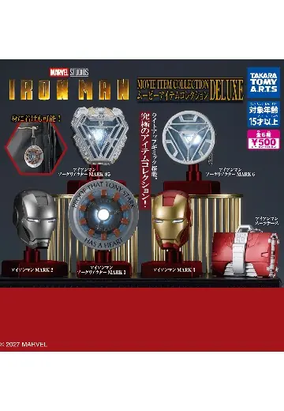 | **[钢铁侠 -电影道具收藏 豪华版-](https://www.hpoi.net/hobby/139609)** アイアンマン -MOVIE ITEM COLLECTION DELUXE- Takara Tomy A.R.T.S · 复仇者联盟、钢铁侠3、钢铁侠2、钢铁侠1 · 钢铁侠 盒蛋/扭蛋 | 500 日元 单次扭蛋，含税，20元 | 2026-12 |
| 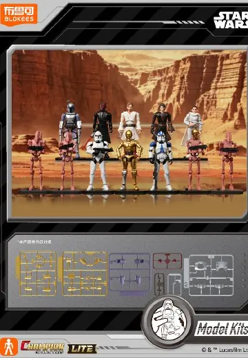 | **[星球大战超越版Lite第2弹-经典角色系列](https://www.hpoi.net/hobby/139584)** 布鲁可星球大战超越版Lite第2弹-经典角色系列 布鲁可 · 星球大战 · 达斯·摩尔、C-3PO、安纳金·天行者 / 达斯·维德、詹戈·费特、欧比旺·克诺比（本·克诺比）、克隆人士兵、帕德梅·阿米达拉 比例人形 · 布鲁可积木人-超越版Lite | 17,820 日元 9 个套装，含税，746元 | 2026-09 |
| 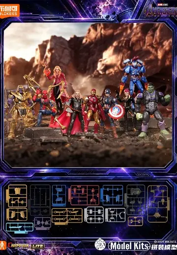 | **[漫威英雄超越版Lite第2弹-终局之战](https://www.hpoi.net/hobby/139583)** 布鲁可 漫威英雄超越版Lite第2弹-终局之战 布鲁可 · 复仇者联盟4：终局之战 · 雷神索尔、灭霸、浩克、蜘蛛侠（彼得·帕克）、猩红女巫、钢铁侠、黑寡妇、美国队长 比例人形 · 布鲁可积木人-超越版Lite | 17,820 日元 9 个套装，含税，746元 | 2026-09 |
| 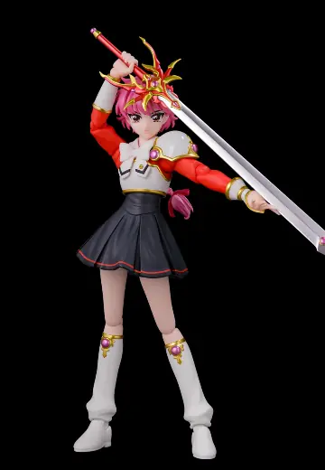 | **[魔法骑士雷阿斯 狮堂光](https://www.hpoi.net/hobby/139582)** TVアニメ「魔法騎士レイアース」アクションフィギュア 獅堂 光 千值练 · 魔法骑士阿雷斯 · 獅堂光 比例人形 | 14,300 日元 含税，598元 | 2027-05 |
| 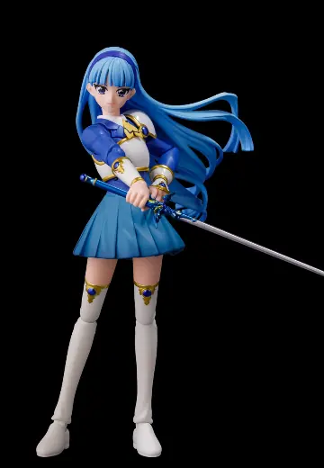 | **[魔法骑士阿雷斯 龙咲海](https://www.hpoi.net/hobby/139581)** TVアニメ「魔法騎士レイアース」アクションフィギュア 龍咲 海 千值练 · 魔法骑士阿雷斯 · 龙咲海 比例人形 | 14,300 日元 含税，598元 | 2027-06 |
| 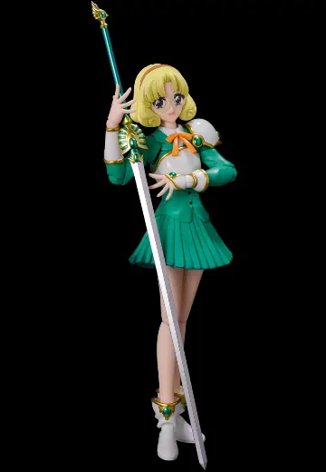 | **[魔法骑士雷阿斯 凤凰寺风](https://www.hpoi.net/hobby/139580)** TVアニメ「魔法騎士レイアース」アクションフィギュア 鳳凰寺 風 千值练 · 魔法骑士阿雷斯 · 凤凰寺风 比例人形 | 14,300 日元 含税，598元 | 2027-07 |
| 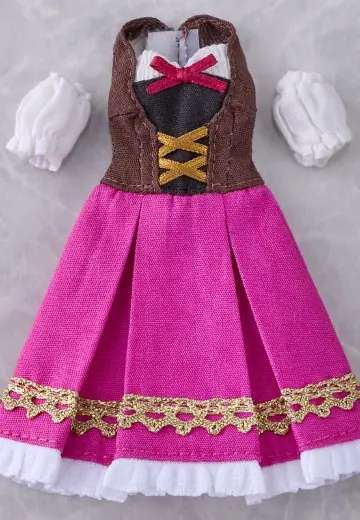 | **[No.SP-13R 羱羊服饰套装 兽拼装限定色](https://www.hpoi.net/hobby/139579)** 【数量限定】No. SP-13R アイベックス衣装セット けもプラ限定カラー【けもプラ公式サイト限定】 青岛社 配件 · KEMOPLA | 5,500 日元 含税，230元 | 2027-05 |
| 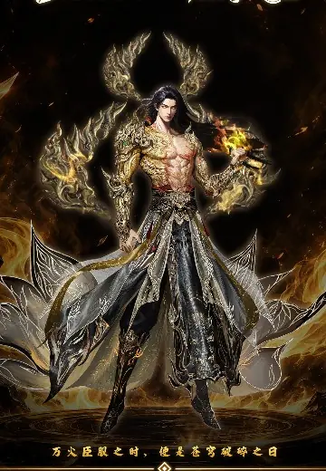 | **[斗破苍穹 萧炎·斗帝](https://www.hpoi.net/hobby/139578)** 斗破苍穹 1/6萧炎·斗帝可动人偶 朗宙 · 斗破苍穹剧场版 双帝之战、斗破苍穹 · 萧炎 比例人形 · 1/6 | 1,985 元 | 2027-09 |
| 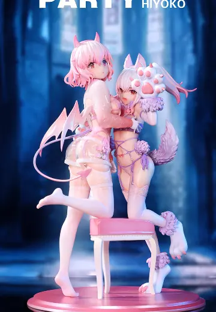 | **[变装派对 Ruri&amp;Hiyoko-粉红之夜](https://www.hpoi.net/hobby/139577)** Costume Party-Ruri&amp;Hiyoko（Pink Ver.） WeArtDoing 比例人形 | 1,480 元 | 2027-09 |
|  | **[航海王 传奇之四皇系列 巴基](https://www.hpoi.net/hobby/139576)** 《航海王》传奇之四皇系列 巴基 1/6 轻型收藏级雕像 集美殿堂 · 航海王 · 巴基 比例人形 · 1/6 | 2,488 元 | 2027-06 |
| 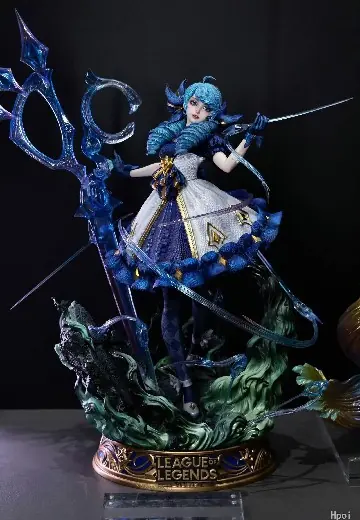 | **[英雄联盟 灵罗娃娃 格温](https://www.hpoi.net/hobby/139574)** 英雄联盟 灵罗娃娃 格温 开天工作室 · 英雄联盟 · 灵罗娃娃 格温 比例人形 | — | 未知 |
| 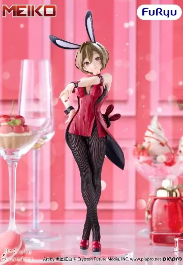 | **[BiCute Bunnies MEIKO](https://www.hpoi.net/hobby/139573)** BiCute Bunniesフィギュア MEIKO FuRyu · piapro · MEIKO 比例人形 | — | 2027-05 |
| 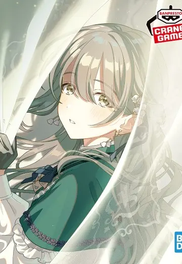 | **[学园偶像大师 氷渡香名江（暂称）](https://www.hpoi.net/hobby/139570)** 学園アイドルマスター 氷渡香名江 （暂称） 眼镜厂 · 学园偶像大师 · 氷渡香名江 比例人形 | — | 未知 |
| 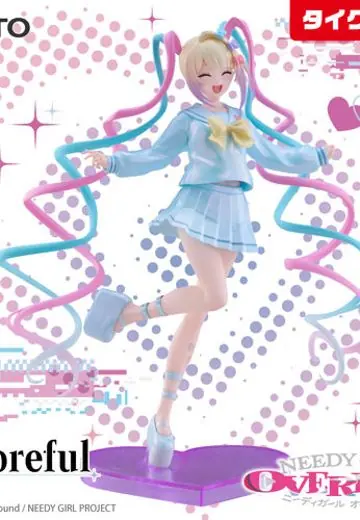 | **[Coreful 主播女孩重度依赖 超绝最可爱天使酱 TAiTO限定](https://www.hpoi.net/hobby/139567)** アニメ「NEEDY GIRL OVERDOSE」 Coreful フィギュア 超絶最かわてんしちゃん（タイクレ限定） TAiTO · 主播女孩重度依赖 · 糖糖 / 超绝最可爱天使酱 比例人形 · Coreful | — | 2026-11 |
| 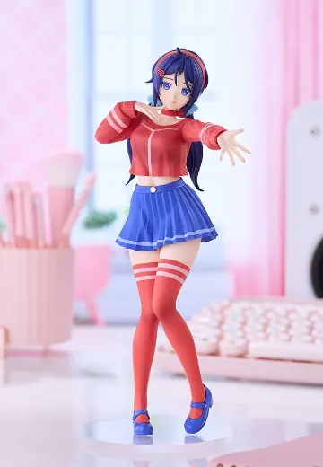 | **[POP UP PARADE 米塔 L尺寸](https://www.hpoi.net/hobby/139566)** POP UP PARADE MiSide : ミサイド ミタ L size 良笑 · 米塔 · 米塔 比例人形 · POP UP PARADE | 8,800 日元 含税，368元 | 2027-06 |
| 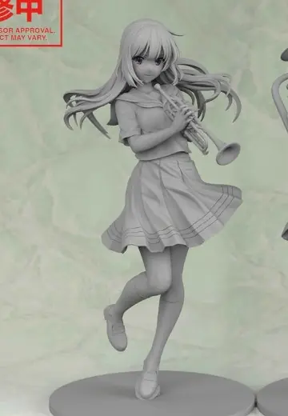 | **[最终乐章 吹响吧！上低音号 高坂丽奈](https://www.hpoi.net/hobby/139565)** 最終楽章 響け！ユーフォニアム 高坂麗奈 寿屋 · 吹响吧！上低音号 · 高坂丽奈 比例人形 | — | 未知 |
| 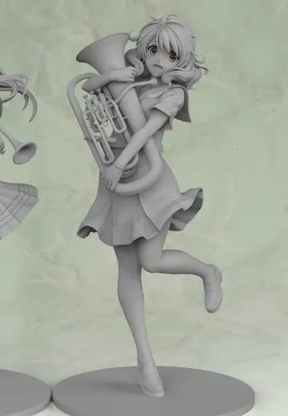 | **[最终乐章 吹响吧！上低音号 黄前久美子](https://www.hpoi.net/hobby/139564)** 最終楽章 響け！ユーフォニアム 黄前久美子 寿屋 · 吹响吧！上低音号 · 黄前久美子 比例人形 | — | 未知 |

## Good Smile 官网（24）

| 图 | 商品 | 价格 | 发售 |
|---|---|---|---|
| 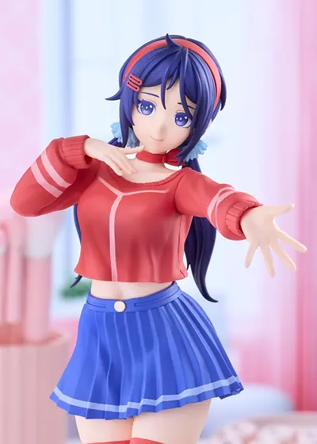 | **[POP UP PARADE ミタ L size](https://www.goodsmile.com/ja/product/1140171)** グッドスマイルカンパニー · MiSide : ミサイド POP UP PARADE · ノンスケール · 预订中 | 8,800 日元 | 未定 截订 2026-12-16 |
| 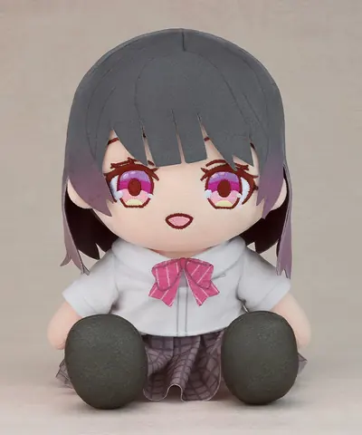 | **[ぬいぐるみ 佐藤こはる](https://www.goodsmile.com/ja/product/1147429)** グッドスマイルカンパニー · 塩対応の佐藤さんが俺にだけ甘い ぬいぐるみ · 预订中 | 4,950 日元 | 未定 截订 2026-12-16 |
| 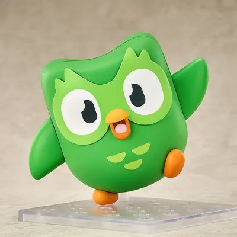 | **[ねんどろいど デュオ](https://www.goodsmile.com/ja/product/1144661)** グッドスマイルアーツ上海 · Duolingo ねんどろいど · ノンスケール · 预订中 · 附特典 | 6,800 日元 | 未定 截订 2026-12-16 |
| 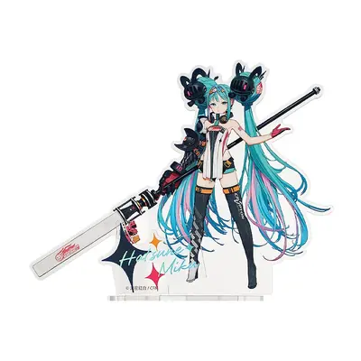 | **[初音ミク レーシングミクVer.2026 アクリルスタンド A/B/C/D/E/F/G](https://www.goodsmile.com/ja/product/1146813)** GoodSmile Moment · 初音ミク GTプロジェクト アクリルスタンド · 预订中 | 2,200 日元 | 未定 截订 2026-12-02 |
| 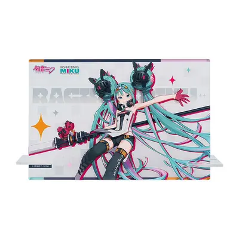 | **[初音ミク レーシングミクVer.2026 アクリルパネル A/B/C/D/E](https://www.goodsmile.com/ja/product/1146814)** GoodSmile Moment · 初音ミク GTプロジェクト その他（グッズ） · 预订中 | 2,750 日元 | 未定 截订 2026-12-02 |
| 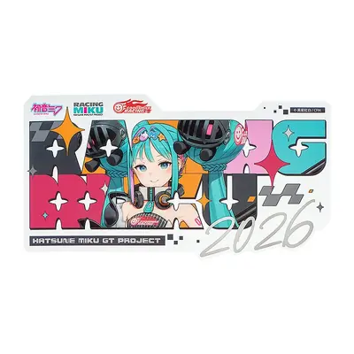 | **[初音ミク レーシングミクVer.2026 シール A/B/C/D/E/F/G](https://www.goodsmile.com/ja/product/1146819)** GoodSmile Moment · 初音ミク GTプロジェクト シール・ステッカー · 预订中 | 1,320 日元 | 未定 截订 2026-12-02 |
| 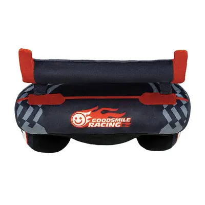 | **[初音ミク レーシングミクVer.2026 ぬいぐるみセット](https://www.goodsmile.com/ja/product/1146823)** GoodSmile Moment · 初音ミク GTプロジェクト その他（グッズ） · 预订中 | 6,160 日元 | 未定 截订 2026-12-02 |
| 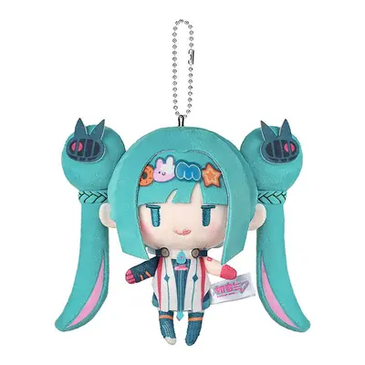 | **[初音ミク レーシングミクVer.2026 棒人間シリーズぬいぐるみストラップ A/B](https://www.goodsmile.com/ja/product/1146824)** GoodSmile Moment · 初音ミク GTプロジェクト ぬいぐるみ · 预订中 | 2,420 日元 | 未定 截订 2026-12-02 |
| 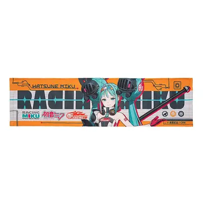 | **[初音ミク レーシングミクVer.2026 応援タオル A/B](https://www.goodsmile.com/ja/product/1146822)** GoodSmile Moment · 初音ミク GTプロジェクト その他（グッズ） · 预订中 | 1,980 日元 | 未定 截订 2026-12-02 |
| 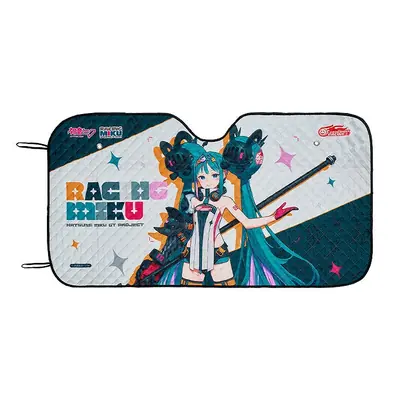 | **[初音ミク レーシングミクVer.2026 サンシェード](https://www.goodsmile.com/ja/product/1146830)** GoodSmile Moment · 初音ミク GTプロジェクト その他（グッズ） · 预订中 | 2,420 日元 | 未定 截订 2026-12-02 |
| 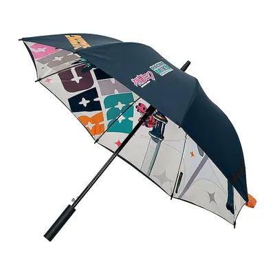 | **[初音ミク レーシングミクVer.2026 長柄傘](https://www.goodsmile.com/ja/product/1146829)** GoodSmile Moment · 初音ミク GTプロジェクト その他（グッズ） · 预订中 | 4,180 日元 | 未定 截订 2026-12-02 |
| 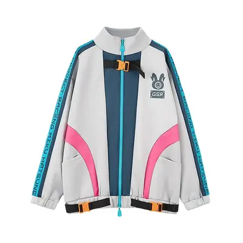 | **[初音ミク レーシングミクVer.2026 ジャージ M/L](https://www.goodsmile.com/ja/product/1146828)** GoodSmile Moment · 初音ミク GTプロジェクト アパレル（半袖Tシャツ以外） · 预订中 | 12,100 日元 | 未定 截订 2026-12-02 |
| 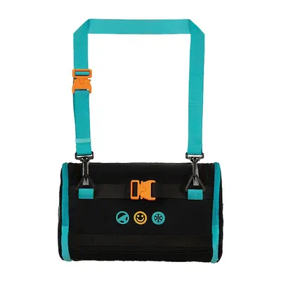 | **[初音ミク レーシングミクVer.2026 バッグ](https://www.goodsmile.com/ja/product/1146827)** GoodSmile Moment · 初音ミク GTプロジェクト その他（グッズ） · 预订中 | 6,380 日元 | 未定 截订 2026-12-02 |
| 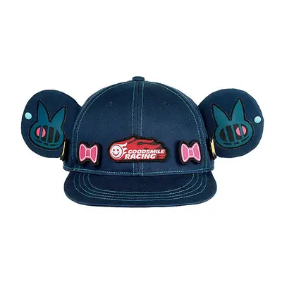 | **[初音ミク レーシングミクVer.2026 キャップ](https://www.goodsmile.com/ja/product/1146826)** GoodSmile Moment · 初音ミク GTプロジェクト その他（グッズ） · 预订中 | 4,290 日元 | 未定 截订 2026-12-02 |
| 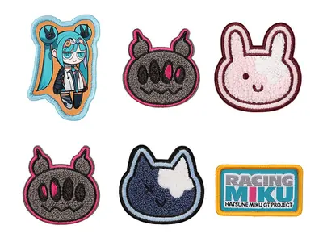 | **[初音ミク レーシングミクVer.2026 刺繍ワッペンシールセット](https://www.goodsmile.com/ja/product/1146825)** GoodSmile Moment · 初音ミク GTプロジェクト その他（グッズ） · 预订中 | 2,200 日元 | 未定 截订 2026-12-02 |
| 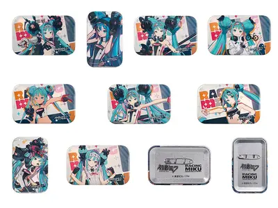 | **[初音ミク レーシングミクVer.2026 トレーディング缶バッジ](https://www.goodsmile.com/ja/product/1146812)** GoodSmile Moment · 初音ミク GTプロジェクト 缶バッジ · 预订中 | 968 日元 | 未定 截订 2026-12-02 |
|  | **[【BOX】初音ミク レーシングミクVer.2026 トレーディング缶バッジ](https://www.goodsmile.com/ja/product/1146811)** GoodSmile Moment · 初音ミク GTプロジェクト 缶バッジ · 预订中 | 8,712 日元 | 未定 截订 2026-12-02 |
|  | **[初音ミク レーシングミクVer.2026 トレーディングホログラムチケット風カード](https://www.goodsmile.com/ja/product/1146818)** GoodSmile Moment · 初音ミク GTプロジェクト その他（グッズ） · 预订中 | 605 日元 | 未定 截订 2026-12-02 |
| 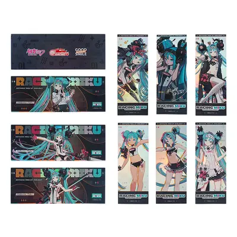 | **[【BOX】初音ミク レーシングミクVer.2026 トレーディングホログラムチケット風カード](https://www.goodsmile.com/ja/product/1146817)** GoodSmile Moment · 初音ミク GTプロジェクト その他（グッズ） · 预订中 | 5,445 日元 | 未定 截订 2026-12-02 |
| 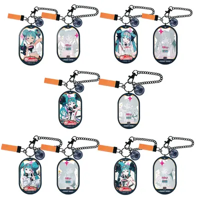 | **[初音ミク レーシングミクVer.2026 トレーディングアクリルキーホルダー](https://www.goodsmile.com/ja/product/1146821)** GoodSmile Moment · 初音ミク GTプロジェクト キーホルダー・キーチェーン · 预订中 | 1,320 日元 | 未定 截订 2026-12-02 |
|  | **[【BOX】初音ミク レーシングミクVer.2026 トレーディングアクリルキーホルダー](https://www.goodsmile.com/ja/product/1146820)** GoodSmile Moment · 初音ミク GTプロジェクト キーホルダー・キーチェーン · 预订中 | 6,600 日元 | 未定 截订 2026-12-02 |
|  | **[初音ミク レーシングミクVer.2026 トレーディングリボンストラップ](https://www.goodsmile.com/ja/product/1146816)** GoodSmile Moment · 初音ミク GTプロジェクト ストラップ · 预订中 | 1,760 日元 | 未定 截订 2026-12-02 |
| 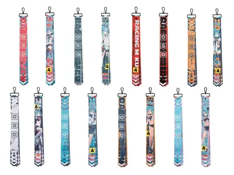 | **[【BOX】初音ミク レーシングミクVer.2026 トレーディングリボンストラップ](https://www.goodsmile.com/ja/product/1146815)** GoodSmile Moment · 初音ミク GTプロジェクト ストラップ · 预订中 | 14,080 日元 | 未定 截订 2026-12-02 |
| 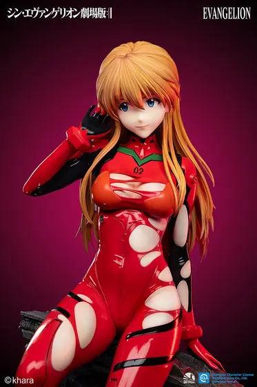 | **[Infinity Studio 『シン・エヴァンゲリオン劇場版:\|\| 』アスカ・ラングレー 1/2スケール](https://www.goodsmile.com/ja/product/1144991)** Infinity Studio · シン・エヴァンゲリオン劇場版𝄇 スケールフィギュア · 1/2 · 预订中 | 193,000 日元 | 未定 截订 2026-12-16 |

## Sofmap（11）

| 图 | 商品 | 价格 | 发售 |
|---|---|---|---|
| 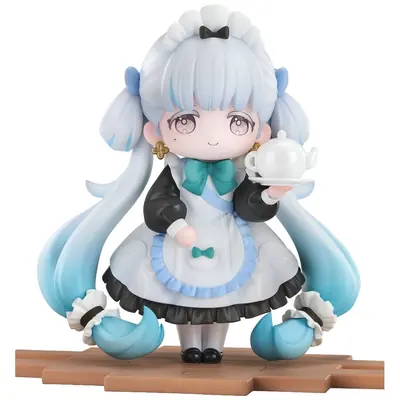 | **[鳴潮 ティータイムシリーズ デフォルメフィギュア 今汐](https://a.sofmap.com/product_detail.aspx?sku=102433862)** RIBOSE コレクション・ミニフィギュア · 预订已满 | 5,500 日元 | 2027-08 |
| 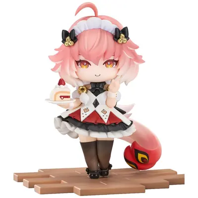 | **[鳴潮 ティータイムシリーズ デフォルメフィギュア 長離](https://a.sofmap.com/product_detail.aspx?sku=102433978)** RIBOSE コレクション・ミニフィギュア · 预订已满 | 5,500 日元 | 2027-08 |
| 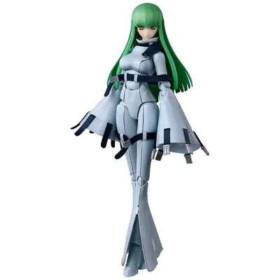 | **[S.H.Figuarts C.C.](https://a.sofmap.com/product_detail.aspx?sku=102439838)** バンダイスピリッツ フィギュアーツ · 预订中 | 8,910 日元 | 2027-07 |
| 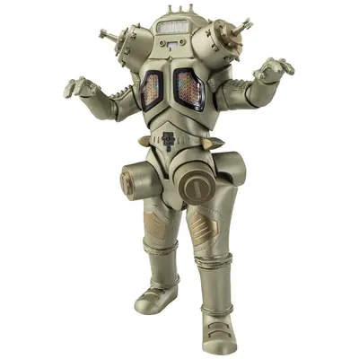 | **[S.H.Figuarts キングジョー 60th Anniversary Edition](https://a.sofmap.com/product_detail.aspx?sku=102440149)** バンダイスピリッツ フィギュアーツ · 预订中 | 10,780 日元 | 2027-08 |
| 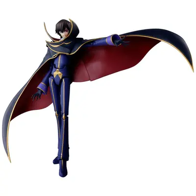 | **[S.H.Figuarts ルルーシュ-ゼロ-](https://a.sofmap.com/product_detail.aspx?sku=102439837)** バンダイスピリッツ フィギュアーツ · 预订中 | 9,900 日元 | 2027-07 |
| 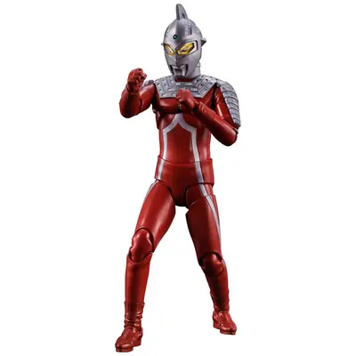 | **[S.H.Figuarts（真骨彫製法）ウルトラセブン](https://a.sofmap.com/product_detail.aspx?sku=102440069)** バンダイスピリッツ フィギュアーツ · 预订已满 | 9,700 日元 | 2027-07 |
| 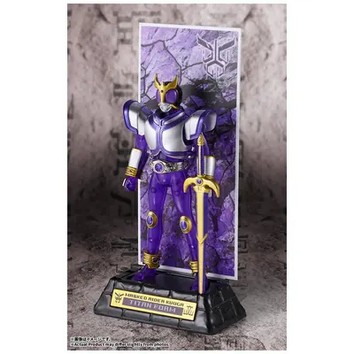 | **[装着変身 仮面ライダークウガ タイタンフォーム](https://a.sofmap.com/product_detail.aspx?sku=102440072)** バンダイスピリッツ その他 フィギュア · 预订中 | 6,540 日元 | 2027-05 |
| 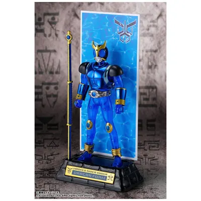 | **[装着変身 仮面ライダークウガ ドラゴンフォーム](https://a.sofmap.com/product_detail.aspx?sku=102440070)** バンダイスピリッツ その他 フィギュア · 预订中 | 6,540 日元 | 2027-04 |
| 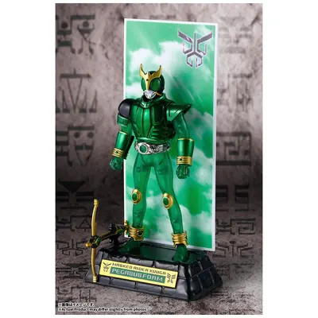 | **[装着変身 仮面ライダークウガ ペガサスフォーム](https://a.sofmap.com/product_detail.aspx?sku=102440071)** バンダイスピリッツ その他 フィギュア · 预订中 | 6,540 日元 | 2027-05 |
| 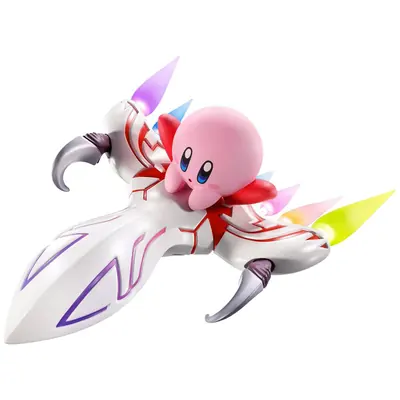 | **[超合金 カービィ＆ドラグーン](https://a.sofmap.com/product_detail.aspx?sku=102440088)** バンダイスピリッツ 超合金 · 预订中 | 16,830 日元 | 2027-05 |
| 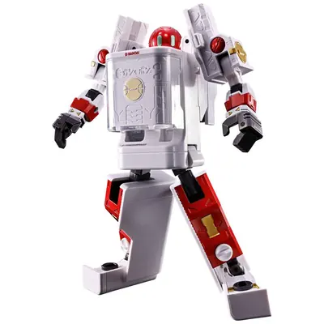 | **[超合金 ガシャポンステーションロボ](https://a.sofmap.com/product_detail.aspx?sku=102440067)** バンダイスピリッツ 超合金 · 预订中 | 9,350 日元 | 2027-04 |

## HLJ（13）

| 图 | 商品 | 价格 | 发售 |
|---|---|---|---|
| 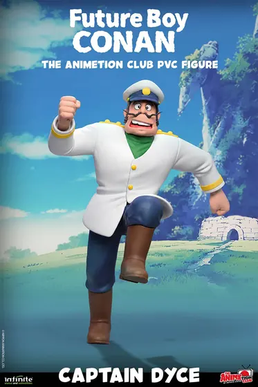 | **[Animation Club/ Future Boy Conan: Dyce Captain PVC Figure](https://www.hlj.com/animation-club-future-boy-conan-dyce-captain-pvc-figure-ifs15460)** Infinity Statue · Future Boy Conan / Conan the Boy in Future 预订中 | 5,600 日元 | 2027-10 |
|  | **[POP UP PARADE Mita L size (MiSide)](https://www.hlj.com/pop-up-parade-mita-l-size-miside-gsc59607)** Good Smile Company · MiSide 预订中 | 8,000 日元 | 2027-06 |
| 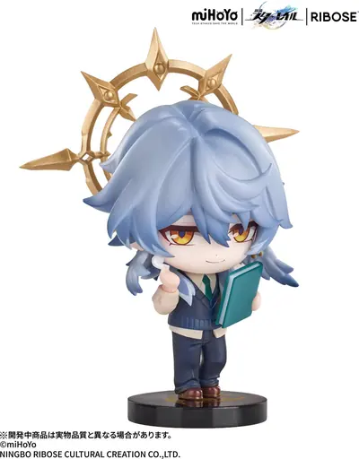 | **[Honkai: Star Rail: Nameless Honor VOL.3 Sunday](https://www.hlj.com/honkai-star-rail-nameless-honor-vol-3-sunday-rbs86283)** RIBOSE · Honkai: Star Rail 预订中 | 2,400 日元 | 2027-09 |
| 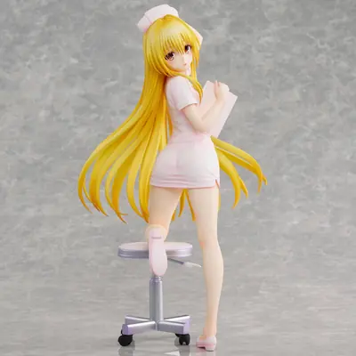 | **[To Love-Ru Darkness: Konjiki no Yami Nurse Ver.](https://www.hlj.com/to-love-ru-darkness-konjiki-no-yami-nurse-ver-unc71878)** Union Creative · To Love-Ru 预订中 | 20,000 日元 | 2027-08 |
|  | **[Animation Club/ Future Boy Conan: Jimsy PVC Figure](https://www.hlj.com/animation-club-future-boy-conan-jimsy-pvc-figure-ifs15458)** Infinity Statue · Future Boy Conan / Conan the Boy in Future 预订中 | 5,600 日元 | 2027-10 |
|  | **[1/2 Infinity Studio Rebuild of Evangelion Asuka Langley](https://www.hlj.com/1-2-scale-infinity-studio-rebuild-of-evangelion-asuka-langley-iso32289)** Infinity Studio · Rebuild of Evangelion 1/2 · 预订中 | 175,455 日元 | 2027-08 |
|  | **[Honkai: Star Rail: Nameless Honor VOL.3 Robin](https://www.hlj.com/honkai-star-rail-nameless-honor-vol-3-robin-rbs86282)** RIBOSE · Honkai: Star Rail 预订中 | 2,400 日元 | 2027-09 |
|  | **[1/7 Azur Lane: Chapayev Melody of the White Cavalier Ver.](https://www.hlj.com/1-7-scale-azur-lane-chapayev-melody-of-the-white-cavalier-ver-aex42356)** APEX · Azur Lane 1/7 · 预订中 | 26,000 日元 | 2027-10 |
|  | **[Animation Club/ Future Boy Conan: Conan PVC Figure](https://www.hlj.com/animation-club-future-boy-conan-conan-pvc-figure-ifs15457)** Infinity Statue · Future Boy Conan / Conan the Boy in Future 预订中 | 5,600 日元 | 2027-10 |
|  | **[Animation Club/ Future Boy Conan: Conan &amp; Lana PVC Figure](https://www.hlj.com/animation-club-future-boy-conan-conan-lana-pvc-figure-ifs15459)** Infinity Statue · Future Boy Conan / Conan the Boy in Future 预订中 | 5,600 日元 | 2027-10 |
|  | **[Honkai: Star Rail: Anaxa Chibi Chara Yurayura Stand](https://www.hlj.com/honkai-star-rail-anaxa-chibi-chara-yurayura-stand-aex42355)** APEX · Honkai: Star Rail 预订中 | 3,000 日元 | 2027-09 |
|  | **[1/7 Arknights: Mizuki](https://www.hlj.com/1-7-scale-arknights-mizuki-aex42357)** APEX · Arknights 1/7 · 预订中 | 24,500 日元 | 2027-10 |
|  | **[Jujutsu Kaisen Kogane Night Light](https://www.hlj.com/jujutsu-kaisen-kogane-night-light-sue81290)** SUNRISEPOP · Jujutsu Kaisen 预订中 | 3,050 日元 | 2027-03 |

## Solaris Japan（29）

| 图 | 商品 | 价格 | 发售 |
|---|---|---|---|
|  | **[To LOVEru Darkness - Konjiki no Yami - Nurse Cosplay (Union Creative International Ltd)](https://solarisjapan.com/products/to-loveru-darkness-konjiki-no-yami-nurse-cosplay-union-creative-international-ltd)** Union Creative International Ltd · To LOVEru Darkness · Konjiki no Yami 预订中 | 129 美元 | 2027-08 |
|  | **[MiSide - Mita - Pop Up Parade - L (Good Smile Company)](https://solarisjapan.com/products/miside-mita-pop-up-parade-l-good-smile-company)** Good Smile Company · MiSide · Mita 预订中 | 46 美元 | 2027-06 |
|  | **[Kimetsu no Yaiba - Kaigaku (Claynel)](https://solarisjapan.com/products/kimetsu-no-yaiba-kaigaku-claynel)** Claynel · Demon Slayer: Kimetsu no Yaiba · Kaigaku 预订中 | 40 美元 | 2027-08 |
|  | **[Magic Knight Rayearth - Shidou Hikaru (Sentinel)](https://solarisjapan.com/products/magic-knight-rayearth-shidou-hikaru-sentinel)** Sentinel · Magic Knight Rayearth · Shidou Hikaru Action · 预订中 | 89 美元 | 2027-05 |
|  | **[Magic Knight Rayearth - Ryuuzaki Umi (Sentinel)](https://solarisjapan.com/products/magic-knight-rayearth-ryuuzaki-umi-sentinel)** Sentinel · Magic Knight Rayearth · Ryuuzaki Umi Action · 预订中 | 89 美元 | 2027-06 |
|  | **[Magic Knight Rayearth - Hououji Fuu (Sentinel)](https://solarisjapan.com/products/magic-knight-rayearth-hououji-fuu-sentinel)** Sentinel · Magic Knight Rayearth · Hououji Fuu Action · 预订中 | 89 美元 | 2027-07 |
|  | **[Honkai: Star Rail - Robin - Honkai: Star Rail Nameless' Guest Medal Series (Vol. 3) - Q Version (Ribose)](https://solarisjapan.com/products/honkai-star-rail-robin-honkai-star-rail-nameless-guest-medal-series-vol-3-q-version-ribose)** Ribose · Honkai: Star Rail · Robin 预订中 | 16 美元 | 2027-09 |
|  | **[Honkai: Star Rail - Sunday - Honkai: Star Rail Nameless' Guest Medal Series (Vol. 3) - Q Version (Ribose)](https://solarisjapan.com/products/honkai-star-rail-sunday-honkai-star-rail-nameless-guest-medal-series-vol-3-q-version-ribose)** Ribose · Honkai: Star Rail · Sunday 预订中 | 16 美元 | 2027-09 |
|  | **[Duolingo - Duo - Nendoroid (#3187) (Good Smile Arts Shanghai, Good Smile Company)](https://solarisjapan.com/products/duolingo-duo-nendoroid-3187-good-smile-arts-shanghai-good-smile-company)** Good Smile Company · Duolingo · Duolingo Nendoroid · 预订中 | 38 美元 | 2027-06 |
|  | **[Evangelion Shin Gekijouban - Souryuu Asuka Langley - 1/2 (Infinity Studio)](https://solarisjapan.com/products/evangelion-shin-gekijouban-souryuu-asuka-langley-1-2-infinity-studio)** Infinity Studio · Evangelion Shin Gekijouban · Souryuu Asuka Langley 1/2 · 预订中 | 1,170 美元 | 2027-08 |
|  | **[Goddess of Victory: Nikke - Blanc - 1/7 - Fortune Express (Good Smile Arts Shanghai, Good Smile Company)](https://solarisjapan.com/products/goddess-of-victory-nikke-blanc-1-7-fortune-express-good-smile-arts-shanghai-good-smile-company)** Good Smile Arts Shanghai · Goddess of Victory: Nikke · Blanc 1/7 · 预订中 | 163 美元 | 2027-12 |
|  | **[Hololive - Shirogane Noel - 1/7 (Phat Company)](https://solarisjapan.com/products/hololive-shirogane-noel-1-7-phat-company)** Phat Company · Hololive · Shirogane Noel 1/7 · 预订中 | 175 美元 | 2027-06 |
|  | **[Arknights - Ch'en - 1/7 - The Dawnstreak, Elite 2 Ver. (Good Smile Arts Shanghai, Good Smile Company)](https://solarisjapan.com/products/arknights-chen-1-7-the-dawnstreak-elite-2-ver-good-smile-arts-shanghai-good-smile-company)** Good Smile Arts Shanghai · Arknights · Ch'en 1/7 · 预订中 | 197 美元 | 2028-03 |
|  | **[Sono Bisque Doll wa Koi o Suru 2 - Kitagawa Marin - 1/6 - Izayoi Arisa Ver. (Bell Fine)](https://solarisjapan.com/products/sono-bisque-doll-wa-koi-o-suru-2-kitagawa-marin-1-6-izayoi-arisa-ver-bell-fine)** Bellfine · Sono Bisque Doll wa Koi o Suru 2 · Marin Kitagawa 1/6 · 预订中 | 149 美元 | 2027-02 |
|  | **[Yosuga no Sora - Kasugano Sora - 1/7 - Elegant China Style Ver (Alter)](https://solarisjapan.com/products/yosuga-no-sora-kasugano-sora-1-7-elegant-china-style-ver-alter)** Alter · Yosuga no Sora · Sora Kasugano 1/7 · 预订中 | 160 美元 | 2027-10 |
|  | **[Original - Nemutai Mahou Shoujo Mitsuki - 1/6 (Eusun)](https://solarisjapan.com/products/original-nemutai-mahou-shoujo-mitsuki-1-6-eusun)** Eusun · Original · Nemutai Mahou Shoujo Mitsuki 1/6 · 预订中 | 116 美元 | 2027-12 |
|  | **[One Piece - Nami - Portrait of Pirates “Elevated Boost” (MegaHouse)](https://solarisjapan.com/products/one-piece-nami-portrait-of-pirates-elevated-boost-megahouse)** MegaHouse · One Piece · Nami 预订中 | 116 美元 | 2027-05 |
|  | **[Azur Lane - Anchorage - Manjuu - 1/6 - A Drink with a Ship (Luminous Box)](https://solarisjapan.com/products/azur-lane-anchorage-manjuu-1-6-a-drink-with-a-ship-luminous-box)** Luminous Box · Azur Lane · Anchorage 1/6 · 预订中 · 成人向 | 169 美元 | 2027-12 |
|  | **[Azur Lane - Manjuu - Unzen - 1/6 - A Drink with a Ship (Luminous Box)](https://solarisjapan.com/products/azur-lane-manjuu-unzen-1-6-a-drink-with-a-ship-luminous-box)** Luminous Box · Azur Lane · Unzen 1/6 · 预订中 · 成人向 | 169 美元 | 2027-12 |
|  | **[Original - Crossdressing Bunny Noel-kun - 1/5 (Insight)](https://solarisjapan.com/products/original-crossdressing-bunny-noel-kun-1-5-insight)** Insight · Original 1/5 · 预订中 · 成人向 | 145 美元 | 2027-05 |
|  | **[Chaos Zero Nightmare - Mei Lin - Nendoroid (#3148) (Good Smile Arts Shanghai, Good Smile Company)](https://solarisjapan.com/products/chaos-zero-nightmare-mei-lin-nendoroid-3148-good-smile-arts-shanghai-good-smile-company)** Good Smile Arts Shanghai · Chaos Zero Nightmare · Mei Lin Nendoroid · 预订中 | 49 美元 | 2027-06 |
|  | **[Arknights: Endfield - Gilberta - Nendoroid (#3152) (Good Smile Arts Shanghai, Good Smile Company)](https://solarisjapan.com/products/arknights-endfield-gilberta-nendoroid-3152-good-smile-arts-shanghai-good-smile-company)** Good Smile Arts Shanghai · Arknights: Endfield · Gilberta Nendoroid · 预订中 | 49 美元 | 2027-07 |
|  | **[Blue Archive - Tendou Kei - Nendoroid (#3182) (Good Smile Company)](https://solarisjapan.com/products/blue-archive-tendou-kei-nendoroid-3182-good-smile-company)** Good Smile Company · Blue Archive · Tendou Kei Nendoroid · 预订中 | 43 美元 | 2027-04 |
|  | **[Final Fantasy XIV - Emet-Selch - Nendoroid (#3194) (Good Smile Company)](https://solarisjapan.com/products/final-fantasy-xiv-emet-selch-nendoroid-3194-good-smile-company)** Good Smile Company · Final Fantasy XIV · Emet-Selch Nendoroid · 预订中 | 44 美元 | 2027-06 |
|  | **[Rakuen Tsuihou: Kokoro no Resonance - Gabriel Faulkner - Nendoroid (#3206) (Good Smile Arts Shanghai, Good Smile Company)](https://solarisjapan.com/products/rakuen-tsuihou-kokoro-no-resonance-gabriel-faulkner-nendoroid-3206-good-smile-arts-shanghai-good-smile-company)** Good Smile Arts Shanghai · Rakuen Tsuihou: Kokoro no Resonance · Gabriel Faulkner Nendoroid · 预订中 | 38 美元 | 2027-05 |
|  | **[Love and Deepspace - Caleb - Nendoroid (#3030) (Good Smile Arts Shanghai, Good Smile Company)](https://solarisjapan.com/products/love-and-deepspace-caleb-nendoroid-3030-good-smile-arts-shanghai-good-smile-company)** Good Smile Company · Love and Deepspace · Caleb Nendoroid · 预订中 | 40 美元 | 2027-04 |
|  | **[Arknights - Lappland - Nendoroid (#1598) - 2027 Re-release (Good Smile Arts Shanghai, Good Smile Company)](https://solarisjapan.com/products/arknights-lappland-nendoroid-1598-2027-re-release-good-smile-arts-shanghai-good-smile-company)** Good Smile Arts Shanghai · Arknights · Lappland Nendoroid · 预订中 | 43 美元 | 2027-05 |
|  | **[Monster Hunter - Otomo Airou - Nendoroid (#3113-DX) - Rathalos Armor Ver., DX (Good Smile Company)](https://solarisjapan.com/products/monster-hunter-otomo-airou-nendoroid-3113-dx-rathalos-armor-ver-dx-good-smile-company)** Good Smile Company · Monster Hunter · Otomo Airou Nendoroid · 预订中 | 54 美元 | 2027-06 |
|  | **[Monster Hunter - Otomo Airou - Nendoroid (#3113) - Rathalos Armor Ver. (Good Smile Company)](https://solarisjapan.com/products/monster-hunter-otomo-airou-nendoroid-3113-rathalos-armor-ver-good-smile-company)** Good Smile Company · Monster Hunter · Otomo Airou Nendoroid · 预订中 | 44 美元 | 2027-06 |
