# 2026-11-19 手办新品

共 30 件（HPOI 21 · Good Smile 官网 1 · HLJ 4 · Solaris Japan 4）。点名称打开原页面。

## HPOI（21）

| 图 | 商品 | 价格 | 发售 |
|---|---|---|---|
| 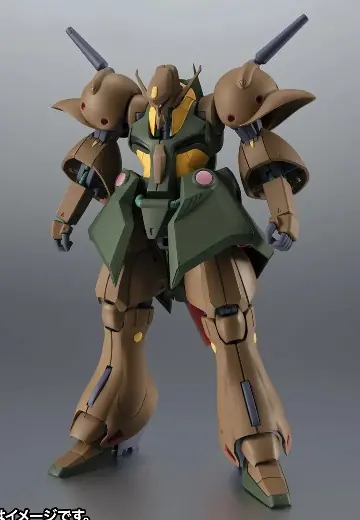 | **[ROBOT魂 ＜SIDE MS＞ RX-110 ガブスレイ ver. A.N.I.M.E.](https://www.hpoi.net/hobby/139746)** ROBOT魂 ＜SIDE MS＞ RX-110 ガブスレイ ver. A.N.I.M.E. 比例人形 | — | 未知 |
|  | **[Fashion 初音未来 户外时装（Taito线上娃娃机限定）](https://www.hpoi.net/hobby/139744)** 初音ミク Fashion フィギュア Outdoor（タイクレ限定） 比例人形 | — | 未知 |
| 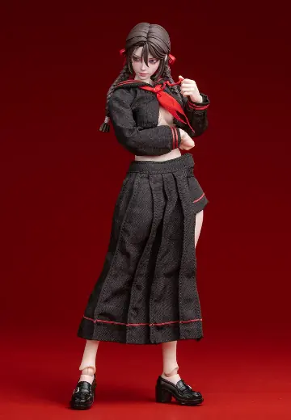 | **[不良少女 鬼冢风子](https://www.hpoi.net/hobby/139734)** Romankey SENKI系列 1/12可动人偶 不良少女 鬼冢风子 Romankey 比例人形 · 1/12 | 439 元 | 2027年第二季度 |
| 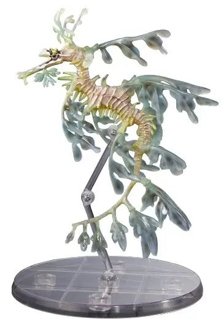 | **[生物大图鉴豪华版 叶海龙 蓝色版](https://www.hpoi.net/hobby/139731)** いきもの大図鑑プレミアム リーフィーシードラゴン リバイスドブルー 万代 其它 · 生物大图鉴系列 | 4,950 日元 含税，207元 | 2027-03 |
| 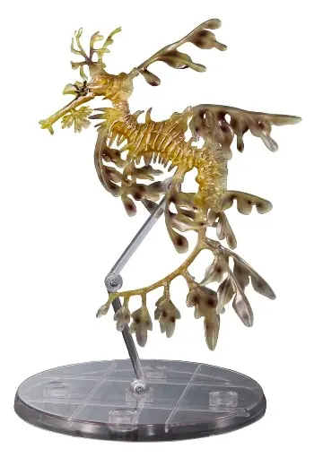 | **[生物大图鉴豪华版 叶海龙 黄色版](https://www.hpoi.net/hobby/139730)** いきもの大図鑑プレミアム リーフィーシードラゴン リバイスドイエロー 万代 其它 · 生物大图鉴系列 | 4,950 日元 含税，207元 | 2027-03 |
| 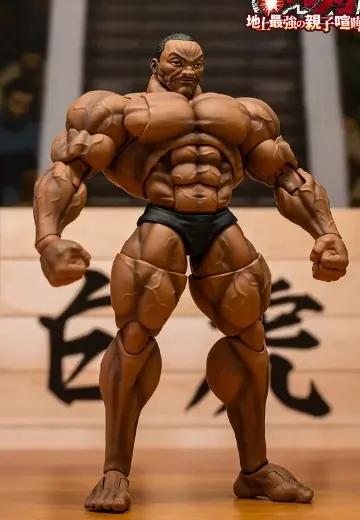 | **[STORM ARENA 比斯凯特・奥利巴](https://www.hpoi.net/hobby/139725)** BISCUIT OLIVA - BAKI HANMA - STORM ARENA 1/12TH Storm Collectibles · 刃牙 · 比斯凯特·奥利巴 比例人形 · STORM ARENA · 1/12 | 30 美元 | 2027-06 |
| 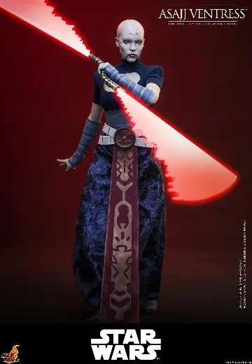 | **[TMS196 《星球大战：克隆人战争》阿萨吉·文崔斯](https://www.hpoi.net/hobby/139724)** Star Wars: The Clone Wars™ - 1/6th scale Asajj Ventress™ Collectible Figure Hot Toys · 星球大战：克隆人战争 比例人形 · 电视杰作系列 · 1/6 | 1,680 元 | 2027年第四季度 |
| 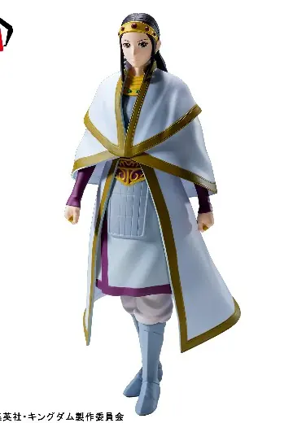 | **[王者天下 摎](https://www.hpoi.net/hobby/139723)** キングダム 摎フィギュア 眼镜厂 · 王者天下 · 摎 比例人形 | — | 2026-11 |
| 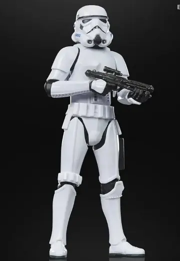 | **[黑色系列 星球大战：新希望 50周年 帝国冲锋队](https://www.hpoi.net/hobby/139722)** STAR WARS BLACK SERIES STORMTROOPER 孩之宝 · 星球大战4：新希望、星球大战 · 帝国冲锋队员 比例人形 · 黑标系列 · 1/12 | 29 美元 | 2027年第一季度 |
| 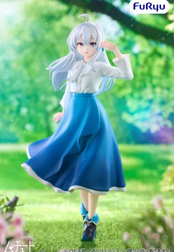 | **[Muchute 魔女之旅 伊蕾娜 优雅蓝](https://www.hpoi.net/hobby/139721)** 魔女の旅々 ムチュートフィギュアーイレイナ・Elegant Blue ver.ー FuRyu · 魔女之旅 · 伊蕾娜 比例人形 · Muchute | — | 2027-05 |
| 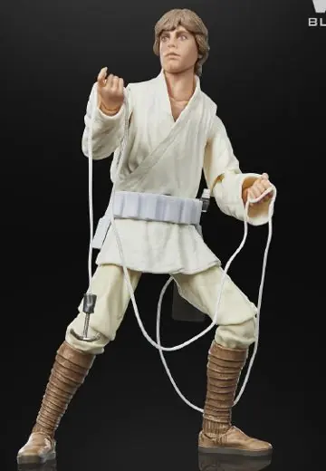 | **[黑色系列 星球大战：新希望 50周年 卢克·天行者](https://www.hpoi.net/hobby/139720)** STAR WARS BLACK SERIES LUKE SKYWALKER 孩之宝 · 星球大战4：新希望、星球大战 · 卢克·天行者 比例人形 · 黑标系列 · 1/12 | 29 美元 | 2027年第一季度 |
| 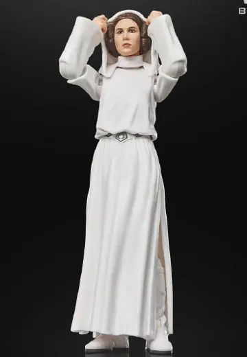 | **[黑色系列 星球大战：新希望 50周年 莱娅·奥加纳公主](https://www.hpoi.net/hobby/139719)** STAR WARS BLACK SERIES PRINCESS LEIA ORGANA 孩之宝 · 星球大战4：新希望、星球大战 · 莱娅·奥加纳 比例人形 · 黑标系列 · 1/12 | 29 美元 | 2027年第一季度 |
| 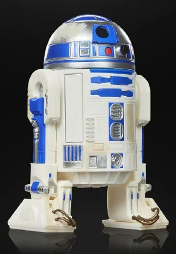 | **[黑色系列 星球大战：新希望 50周年](https://www.hpoi.net/hobby/139718)** STAR WARS BLACK SERIES ARTOO-DETOO (R2-D2) 孩之宝 · 星球大战、星球大战4：新希望 · R2-D2 比例人形 · 黑标系列 · 1/12 | 29 美元 | 2027年第一季度 |
|  | **[尼尔：自动人形（动画版）2B 与 9S](https://www.hpoi.net/hobby/139716)** NieR:Automata Ver1.1a 1/7スケールフィギュア 2B/9S SSF · 尼尔：自动人形（动画版） · 9S（寄叶九号S型）、2B（寄叶二号B型） 比例人形 · 1/7 | 37,400 日元 含税，1566元 | 2027-08 |
| 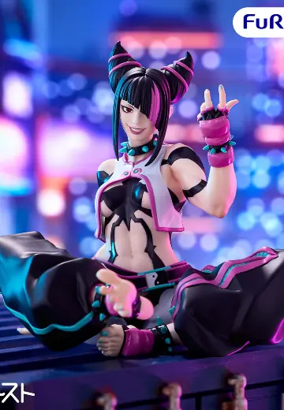 | **[压泡面 街头霸王6 蛛俐](https://www.hpoi.net/hobby/139715)** ストリートファイター6 ぬースト ジュリ FuRyu · 街霸6 · 蛛俐 比例人形 | — | 2027-06 |
| 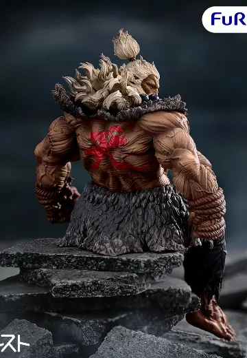 | **[压泡面 街头霸王6 豪鬼](https://www.hpoi.net/hobby/139714)** ストリートファイター6 ぬースト 豪鬼 FuRyu · 街霸6 · 豪鬼 比例人形 · 泡面压 | — | 2027-05 |
| 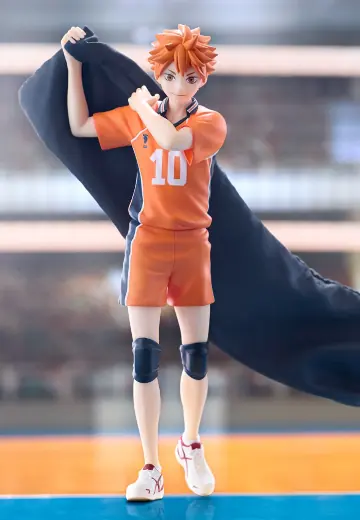 | **[Muchute 排球少年!! 日向翔阳](https://www.hpoi.net/hobby/139713)** ムチュートフィギュア アニメ「ハイキュー!!」 日向翔陽 FuRyu · 排球少年!! · 日向翔阳 比例人形 · Muchute | — | 未知 |
|  | **[胜利女神：新的希望 玛丽安：女王 最后的爱恋](https://www.hpoi.net/hobby/139712)** 勝利の女神:NIKKE「マリアン: Queen – Last Affection」 良笑塑美 · 胜利女神：新的希望 · 玛丽安 比例人形 | — | 未知 |

旧品补录 3 件：HPOI 新收录、但早已发售的老商品

| 图 | 商品 | 价格 | 发售 |
|---|---|---|---|
| 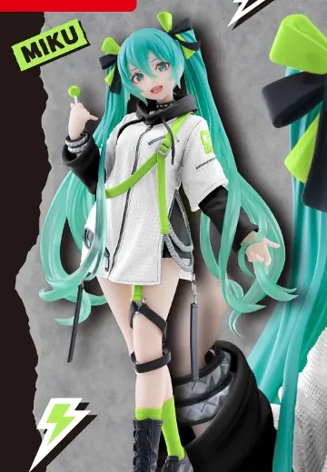 | **[Fashion 初音未来 朋克时装（Taito线上娃娃机限定）](https://www.hpoi.net/hobby/139743)** 初音ミク Fashion フィギュア Punk（タイクレ限定） TAiTO · piapro · 初音未来 比例人形 · Fashion · 旧品补录 | — | 2024-11 |
| 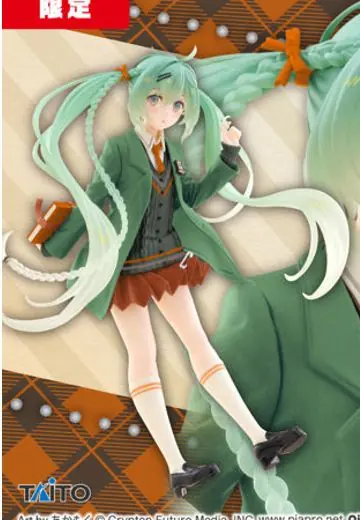 | **[Fashion 初音未来 学院派（Taito线上娃娃机限定）](https://www.hpoi.net/hobby/139742)** 初音ミク Fashion フィギュア Preppy（タイクレ限定） TAiTO · piapro · 初音未来 比例人形 · Fashion · 旧品补录 | — | 2025-07 |
| 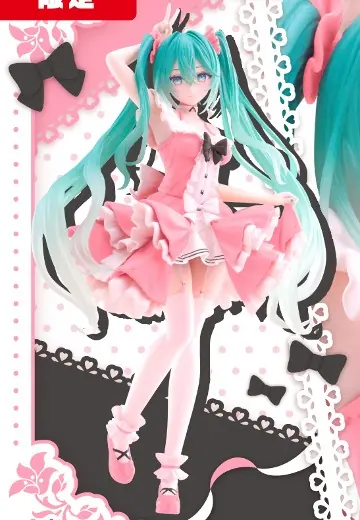 | **[Fashion 初音未来 洛丽塔 （Taito线上娃娃机限定）](https://www.hpoi.net/hobby/139741)** 初音ミク Fashion フィギュア Lolita（タイクレ限定） TAiTO · piapro · 初音未来 比例人形 · Fashion · 旧品补录 | — | 2024-06 |

## Good Smile 官网（1）

| 图 | 商品 | 价格 | 发售 |
|---|---|---|---|
| 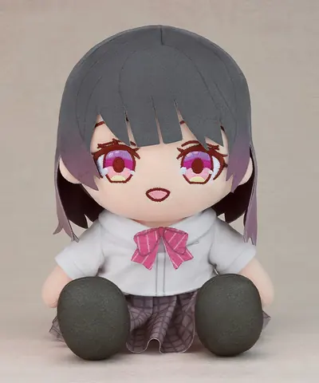 | **[ぬいぐるみ 佐藤こはる](https://www.goodsmile.com/ja/product/1147554)** グッドスマイルカンパニー · 塩対応の佐藤さんが俺にだけ甘い ぬいぐるみ · 预订中 | 4,950 日元 | 未定 截订 2026-12-16 |

## HLJ（4）

| 图 | 商品 | 价格 | 发售 |
|---|---|---|---|
| 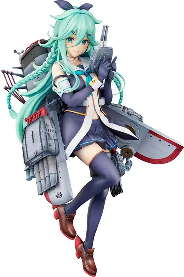 | **[1/7 Kantai Collection -Kancolle-: Yamakaze Kai Ni](https://www.hlj.com/1-7-scale-kantai-collection-kancolle-yamakaze-kai-ni-qsq84347)** Ques Q · Fleet Collection / Kancolle 1/7 · 预订中 | 29,800 日元 | 2027-11 |
| 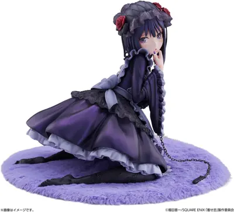 | **[1/4 My Dress-Up Darling: Marin Kitagawa -Shizuku Kuroe Ver.-](https://www.hlj.com/1-4-scale-my-dress-up-darling-marin-kitagawa-shizuku-kuroe-ver-erm33301)** Cyberagent · My Dress-Up Darling 1/4 · 预订中 | 35,000 日元 | 2027-08 |
| 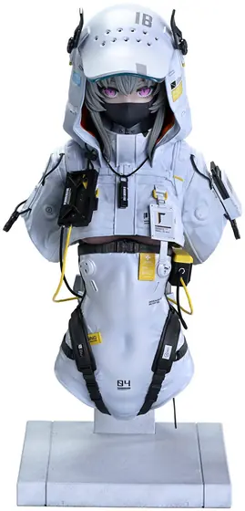 | **[1/2 Concept Masterline Flower Imitation. N/DOLL](https://www.hlj.com/1-2-scale-concept-masterline-flower-imitation-n-doll-prs12461)** Prime 1 Studio · Flower Imitation. 1/2 · 预订中 | 154,900 日元 | 2028-05 |
| 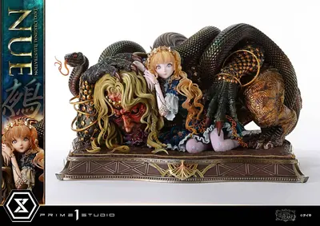 | **[1/5 The Legend of Beauty and the Beast Taiki Original Illustration Nue](https://www.hlj.com/1-5-scale-the-legend-of-beauty-and-the-beast-taiki-original-illustration-nue-prs12608)** Prime 1 Studio · Original Character 1/5 · 预订中 | 236,900 日元 | 2028-05 |

## Solaris Japan（4）

| 图 | 商品 | 价格 | 发售 |
|---|---|---|---|
|  | **[Isekai Ryokou no Techou (05) - Duck Killer Amy Becker (PR\_Production)](https://solarisjapan.com/products/isekai-ryokou-no-techou-05-duck-killer-amy-becker-pr_production)** PR-Production · Isekai Ryokou no Techou (05) · Duck Killer Amy Becker Model Kit · 预订中 | 17 美元 | 2027-02 |
|  | **[Original - Chuhon - 1/6 (B'full FOTS JAPAN)](https://solarisjapan.com/products/original-chuhon-1-6-bfull-fots-japan)** B'full FOTS JAPAN · Original · Chuhon 1/6 · 预订中 · 成人向 | 133 美元 | 2027-05 |
|  | **[Original - Chuhon - 1/6 (Insight)](https://solarisjapan.com/products/original-chuhon-1-6-insight)** Insight · Original · Chuhon 1/6 · 预订中 · 成人向 | 133 美元 | 2027-05 |
|  | **[Bonyuu-chan wa Dashitai. - Sakurazawa Tomomi - Creator's Collection - 1/4 - Bunny Ver (BINDing, Native) \[Shop Exclusive\]](https://solarisjapan.com/products/bonyuu-chan-wa-dashitai-sakurazawa-tomomi-creators-collection-1-4-bunny-ver-binding-native-shop-exclusive)** BINDing · Bonyuu-chan wa Dashitai. · Sakurazawa Tomomi 1/4 · 成人向 | 0 美元 | 2027-05 |
