# 2026-11-20 手办新品

共 42 件（HPOI 21 · HLJ 12 · Solaris Japan 9）。点名称打开原页面。

## HPOI（21）

| 图 | 商品 | 价格 | 发售 |
|---|---|---|---|
| 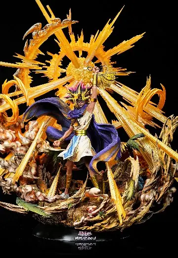 | **[游戏王 怪兽之决斗 阿图姆](https://www.hpoi.net/hobby/139827)** 游戏王 怪兽之决斗 阿图姆 神秘工作室 · 游戏王、游戏王 怪兽之决斗 · 武藤游戏、暗游戏 比例人形 · 1/6 | 5,288 元 | 2027-09 |
| 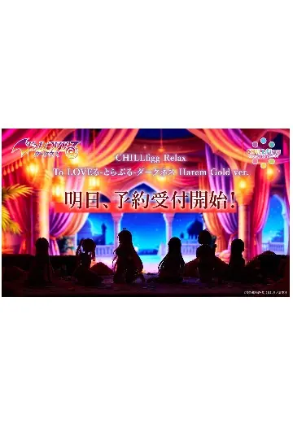 | **[CHILLfigg Relax 出包王女DARKNESS Harem Gold](https://www.hpoi.net/hobby/139822)** CHILLfigg Relax To LOVEる-とらぶる-ダークネス Harem Gold ver. VISION · 出包王女DARKNESS 比例人形 · CHILLfigg | — | 未知 |
| 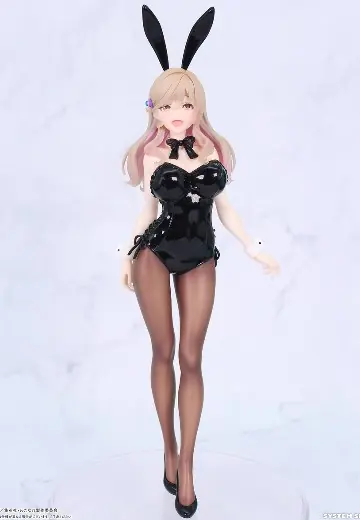 | **[Vivit 我们不可能成为恋人！绝对不行。（※似乎可行!？） 濑名紫阳花 兔女郎](https://www.hpoi.net/hobby/139817)** わたしが恋人になれるわけないじゃん、ムリムリ!（※ムリじゃなかった!?）Vivit フィギュア 瀬名 紫陽花 バニーVer System Service · 我们不可能成为恋人！绝对不行。（※似乎可行!？） · 濑名紫阳花 比例人形 · Vivit | — | 2027-05 |
| 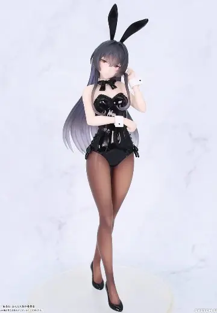 | **[Vivit 我们不可能成为恋人！绝对不行。（※似乎可行!？）琴纱月 兔女郎](https://www.hpoi.net/hobby/139814)** わたしが恋人になれるわけないじゃん、ムリムリ!（※ムリじゃなかった!?）Vivit フィギュア 琴 紗月 バニーVer System Service · 我们不可能成为恋人！绝对不行。（※似乎可行!？） · 琴纱月 比例人形 · Vivit | — | 2027-04 |
| 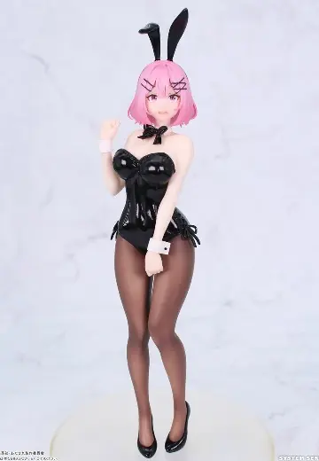 | **[Vivit 我们不可能成为恋人！绝对不行。（※似乎可行!？）甘织玲奈子 兔女郎](https://www.hpoi.net/hobby/139813)** わたしが恋人になれるわけないじゃん、ムリムリ!（※ムリじゃなかった!?）Vivit フィギュア 甘織 れな子 バニーVer System Service · 我们不可能成为恋人！绝对不行。（※似乎可行!？） · 甘织玲奈子 比例人形 · Vivit | — | 2027-03 |
| 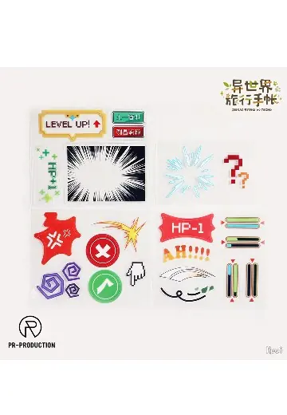 | **[异世界旅行手帐 玩法拓展包 气泡支架TypeB](https://www.hpoi.net/hobby/139796)** 异世界旅行手帐 玩法拓展包 气泡支架TypeB PR-PRODUCTION 配件 · 异世界旅行手帐 | 15 元 | 2027年第一季度 |
| 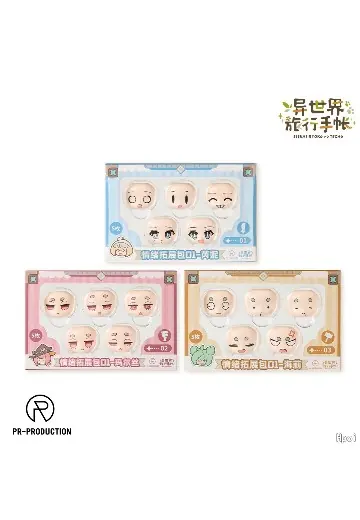 | **[异世界旅行手帐 情绪拓展包01](https://www.hpoi.net/hobby/139794)** 异世界旅行手帐 情绪拓展包01 PR-PRODUCTION 配件 · 异世界旅行手帐 | 20 元 | 2027-03 |
| 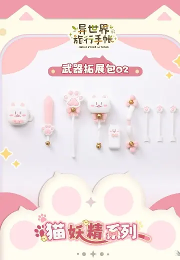 | **[异世界旅行手帐 武器拓展包02 猫妖精系列](https://www.hpoi.net/hobby/139792)** 异世界旅行手帐 武器拓展包02 猫妖精系列 PR-PRODUCTION 配件 · 异世界旅行手帐 | 45 元 | 2027年第一季度 |
| 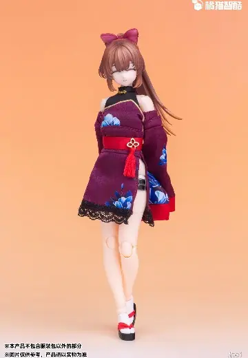 | **[GM-N-008 月下蓝棠 宽袖改良和服服装包](https://www.hpoi.net/hobby/139787)** 1/12 GM-N-008 月下蓝棠 宽袖改良和服服装包 6 寸机娘服装包 GOOMOO 橘猫智酷 配件 · 1/12 | 118 元 | 2027年第一季度 |
| 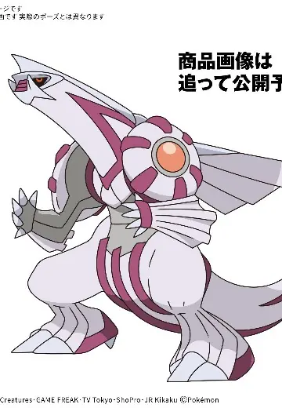 | **[宝可梦拼装模型 No.5 特选系列 65 帕路奇亚](https://www.hpoi.net/hobby/139779)** ポケモンプラモコレクション 65 セレクトシリーズ パルキア BANDAI SPIRITS · 宝可梦 · 帕路奇亚 生物/幻灵 · 宝可梦拼装模型收藏、宝可梦拼装模型收藏 特选系列 | 2,970 日元 含税，124元 | 2027-06 |
| 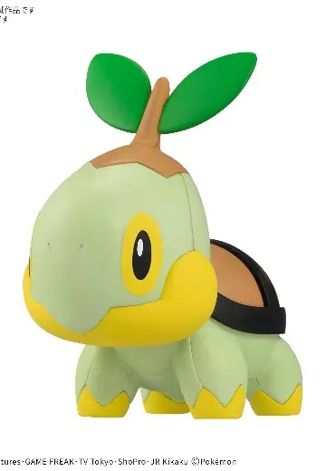 | **[宝可梦组装模型 快快拼系列！！31 草苗龟](https://www.hpoi.net/hobby/139778)** ポケモンプラモコレクション クイック!! 31 ナエトル BANDAI SPIRITS · 宝可梦 · 草苗龟 生物/幻灵 · 宝可梦拼装模型收藏 快快拼！！、宝可梦拼装模型收藏 | 858 日元 含税，35元 | 2027-04 |
| 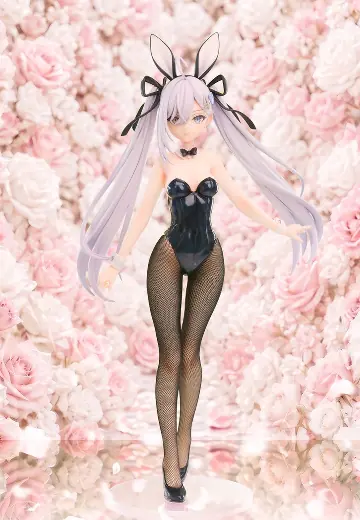 | **[B-style 以死亡游戏为生。 幽鬼 兔女郎](https://www.hpoi.net/hobby/139777)** B-style 死亡遊戯で飯を食う。 幽鬼 バニーVer. FREEing · 以死亡游戏为生。、靠死亡游戏混饭吃。 · 幽鬼 比例人形 · B-style · 1/4 | 39,600 日元 含税，1658元 | 2027-03 |
| 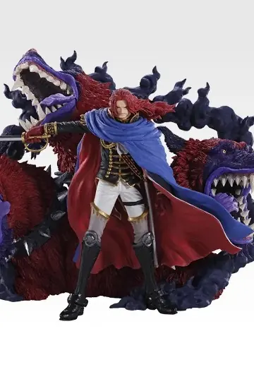 | **[一番赏 航海王 艾尔巴夫篇- GIANT BOOST!!! 最终奖 夏姆洛克圣 刻耳贝洛斯 Revible Moment](https://www.hpoi.net/hobby/139772)** 一番くじ ONE PIECE -エルバフ編- GIANT BOOST!!! ラストワン賞 シャムロック聖 ケルベロス Revible Moment BANDAI SPIRITS · 航海王 · 刻耳贝洛斯、费加兰度·夏姆洛克圣 比例人形 · 一番赏、追忆往昔、一番赏 航海王艾尔巴夫篇- GIANT BOOST!!! | — | 2027-04 |
| 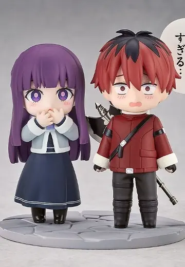 | **[Mini Memory 葬送的芙莉莲 菲伦与休塔尔克](https://www.hpoi.net/hobby/139770)** Mini Memory 葬送のフリーレン フェルン&amp;シュタルク 良笑 · 葬送的芙莉莲 · 菲伦、休塔尔克 Q版人形 · Mini Memory | 6,800 日元 含税，284元 | 2027-05 |
| 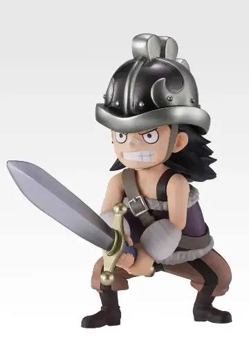 | **[一番赏 航海王 艾尔巴夫篇- GIANT BOOST!!! E奖 海尔丁 幼年期](https://www.hpoi.net/hobby/139767)** 一番くじ ONE PIECE -エルバフ編- GIANT BOOST!!! E賞 ハイルディン 幼少期フィギュア BANDAI SPIRITS · 航海王 · 海尔丁 比例人形 · 一番赏、一番赏 航海王艾尔巴夫篇- GIANT BOOST!!! | — | 未知 |
| 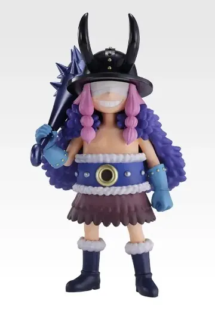 | **[一番赏 航海王 艾尔巴夫篇- GIANT BOOST!!! D奖 洛基 幼年期](https://www.hpoi.net/hobby/139764)** 一番くじ ONE PIECE -エルバフ編- GIANT BOOST!!! D賞 ロキ 幼少期フィギュア BANDAI SPIRITS · 航海王 · 洛基 比例人形 · 一番赏、一番赏 航海王艾尔巴夫篇- GIANT BOOST!!! | — | 2027-04 |
| 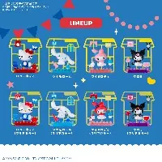 | **[SNAP SCENE 三丽鸥角色 “Welcome Home”](https://www.hpoi.net/hobby/139762)** BANDAI SPIRITS | — | 2027-04 |
| 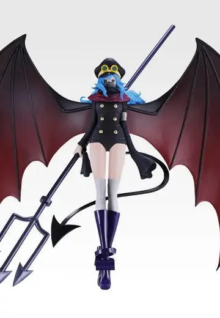 | **[一番赏 航海王 艾尔巴夫篇- GIANT BOOST!!! C奖 军子宫 伊姆附身 MASTERLISE EXPIECE](https://www.hpoi.net/hobby/139760)** 一番くじ ONE PIECE -エルバフ編- GIANT BOOST!!! C賞 軍子宮 イム憑依 MASTERLISE EXPIECE BANDAI SPIRITS · 航海王 · 伊姆、曼麦亚·军子宫 比例人形 · 一番赏、MASTERLISE EXPIECE、一番赏 航海王艾尔巴夫篇- GIANT BOOST!!! | — | 2027-04 |
| 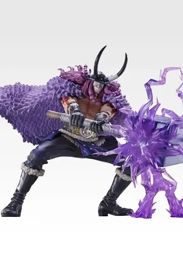 | **[一番赏 航海王 艾尔巴夫篇- GIANT BOOST!!! B奖 洛基 MASTERLISE EXPIECE](https://www.hpoi.net/hobby/139757)** 一番くじ ONE PIECE -エルバフ編- GIANT BOOST!!! B賞 ロキ MASTERLISE EXTRA BANDAI SPIRITS · 航海王 · 洛基 比例人形 · 一番赏、一番赏 航海王艾尔巴夫篇- GIANT BOOST!!!、MASTERLISE EXTRA | — | 2027-04 |
| 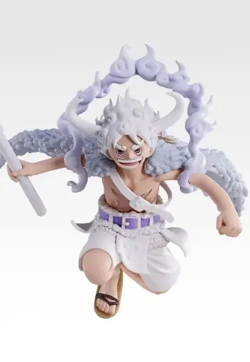 | **[一番赏 航海王 艾尔巴夫篇 A奖 蒙奇·D·路飞 五档 尼卡 MASTERLISE EXPIECE](https://www.hpoi.net/hobby/139756)** 一番くじ ONE PIECE -エルバフ編- GIANT BOOST!!! A賞 モンキー・D・ルフィ ギア5 エルバフ MASTERLISE EXPIECE BANDAI SPIRITS · 航海王 · 蒙奇·D·路飞 比例人形 · 一番赏、MASTERLISE EXPIECE、一番赏 航海王艾尔巴夫篇- GIANT BOOST!!! | — | 2027-04 |
|  | **[白金燐子](https://www.hpoi.net/hobby/139754)** 白金燐子 比例人形 | — | 未知 |

## HLJ（12）

| 图 | 商品 | 价格 | 发售 |
|---|---|---|---|
|  | **[Cosmic Princess Kaguya! Desktop Cute Figure Iroha Sakayori -Collaboration Concert ver.-](https://www.hlj.com/cosmic-princess-kaguya-desktop-cute-figure-iroha-sakayori-collaboration-concert-ver-tat452216600)** Taito · Cosmic Princess Kaguya! 预订中 | 2,900 日元 | 2027-04 |
|  | **[My Dress-Up Darling AMP+ Marin Kitagawa Figure -Black Lobelia ver.-](https://www.hlj.com/my-dress-up-darling-amp-marin-kitagawa-figure-black-lobelia-ver-tat452211900)** Taito · My Dress-Up Darling 预订中 | 2,900 日元 | 2027-04 |
|  | **[Frieren: Beyond Journey's End Coreful Figure Frieren -Yukata ver.-](https://www.hlj.com/frieren-beyond-journey-s-end-coreful-figure-frieren-yukata-ver-tat452215000)** Taito · Frieren: Beyond Journey's End 预订中 | 2,900 日元 | 2027-04 |
|  | **[Grow Up Show: Sunflower Circus Desktop Cute Figure Ouka Kawasumi -Room Wear ver.-](https://www.hlj.com/grow-up-show-sunflower-circus-desktop-cute-figure-ouka-kawasumi-room-wear-ver-tat452216800)** Taito · Grow Up Show: Sunflower Circus 预订中 | 2,900 日元 | 2027-04 |
|  | **[Sakura Miku T-most Figure](https://www.hlj.com/sakura-miku-t-most-figure-tat452216700)** Taito · Vocaloid 预订中 | 2,900 日元 | 2027-04 |
| 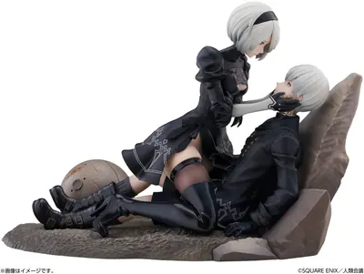 | **[1/7 NieR:Automata Ver1.1a: 2B/9S](https://www.hlj.com/1-7-scale-nier-automata-ver1-1a-2b-9s-erm33302)** Cyberagent · NieR Series 1/7 · 预订中 | 34,000 日元 | 2027-08 |
| 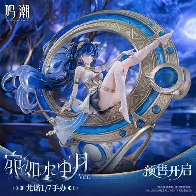 | **[1/7 Wuthering Waves: Resonator Themed Iuno Moon in Water Ver.](https://www.hlj.com/1-7-scale-wuthering-waves-resonator-themed-iuno-moon-in-water-ver-krg81519)** KURO GAMES · Wuthering Waves 1/7 · 预订中 | 30,000 日元 | 2027-09 |
|  | **[To LOVE-Ru Darkness Desktop Cute Figure Nana -Chinese Dress ver.- Renewal](https://www.hlj.com/to-love-ru-darkness-desktop-cute-figure-nana-chinese-dress-ver-renewal-tat452211100)** Taito · To Love-Ru 预订中 | 2,900 日元 | 2027-04 |
| 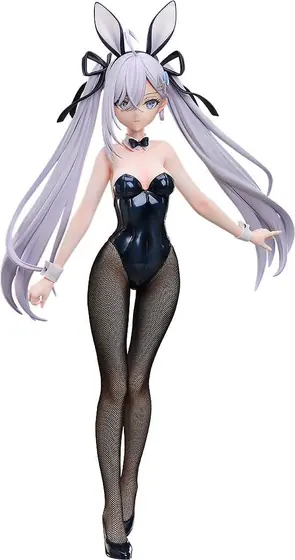 | **[1/4 Playing Death Games to Put Food on the Table: Yuki: Bunny Ver.](https://www.hlj.com/1-4-scale-playing-death-games-to-put-food-on-the-table-yuki-bunny-ver-fre51533)** Freeing · Playing Death Games to Put Food on the Table 1/4 · 预订中 | 36,000 日元 | 2027-03 |
| 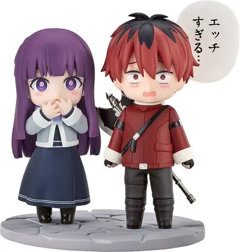 | **[Mini Memory Fern &amp; Stark (Frieren: Beyond Journey's End)](https://www.hlj.com/mini-memory-fern-stark-frieren-beyond-journey-s-end-gsc59278)** Good Smile Company · Frieren: Beyond Journey's End 预订中 | 6,182 日元 | 2027-05 |
|  | **[Grow Up Show: Sunflower Circus Desktop Cute Figure Mizuka Tsurumaki -Room Wear ver.-](https://www.hlj.com/grow-up-show-sunflower-circus-desktop-cute-figure-mizuka-tsurumaki-room-wear-ver-tat452216900)** Taito · Grow Up Show: Sunflower Circus 预订中 | 2,900 日元 | 2027-04 |
|  | **[1/7 Punishing: Gray Raven Lucia: Pyroath Pillow Talk Ver.](https://www.hlj.com/1-7-scale-punishing-gray-raven-lucia-pyroath-pillow-talk-ver-krg81525)** KURO GAMES · Punishing: Gray Raven 1/7 · 预订中 | 23,000 日元 | 2027-11 |

## Solaris Japan（9）

| 图 | 商品 | 价格 | 发售 |
|---|---|---|---|
| 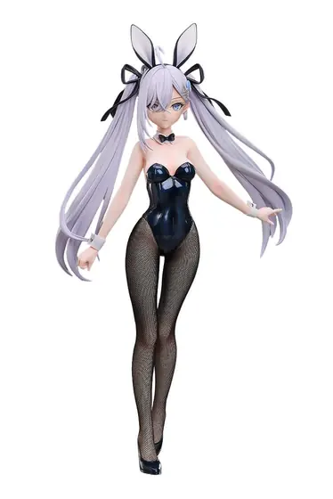 | **[Shibou Yuugi de Meshi wo Kuu. - Sorimachi Yuki - B-style - 1/4 - Bunny Ver. (FREEing)](https://solarisjapan.com/products/shibou-yuugi-de-meshi-wo-kuu-sorimachi-yuki-b-style-1-4-bunny-ver-freeing)** FREEing · Shibou Yuugi de Meshi wo Kuu. · Sorimachi Yuki 1/4 · 预订中 | 237 美元 | 2027-03 |
| 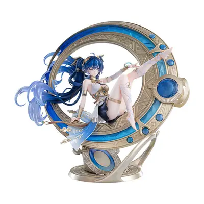 | **[Wuthering Waves - Iuno - Metheus Series - 1/7 - Moon in Water Ver. (Kurometheus)](https://solarisjapan.com/products/wuthering-waves-iuno-metheus-series-1-7-moon-in-water-ver-kurometheus)** KURO GAMES · Wuthering Waves · Iuno 1/7 · 预订中 | 183 美元 | 2027-09 |
| 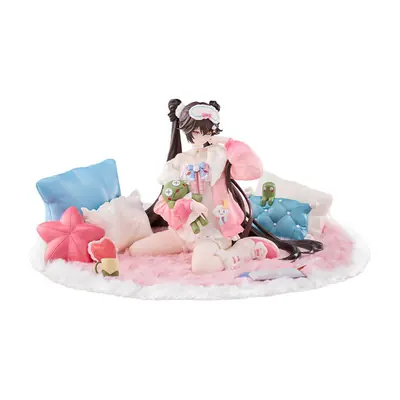 | **[Punishing: Gray Raven - Lucia - Pyroath - 1/7 - Pillow Talk ver. (Kuro Games)](https://solarisjapan.com/products/punishing-gray-raven-lucia-pyroath-1-7-pillow-talk-ver-kuro-games)** KURO GAMES · Punishing: Gray Raven · Lucia 1/7 · 预订中 | 140 美元 | 2027-11 |
| 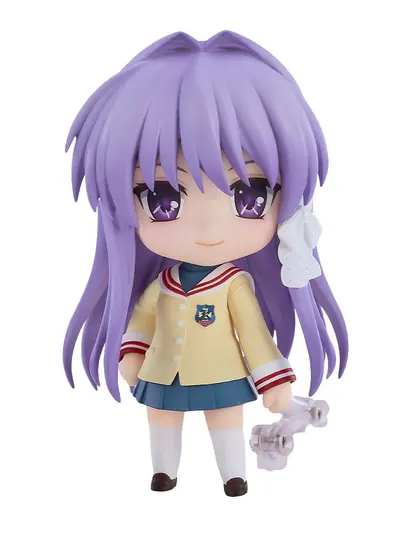 | **[Clannad - Botan - Fujibayashi Kyou - Nendoroid (#3191) (Good Smile Company)](https://solarisjapan.com/products/clannad-botan-fujibayashi-kyou-nendoroid-3191-good-smile-company)** Good Smile Company · Clannad · Fujibayashi Kyou Nendoroid · 预订中 | 35 美元 | 2027-06 |
| 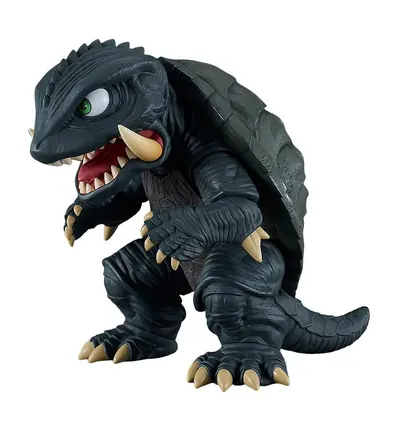 | **[Gamera 2: Legion Shuurai - Gamera - Nendoroid (#3199) (Good Smile Company)](https://solarisjapan.com/products/gamera-2-legion-shuurai-gamera-nendoroid-3199-good-smile-company)** Good Smile Company · Gamera 2: Legion Shuurai · Gamera Nendoroid · 预订中 | 45 美元 | 2027-04 |
| 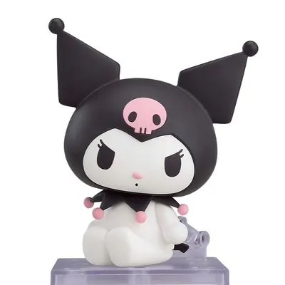 | **[Kuromi - Nendoroid (#3129) (Good Smile Company)](https://solarisjapan.com/products/kuromi-nendoroid-3129-good-smile-company)** Good Smile Company · Kuromi · Kuromi Nendoroid · 预订中 | 33 美元 | 2027-05 |
| 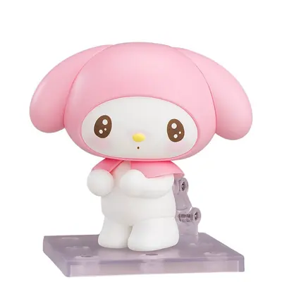 | **[My Melody - Nendoroid (#3128) (Good Smile Company)](https://solarisjapan.com/products/my-melody-nendoroid-3128-good-smile-company)** Good Smile Company · My Melody · My Melody Nendoroid · 预订中 | 33 美元 | 2027-05 |
| 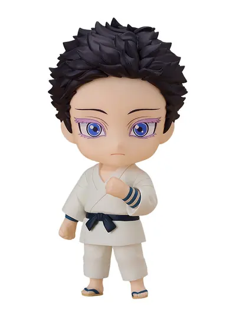 | **[Kimetsu no Yaiba - Akaza - Nendoroid (#3166) - Nendoroid Basic - Hakuji (Good Smile Company)](https://solarisjapan.com/products/kimetsu-no-yaiba-akaza-nendoroid-3166-nendoroid-basic-hakuji-good-smile-company)** Good Smile Company · Demon Slayer: Kimetsu no Yaiba · Akaza Nendoroid · 预订中 | 20 美元 | 2027-04 |
| 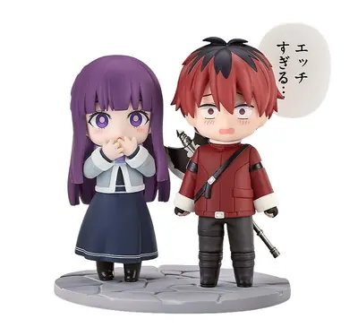 | **[Sousou no Frieren - Fern - Stark - Mini Memory (Good Smile Company)](https://solarisjapan.com/products/sousou-no-frieren-fern-stark-mini-memory-good-smile-company)** Good Smile Company · Sousou no Frieren Trading · 预订中 | 35 美元 | 2027-05 |
