# 2026-11-23 手办新品

共 40 件（Sofmap 40）。点名称打开原页面。

## Sofmap（40）

| 图 | 商品 | 价格 | 发售 |
|---|---|---|---|
|  | **[ねんどろいど 原神 ナヒーダ](https://a.sofmap.com/product_detail.aspx?sku=102448264)** グッドスマイルカンパニー 预订中 | 7,900 日元 | 未定 |
|  | **[ねんどろいど 崩壊：スターレイル モーディス](https://a.sofmap.com/product_detail.aspx?sku=102448267)** グッドスマイルカンパニー 预订中 | 7,900 日元 | 未定 |
| 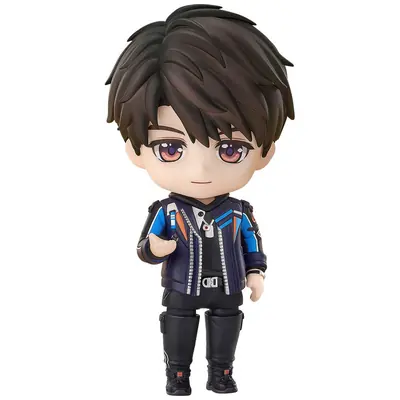 | **[ねんどろいど 恋と深空 マヒル](https://a.sofmap.com/product_detail.aspx?sku=102448191)** グッドスマイルアーツ上海 预订中 | 7,200 日元 | 未定 |
|  | **[ねんどろいど 東方LostWord 博麗霊夢 神を降ろす祈祷師Ver.](https://a.sofmap.com/product_detail.aspx?sku=102445522)** グッドスマイルカンパニー ねんどろいど · 预订中 | 6,800 日元 | 2027-04 |
| 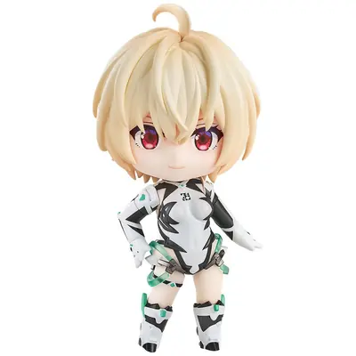 | **[ねんどろいど 楽園追放 心のレゾナンス ガブリエル](https://a.sofmap.com/product_detail.aspx?sku=102448181)** グッドスマイルアーツ上海 预订中 | 6,900 日元 | 未定 |
|  | **[ねんどろいど 生徒会にも穴はある！ 陸奥こまろ](https://a.sofmap.com/product_detail.aspx?sku=102448162)** グッドスマイルカンパニー 预订中 | 6,900 日元 | 未定 |
|  | **[ねんどろいどさぷらいず ダンガンロンパ1・2 Reload【単品】](https://a.sofmap.com/product_detail.aspx?sku=102448161)** グッドスマイルカンパニー ねんどろいど · 预订中 | 1,800 日元 | 2027-06 |
| 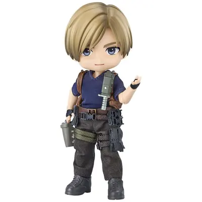 | **[ねんどろいどどーる バイオハザード RE：4 レオン・S・ケネディ](https://a.sofmap.com/product_detail.aspx?sku=102448165)** グッドスマイルカンパニー 预订中 | 9,800 日元 | 未定 |
|  | **[ダイキャスト製塗装済み完成品ミニカー 1/64 その着せ替え人形は恋をする Season 2 TKRI松永建設AMG GT3 2026Ver.](https://a.sofmap.com/product_detail.aspx?sku=102448200)** グッドスマイルカンパニー その他 フィギュア · 1/64 · 预订中 | 4,950 日元 | 2027-05 |
| 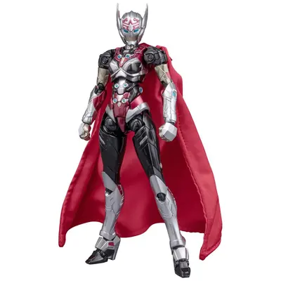 | **[ファイティングアーマー MARVEL マイティ・ソー](https://a.sofmap.com/product_detail.aspx?sku=102448252)** 千値練 预订中 | 16,500 日元 | 未定 |
| 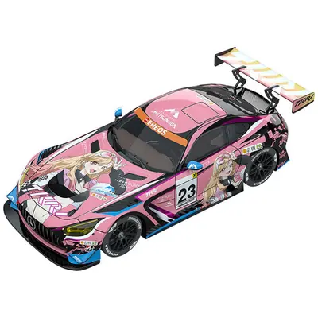 | **[レジン（PU）製塗装済み完成品ミニカー 1/43 その着せ替え人形は恋をする Season 2 TKRI松永建設AMG GT3 2026Ver.](https://a.sofmap.com/product_detail.aspx?sku=102448201)** グッドスマイルカンパニー 1/43 · 预订中 | 22,000 日元 | 未定 |
|  | **[塗装済み完成品 1/3 食戟のソーマ 小林竜胆 バニーVer.](https://a.sofmap.com/product_detail.aspx?sku=102445631)** フリーイング 1/3 · 预订中 | 77,000 日元 | 未定 |
|  | **[塗装済み完成品 1/4 その着せ替え人形（ビスク・ドール）は恋をする 喜多川海夢 水着Ver.](https://a.sofmap.com/product_detail.aspx?sku=102448260)** フリーイング 1/4 · 预订中 | 33,000 日元 | 未定 |
| 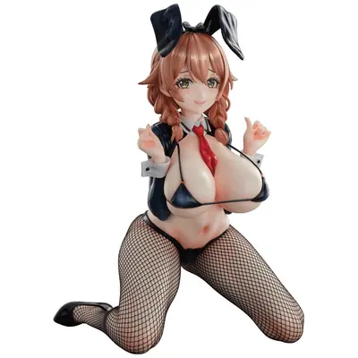 | **[塗装済み完成品 1/4 バニーガーデン 花奈 逆バニーVer.](https://a.sofmap.com/product_detail.aspx?sku=102445521)** メディコスエンタテイメント 1/4 · 预订中 | 25,850 日元 | 未定 |
| 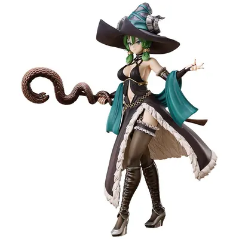 | **[塗装済み完成品 1/4 ユニコーンオーバーロード ヤーナ\[クラス：ソーサレス\]](https://a.sofmap.com/product_detail.aspx?sku=102445492)** フリーイング 1/4 · 预订中 | 55,000 日元 | 未定 |
| 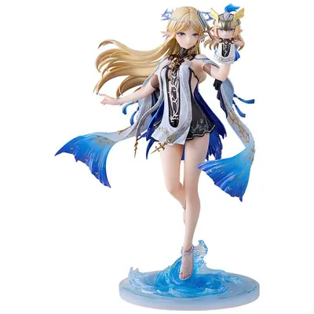 | **[塗装済み完成品 1/6 SSR FIGURE 鳴潮 カルテジア](https://a.sofmap.com/product_detail.aspx?sku=102448263)** グッドスマイルカンパニー 1/6 · 预订中 | 26,500 日元 | 未定 |
| 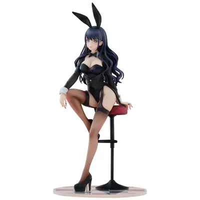 | **[塗装済み完成品 1/6 その着せ替え人形（ビスク・ドール）は恋をする Season 2 喜多川海夢 十六夜ありさVer.](https://a.sofmap.com/product_detail.aspx?sku=102448228)** ベルファイン 1/6 · 预订中 | 28,600 日元 | 未定 |
| 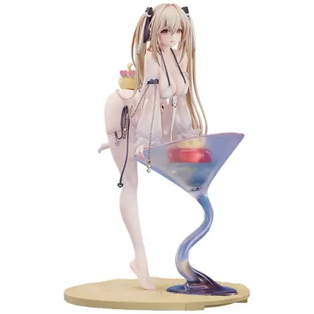 | **[塗装済み完成品 1/6 アズールレーン アンカレッジ 艦船との一杯](https://a.sofmap.com/product_detail.aspx?sku=102448266)** ルミナスボックス 1/6 · 预订中 | 27,400 日元 | 未定 |
| 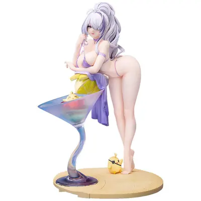 | **[塗装済み完成品 1/6 アズールレーン 雲仙 艦船との一杯](https://a.sofmap.com/product_detail.aspx?sku=102448190)** ルミナスボックス 1/6 · 预订中 | 27,400 日元 | 未定 |
| 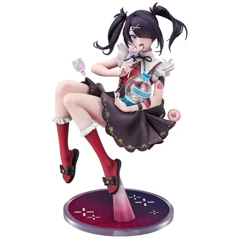 | **[塗装済み完成品 1/7 NEEDY GIRL OVERDOSE あめちゃん Candy Ver.](https://a.sofmap.com/product_detail.aspx?sku=102448192)** グッドスマイルアーツ上海 1/7 · 预订中 | 22,000 日元 | 未定 |
|  | **[塗装済み完成品 1/7 Steins；Gate（シュタインズゲート） 牧瀬紅莉栖 白衣バニーVer.](https://a.sofmap.com/product_detail.aspx?sku=102448182)** グッドスマイルアーツ上海 1/7 · 预订中 | 22,800 日元 | 未定 |
| 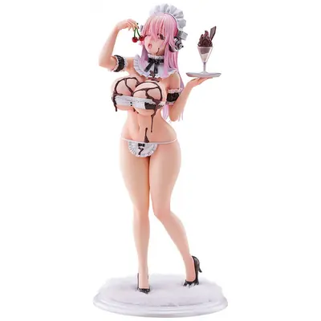 | **[塗装済み完成品 1/7 すーぱーそに子\[セクシーパティシエ Ver.\]](https://a.sofmap.com/product_detail.aspx?sku=102448176)** ウェーブ 1/7 · 预订中 | 23,800 日元 | 未定 |
| 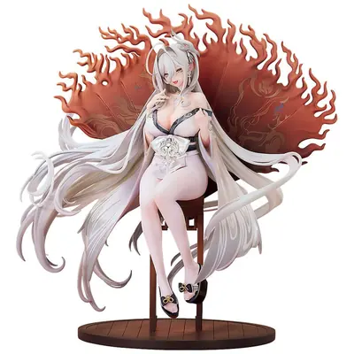 | **[塗装済み完成品 1/7 アズールレーン 白鳳](https://a.sofmap.com/product_detail.aspx?sku=102448184)** グッドスマイルアーツ上海 1/7 · 预订中 | 32,000 日元 | 未定 |
| 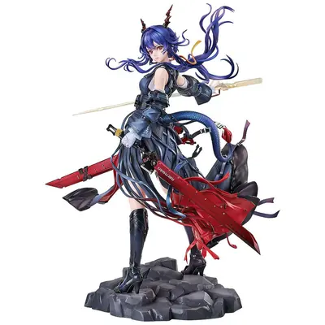 | **[塗装済み完成品 1/7 アークナイツ 赤刃明霄チェン 昇進段階2VER.](https://a.sofmap.com/product_detail.aspx?sku=102448193)** グッドスマイルアーツ上海 1/7 · 预订中 | 31,900 日元 | 未定 |
| 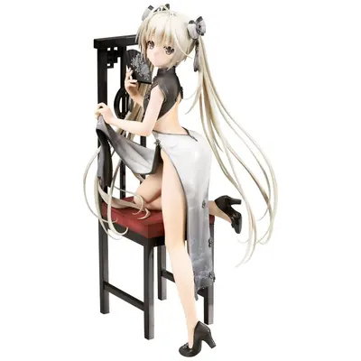 | **[塗装済み完成品 1/7 ヨスガノソラ 春日野穹 -Elegant China Style-](https://a.sofmap.com/product_detail.aspx?sku=102448215)** アルター 1/7 · 预订中 | 27,280 日元 | 未定 |
| 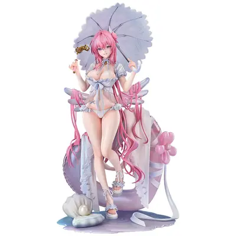 | **[塗装済み完成品 1/7 勝利の女神：NIKKE ドロシー：セレンディピティ](https://a.sofmap.com/product_detail.aspx?sku=102445606)** グッドスマイルアーツ上海 1/7 · 预订中 | 29,900 日元 | 未定 |
| 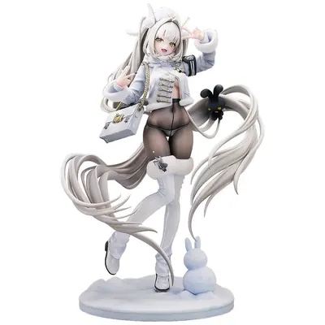 | **[塗装済み完成品 1/7 勝利の女神：NIKKE ブラン フォーチュンエクスプレス](https://a.sofmap.com/product_detail.aspx?sku=102448188)** グッドスマイルアーツ上海 1/7 · 预订中 | 26,400 日元 | 未定 |
| 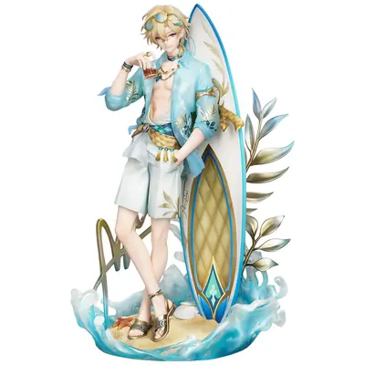 | **[塗装済み完成品 1/7 崩壊：スターレイル アベンチュリン・波と戯れる夏](https://a.sofmap.com/product_detail.aspx?sku=102444941)** MINBOO 1/7 · 预订中 | 30,800 日元 | 未定 |
| 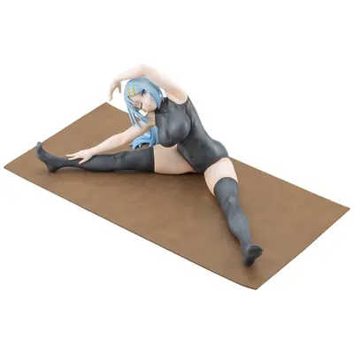 | **[塗装済み完成品 1/7 貸した魔力は【リボ払い】で強制徴収 リンカ普段着Ver.](https://a.sofmap.com/product_detail.aspx?sku=102445065)** コトブキヤ 1/7 · 预订中 | 17,600 日元 | 未定 |
| 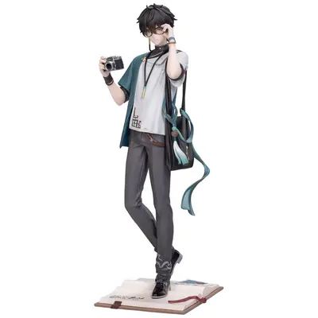 | **[塗装済み完成品 1/8 Gift＋ 崩壊：スターレイル 丹恒 列車周遊記Ver.](https://a.sofmap.com/product_detail.aspx?sku=102445035)** MINBOO 1/8 · 预订中 | 8,910 日元 | 未定 |
| 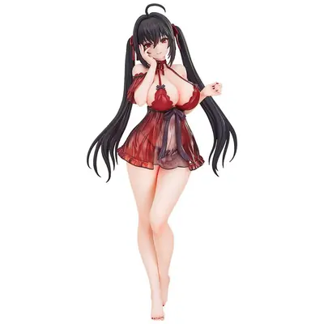 | **[塗装済み完成品 1/8 LessMore アズールレーン 大鳳 交流宿舎ver.](https://a.sofmap.com/product_detail.aspx?sku=102448187)** グッドスマイルアーツ上海 1/8 · 预订中 | 8,500 日元 | 未定 |
| 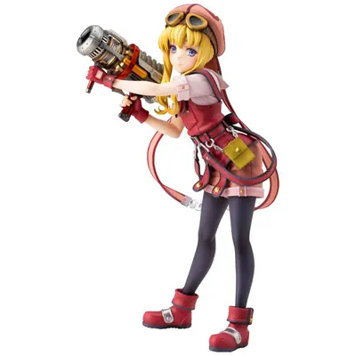 | **[塗装済み完成品 1/8 軌跡シリーズ ティータ・ラッセル](https://a.sofmap.com/product_detail.aspx?sku=102444971)** コトブキヤ 1/8 · 预订中 | 23,100 日元 | 未定 |
| 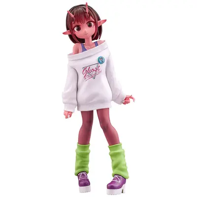 | **[塗装済み完成品 銀河特急 ミルキー☆サブウェイ チハル](https://a.sofmap.com/product_detail.aspx?sku=102448169)** ファットカンパニー 预订中 | 24,800 日元 | 未定 |
| 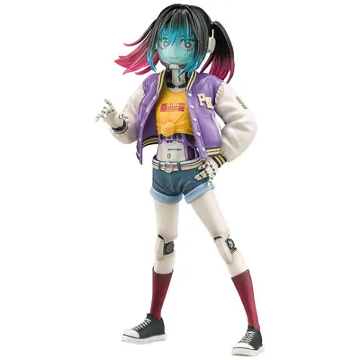 | **[塗装済み完成品 銀河特急 ミルキー☆サブウェイ マキナ](https://a.sofmap.com/product_detail.aspx?sku=102448168)** ファットカンパニー 预订中 | 26,800 日元 | 未定 |
| 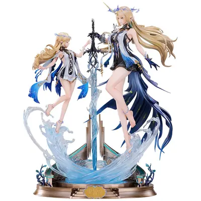 | **[塗装済み完成品 鳴潮 フルールドリス＆カルテジア スタチューセット](https://a.sofmap.com/product_detail.aspx?sku=102448189)** インフィニティスタジオ 预订已满 | 148,000 日元 | 未定 |
| 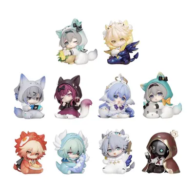 | **[学生寮シリーズ ちびキャラクター ブラインドボックス【単品】 第2弾](https://a.sofmap.com/product_detail.aspx?sku=102448246)** MYETHOS 预订中 | 1,994 日元 | 未定 |
| 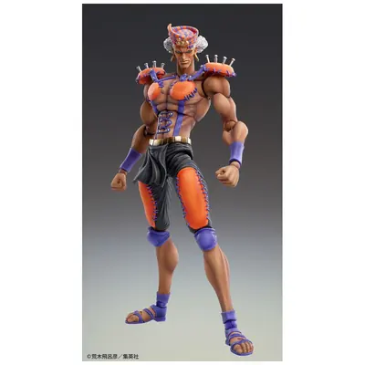 | **[超像可動 ジョジョの奇妙な冒険 第2部 エシディシ](https://a.sofmap.com/product_detail.aspx?sku=102445524)** メディコスエンタテイメント 预订中 | 9,900 日元 | 未定 |
| 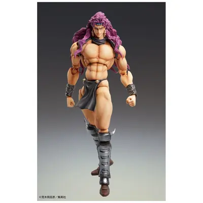 | **[超像可動 ジョジョの奇妙な冒険 第2部 カーズ](https://a.sofmap.com/product_detail.aspx?sku=102445523)** メディコスエンタテイメント 预订中 | 9,900 日元 | 未定 |
| 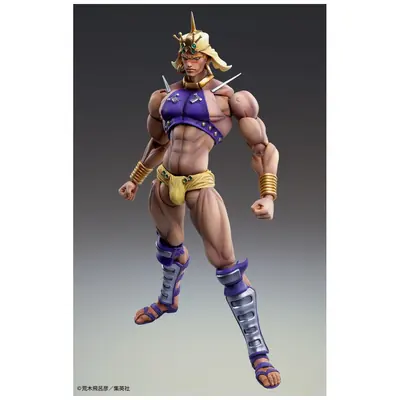 | **[超像可動 ジョジョの奇妙な冒険 第2部 ワムウ](https://a.sofmap.com/product_detail.aspx?sku=102445526)** メディコスエンタテイメント 预订中 | 9,900 日元 | 未定 |
| 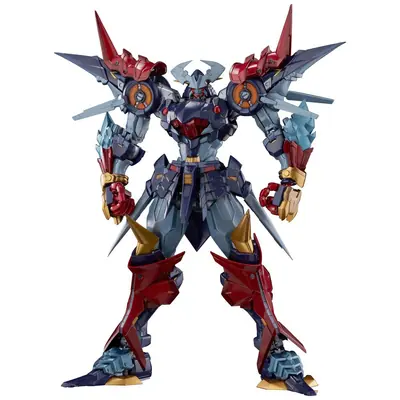 | **[鉄機巧 スーパーロボット大戦OG ダイゼンガー](https://a.sofmap.com/product_detail.aspx?sku=102445589)** フレイムトイズ 预订中 | 49,500 日元 | 未定 |
