# 2026-11-24 手办新品

共 75 件（HPOI 28 · Good Smile 官网 22 · HLJ 1 · Solaris Japan 24）。点名称打开原页面。

## HPOI（28）

| 图 | 商品 | 价格 | 发售 |
|---|---|---|---|
| 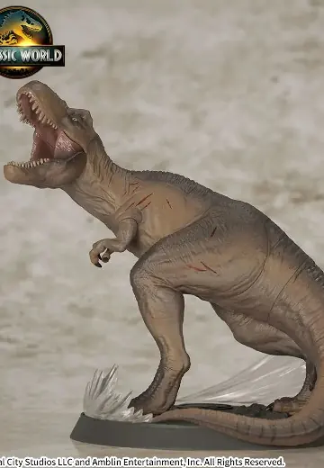 | **[侏罗纪公园 Luminasta 霸王龙 高潮场景](https://www.hpoi.net/hobby/140063)** ジュラシック・パークLuminasta‐T.REX‐クライマックス 世嘉 · 侏罗纪公园 · 暴龙（霸王龙） 自然生物 · Luminasta | — | 2026-11 |
| 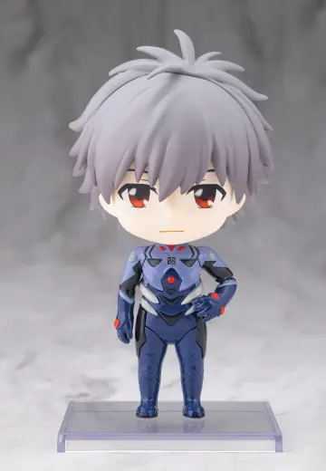 | **[OSHI WORKS Mini 新世纪福音战士新剧场版 渚薰](https://www.hpoi.net/hobby/140061)** OSHI WORKS Mini ヱヴァンゲリヲン新劇場版 渚カヲル 寿屋 · 新世纪福音战士新剧场版 · 渚薰 Q版人形 · OSHI WORKS | 1,980 日元 含税，82元 | 2027-05 |
| 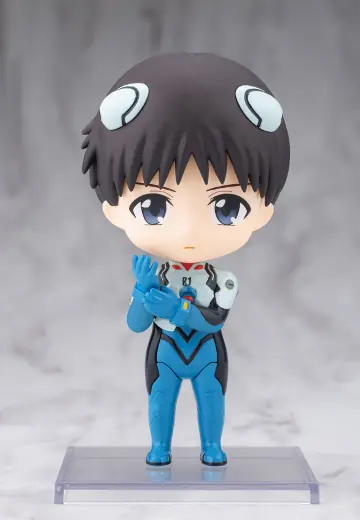 | **[OSHI WORKS Mini 新世纪福音战士新剧场版 碇真嗣](https://www.hpoi.net/hobby/140060)** OSHI WORKS Mini ヱヴァンゲリヲン新劇場版 碇シンジ 寿屋 · 新世纪福音战士新剧场版 · 碇真嗣 Q版人形 · OSHI WORKS | 1,980 日元 含税，82元 | 2027-05 |
| 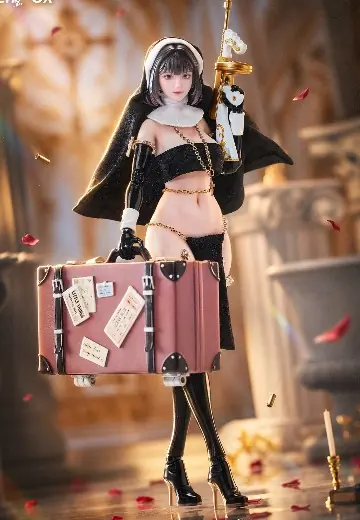 | **[终末弥撒 圣裁修女](https://www.hpoi.net/hobby/140059)** 终末弥撒 圣裁修女 Eiifox 比例人形 · 1/8 | — | 未知 |
| 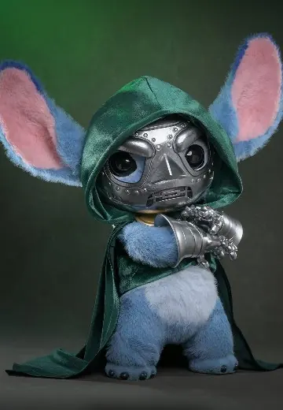 | **[《漫威史迪奇》毁灭博士史迪奇](https://www.hpoi.net/hobby/140056)** Marvel Stitch - Stitch as Doctor Doom Collectible Figure Hot Toys · 漫威 · 维克多·冯·杜姆（毁灭博士）、史迪奇 幻想生物 | 180 | 2026-11 |
| 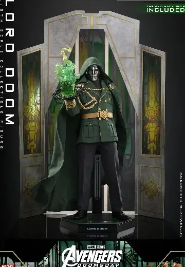 | **[《复仇者联盟5》君王杜姆](https://www.hpoi.net/hobby/140055)** Avengers: Doomsday - 1/6th scale Lord Doom Collectible Figure Hot Toys · 复仇者联盟5:毁灭之日、漫威 · 维克多·冯·杜姆（毁灭博士） 比例人形 · 电影杰作系列 · 1/6 | 180 | 2026-11 |
| 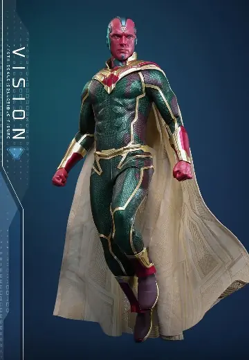 | **[《幻视任务》幻视](https://www.hpoi.net/hobby/140054)** VisionQuest - 1/6th scale Vision Collectible Figure Hot Toys · 漫威、幻视任务 · 幻视 比例人形 · 电视杰作系列 · 1/6 | — | 未知 |
| 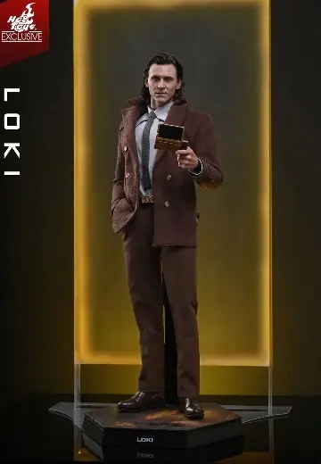 | **[《复仇者联盟5》洛基 (植发版)](https://www.hpoi.net/hobby/140053)** Avengers: Doomsday - 1/6th scale Loki Collectible Figure (Artisan Edition) \[Hot Toys Exclusive\] Hot Toys · 漫威、复仇者联盟5:毁灭之日 · 洛基·劳菲森 比例人形 · 电影杰作系列 · 1/6 | — | 未知 |
| 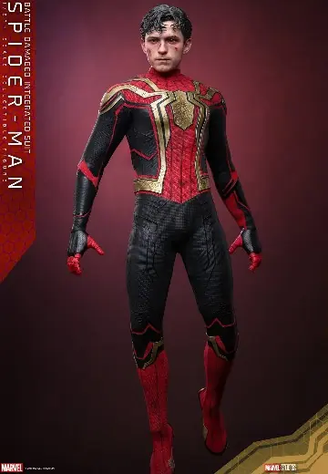 | **[《蜘蛛侠：英雄无归》蜘蛛侠（融合战衣战损版）（普通版）](https://www.hpoi.net/hobby/140052)** Spider-Man: No Way Home - 1/6th scale Spider-Man (Battle Damaged Integrated Suit) Collectible Figure Hot Toys · 漫威、蜘蛛侠：英雄无归 · 蜘蛛侠（彼得·帕克） 比例人形 · 电影杰作系列 · 1/6 | — | 未知 |
| 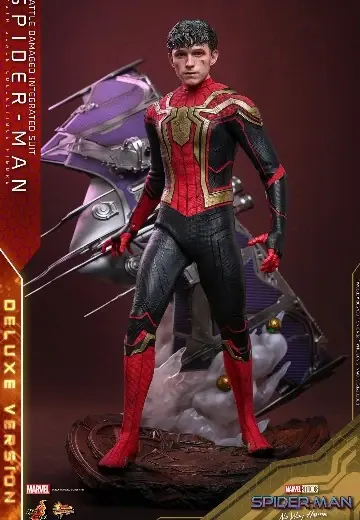 | **[《蜘蛛侠：英雄无归》蜘蛛侠（融合战衣战损版）豪华版](https://www.hpoi.net/hobby/140049)** Spider-Man: No Way Home - 1/6th scale Spider-Man (Battle Damaged Integrated Suit)Collectible Figure (Deluxe Version) Hot Toys · 漫威、蜘蛛侠：英雄无归 · 蜘蛛侠（彼得·帕克） 比例人形 · 电影杰作系列 · 1/6 | — | 未知 |
| 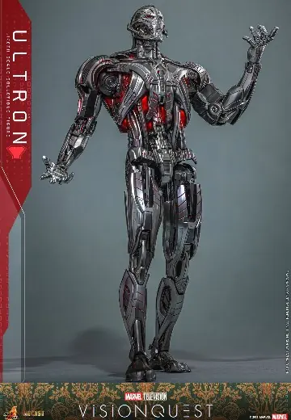 | **[TMS199D85 《幻视任务》奥创](https://www.hpoi.net/hobby/140041)** VisionQuest - 1/6th scale Ultron Collectible Figure Hot Toys · 漫威、幻视任务 · 奥创 比例人形 · 电视杰作系列 · 1/6 | — | 未知 |
| 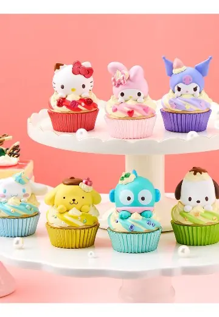 | **[食玩 杯子蛋糕收纳盒 三丽鸥角色](https://www.hpoi.net/hobby/140037)** カップケーキケース サンリオキャラクターズ 万代 · 三丽鸥 · 凯蒂猫、酷洛米、大耳狗、美乐蒂、布丁狗、帕恰狗 盒蛋/扭蛋 · PB限定、万代食玩 | 539 日元 | 2027-06 |
| 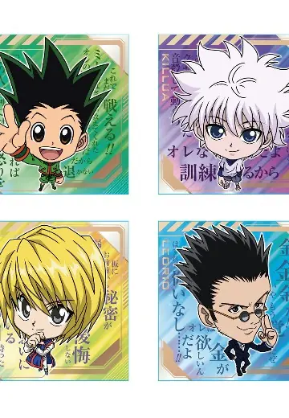 | **[食玩 Nifforme HUNTER×HUNTER 贴纸×威化饼干 Vol.10](https://www.hpoi.net/hobby/140035)** にふぉるめーしょん HUNTER×HUNTER シール×ウエハースvol.10 万代 · 全职猎人 盒蛋/扭蛋 · PB限定、万代食玩 | 154 日元 单款，含税，6元 | 2027-03 |
| 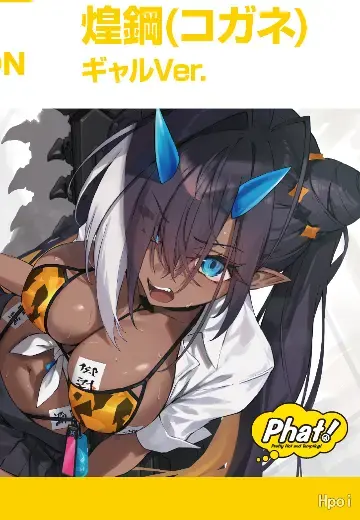 | **[煌钢 辣妹](https://www.hpoi.net/hobby/140029)** 煌鋼(コガネ) ギャルVer. Phat! 比例人形 | — | 未知 |
| 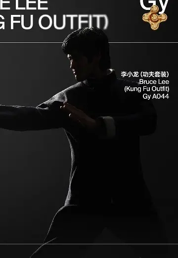 | **[李小龙（功夫套装）](https://www.hpoi.net/hobby/140018)** 李小龙（功夫套装）1/6收藏级可动人偶 INART 比例人形 · 1/6 | — | 未知 |
| 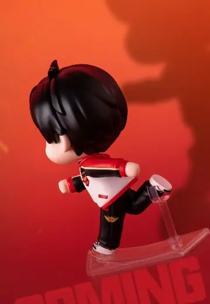 | **[Let's GONG系列 全职高手](https://www.hpoi.net/hobby/140017)** 《全职高手》Let's GONG系列手办 共鸣GONG · 全职高手 Q版人形 | — | 未知 |
| 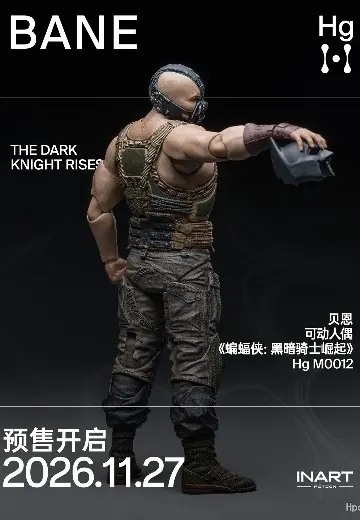 | **[蝙蝠侠：黑暗骑士崛起 贝恩](https://www.hpoi.net/hobby/140016)** 《蝙蝠侠：黑暗骑士崛起》-贝恩可动人偶 INART Action · 蝙蝠侠：黑暗骑士崛起 · 贝恩 比例人形 · 1/12 | — | 未知 |
| 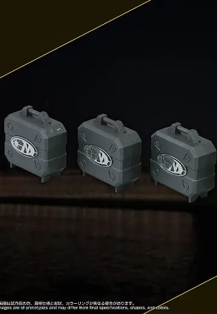 | **[LEGACYSOUL 微星小超人 间谍魔术师 微型舱 4 个套装](https://www.hpoi.net/hobby/140015)** 国内:タカラトミーモール限定 LEGACYSOUL ミクロマン スパイマジシャン ミクロチェンバー4個セット T-SPARK · 微星小超人 配件 | 1,100 日元 含税，46元 | 2027-05 |
| 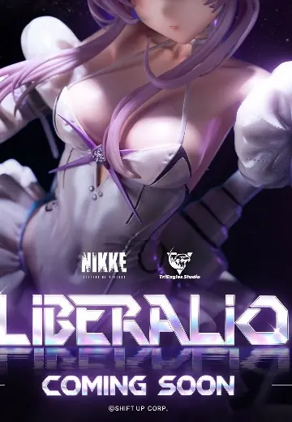 | **[胜利女神：新的希望 莉贝雷利奥‌](https://www.hpoi.net/hobby/140014)** NIKKE雕像第八弹-莉贝雷利奥‌（Liberalio） TriEagles · 胜利女神：新的希望 · 莉贝雷利奥 比例人形 · 1/4 | — | 未知 |
| 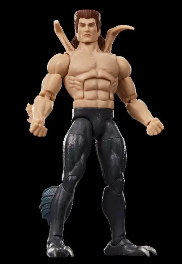 | **[漫威传奇系列 玛莉・史密斯（蜘蛛侠动画系列）](https://www.hpoi.net/hobby/140012)** マーベル・レジェンド マーベル・スマイス(スパイダーマン:アニメシリーズ) 孩之宝 · 蜘蛛侠（1994年动画片） 比例人形 · 漫威传奇系列 | 27 美元 | 2027-01 |
| 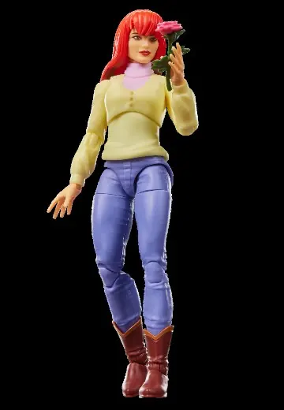 | **[漫威传奇系列 玛丽・简・沃森（蜘蛛侠动画系列）](https://www.hpoi.net/hobby/140010)** マーベル・レジェンド メリー・ジェーン・ワトソン(スパイダーマン:アニメイテッドシリーズ) 孩之宝 · 蜘蛛侠（1994年动画片） · 玛丽简 比例人形 · 漫威传奇系列 | 27 美元 | 2026-12 |
|  | **[漫威传奇系列 梅婶（蜘蛛侠动画版）](https://www.hpoi.net/hobby/140009)** マーベル・レジェンド メイおばさん(スパイダーマン:アニメシリーズ) 孩之宝 · 蜘蛛侠（1994年动画片） 比例人形 · 漫威传奇系列 | 27 美元 | 2026-12 |
| 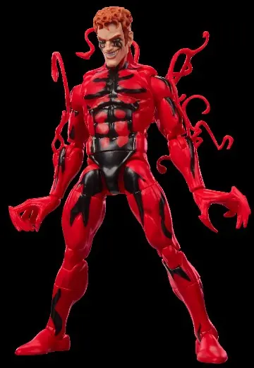 | **[漫威传奇系列 屠杀（漫画《Maximum Carnage》版）](https://www.hpoi.net/hobby/140008)** マーベル・レジェンド カーネイジ(マキシマムカーネイジ コミック) 孩之宝 · 屠杀 比例人形 · 漫威传奇系列 | 27 美元 | 2027-01 |
| 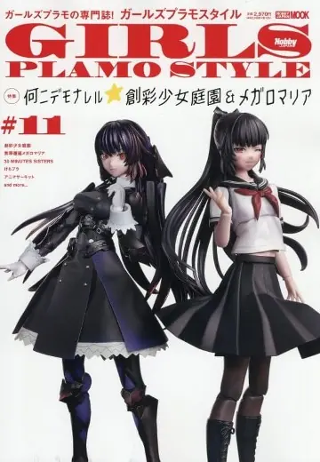 | **[Girls Plamo Style #11](https://www.hpoi.net/hobby/139996)** ガールズプラモスタイル #11 Hobby JAPAN 比例人形 | 2,970 日元 含税，124元 | 2026-09 |
| 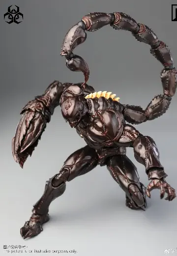 | **[MF004 演化战域系列 瘟疫](https://www.hpoi.net/hobby/139993)** MF004 演化战域系列 瘟疫 Mirrfig 比例人形 · 1/12 | 388 元 | 2027-03 |
| 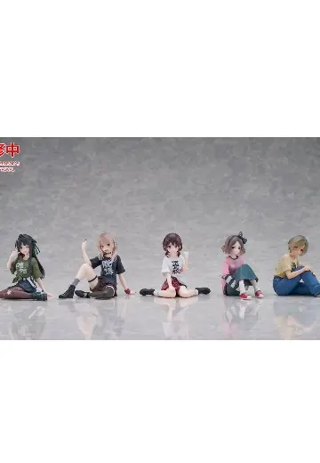 | **[CHILLfigg Relax 少女乐队的呐喊 T恤版](https://www.hpoi.net/hobby/139992)** CHILLfigg Relax ガールズバンドクライ Tシャツver. VISION · 少女乐队的呐喊 · 鲁帕、安和昴、海老塚智、河原木桃香、井芹仁菜 比例人形 · CHILLfigg | — | 未知 |
| 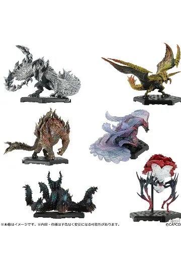 | **[CFB 怪物猎人 标准模型Plus THE BEST ～Vol. 27・28・29～](https://www.hpoi.net/hobby/139990)** カプコンフィギュアビルダー モンスターハンター スタンダードモデル Plus THE BEST ～Vol. 27・28・29～ CAPCOM · 怪物猎人 幻想生物 · CAPCOM FIGURE BUILDER（CFB） | 11,880 日元 含税，497元 | 2027-06 |

旧品补录 1 件：HPOI 新收录、但早已发售的老商品

| 图 | 商品 | 价格 | 发售 |
|---|---|---|---|
| 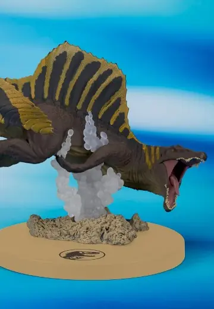 | **[侏罗纪世界：重生 ACT/CUT 高级手办 “棘龙”](https://www.hpoi.net/hobby/140066)** ジュラシック・ワールド／復活の大地ACT/CUTプレミアムフィギュア“スピノサウルス” 世嘉 · 侏罗纪世界4：重生 自然生物 · ACT/CUT · 旧品补录 | — | 2025-08 |

## Good Smile 官网（22）

| 图 | 商品 | 价格 | 发售 |
|---|---|---|---|
| 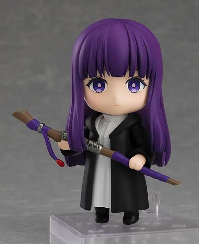 | **[ねんどろいど フェルン](https://www.goodsmile.com/ja/product/56112)** グッドスマイルカンパニー · 葬送のフリーレン ねんどろいど · ノンスケール · 预订中 · 二次再贩 · 附特典 | 5,900 日元 | 2027-06 截订 2027-01-06 |
| 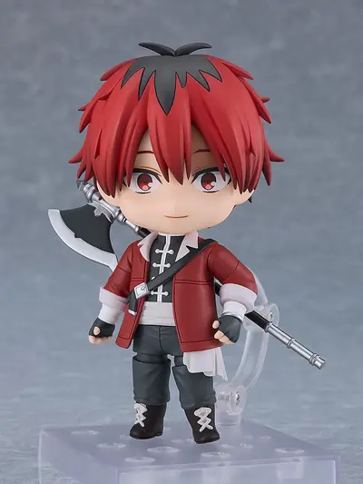 | **[ねんどろいど シュタルク](https://www.goodsmile.com/ja/product/57429)** グッドスマイルカンパニー · 葬送のフリーレン ねんどろいど · ノンスケール · 预订中 · 再贩 · 附特典 | 6,500 日元 | 2027-06 截订 2027-01-06 |
| 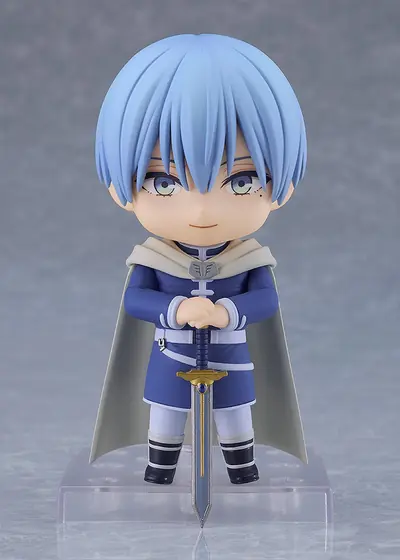 | **[ねんどろいど ヒンメル](https://www.goodsmile.com/ja/product/57430)** グッドスマイルカンパニー · 葬送のフリーレン ねんどろいど · ノンスケール · 预订中 · 再贩 · 附特典 | 6,500 日元 | 2027-06 截订 2027-01-06 |
| 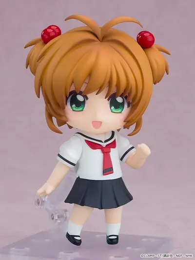 | **[ねんどろいど 木之本桜 友枝小学校夏制服Ver. べーしっく](https://www.goodsmile.com/ja/product/1143267)** グッドスマイルカンパニー · カードキャプターさくら クリアカード編 ねんどろいど · ノンスケール · 预订中 · 附特典 | 3,900 日元 | 未定 截订 2027-01-06 |
| 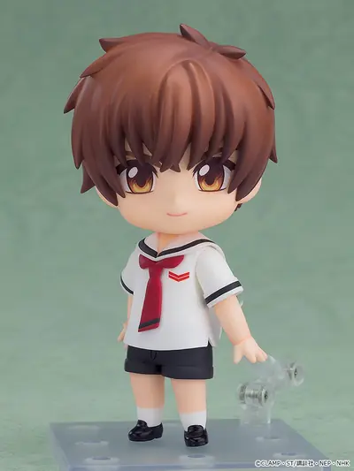 | **[ねんどろいど 李小狼 友枝小学校夏制服Ver. べーしっく](https://www.goodsmile.com/ja/product/1143268)** グッドスマイルカンパニー · カードキャプターさくら クリアカード編 ねんどろいど · ノンスケール · 预订中 · 附特典 | 3,900 日元 | 未定 截订 2027-01-06 |
| 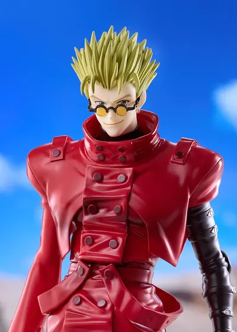 | **[POP UP PARADE ヴァッシュ・ザ・スタンピード L size](https://www.goodsmile.com/ja/product/1140730)** グッドスマイルカンパニー · TRIGUN POP UP PARADE L size · ノンスケール · 预订中 | 9,800 日元 | 未定 截订 2026-12-23 |
| 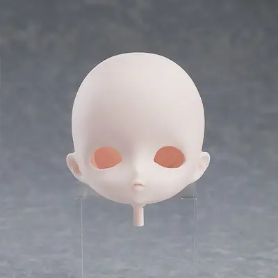 | **[Harmonia bloom blooming doll (Head/Snow)](https://www.goodsmile.com/ja/product/1145302)** グッドスマイルカンパニー · Harmonia bloom Harmonia bloom · ノンスケール · 预订中 | 5,500 日元 | 未定 截订 2027-01-06 |
| 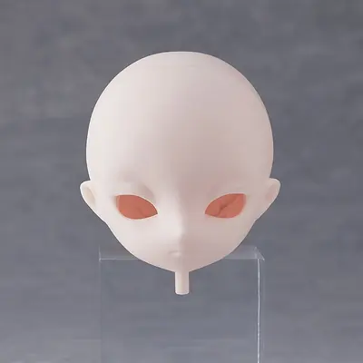 | **[Harmonia bloom blooming doll root (Head/Snow)](https://www.goodsmile.com/ja/product/1145303)** グッドスマイルカンパニー · Harmonia bloom Harmonia bloom · ノンスケール · 预订中 | 5,500 日元 | 未定 截订 2027-01-06 |
| 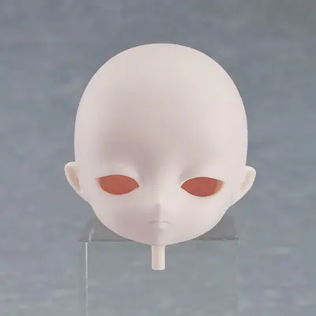 | **[Harmonia bloom blooming doll root (Head-Nagi/Snow)](https://www.goodsmile.com/ja/product/1145304)** グッドスマイルカンパニー · Harmonia bloom Harmonia bloom · ノンスケール · 预订中 | 5,500 日元 | 未定 截订 2027-01-06 |
| 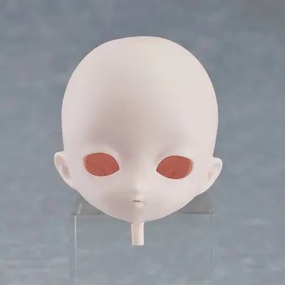 | **[Harmonia bloom blooming doll (Head-Nepeta/Snow)](https://www.goodsmile.com/ja/product/1146695)** グッドスマイルカンパニー · Harmonia bloom Harmonia bloom · ノンスケール · 预订中 | 5,500 日元 | 未定 截订 2027-01-06 |
| 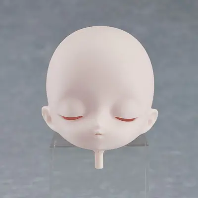 | **[Harmonia bloom blooming doll (Head-Valerian/Snow)](https://www.goodsmile.com/ja/product/1146696)** グッドスマイルカンパニー · Harmonia bloom Harmonia bloom · ノンスケール · 预订中 | 5,500 日元 | 未定 截订 2027-01-06 |
| 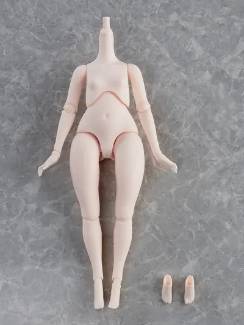 | **[Harmonia bloom blooming doll (Body/Snow)](https://www.goodsmile.com/ja/product/1145301)** グッドスマイルカンパニー · Harmonia bloom Harmonia bloom · ノンスケール · 预订中 | 10,000 日元 | 未定 截订 2027-01-06 |
| 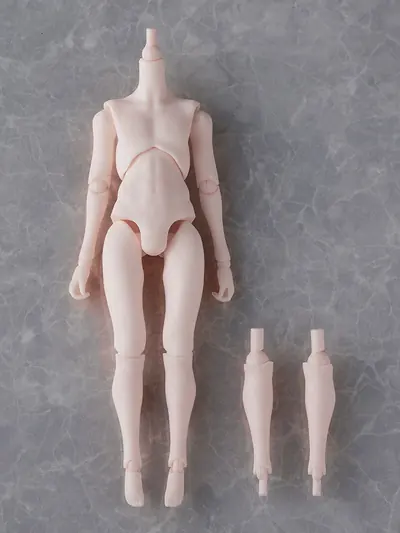 | **[Harmonia bloom blooming doll root (Body/Snow）](https://www.goodsmile.com/ja/product/1147028)** グッドスマイルカンパニー · Harmonia bloom Harmonia bloom · ノンスケール · 预订中 | 10,000 日元 | 未定 截订 2027-01-06 |
| 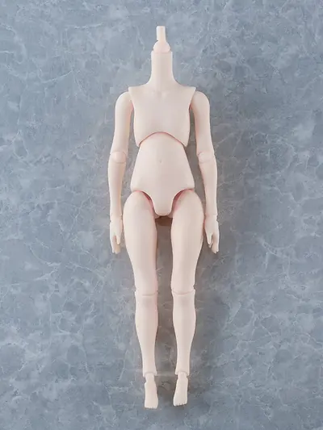 | **[Harmonia bloom blooming doll root (Body-Boyhood/Snow)](https://www.goodsmile.com/ja/product/1147505)** グッドスマイルカンパニー · Harmonia bloom Harmonia bloom · ノンスケール · 预订中 | 10,000 日元 | 未定 截订 2027-01-06 |
|  | **[ミルキー☆サブウェイ ～銀河特急コレクション～](https://www.goodsmile.com/ja/product/1142123)** グッドスマイルカンパニー · 銀河特急 ミルキー☆サブウェイ トレーディング・カプセルトイ · ノンスケール · 预订中 | 1,580 日元 | 未定 截订 2027-01-06 |
|  | **[【BOX】ミルキー☆サブウェイ ～銀河特急コレクション～（6個入）](https://www.goodsmile.com/ja/product/1148023)** グッドスマイルカンパニー · 銀河特急 ミルキー☆サブウェイ トレーディング・カプセルトイ · ノンスケール · 预订中 | 9,480 日元 | 未定 截订 2027-01-06 |
| 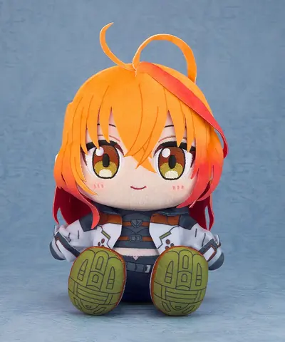 | **[ぬいぐるみ 久瀬シイナ/夜海トワ/高町なのは/フェイト・T・ハラオウン](https://www.goodsmile.com/ja/product/1146322)** グッドスマイルカンパニー · 魔法少女リリカルなのは EXCEEDS Gun Blaze Vengeance ぬいぐるみ · 预订中 | 4,400 日元 | 未定 截订 2026-12-23 |
| 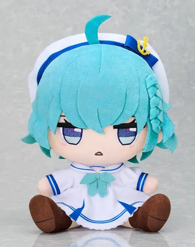 | **[おすわりぬいぐるみ スーズ/レトロ](https://www.goodsmile.com/ja/product/1145020)** グッドスマイルカンパニー · アクアリウムは踊らない ぬいぐるみ · 预订中 | 4,400 日元 | 未定 截订 2027-01-06 |
| 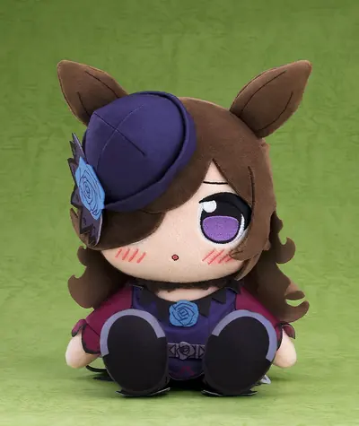 | **[くりぱん ぬいぐるみ ライスシャワー/シュヴァルグラン](https://www.goodsmile.com/ja/product/62131)** グッドスマイルカンパニー · ウマ娘 プリティーダービー ぬいぐるみ · 预订中 · 再贩 | 4,400 日元 | 未定 截订 2026-12-23 |
| 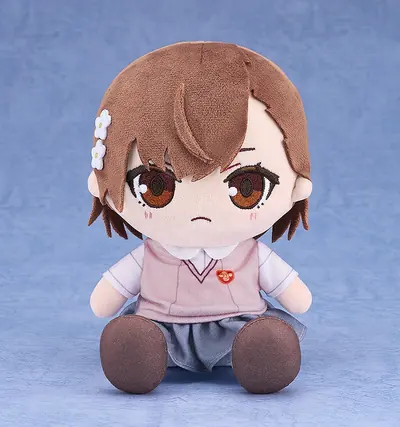 | **[ちょこぷに ぬいぐるみ 御坂美琴/白井黒子/初春飾利](https://www.goodsmile.com/ja/product/36239)** グッドスマイルカンパニー · とある科学の超電磁砲T ぬいぐるみ · 预订中 · 再贩 | 4,400 日元 | 未定 截订 2026-12-23 |
| 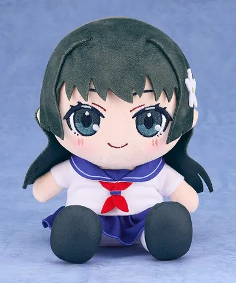 | **[ちょこぷに ぬいぐるみ 佐天涙子/食蜂操祈](https://www.goodsmile.com/ja/product/36242)** グッドスマイルカンパニー · とある科学の超電磁砲T ぬいぐるみ · 预订中 · 再贩 | 4,400 日元 | 未定 截订 2026-12-23 |
| 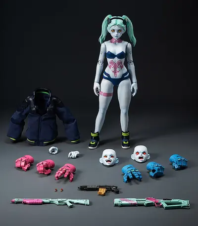 | **[フィグゼロ 1/6 レベッカ](https://www.goodsmile.com/ja/product/1147694)** threezero · サイバーパンク: エッジランナーズ アクションフィギュア · 1/6 · 预订中 | 37,400 日元 | 未定 截订 2026-12-23 |

## HLJ（1）

| 图 | 商品 | 价格 | 发售 |
|---|---|---|---|
| 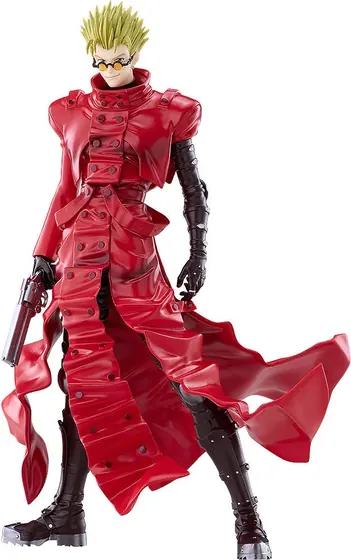 | **[POP UP PARADE Vash the Stampede L Size (TRIGUN)](https://www.hlj.com/pop-up-parade-vash-the-stampede-l-size-trigun-gsc59586)** Good Smile Company · Trigun 预订中 | 8,909 日元 | 2027-06 |

## Solaris Japan（24）

| 图 | 商品 | 价格 | 发售 |
|---|---|---|---|
| 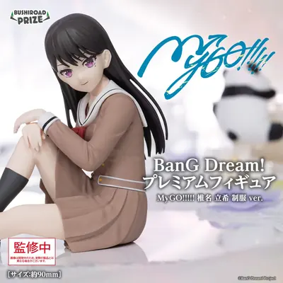 | **[BanG Dream! It’s MyGO!!!!! - Shiina Taki - Bushiroad Prize - Premium Figure - Seifuku ver. (Bushiroad Creative)](https://solarisjapan.com/products/bang-dream-it-s-mygo-shiina-taki-bushiroad-prize-premium-figure-seifuku-ver-bushiroad-creative)** Bushiroad Creative · BanG Dream! It’s MyGO!!!!! Prize | 0 美元 | 2026-11 |
| 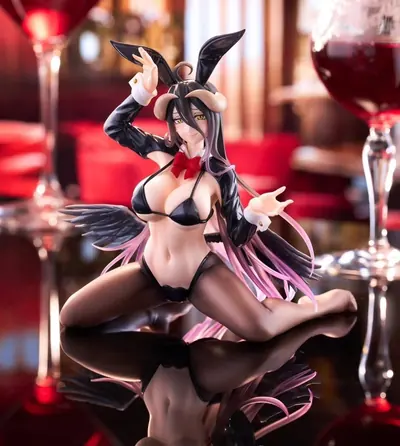 | **[Overlord - Albedo - Moflock - Reverse Bunny Ver. (Taito)](https://solarisjapan.com/products/overlord-albedo-moflock-reverse-bunny-ver-taito)** Taito · Overlord Prize · 现货 | 35 美元 | 2026-11 |
|  | **[Sousou no Frieren - Frieren - Desktop Cute - Shuugyou Jidai Ver. (Taito, Vision)](https://solarisjapan.com/products/sousou-no-frieren-frieren-desktop-cute-shuugyou-jidai-ver-taito-vision)** Taito · Sousou no Frieren Prize | 0 美元 | 2026-11 |
|  | **[Needy Girl Overdose - Chouzetsu Saikawa Tenshi-chan - Coreful Figure (Taito)](https://solarisjapan.com/products/needy-girl-overdose-chouzetsu-saikawa-tenshi-chan-coreful-figure-taito)** Taito · Needy Girl Overdose Prize | 0 美元 | 2026-11 |
|  | **[Final Fantasy X - Yuna - AM Scale Figure (Taito)](https://solarisjapan.com/products/final-fantasy-x-yuna-am-scale-figure-taito)** Taito · Final Fantasy X Prize | 0 美元 | 2026-11 |
|  | **[To LOVEru Darkness - Konjiki no Yami - Moflock - Fluffy Bunny ver. (Taito, Vision)](https://solarisjapan.com/products/to-loveru-darkness-konjiki-no-yami-moflock-fluffy-bunny-ver-taito-vision)** Taito · To LOVEru Darkness Prize · 现货 | 31 美元 | 2026-11 |
|  | **[Zero no Tsukaima - Louise Françoise Le Blanc de la Vallière - Desktop Cute - Priestess ver. (Taito, Vision)](https://solarisjapan.com/products/zero-no-tsukaima-louise-francoise-le-blanc-de-la-valliere-desktop-cute-priestess-ver-taito-vision)** Taito · Zero no Tsukaima Prize · 现货 | 32 美元 | 2026-11 |
|  | **[Vocaloid - Hatsune Miku - Artist MasterPiece+ - Snow Miku All Stars, 2016 Ver. (Taito, Vision)](https://solarisjapan.com/products/vocaloid-hatsune-miku-artist-masterpiece-snow-miku-all-stars-2016-ver-taito-vision)** Taito · Vocaloid Prize · 现货 | 35 美元 | 2026-11 |
|  | **[Baki-Dou - Miyamoto Musashi - Luminasta (Sega Fave)](https://solarisjapan.com/products/baki-dou-miyamoto-musashi-luminasta-sega-fave)** Sega Fave · Baki-Dou Prize · 现货 | 38 美元 | 2026-11 |
|  | **[Chitose-kun wa Ramune Bin no Naka - Nanase Yuzuki - Yumemirize (Sega Fave)](https://solarisjapan.com/products/chitose-kun-wa-ramune-bin-no-naka-nanase-yuzuki-yumemirize-sega-fave)** Sega Fave · Chitose-kun wa Ramune Bin no Naka Prize · 现货 | 43 美元 | 2026-11 |
|  | **[Made in Abyss: Retsujitsu no Ougonkyou - Nanachi - Luminasta - Yumemiru Shokutaku (Sega Fave)](https://solarisjapan.com/products/made-in-abyss-retsujitsu-no-ougonkyou-nanachi-luminasta-yumemiru-shokutaku-sega-fave)** Sega Fave · Made in Abyss: Retsujitsu no Ougonkyou Prize · 现货 | 43 美元 | 2026-11 |
|  | **[Shunkashuutou Daikousha: Haru no Mai - Kantsubaki Rousei - XStellar (Sega Fave)](https://solarisjapan.com/products/shunkashuutou-daikousha-haru-no-mai-kantsubaki-rousei-xstellar-sega-fave)** Sega Fave · Shunkashuutou Daikousha: Haru no Mai Prize · 现货 | 34 美元 | 2026-11 |
|  | **[Shingeki no Kyojin The Final Season - Eren Kyojin - Eren Yeager - GigantiX (Sega Fave)](https://solarisjapan.com/products/shingeki-no-kyojin-the-final-season-eren-kyojin-eren-yeager-gigantix-sega-fave)** Sega Fave · Shingeki no Kyojin The Final Season Prize · 现货 | 45 美元 | 2026-11 |
|  | **[Piapro Characters - Hatsune Miku - Figurizm Alpha - Christmas 2026 (Sega Fave)](https://solarisjapan.com/products/piapro-characters-hatsune-miku-figurizm-alpha-christmas-2026-sega-fave)** Sega Fave · Piapro Characters Prize · 现货 | 38 美元 | 2026-11 |
|  | **[Evangelion Shin Gekijouban - Souryuu Asuka Langley - Figurizm Alpha (Sega Fave)](https://solarisjapan.com/products/evangelion-shin-gekijouban-souryuu-asuka-langley-figurizm-alpha-sega-fave)** Sega Fave · Evangelion Shin Gekijouban Prize · 现货 | 43 美元 | 2026-11 |
|  | **[Blue Archive - Tachibana Nozomi - XStellar (Sega Fave)](https://solarisjapan.com/products/blue-archive-tachibana-nozomi-xstellar-sega-fave)** Sega Fave · Blue Archive Prize | 0 美元 | 2026-11 |
|  | **[Blue Archive - Tachibana Hikari - XStellar (Sega Fave)](https://solarisjapan.com/products/blue-archive-tachibana-hikari-xstellar-sega-fave)** Sega Fave · Blue Archive Prize | 0 美元 | 2026-11 |
|  | **[Boku no Hero Academia - Kirishima Eijiro - Maximatic (Bandai Spirits)](https://solarisjapan.com/products/boku-no-hero-academia-kirishima-eijiro-maximatic-bandai-spirits)** Bandai Spirits · Boku no Hero Academia Prize | 0 美元 | 2026-11 |
|  | **[Gakuen iDOLM@STER - Kuramoto China - Espresto - Frilly lace (Bandai Spirits)](https://solarisjapan.com/products/gakuen-idolm-ster-kuramoto-china-espresto-frilly-lace-bandai-spirits)** Bandai Spirits · Gakuen iDOLM@STER Prize · 现货 | 26 美元 | 2026-11 |
|  | **[Kimetsu no Yaiba - Akaza - Grandista - II (Bandai Spirits)](https://solarisjapan.com/products/kimetsu-no-yaiba-akaza-grandista-ii-bandai-spirits)** Bandai Spirits · Kimetsu no Yaiba Prize | 0 美元 | 2026-11 |
|  | **[Boku no Hero Academia - Shigaraki Tomura - Final Season (Bandai Spirits)](https://solarisjapan.com/products/boku-no-hero-academia-shigaraki-tomura-final-season-bandai-spirits)** Bandai Spirits · Boku no Hero Academia Prize | 0 美元 | 2026-11 |
|  | **[One Piece - Loki - World Collectable Figure - World Collectable Figure MEGA (Bandai Spirits)](https://solarisjapan.com/products/one-piece-loki-world-collectable-figure-world-collectable-figure-mega-bandai-spirits)** Bandai Spirits · One Piece Prize | 0 美元 | 2026-11 |
|  | **[Naruto Shippuuden - Gaara - Grandista (Bandai Spirits)](https://solarisjapan.com/products/naruto-shippuuden-gaara-grandista-bandai-spirits)** Bandai Spirits · Naruto Shippuuden Prize · 现货 | 30 美元 | 2026-11 |
|  | **[Kusuriya no Hitorigoto - Maomao - Glasscape (Bandai Spirits)](https://solarisjapan.com/products/kusuriya-no-hitorigoto-maomao-glasscape-bandai-spirits)** Bandai Spirits · Kusuriya no Hitorigoto Prize · 现货 | 30 美元 | 2026-11 |
