# 2026-11-25 手办新品

共 71 件（HPOI 29 · Sofmap 3 · HLJ 9 · Solaris Japan 30）。点名称打开原页面。

## HPOI（29）

| 图 | 商品 | 价格 | 发售 |
|---|---|---|---|
|  | **[转轮科技 惊奇山口 蜘蛛侠Ver.2.0 EX](https://www.hpoi.net/hobby/140182)** リボルテック アメイジング・ヤマグチ スパイダーマン Ver.2.0 EX 海洋堂 · 蜘蛛侠1、漫威 · 蜘蛛侠（彼得·帕克） 比例人形 · 转轮科技、转轮科技 惊奇山口 | — | 未知 |
| 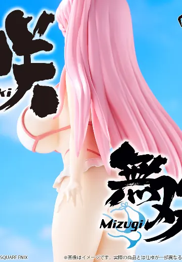 | **[天才麻将少女 原村和 水着无双](https://www.hpoi.net/hobby/140179)** 咲-Saki- 新作/水着無双 眼镜厂 · 天才麻将少女 · 原村和 比例人形 | — | 2027-05 |
| 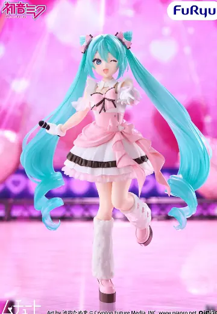 | **[Muchute 初音未来 偶像服装](https://www.hpoi.net/hobby/140177)** ムチュートフィギュア 初音ミク アイドル衣装 FuRyu · piapro · 初音未来 比例人形 · Muchute | — | 2027-06 |
|  | **[MOFLOCK 出包王女DARKNESS 菈菈 兔女郎（暂称）](https://www.hpoi.net/hobby/140176)** MOFLOCK To LOVEるダークネス ララ バニー TAiTO · 出包王女DARKNESS · 菈菈·撒塔琳·戴比路克 比例人形 · MOFLOCK | — | 未知 |
| 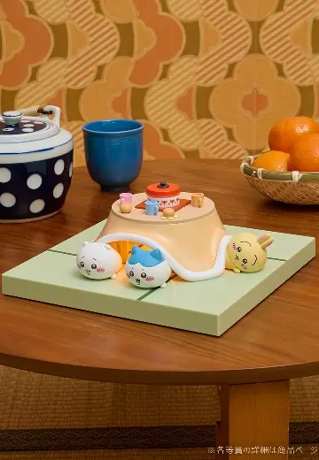 | **[AnyMy赏 吉伊卡哇 第四弹 ① 场景手办](https://www.hpoi.net/hobby/140154)** エニマイくじ ちいかわ ① ジオラマフィギュア LEGS · 吉伊卡哇 · 吉伊、乌萨奇、小八/哈奇喵 场景 · AnyMy赏、AnyMy赏 吉伊卡哇 第四弹 | — | 2026-12 |
|  | **[肉感少女 忏悔室的巨乳修女 蒂罗瓦尔 全裸](https://www.hpoi.net/hobby/140152)** 肉感少女 懺悔室の巨乳シスター ティロワール 全裸ver. Insight 比例人形 · 1/7 · 成人向 | 10,780 日元 含税，449元 | 2027-04 |
| 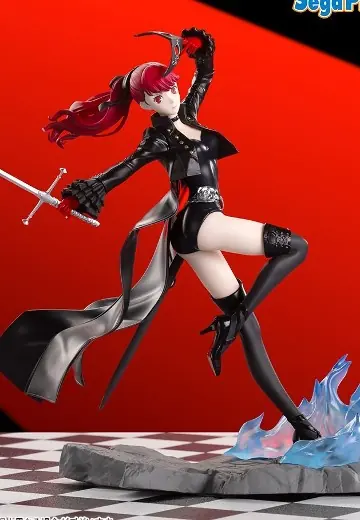 | **[Luminasta 女神异闻录5 皇家版 VIOLET](https://www.hpoi.net/hobby/140151)** Luminasta ペルソナ５ ザ・ロイヤル ヴァイオレット 世嘉 · 女神异闻录5 皇家版 · 芳泽霞 比例人形 · Luminasta | — | 2027-05 |
| 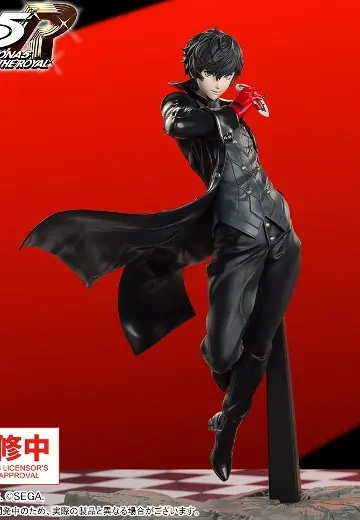 | **[Luminasta 女神异闻录5 皇家版 JOKER](https://www.hpoi.net/hobby/140150)** Luminasta ペルソナ５ ザ・ロイヤル ジョーカー 世嘉 · 女神异闻录5 皇家版 · 雨宫莲 / JOKER 比例人形 · Luminasta | — | 2027-05 |
| 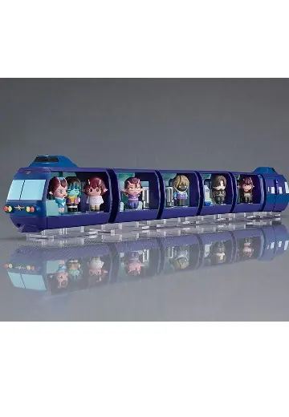 | **[银河特急 银河☆地铁 列车车厢造型手办模型盲盒](https://www.hpoi.net/hobby/140149)** ミルキー☆サブウェイ ～銀河特急コレクション～ 良笑 · 银河特急 银河☆地铁 · 欧塔姆、千春、朱音、柯特、麦克斯、铁多、真希奈 场景 | 9,477 日元 | 2027-05 |
| 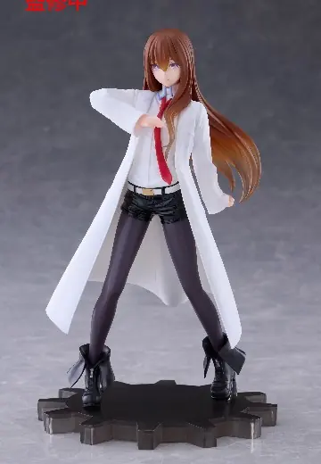 | **[Coreful 命运石之门 牧濑红莉栖 白衣](https://www.hpoi.net/hobby/140148)** STEINS;GATE Coreful フィギュア 牧瀬紅莉栖 白衣 TAiTO · 命运石之门 · 牧濑红莉栖 比例人形 · Coreful | — | 未知 |
| 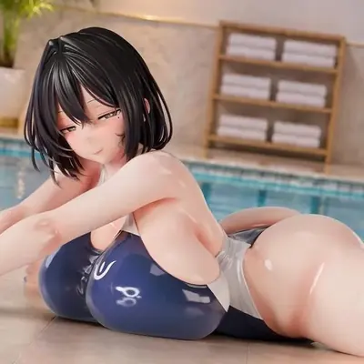 | **[巨乳人妻和秘密的游泳教室 朱鸿](https://www.hpoi.net/hobby/140146)** 巨乳人妻と秘密の水泳教室 チュウホン Bfull FOTS JAPAN 比例人形 · 1/6 · 成人向 | 23,980 日元 含税，1000元 | 2027-05 |
|  | **[约会大作战Ⅴ 崇宫澪 夏日连衣裙](https://www.hpoi.net/hobby/140136)** Date A Live Ⅴ Summer Dress Figure -Mio Takamiya- FuRyu · 约会大作战 第五季（约战V）、约会大作战 · 崇宫澪 比例人形 | — | 2027-05 |
| 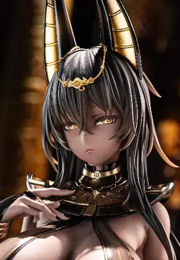 | **[阿努比斯（黑色款）](https://www.hpoi.net/hobby/140132)** 阿努比斯（黑色款） ABILU 比例人形 · 1/4 · 成人向 | 650 元 | 2027-12 |
| 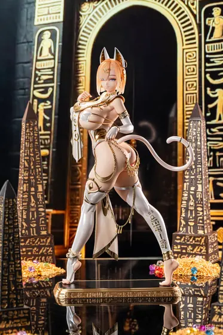 | **[巴斯泰托（白色款）](https://www.hpoi.net/hobby/140128)** 巴斯泰托（白色款） ABILU 比例人形 · 1/4 · 成人向 | 650 元 | 2027-12 |
| 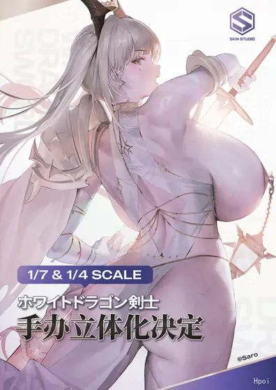 | **[白龙剑士 1/4尺寸](https://www.hpoi.net/hobby/140117)** ホワイトドラゴン剣士 Skin Studio 比例人形 · 1/4 · 成人向 | — | 未知 |
| 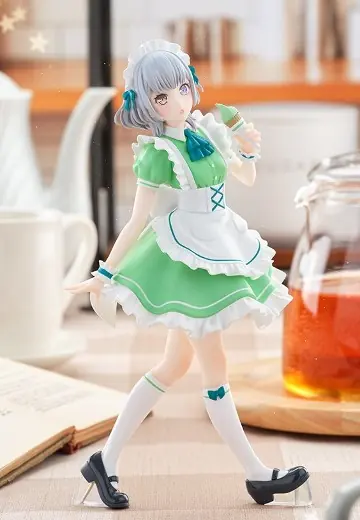 | **[XStellar 梦想协奏曲！迷途之子！！！！！要乐奈 ～甜蜜女仆～](https://www.hpoi.net/hobby/140104)** XStellar BanG Dream! 要楽奈 ～Sweet Maid～ 世嘉 · 梦想协奏曲！迷途之子！！！！！、BanG Dream! 交织的乐章、梦想协奏曲！/ BanG Dream! · 要乐奈 比例人形 · XStellar | — | 2027-05 |
| 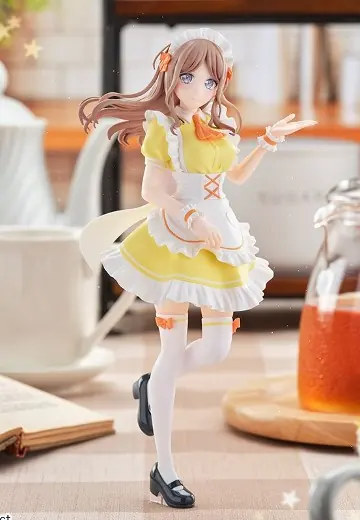 | **[XStellar 梦想协奏曲！迷途之子！！！！！长崎爽世 ～甜蜜女仆～](https://www.hpoi.net/hobby/140103)** XStellar BanG Dream! 長崎そよ ～Sweet Maid～ 世嘉 · 梦想协奏曲！迷途之子！！！！！、梦想协奏曲！/ BanG Dream!、BanG Dream! 交织的乐章 · 长崎爽世 比例人形 · XStellar | — | 2027-05 |
| 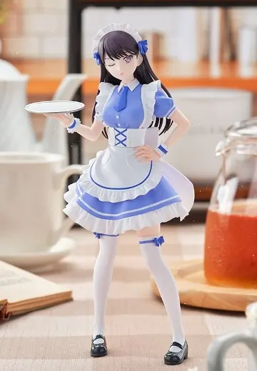 | **[XStellar 梦想协奏曲！迷途之子！！！！！椎名立希 ～甜蜜女仆～](https://www.hpoi.net/hobby/140102)** XStellar BanG Dream! 椎名立希 ～Sweet Maid～ 世嘉 · 梦想协奏曲！迷途之子！！！！！、梦想协奏曲！/ BanG Dream!、BanG Dream! 交织的乐章 · 椎名立希 比例人形 · XStellar | — | 2027-05 |
| 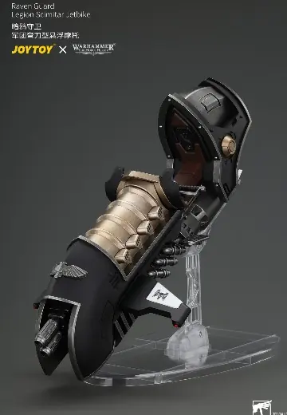 | **[战锤系列 “荷鲁斯之乱” 暗鸦守卫 军团弯刀型悬浮摩托 配备多管热熔枪](https://www.hpoi.net/hobby/140100)** 战锤系列 “荷鲁斯之乱” 暗鸦守卫 军团弯刀型悬浮摩托 配备多管热熔枪 JOYTOY暗源 · 战锤：荷鲁斯之乱 配件 · 1/18 | 199 元 | 2026-12 |
| 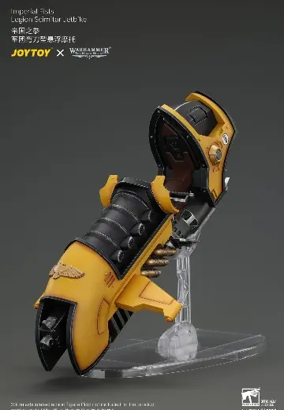 | **[战锤系列 “荷鲁斯之乱” 帝国之拳 军团弯刀型悬浮摩托 配备重型爆矢枪](https://www.hpoi.net/hobby/140097)** 战锤系列 “荷鲁斯之乱” 帝国之拳 军团弯刀型悬浮摩托 配备重型爆矢枪 JOYTOY暗源 · 战锤：荷鲁斯之乱 配件 · 1/18 | 199 元 | 2026-12 |
| 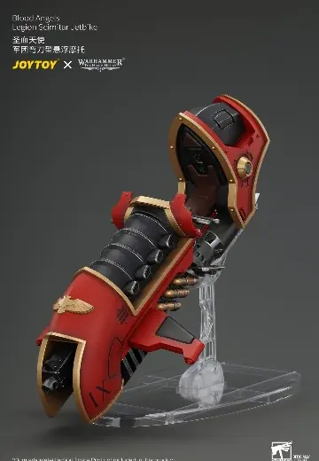 | **[战锤系列 “荷鲁斯之乱” 极限战士 军团弯刀型悬浮摩托 配备多管热熔枪](https://www.hpoi.net/hobby/140096)** 战锤系列 “荷鲁斯之乱” 极限战士 军团弯刀型悬浮摩托 配备多管热熔枪 JOYTOY暗源 · 战锤：荷鲁斯之乱 配件 · 1/18 | 199 元 | 2026-12 |
| 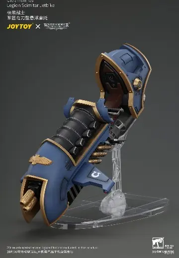 | **[战锤系列 “荷鲁斯之乱” 极限战士 军团弯刀型悬浮摩托 配备多管热熔枪](https://www.hpoi.net/hobby/140095)** 战锤系列 “荷鲁斯之乱” 极限战士 军团弯刀型悬浮摩托 配备多管热熔枪 JOYTOY暗源 · 战锤：荷鲁斯之乱 配件 · 1/18 | 199 元 | 2026-12 |
| 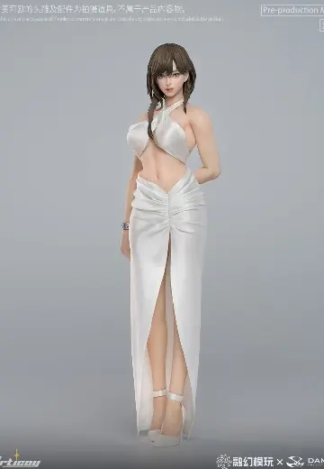 | **[铂金硅胶肤纹女素体-礼服装](https://www.hpoi.net/hobby/140093)** 铂金硅胶肤纹女素体-礼服装 融幻模玩 比例人形 · 1/6 | 488 元 | 2027-06 |
| 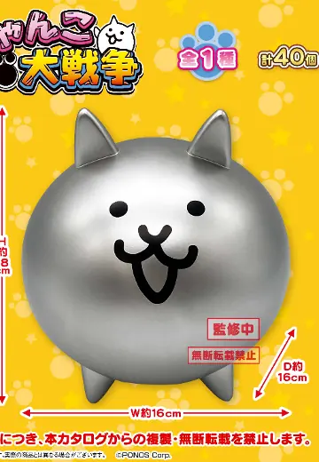 | **[猫咪大战争 BIG无比例手办](https://www.hpoi.net/hobby/140090)** にゃんこ大戦争BIGソフビフィギュア(メタルネコ) SK JAPAN · 猫咪大战争 幻想生物 | — | 2027-04 |
| 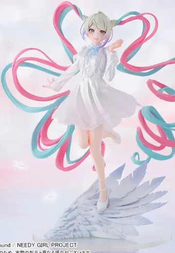 | **[世嘉 FIGURIZMα系列 主播女孩重度依赖 -超绝最可爱天使酱-](https://www.hpoi.net/hobby/140088)** 世嘉 FIGURIZMα系列 主播女孩重度依赖 -超绝最可爱天使酱- 世嘉 · 主播女孩重度依赖（动画） · 糖糖 / 超绝最可爱天使酱 比例人形 · FIGURIZMα | — | 2027-05 |
| 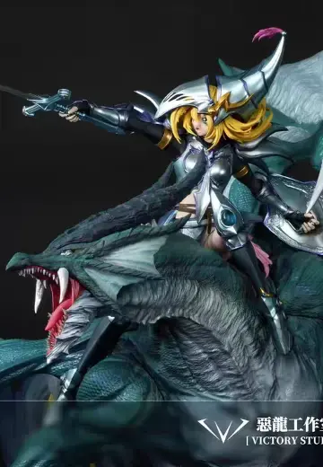 | **[游戏王 怪兽之决斗 龙骑士黑魔导女孩](https://www.hpoi.net/hobby/140078)** 游戏王 怪兽之决斗 龙骑士黑魔导女孩 易玩天开 · 游戏王、游戏王 怪兽之决斗 · 黑魔导女孩 比例人形 · 1/6 | 5,200 元 | 2027年第三季度 |
| 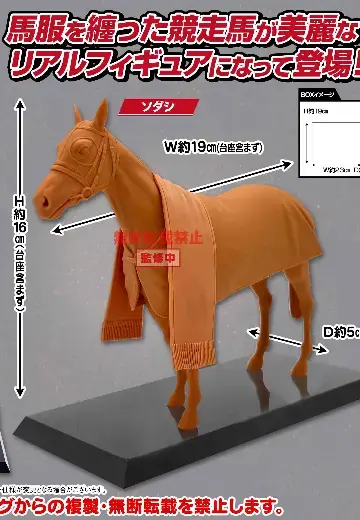 | **[名马收藏 无比例手办（Sodashi）](https://www.hpoi.net/hobby/140070)** サラブレッドコレクション魂クラフトフィギュア(ソダシ) SK JAPAN 自然生物 · 名马收藏 | — | 2027-04 |

旧品补录 2 件：HPOI 新收录、但早已发售的老商品

| 图 | 商品 | 价格 | 发售 |
|---|---|---|---|
| 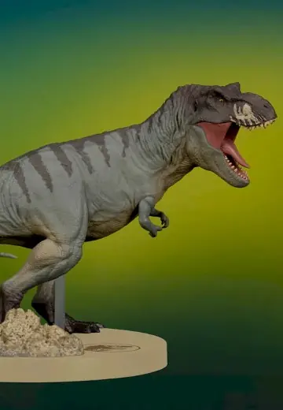 | **[《侏罗纪世界：重生》ACT/CUT 高级手办“霸王龙”](https://www.hpoi.net/hobby/140108)** ジュラシック・ワールド／復活の大地 ACT/CUTプレミアムフィギュア“T.REX” 世嘉 · 侏罗纪世界4：重生 · 暴龙（霸王龙） 自然生物 · ACT/CUT · 旧品补录 | — | 2025-08 |
| 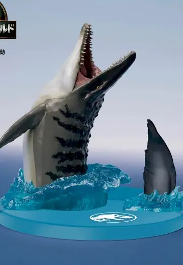 | **[《侏罗纪世界：重生》 ACT/CUT 高级手办“沧龙”](https://www.hpoi.net/hobby/140107)** ジュラシック・ワールド／復活の大地ACT/CUTプレミアムフィギュア“モササウルス” 世嘉 · 侏罗纪世界4：重生 自然生物 · ACT/CUT · 旧品补录 | — | 2025-08 |

## Sofmap（3）

| 图 | 商品 | 价格 | 发售 |
|---|---|---|---|
| 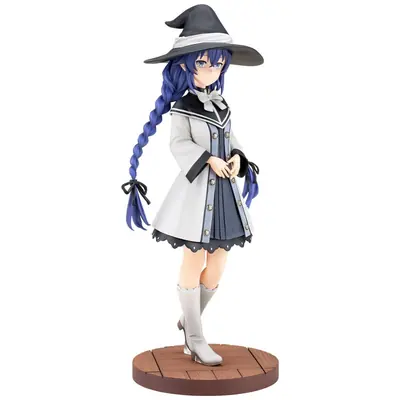 | **[塗装済み完成品 1/7 無職転生III ～異世界行ったら本気だす～ ロキシー・ミグルディア・グレイラット](https://a.sofmap.com/product_detail.aspx?sku=102445063)** コトブキヤ 1/7 · 预订中 | 19,800 日元 | 未定 |
| 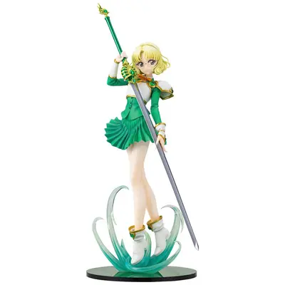 | **[塗装済み完成品 1/7 魔法騎士レイアース 鳳凰寺風](https://a.sofmap.com/product_detail.aspx?sku=102444969)** コトブキヤ 1/7 · 预订中 | 24,860 日元 | 未定 |
|  | **[4.5ちゃん 巡音ルカ 海の魔女ver.](https://a.sofmap.com/product_detail.aspx?sku=102451323)** FuRyu(フリュー) 预订中 | 3,300 日元 | 未定 |

## HLJ（9）

| 图 | 商品 | 价格 | 发售 |
|---|---|---|---|
|  | **[UDF BUGS BUNNY 1993 Air Jordan](https://www.hlj.com/udf-bugs-bunny-1993-air-jordan-medudf-974)** Medicom · Looney Tunes 预订中 | 2,430 日元 | 2027-01 |
| 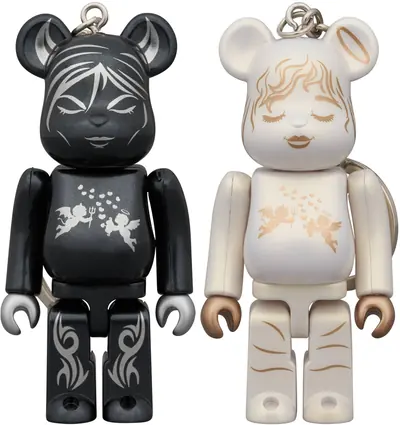 | **[LOVERS' BE@RBRICK 2PCS Set](https://www.hlj.com/lovers-be-rbrick-2pcs-set-med62842)** Medicom · Be@rbrick 预订中 | 4,085 日元 | 2026-12 |
|  | **[UDF BUGS BUNNY 1992 Air Jordan](https://www.hlj.com/udf-bugs-bunny-1992-air-jordan-medudf-973)** Medicom · Looney Tunes 预订中 | 2,430 日元 | 2027-01 |
| 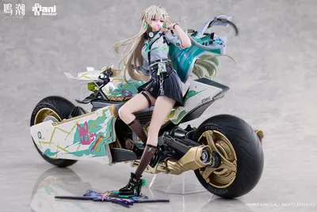 | **[1/7 Wuthering Waves: Lynae Deluxe Edition](https://www.hlj.com/1-7-scale-wuthering-waves-lynae-deluxe-edition-ant81104)** AniMester · Wuthering Waves 1/7 · 预订中 | 43,800 日元 | 2027-10 |
|  | **[OSHI WORKS Mini Shinji Ikari (Evangelion: New Theatrical Edition)](https://www.hlj.com/oshi-works-mini-shinji-ikari-evangelion-new-theatrical-edition-kbyqa-042)** Kotobukiya · Rebuild of Evangelion 预订中 | 1,800 日元 | 2027-05 |
| 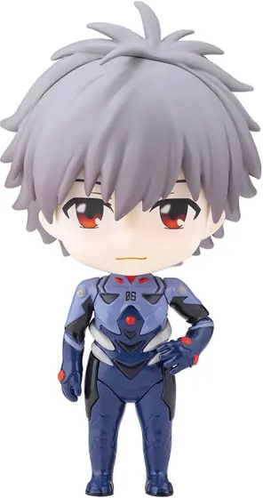 | **[OSHI WORKS Mini Kaworu Nagisa (Evangelion: New Theatrical Edition)](https://www.hlj.com/oshi-works-mini-kaworu-nagisa-evangelion-new-theatrical-edition-kbyqa-039)** Kotobukiya · Rebuild of Evangelion 预订中 | 1,800 日元 | 2027-05 |
| 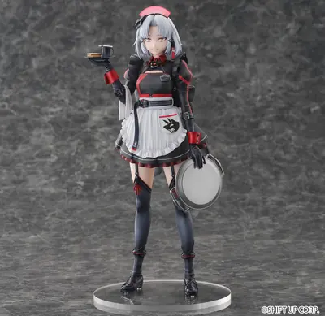 | **[1/6 Goddess of Victory: Nikke: Drake - Maid For Villain](https://www.hlj.com/1-6-scale-goddess-of-victory-nikke-drake-maid-for-villain-unc71879)** Union Creative · Goddess of Victory: Nikke 1/6 · 预订中 | 24,000 日元 | 2027-10 |
| 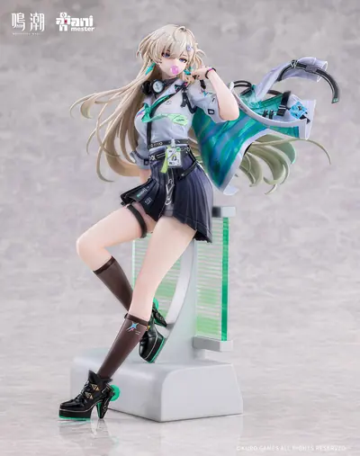 | **[1/7 Wuthering Waves: Lynae Standard Edition](https://www.hlj.com/1-7-scale-wuthering-waves-lynae-standard-edition-ant81103)** AniMester · Wuthering Waves 1/7 · 预订中 | 27,200 日元 | 2027-10 |
| 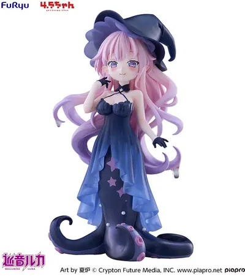 | **[4.5 chan Megurine Luka Sea Witch ver.](https://www.hlj.com/4-5-chan-megurine-luka-sea-witch-ver-fruamu-tnl0206)** FuRyu · Vocaloid 预订中 | 3,000 日元 | 2027-05 |

## Solaris Japan（30）

| 图 | 商品 | 价格 | 发售 |
|---|---|---|---|
|  | **[Bunny Suit Planning - Sophia F. Shirring - B-style - 1/4 - Bunny Ver., 4th (FREEing)](https://solarisjapan.com/products/bunny-suit-planning-sophia-f-shirring-b-style-1-4-bunny-ver-4th-freeing)** FREEing · Bunny Suit Planning · Sophia F. Shirring 1/4 · 预订中 · 成人向 | 238 美元 | 2027-05 |
| 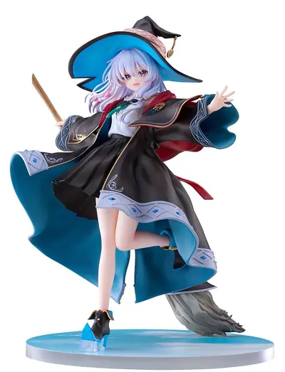 | **[Majo no Tabitabi - Elaina - F:Nex - 1/7 - Bloom Ver. (FuRyu)](https://solarisjapan.com/products/majo-no-tabitabi-elaina-f-nex-1-7-bloom-ver-furyu)** FuRyu · Majo no Tabitabi - Wandering Witch · Elaina 1/7 · 预订中 | 157 美元 | 2027-07 |
| 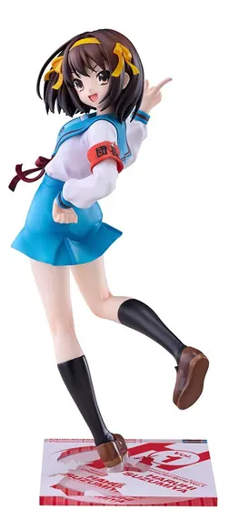 | **[Suzumiya Haruhi no Yuuutsu - Suzumiya Haruhi - F:Nex - 1/7 (FuRyu)](https://solarisjapan.com/products/suzumiya-haruhi-no-yuuutsu-suzumiya-haruhi-f-nex-1-7-furyu)** FuRyu · Suzumiya Haruhi no Yuuutsu · Suzumiya Haruhi 1/7 · 预订中 | 123 美元 | 2027-07 |
| 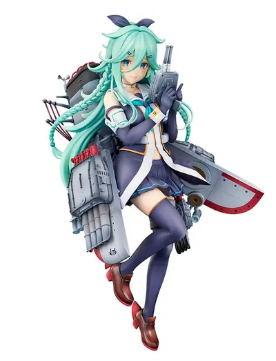 | **[Kantai Collection ~KanColle~ - Yamakaze - 1/7 - Kai Ni (Ques Q)](https://solarisjapan.com/products/kantai-collection-kancolle-yamakaze-1-7-kai-ni-ques-q)** ques Q · Kantai Collection ~KanColle~ · Yamakaze 1/7 · 预订中 | 172 美元 | 2027-11 |
| 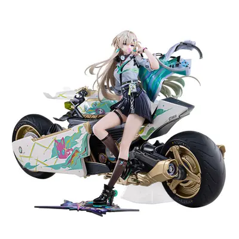 | **[Wuthering Waves - Lynae - 1/7 - Deluxe Edition (AniMester)](https://solarisjapan.com/products/wuthering-waves-lynae-1-7-deluxe-edition-animester)** Animester · Wuthering Waves · Lynae 1/7 · 预订中 | 268 美元 | 2027-10 |
| 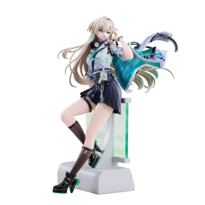 | **[Wuthering Waves - Lynae - 1/7 - Standard Edition (AniMester)](https://solarisjapan.com/products/wuthering-waves-lynae-1-7-standard-edition-animester)** Animester · Wuthering Waves · Lynae 1/7 · 预订中 | 166 美元 | 2027-10 |
| 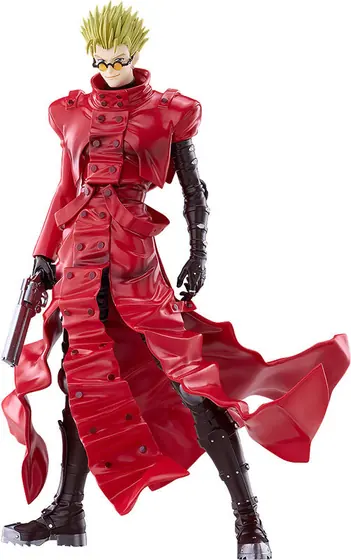 | **[Trigun - Vash the Stampede - Pop Up Parade - L (Good Smile Company)](https://solarisjapan.com/products/trigun-vash-the-stampede-pop-up-parade-l-good-smile-company)** Good Smile Company · Trigun · Vash the Stampede 预订中 | 50 美元 | 2027-06 |
| 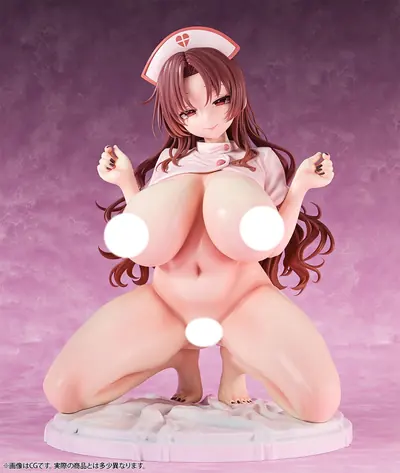 | **[Original - Takesato~san - 1/6 (Insight)](https://solarisjapan.com/products/original-takesato-san-1-6-insight)** Insight · Original 1/6 · 预订中 · 成人向 | 133 美元 | 2027-05 |
| 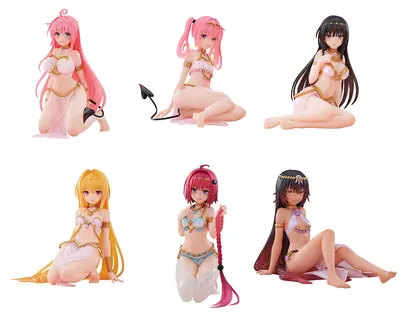 | **[To LOVEru Darkness - CHILLfigg - CHILLfigg Relax - CHILLfigg Relax To LOVEru Darkness Harem Gold Ver. - Harem Gold Ver. (Vision)](https://solarisjapan.com/products/to-loveru-darkness-chillfigg-chillfigg-relax-chillfigg-relax-to-loveru-darkness-harem-gold-ver-harem-gold-ver-vision)** Vision · To LOVEru Darkness 预订中 | 94 美元 | 2027-04 |
| 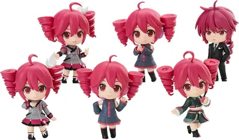 | **[Kasane Teto - Nendoroid Surprise - Nendoroid Surprise Kasane Teto Collection (Good Smile Company)](https://solarisjapan.com/products/kasane-teto-nendoroid-surprise-nendoroid-surprise-kasane-teto-collection-good-smile-company)** Good Smile Company · Kasane Teto · Kasane Teto Nendoroid · 预订中 | 60 美元 | 2027-06 |
| 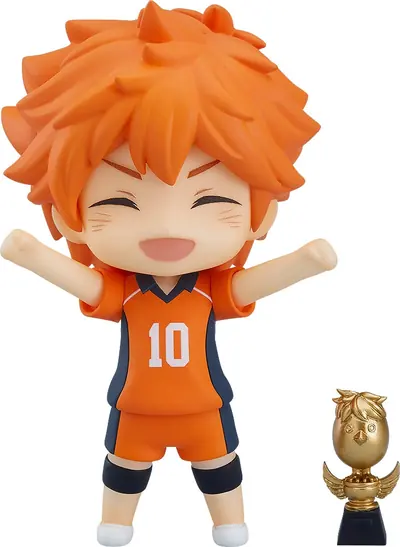 | **[Haikyuu!! - Nendoroid Surprise - Nendoroid Surprise Haikyu!! Zenkokutaikai Hen (Good Smile Company, Orange Rouge)](https://solarisjapan.com/products/haikyuu-nendoroid-surprise-nendoroid-surprise-haikyu-zenkokutaikai-hen-good-smile-company-orange-rouge)** Good Smile Company · Haikyuu!! Nendoroid · 预订中 | 80 美元 | 2027-06 |
| 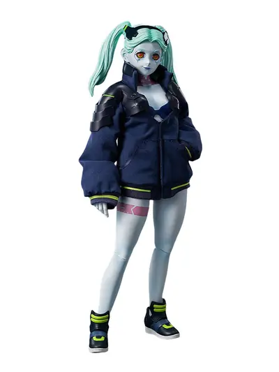 | **[Cyberpunk: Edgerunners - Rebecca - FigZero - 1/6 (ThreeZero)](https://solarisjapan.com/products/cyberpunk-edgerunners-rebecca-figzero-1-6-threezero)** ThreeZero · Cyberpunk: Edgerunners · Rebecca Action · 1/6 · 预订中 | 191 美元 | 2027-03 |
| 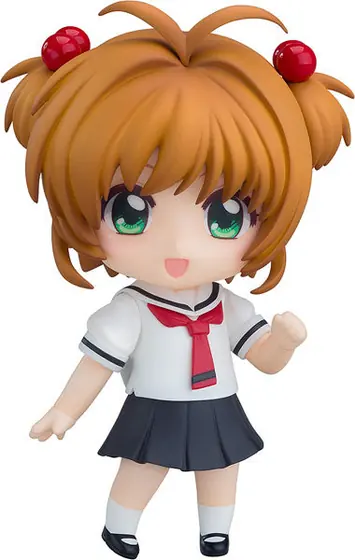 | **[Card Captor Sakura: Clear Card-hen - Kinomoto Sakura - Nendoroid (#3131) - Nendoroid Basic - Tomoeda Elementary School Summer Uniform Ver. (Good Smile Company)](https://solarisjapan.com/products/card-captor-sakura-clear-card-hen-kinomoto-sakura-nendoroid-3131-nendoroid-basic-tomoeda-elementary-school-summer-uniform-ver-good-smile-company)** Good Smile Company · Card Captor Sakura: Clear Card-hen · Sakura Kinomoto Nendoroid · 预订中 | 20 美元 | 2027-05 |
| 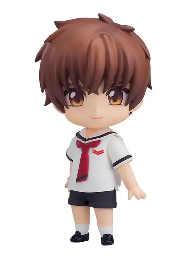 | **[Card Captor Sakura: Clear Card-hen - Li Syaoran - Nendoroid (#3132) - Nendoroid Basic - Tomoeda Elementary School Summer Uniform Ver. (Good Smile Company)](https://solarisjapan.com/products/card-captor-sakura-clear-card-hen-li-syaoran-nendoroid-3132-nendoroid-basic-tomoeda-elementary-school-summer-uniform-ver-good-smile-company)** Good Smile Company · Card Captor Sakura: Clear Card-hen · Li Syaoran Nendoroid · 预订中 | 20 美元 | 2027-05 |
| 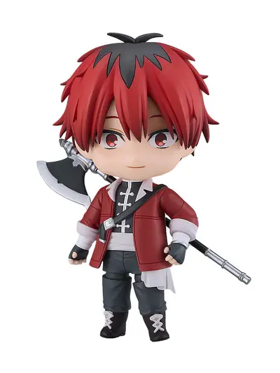 | **[Sousou no Frieren - Stark - Nendoroid (#2497) - 2027 Re-release (Good Smile Company)](https://solarisjapan.com/products/sousou-no-frieren-stark-nendoroid-2497-2027-re-release-good-smile-company)** Good Smile Company · Sousou no Frieren · Stark Nendoroid · 预订中 | 33 美元 | 2027-06 |
| 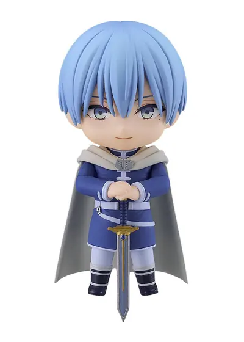 | **[Sousou no Frieren - Himmel - Nendoroid (#2498) - 2027 Re-release (Good Smile Company)](https://solarisjapan.com/products/sousou-no-frieren-himmel-nendoroid-2498-2027-re-release-good-smile-company)** Good Smile Company · Sousou no Frieren · Himmel Nendoroid · 预订中 | 33 美元 | 2027-06 |
| 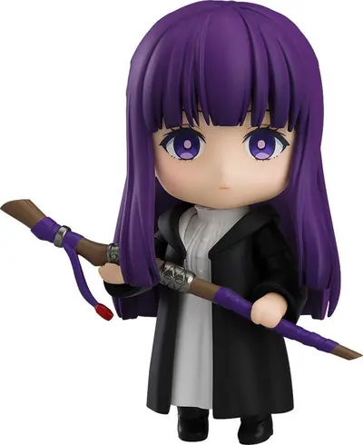 | **[Sousou no Frieren - Fern - Nendoroid (#2368) - 2027 Re-release (Good Smile Company)](https://solarisjapan.com/products/sousou-no-frieren-fern-nendoroid-2368-2027-re-release-good-smile-company)** Good Smile Company · Sousou no Frieren · Fern Nendoroid · 预订中 | 30 美元 | 2027-06 |
|  | **[Evangelion Shin Gekijouban - Ikari Shinji - Oshi Works Mini (Kotobukiya)](https://solarisjapan.com/products/evangelion-shin-gekijouban-ikari-shinji-oshi-works-mini-kotobukiya)** Kotobukiya · Evangelion Shin Gekijouban · Ikari Shinji 预订中 | 11 美元 | 2027-05 |
| 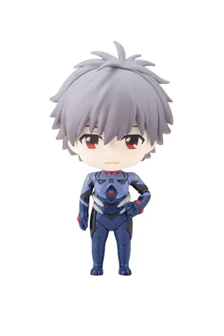 | **[Evangelion Shin Gekijouban - Nagisa Kaworu - Oshi Works Mini (Kotobukiya)](https://solarisjapan.com/products/evangelion-shin-gekijouban-nagisa-kaworu-oshi-works-mini-kotobukiya)** Kotobukiya · Evangelion Shin Gekijouban · Nagisa Kaworu 预订中 | 11 美元 | 2027-05 |
|  | **[Honkai: Star Rail - Ashveil - Piccodo - 1/12 (Genesis)](https://solarisjapan.com/products/honkai-star-rail-ashveil-piccodo-1-12-genesis)** Genesis · Honkai: Star Rail · Ashveil Action · 1/12 · 预订中 | 80 美元 | 2027-08 |
|  | **[Jujutsu Kaisen Shimetsu Kaiyuu - Datto - Fushiguro Megumi - Luminasta (Sega Fave)](https://solarisjapan.com/products/jujutsu-kaisen-shimetsu-kaiyuu-datto-fushiguro-megumi-luminasta-sega-fave)** Sega Fave · Jujutsu Kaisen Shimetsu Kaiyuu Prize | 0 美元 | 2026-12 |
|  | **[Kusuriya no Hitorigoto - Maomao - Luminasta - Kusuri to Koukishin (Sega Fave)](https://solarisjapan.com/products/kusuriya-no-hitorigoto-maomao-luminasta-kusuri-to-koukishin-sega-fave)** Sega Fave · Kusuriya no Hitorigoto Prize | 0 美元 | 2026-12 |
|  | **[Monogatari Series - Oshino Shinobu - XStellar (Sega Fave)](https://solarisjapan.com/products/monogatari-series-oshino-shinobu-xstellar-sega-fave)** Sega Fave · Monogatari Series Prize · 现货 | 43 美元 | 2026-12 |
|  | **[Piapro Characters - Hatsune Miku - Luminasta - Wandering Minstrel (Sega Fave)](https://solarisjapan.com/products/piapro-characters-hatsune-miku-luminasta-wandering-minstrel-sega-fave)** Sega Fave · Piapro Characters Prize | 0 美元 | 2026-12 |
|  | **[Needy Girl Overdose - Purple Lollipop - XStellar (Sega Fave)](https://solarisjapan.com/products/needy-girl-overdose-purple-lollipop-xstellar-sega-fave)** Sega Fave · Needy Girl Overdose Prize · 现货 | 43 美元 | 2026-12 |
|  | **[Shingeki no Kyojin The Final Season - Reiner Braun - Yoroi no Kyojin - GigantiX (Sega Fave)](https://solarisjapan.com/products/shingeki-no-kyojin-the-final-season-reiner-braun-yoroi-no-kyojin-gigantix-sega-fave)** Sega Fave · Shingeki no Kyojin The Final Season Prize · 现货 | 49 美元 | 2026-12 |
|  | **[Piapro Characters - Hatsune Miku - High Premium Figure - Mokomoko Christmas Ver. (Sega Fave)](https://solarisjapan.com/products/piapro-characters-hatsune-miku-high-premium-figure-mokomoko-christmas-ver-sega-fave)** Sega Fave · Piapro Characters Prize | 0 美元 | 2026-12 |
|  | **[Kagurabachi - Rokuhira Chihiro - Luminasta - Kuro (Sega Fave)](https://solarisjapan.com/products/kagurabachi-rokuhira-chihiro-luminasta-kuro-sega-fave)** Sega Fave · Kagurabachi Prize · 现货 | 43 美元 | 2026-12 |
|  | **[Jujutsu Kaisen Shimetsu Kaiyuu - Itadori Yuji - Luminasta (Sega Fave)](https://solarisjapan.com/products/jujutsu-kaisen-shimetsu-kaiyuu-itadori-yuji-luminasta-sega-fave)** Sega Fave · Jujutsu Kaisen Shimetsu Kaiyuu Prize | 0 美元 | 2026-12 |
|  | **[Jujutsu Kaisen Shimetsu Kaiyuu - Higuruma Hiromi - Luminasta (Sega Fave)](https://solarisjapan.com/products/jujutsu-kaisen-shimetsu-kaiyuu-higuruma-hiromi-luminasta-sega-fave)** Sega Fave · Jujutsu Kaisen Shimetsu Kaiyuu Prize | 0 美元 | 2026-12 |
