# 2026-11-26 手办新品

共 32 件（HPOI 26 · HLJ 1 · Solaris Japan 5）。点名称打开原页面。

## HPOI（26）

| 图 | 商品 | 价格 | 发售 |
|---|---|---|---|
| 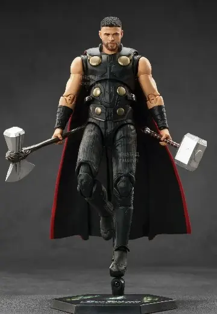 | **[《复仇者联盟5》雷神](https://www.hpoi.net/hobby/140251)** 《复仇者联盟5》雷神 中动玩具 · 漫威、复仇者联盟5:毁灭之日 · 雷神索尔 比例人形 · 1/10 | 189 元 | 2026-11 |
| 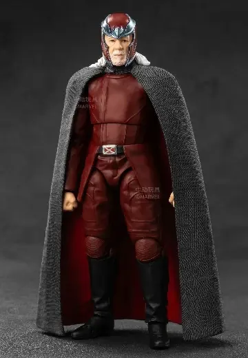 | **[《复仇者联盟5》万磁王](https://www.hpoi.net/hobby/140247)** 《复仇者联盟5》万磁王 中动玩具 · 漫威、复仇者联盟5:毁灭之日 · 万磁王 比例人形 · 1/10 | 189 元 | 2026-11 |
| 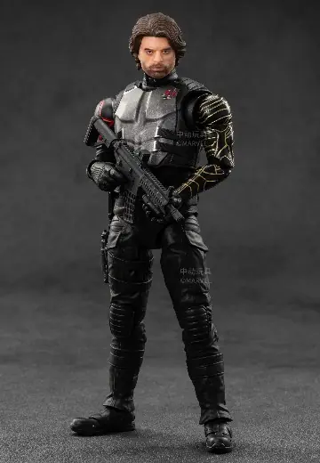 | **[《复仇者联盟5》冬兵](https://www.hpoi.net/hobby/140246)** 《复联5》冬兵 中动玩具 · 漫威、复仇者联盟5:毁灭之日 · 冬兵 比例人形 · 1/10 | 189 元 | 2026-11 |
| 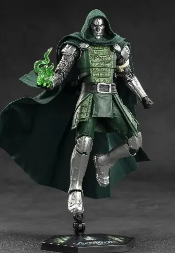 | **[毁灭博士](https://www.hpoi.net/hobby/140245)** 毁灭博士 可动人偶 中动玩具 · 漫威、复仇者联盟5:毁灭之日 · 维克多·冯·杜姆（毁灭博士） 比例人形 · 1/10 | 189 元 | 2026-11 |
| 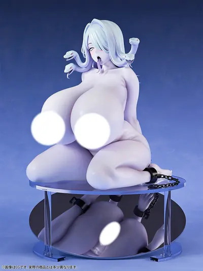 | **[肉感少女 异世界的奴◯市 出品番号09 美杜莎族](https://www.hpoi.net/hobby/140244)** 肉感少女 異世界の奴◯市 出品番号09 メドゥーサ族 Insight 比例人形 · 1/6 | 23,980 日元 含税，1006元 | 2027-05 |
| 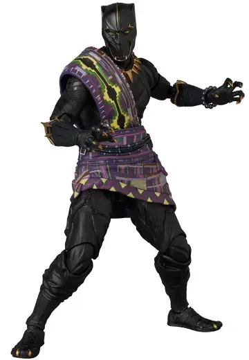 | **[MAFEX No.341 《黑豹》特查拉](https://www.hpoi.net/hobby/140243)** マフェックス No.341 MAFEX T’Chaka Medicom Toy · 漫威、黑豹 · 黑豹 (特查拉) 比例人形 · MAFEX | 14,080 日元 含税，590元 | 2027-09 |
| 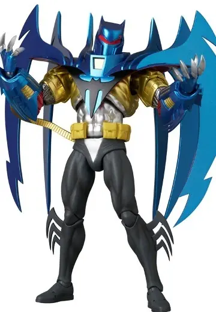 | **[MAFEX No.340 《蝙蝠侠：骑士陨落》 蝙蝠侠](https://www.hpoi.net/hobby/140242)** マフェックス No.340 MAFEX KNIGHTSEND BATMAN Medicom Toy · DC、蝙蝠侠：骑士陨落 · 蝙蝠侠 比例人形 · MAFEX | 14,080 日元 含税，590元 | 2027-10 |
| 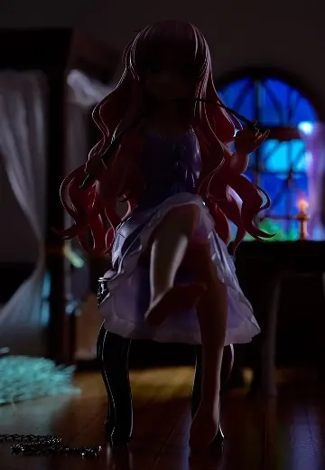 | **[零之使魔F 露易丝](https://www.hpoi.net/hobby/140240)** ゼロの使い魔F ルイズ 寿屋 · 零之使魔F · 露易丝·法兰西斯·露·布朗·杜·拉·瓦利埃尔 比例人形 | — | 未知 |
| 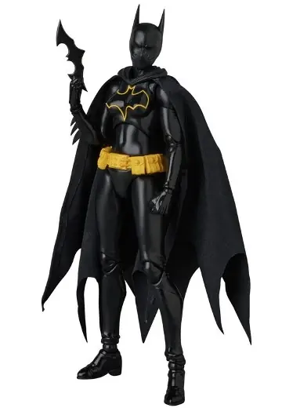 | **[MAFEX No.339 《蝙蝠侠：无主之地》 蝙蝠女（卡珊德拉·该隐）](https://www.hpoi.net/hobby/140237)** バットマン マフェックス No.339 BATGIRL(Cassandra Cain) Medicom Toy · 蝙蝠侠：无主之地、DC · 卡珊德拉·该隐、蝙蝠女 比例人形 · MAFEX | 14,080 日元 含税，590元 | 2027-10 |
|  | **[小羊肖恩 植绒标记扭蛋挂件](https://www.hpoi.net/hobby/140234)** ひつじのショーン フロッキーめじるしガチャマスコット Takara Tomy A.R.T.S 幻想生物 | 400 日元 单次扭蛋，含税，16元 | 2026-11 |
| 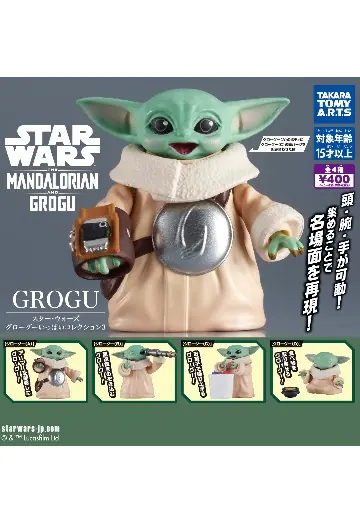 | **[星球大战 古古 满满收藏系列3](https://www.hpoi.net/hobby/140233)** スター・ウォーズ グローグーいっぱいコレクション3 Takara Tomy A.R.T.S · 曼达洛人、星球大战 · 古古 幻想生物 | 400 日元 单次扭蛋，含税，16元 | 2026-11 |
| 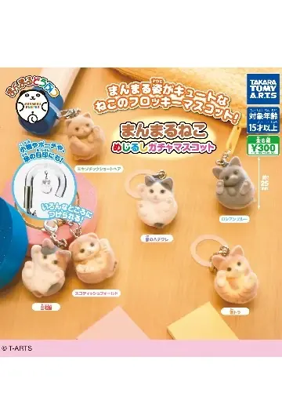 | **[圆滚滚动物 圆滚滚猫咪 挂饰扭蛋](https://www.hpoi.net/hobby/140232)** まんまるどうぶつ まんまるねこ めじるしガチャマスコット Takara Tomy A.R.T.S 自然生物 | 300 日元 单次扭蛋，含税，12元 | 2026-11 |
| 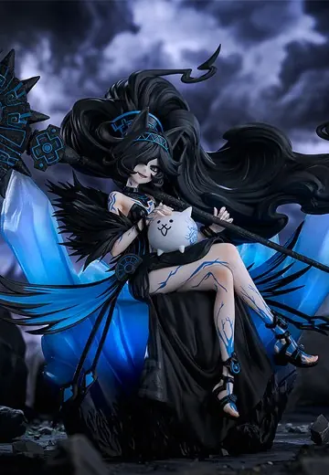 | **[猫咪大战争 漆黑魔女凯斯莉](https://www.hpoi.net/hobby/140231)** にゃんこ大戦争 漆黒の魔女ダークキャスリィ PONOS · 猫咪大战争 比例人形 · 1/7 | 29,700 日元 含税，1246元 | 2027-03 |
| 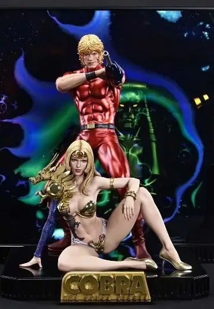 | **[传世王座 哥普拉 哥普拉 &amp; 玛杜小姐](https://www.hpoi.net/hobby/140229)** レガシーアート COBRA コブラ＆ミス・マドウ Prime 1 Studio · 哥普拉 · 哥普拉 比例人形 · 传世王座 · 1/4 | 256,190 日元 | 2028-07 |
| 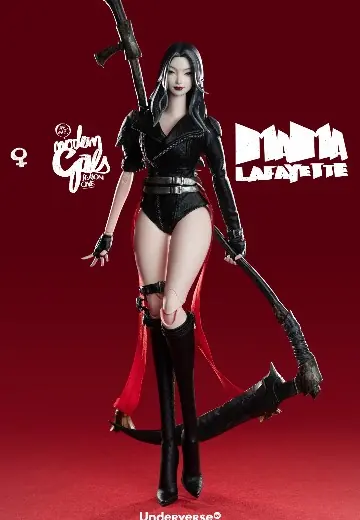 | **[Modern Gals Season One MAMA LAFAYETTE](https://www.hpoi.net/hobby/140226)** Modern Gals — Season One 1/6 收藏级可动人偶 MAMA LAFAYETTE Underverse 比例人形 · 1/6 | 1,180 元 | 2027年第二季度 |
| 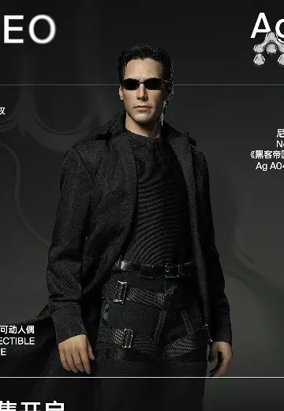 | **[黑客帝国 尼奥](https://www.hpoi.net/hobby/140224)** 《黑客帝国》-尼奥1/6收藏级可动人偶 INART · 黑客帝国1 比例人形 · 1/6 | — | 未知 |
| 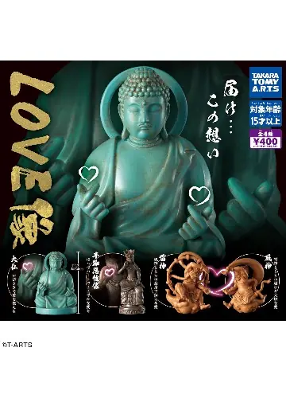 | **[LOVE像](https://www.hpoi.net/hobby/140222)** LOVE像 Takara Tomy A.R.T.S 幻想生物 | 400 日元 单次扭蛋，含税，16元 | 2026-11 |
| 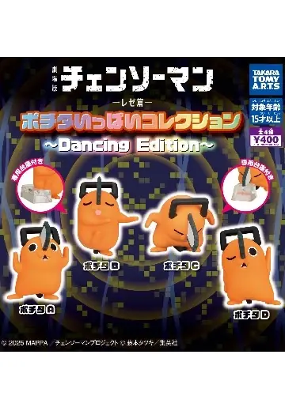 | **[剧场版《电锯人 蕾塞篇》 波奇塔满满收藏系列 ～Dancing Edition～](https://www.hpoi.net/hobby/140220)** 劇場版『チェンソーマン レゼ篇』 ポチタいっぱいコレクション ～Dnacing Edition～ Takara Tomy A.R.T.S · 链锯人 蕾塞篇 · 波奇塔 幻想生物 | 400 日元 单次扭蛋，含税，16元 | 2026-11 |
| 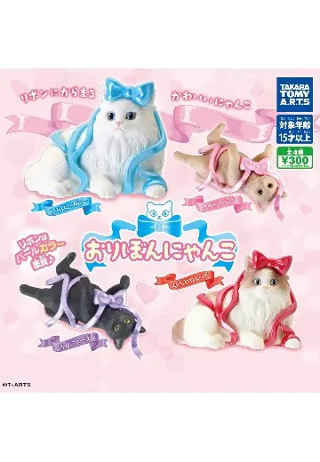 | **[缎带猫猫](https://www.hpoi.net/hobby/140218)** おりぼんにゃんこ Takara Tomy A.R.T.S 自然生物 | 300 日元 单次扭蛋，含税，12元 | 2026-11 |
| 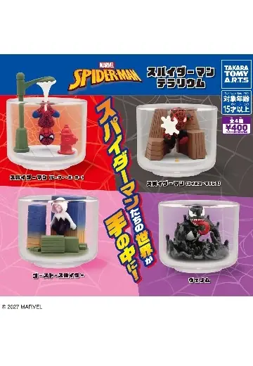 | **[蜘蛛侠 微景观生态瓶](https://www.hpoi.net/hobby/140214)** スパイダーマン テラリウム Takara Tomy A.R.T.S · 漫威 · 毒液、蜘蛛格温、蜘蛛侠 (迈尔斯·莫拉莱斯)、蜘蛛侠（彼得·帕克） 盒蛋/扭蛋 | 400 日元 单次扭蛋，含税，16元 | 2027-01 |
|  | **[Fuwa Petit Q版玩偶 蔚蓝档案 早濑优香](https://www.hpoi.net/hobby/140200)** ブルーアーカイブ ふわぷち デフォルメフィギュア ユウカ 世嘉 · 蔚蓝档案 · 早濑优香 Q版人形 · Fuwa Petit | 3,080 日元 含税，129元 | 2027-07 |
|  | **[Fuwa Petit Q版玩偶 蔚蓝档案 生盐诺亚](https://www.hpoi.net/hobby/140197)** ブルーアーカイブ ふわぷち デフォルメフィギュア ノア 世嘉 · 蔚蓝档案 · 生盐诺亚 Q版人形 · Fuwa Petit | 3,080 日元 含税，129元 | 2027-07 |
| 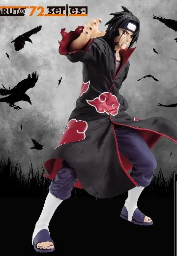 | **[火影忍者72册漫画封面系列- 43 忍界造型列传 宇智波鼬](https://www.hpoi.net/hobby/140194)** NARUTO 72 series- 43 忍界造形列伝-うちはイタチ 眼镜厂 · 火影忍者 疾风传 · 宇智波鼬 比例人形 · -火影忍者72册漫画封面系列-、忍界造型列传 | — | 2027-05 |
|  | **[Fuwa Petit Q版玩偶 蔚蓝档案 黑崎小雪](https://www.hpoi.net/hobby/140192)** ブルーアーカイブ ふわぷち デフォルメフィギュア コユキ 世嘉 · 蔚蓝档案 · 黑崎小雪 Q版人形 · Fuwa Petit | 3,080 日元 含税，129元 | 2027-07 |

旧品补录 2 件：HPOI 新收录、但早已发售的老商品

| 图 | 商品 | 价格 | 发售 |
|---|---|---|---|
| 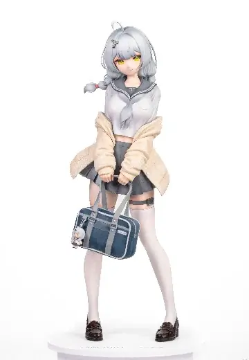 | **[浅野天琪 新公式服Ver. 珍藏手办](https://www.hpoi.net/hobby/140241)** 浅野天琪 新公式服Ver. 珍藏手办 AMIM青模社 比例人形 · 旧品补录 | 520 元 | 2026-08 |
| 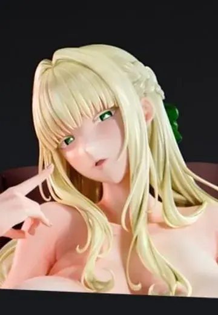 | **[圣华女学院公认竿叔叔4 路易莎·里希特](https://www.hpoi.net/hobby/140238)** 黒巣ガタリ『聖華女学院公認竿おじさん４』生徒会長 ルイーザ・リヒター 1/4スケール塗装済み完成品フィギュア Insight 比例人形 · 1/4 · 旧品补录 | 32,780 日元 | 2025-07 |

## HLJ（1）

| 图 | 商品 | 价格 | 发售 |
|---|---|---|---|
|  | **[1/1 Crystal Lake: Baby Jason Prop Replica](https://www.hlj.com/1-1-scale-crystal-lake-baby-jason-prop-replica-nec15475)** Neca · Friday the 13th 1/1 · 预订中 | 48,780 日元 | 2027-11 |

## Solaris Japan（5）

| 图 | 商品 | 价格 | 发售 |
|---|---|---|---|
|  | **[Samurai Spirits - Majikina Mina - 1/6 - Limited Edition (Amakuni, Hobby Japan) \[Shop Exclusive\]](https://solarisjapan.com/products/samurai-spirits-majikina-mina-1-6-limited-edition-amakuni-hobby-japan-shop-exclusive)** AMAKUNI · Samurai Spirits · Mina Majikina 1/6 · 成人向 | 232 美元 | 2027-06 |
|  | **[Goddess of Victory: Nikke - Drake - 1/6 - Maid For Villain (Union Creative International Ltd)](https://solarisjapan.com/products/goddess-of-victory-nikke-drake-1-6-maid-for-villain-union-creative-international-ltd)** Union Creative International Ltd · Goddess of Victory: Nikke · Drake 1/6 · 预订中 | 155 美元 | 2027-10 |
| 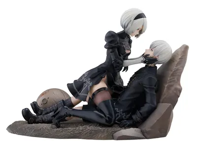 | **[NieR:Automata Ver1.1a - YoRHa No. 2 Type B - YoRHa No. 9 Type S - Shibuya Scramble Figure - 1/7 (CyberZ)](https://solarisjapan.com/products/nier-automata-ver1-1a-yorha-no-2-type-b-yorha-no-9-type-s-shibuya-scramble-figure-1-7-cyberz)** CyberZ · NieR Series · YoRHa No. 2 Type B YoRHa No. 9 Type S 1/7 · 预订中 | 220 美元 | 2027-08 |
| 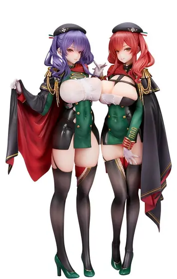 | **[Azur Lane - Pola - Zara - 1/7 (Alter)](https://solarisjapan.com/products/azur-lane-pola-zara-1-7-alter)** Alter · Azur Lane · Pola Zara 1/7 · 预订中 | 245 美元 | 2027-11 |
|  | **[Original - Sister Tiroir - Nude Version - 1/7 (Insight)](https://solarisjapan.com/products/original-sister-tiroir-nude-version-1-7-insight)** Insight · Original 1/7 · 预订中 · 成人向 | 60 美元 | 2027-04 |
