# 2026-11-27 手办新品

共 53 件（HPOI 9 · Good Smile 官网 8 · HLJ 5 · Sofmap 13 · Solaris Japan 18）。点名称打开原页面。

## HPOI（9）

| 图 | 商品 | 价格 | 发售 |
|---|---|---|---|
|  | **[麻糬与棉花糖 棉花糖](https://www.hpoi.net/hobby/140334)** 麻糬与棉花糖 棉花糖 SIKI ANIM 比例人形 · 1/4 | — | 未知 |
|  | **[FIGURIZMα系列 咒术回战 怀玉·玉折 五条悟 觉醒](https://www.hpoi.net/hobby/140333)** 世嘉 | — | 2027-05 |
|  | **[FIGURIZMα系列 初音未来 黎明](https://www.hpoi.net/hobby/140332)** 世嘉 | — | 2027-05 |
|  | **[XStellar系列 少女乐队的呐喊剧场版 制作发表纪念插画 井芹仁菜](https://www.hpoi.net/hobby/140315)** 世嘉 | — | 2027-05 |
|  | **[食玩 拓麻歌子 食玩BOX 第7弹 盲盒](https://www.hpoi.net/hobby/140271)** たまごっち おかしなたまごボーロっち パッケージチャームつき４ 万代 · 拓麻歌子 盒蛋/扭蛋 · 万代食玩 | 396 日元 | 2027-05 |
|  | **[食玩 HUNTER×HUNTER 食玩BOX 第1弹 盲盒](https://www.hpoi.net/hobby/140268)** HUNTER×HUNTER パッケージチャーム×ビスケット 万代 · 全职猎人 · 侠客、西索、雷欧力·帕拉丁奈特、飞坦、杰·富力士、酷拉皮卡、奇犽·揍敌客、库洛洛·鲁西鲁 盒蛋/扭蛋 · 万代食玩 | 396 日元 | 2027-05 |
|  | **[OSHI WORKS 寂静岭f 深水雏子](https://www.hpoi.net/hobby/140266)** OSHI WORKS SILENT HILL f 深水 雛子 寿屋 · 寂静岭f · 深水雏子 比例人形 · OSHI WORKS · 1/7 | 9,350 日元 含税，390元 | 2027-06 |
|  | **[《复仇者联盟4》钢铁侠MK85](https://www.hpoi.net/hobby/140265)** 《复仇者联盟4》钢铁侠MK85 中动玩具 · 漫威、复仇者联盟4：终局之战 · 钢铁侠 比例人形 | 399 元 | 2026-09 |
|  | **[天玑系列 师兄啊师兄 云霄仙子](https://www.hpoi.net/hobby/140264)** 天玑系列 师兄啊师兄 云霄仙子 1/4收藏级雕像 光年工作室 比例人形 · 1/4 | — | 未知 |

## Good Smile 官网（8）

| 图 | 商品 | 价格 | 发售 |
|---|---|---|---|
| 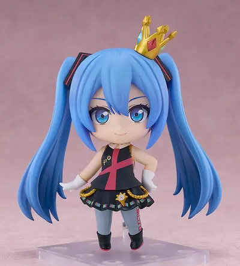 | **[ねんどろいど 初音ミク 気まぐれメルシィVer.](https://www.goodsmile.com/ja/product/1144443)** グッドスマイルカンパニー · キャラクター・ボーカル・シリーズ01 初音ミク ねんどろいど · ノンスケール · 预订中 · 附特典 | 7,800 日元 | 未定 截订 2027-01-06 |
|  | **[ねんどろいど 獅堂 光](https://www.goodsmile.com/ja/product/1137451)** グッドスマイルカンパニー · TVアニメ「魔法騎士レイアース」 ねんどろいど · ノンスケール · 预订中 · 附特典 | 7,500 日元 | 未定 截订 2027-01-06 |
|  | **[ねんどろいど 龍咲 海](https://www.goodsmile.com/ja/product/1140462)** グッドスマイルカンパニー · TVアニメ「魔法騎士レイアース」 ねんどろいど · ノンスケール · 预订中 · 附特典 | 7,500 日元 | 未定 截订 2027-01-06 |
| 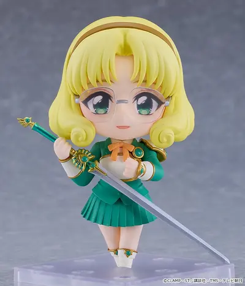 | **[ねんどろいど 鳳凰寺 風](https://www.goodsmile.com/ja/product/1140463)** グッドスマイルカンパニー · TVアニメ「魔法騎士レイアース」 ねんどろいど · ノンスケール · 预订中 · 附特典 | 7,500 日元 | 未定 截订 2027-01-06 |
| 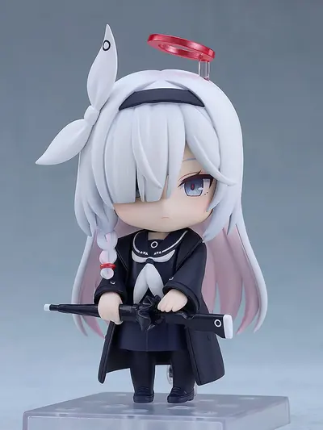 | **[ねんどろいど プラナ](https://www.goodsmile.com/ja/product/60275)** グッドスマイルカンパニー · ブルーアーカイブ -Blue Archive- ねんどろいど · ノンスケール · 预订中 · 再贩 · 附特典 | 6,700 日元 | 2027-04 截订 2027-01-06 |
|  | **[ねんどろいど 鹿目まどか 〈ワルプルギスの廻天〉Ver. べーしっく](https://www.goodsmile.com/ja/product/1139201)** グッドスマイルカンパニー · 劇場版 魔法少女まどか☆マギカ〈ワルプルギスの廻天〉 ねんどろいどシリーズ · ノンスケール · 预订中 · 再贩 · 附特典 | 3,900 日元 | 2027-06 截订 2027-01-13 |
|  | **[ねんどろいど 暁美ほむら 〈ワルプルギスの廻天〉Ver. べーしっく](https://www.goodsmile.com/ja/product/1139202)** グッドスマイルカンパニー · 劇場版 魔法少女まどか☆マギカ〈ワルプルギスの廻天〉 ねんどろいど · ノンスケール · 预订中 · 再贩 · 附特典 | 3,900 日元 | 2027-06 截订 2027-01-13 |
|  | **[Infinity Studio X Blizzard &lt;World of Warcraft&gt; グロマッシュ・ヘルスクリーム 1/3バストモデル](https://www.goodsmile.com/ja/product/1147696)** Infinity Studio · World of Warcraft その他フィギュア · 1/3 · 预订中 | 87,500 日元 | 未定 截订 2027-01-06 |

## HLJ（5）

| 图 | 商品 | 价格 | 发售 |
|---|---|---|---|
|  | **[1/6 Louise Negligee Ver. (The Familiar of Zero F)](https://www.hlj.com/1-6-scale-louise-negligee-ver-the-familiar-of-zero-f-kbypv-469)** Kotobukiya · Zero no Tsukaima 1/6 · 预订中 | 18,000 日元 | 2027-06 |
|  | **[1/3 Infinity Studio x Blizzard (World of Warcraft) Grommash Hellscream Bust Model](https://www.hlj.com/1-3-scale-infinity-studio-x-blizzard-world-of-warcraft-grommash-hellscream-bust-model-iso32312)** Infinity Studio · World of Warcraft 1/3 · 预订中 | 79,545 日元 | 2027-11 |
| 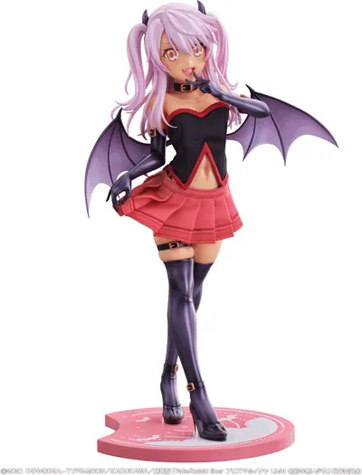 | **[1/4 Fate/kaleid liner PRISMA ILLYA Licht Nameless Girl: Re Dress Chloe von Einzbern Sweet Devil Ver.](https://www.hlj.com/1-4-scale-fate-kaleid-liner-prisma-illya-licht-nameless-girl-re-dress-chloe-von-einzbern-sweet-devil-ver-mdc85992)** Medicos · Fate/kaleid liner Prisma Illya 1/4 · 预订中 | 24,500 日元 | 2027-08 |
|  | **[1/7 Shimizu Hinako OSHI WORKS (SILENT HILL f)](https://www.hlj.com/1-7-scale-shimizu-hinako-oshi-works-silent-hill-f-kbygp-056)** Kotobukiya · Silent Hill 1/7 · 预订中 | 8,500 日元 | 2027-06 |
|  | **[1/7 Kaguya (Cosmic Princess Kaguya!)](https://www.hlj.com/1-7-scale-kaguya-cosmic-princess-kaguya-kbypv-475)** Kotobukiya · Cosmic Princess Kaguya! 1/7 · 预订中 | 24,000 日元 | 2027-10 |

## Sofmap（13）

| 图 | 商品 | 价格 | 发售 |
|---|---|---|---|
|  | **[CHILLfigg Relax To LOVEる-とらぶる-ダークネス Harem Gold ver.【単品】](https://a.sofmap.com/product_detail.aspx?sku=102451336)** VISION コレクション・ミニフィギュア · 预订中 | 3,000 日元 | 2027-04 |
| 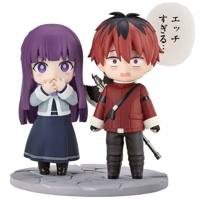 | **[Mini Memory 葬送のフリーレン フェルン＆シュタルク](https://a.sofmap.com/product_detail.aspx?sku=102451345)** グッドスマイルカンパニー 预订中 | 6,800 日元 | 未定 |
| 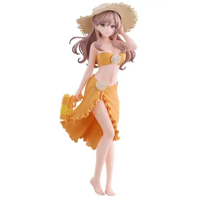 | **[POP UP PARADE BEACH QUEENS わたしが恋人になれるわけないじゃん、ムリムリ！（※ムリじゃなかった！？） 瀬名紫陽花 L size](https://a.sofmap.com/product_detail.aspx?sku=102451333)** グッドスマイルカンパニー 预订中 | 8,800 日元 | 未定 |
|  | **[POP UP PARADE BEACH QUEENS わたしが恋人になれるわけないじゃん、ムリムリ！（※ムリじゃなかった！？） 王塚真唯 L size](https://a.sofmap.com/product_detail.aspx?sku=102451331)** グッドスマイルカンパニー 预订中 | 8,800 日元 | 未定 |
|  | **[POP UP PARADE BEACH QUEENS わたしが恋人になれるわけないじゃん、ムリムリ！（※ムリじゃなかった！？） 甘織れな子 L size](https://a.sofmap.com/product_detail.aspx?sku=102451384)** グッドスマイルカンパニー 预订中 | 8,800 日元 | 未定 |
| 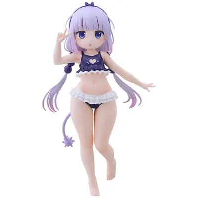 | **[POP UP PARADE BEACH QUEENS 小林さんちのメイドラゴン カンナ Lsize](https://a.sofmap.com/product_detail.aspx?sku=102451372)** グッドスマイルカンパニー 预订中 | 8,800 日元 | 未定 |
| 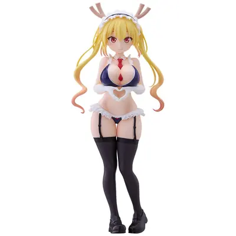 | **[POP UP PARADE BEACH QUEENS 小林さんちのメイドラゴン トール Lsize](https://a.sofmap.com/product_detail.aspx?sku=102451369)** グッドスマイルカンパニー 预订中 | 8,800 日元 | 未定 |
| 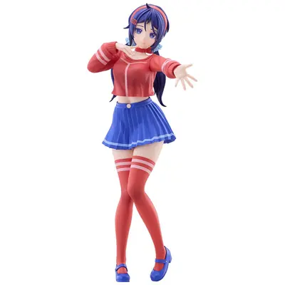 | **[POP UP PARADE MiSide ： ミサイド ミタ L size](https://a.sofmap.com/product_detail.aspx?sku=102451366)** グッドスマイルカンパニー 预订中 | 8,800 日元 | 未定 |
| 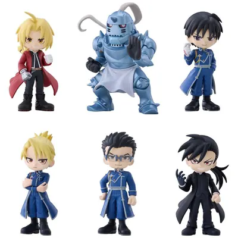 | **[PalVerse（パルバース） 鋼の錬金術師 FULLMETAL ALCHEMIST【単品】](https://a.sofmap.com/product_detail.aspx?sku=102451360)** ブシロードクリエイティブ コレクション・ミニフィギュア · 预订中 | 1,210 日元 | 2027-05 |
|  | **[nazoQ ぬーどるストッパーフィギュア 桜ミク【単品】](https://a.sofmap.com/product_detail.aspx?sku=102451387)** FuRyu(フリュー) コレクション・ミニフィギュア · 预订中 | 1,430 日元 | 2027-05 |
|  | **[【二次再販】ねんどろいどさぷらいず ハイキュー！！全国大会編【単品】](https://a.sofmap.com/product_detail.aspx?sku=102451319)** オランジュルージュ 预订中 · 再贩 | 1,800 日元 | 未定 |
| 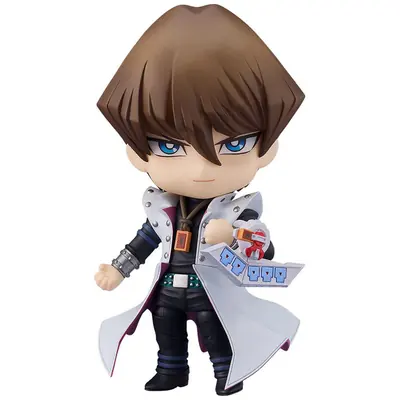 | **[【再販】ねんどろいど 遊☆戯☆王デュエルモンスターズ 海馬瀬人](https://a.sofmap.com/product_detail.aspx?sku=102451361)** グッドスマイルカンパニー 预订中 · 再贩 | 7,400 日元 | 未定 |
|  | **[【再販】塗装済み完成品 1/7 G.S.Collection プロジェクトセカイ カラフルステージ！ feat. 初音ミク Rose Cage Ver.](https://a.sofmap.com/product_detail.aspx?sku=102451340)** グッドスマイルカンパニー 1/7 · 预订中 · 再贩 | 32,800 日元 | 未定 |

## Solaris Japan（18）

| 图 | 商品 | 价格 | 发售 |
|---|---|---|---|
| 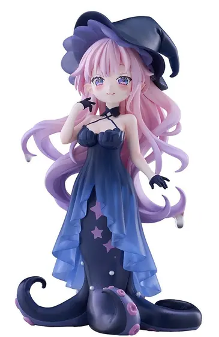 | **[Piapro Characters - Megurine Luka - 4.5 Chan - Umi no Majo Ver. (FuRyu)](https://solarisjapan.com/products/piapro-characters-megurine-luka-4-5-chan-umi-no-majo-ver-furyu)** FURYU · Hatsune Miku Vocaloid · Megurine Luka 预订中 | 18 美元 | 2027-05 |
|  | **[Chou Kaguya-hime! - Kaguya - 1/7 (Kotobukiya)](https://solarisjapan.com/products/chou-kaguya-hime-kaguya-1-7-kotobukiya)** Kotobukiya · Chou Kaguya-hime! · Kaguya 1/7 · 预订中 | 147 美元 | 2027-10 |
| 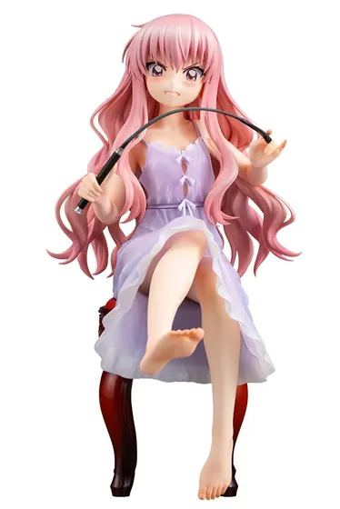 | **[Zero no Tsukaima - Louise Françoise Le Blanc de la Vallière - 1/6 - Negligee Ver. (Kotobukiya)](https://solarisjapan.com/products/zero-no-tsukaima-louise-francoise-le-blanc-de-la-valliere-1-6-negligee-ver-kotobukiya)** Kotobukiya · Zero no Tsukaima · Louise Francoise Le Blanc de La Valliere 1/6 · 预订中 | 110 美元 | 2027-06 |
| 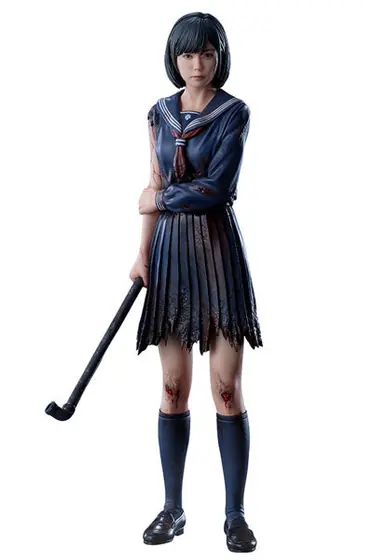 | **[Silent Hill f - Shimizu Hinako - Oshi Works - 1/7 (Kotobukiya)](https://solarisjapan.com/products/silent-hill-f-shimizu-hinako-oshi-works-1-7-kotobukiya)** Kotobukiya · Silent Hill f · Hinako Shimizu 1/7 · 预订中 | 52 美元 | 2027-06 |
|  | **[Gekijouban Fate/kaleid Liner Prisma ☆ Illya: Licht - Namae no Nai Shoujo - Chloe von Einzbern - Re▼Dress - 1/4 - Sweet Devil Ver. (Medicos Entertainment)](https://solarisjapan.com/products/gekijouban-fate-kaleid-liner-prisma-illya-licht-namae-no-nai-shoujo-chloe-von-einzbern-re-dress-1-4-sweet-devil-ver-medicos-entertainment)** Medicos Entertainment · Gekijouban Fate/kaleid Liner Prisma ☆ Illya: Licht · Chloe Von Einzbern(Kuro/Archer/Avenger) 1/4 · 预订中 · 成人向 | 150 美元 | 2027-08 |
|  | **[Sokuhame Dekichau JK Miya-chan no Ichinichi - Kojou Miyako - 1/6 - Deluxe Edition (PinkMango)](https://solarisjapan.com/products/sokuhame-dekichau-jk-miya-chan-no-ichinichi-kojou-miyako-1-6-deluxe-edition-pinkmango)** PinkMango · Sokuhame Dekichau JK Miya-chan no Ichinichi · Kojou Miyako 1/6 · 预订中 · 成人向 | 194 美元 | 2027-11 |
|  | **[Sokuhame Dekichau JK Miya-chan no Ichinichi - Kojou Miyako - 1/6 (PinkMango)](https://solarisjapan.com/products/sokuhame-dekichau-jk-miya-chan-no-ichinichi-kojou-miyako-1-6-pinkmango)** PinkMango · Sokuhame Dekichau JK Miya-chan no Ichinichi · Kojou Miyako 1/6 · 预订中 · 成人向 | 168 美元 | 2027-11 |
|  | **[Original - Ramaja Lulu - 1/6 (Insight)](https://solarisjapan.com/products/original-ramaja-lulu-1-6-insight)** Insight · Original 1/6 · 预订中 · 成人向 | 133 美元 | 2027-05 |
|  | **[Original - Isekai no Dorei Ichi - Item No. 09 - Medusa - 1/6 (Insight)](https://solarisjapan.com/products/original-isekai-no-dorei-ichi-item-no-09-medusa-1-6-insight)** Insight · Original 1/6 · 预订中 · 成人向 | 133 美元 | 2027-05 |
|  | **[Vocaloid - Hatsune Miku - Nendoroid (#3181) - Kimagure Mercy Ver. (Good Smile Company)](https://solarisjapan.com/products/vocaloid-hatsune-miku-nendoroid-3181-kimagure-mercy-ver-good-smile-company)** Good Smile Company · Hatsune Miku Vocaloid · Hatsune Miku Nendoroid · 预订中 | 43 美元 | 2027-06 |
| 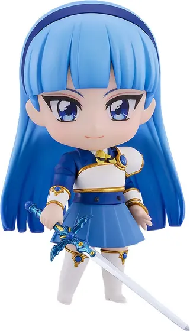 | **[Magic Knight Rayearth - Ryuuzaki Umi - Nendoroid (#3161) (Good Smile Company)](https://solarisjapan.com/products/magic-knight-rayearth-ryuuzaki-umi-nendoroid-3161-good-smile-company)** Good Smile Company · Magic Knight Rayearth · Ryuuzaki Umi Nendoroid · 预订中 | 42 美元 | 2027-04 |
|  | **[Magic Knight Rayearth - Mokona - Shidou Hikaru - Nendoroid (#3160) (Good Smile Company)](https://solarisjapan.com/products/magic-knight-rayearth-mokona-shidou-hikaru-nendoroid-3160-good-smile-company)** Good Smile Company · Magic Knight Rayearth · Mokona Shidou Hikaru Nendoroid · 预订中 | 42 美元 | 2027-04 |
|  | **[Magic Knight Rayearth - Hououji Fuu - Nendoroid (#3162) (Good Smile Company)](https://solarisjapan.com/products/magic-knight-rayearth-hououji-fuu-nendoroid-3162-good-smile-company)** Good Smile Company · Magic Knight Rayearth · Hououji Fuu Nendoroid · 预订中 | 42 美元 | 2027-04 |
|  | **[Blue Archive - Plana - Nendoroid (#2603) - 2027 Re-release (Good Smile Company)](https://solarisjapan.com/products/blue-archive-plana-nendoroid-2603-2027-re-release-good-smile-company)** Good Smile Company · Blue Archive · Plana Nendoroid · 预订中 | 37 美元 | 2027-04 |
|  | **[Gekijouban Mahou Shoujo Madoka☆Magica Walpurgis no Kaiten - Kaname Madoka - Nendoroid (#2920) - Nendoroid Basic - Walpurgisnacht: Rising Ver. - 2027 Re-release (Good Smile Company)](https://solarisjapan.com/products/gekijouban-mahou-shoujo-madoka-magica-walpurgis-no-kaiten-kaname-madoka-nendoroid-2920-nendoroid-basic-walpurgisnacht-rising-ver-2027-re-release-good-smile-company)** Good Smile Company · Madoka Magica · Kaname Madoka Nendoroid · 预订中 | 22 美元 | 2027-06 |
|  | **[Gekijouban Mahou Shoujo Madoka☆Magica Walpurgis no Kaiten - Akemi Homura - Nendoroid (#3001) - Nendoroid Basic - 2027 Re-release (Good Smile Company)](https://solarisjapan.com/products/gekijouban-mahou-shoujo-madoka-magica-walpurgis-no-kaiten-akemi-homura-nendoroid-3001-nendoroid-basic-2027-re-release-good-smile-company)** Good Smile Company · Madoka Magica · Akemi Homura Nendoroid · 预订中 | 22 美元 | 2027-06 |
| 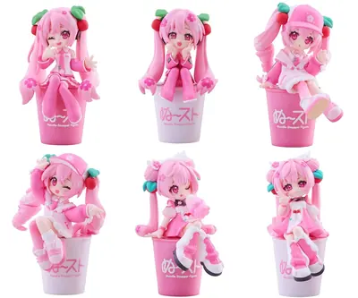 | **[Piapro Characters - Hatsune Miku - nazoQ Sakura Miku Series - Noodle Stopper Figure (FuRyu)](https://solarisjapan.com/products/piapro-characters-hatsune-miku-nazoq-sakura-miku-series-noodle-stopper-figure-furyu)** FuRyu · Hatsune Miku Vocaloid · Hatsune Miku 预订中 | 44 美元 | 2027-05 |
|  | **[Rinrin Shimono - 1/5 (Nebula Toys)](https://solarisjapan.com/products/rinrin-shimono-1-5-nebula-toys)** Nebula Toys · Rinrin Shimono · Rinrin Shimono 1/5 · 预订中 · 成人向 | 177 美元 | 2027-10 |
