# 2026-11-27 手办新品

共 245 件（HPOI 49 · Good Smile 官网 23 · Native 官网 24 · MegaHouse 官网 11 · KDcolle 官网 20 · Tokyo Figure 20 · Sofmap 13 · HLJ 20 · Nin-Nin-Game 20 · Solaris Japan 45）。点名称打开原页面。

## HPOI（49）

| 图 | 商品 | 价格 | 发售 |
|---|---|---|---|
|  | **[麻糬与棉花糖 棉花糖](https://www.hpoi.net/hobby/140334)** 麻糬与棉花糖 棉花糖 SIKI ANIM 比例人形 · 1/4 | — | 未知 |
| 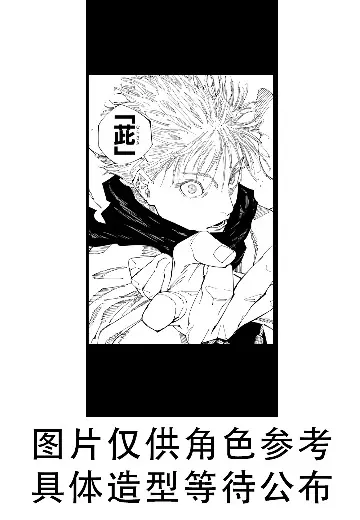 | **[FIGURIZMα系列 咒术回战 怀玉·玉折 五条悟 觉醒](https://www.hpoi.net/hobby/140333)** 世嘉 | — | 2027-05 |
| 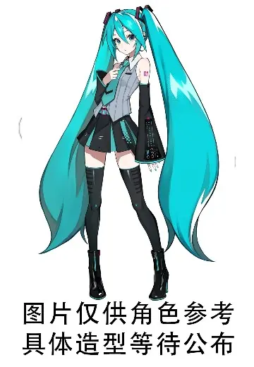 | **[FIGURIZMα系列 初音未来 黎明](https://www.hpoi.net/hobby/140332)** 世嘉 | — | 2027-05 |
| 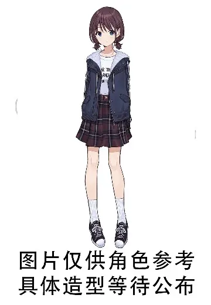 | **[XStellar系列 少女乐队的呐喊剧场版 制作发表纪念插画 井芹仁菜](https://www.hpoi.net/hobby/140315)** 世嘉 | — | 2027-05 |
| 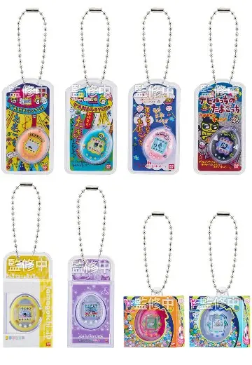 | **[食玩 拓麻歌子 食玩BOX 第7弹 盲盒](https://www.hpoi.net/hobby/140271)** たまごっち おかしなたまごボーロっち パッケージチャームつき４ 万代 · 拓麻歌子 盒蛋/扭蛋 · 万代食玩 | 396 日元 | 2027-05 |
| 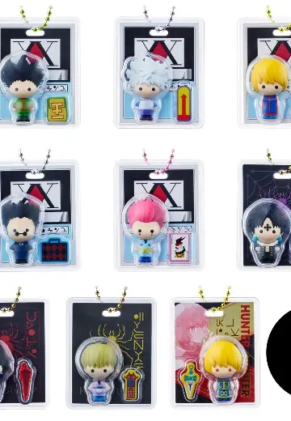 | **[食玩 HUNTER×HUNTER 食玩BOX 第1弹 盲盒](https://www.hpoi.net/hobby/140268)** HUNTER×HUNTER パッケージチャーム×ビスケット 万代 · 全职猎人 · 侠客、西索、雷欧力·帕拉丁奈特、飞坦、杰·富力士、酷拉皮卡、奇犽·揍敌客、库洛洛·鲁西鲁 盒蛋/扭蛋 · 万代食玩 | 396 日元 | 2027-05 |
| 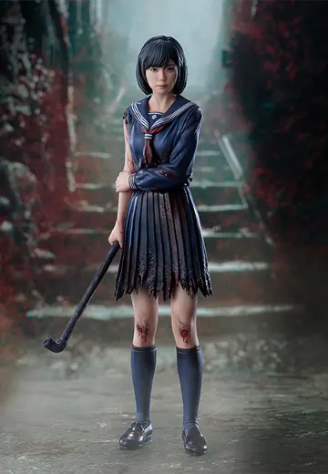 | **[OSHI WORKS 寂静岭f 深水雏子](https://www.hpoi.net/hobby/140266)** OSHI WORKS SILENT HILL f 深水 雛子 寿屋 · 寂静岭f · 深水雏子 比例人形 · OSHI WORKS · 1/7 | 9,350 日元 含税，390元 | 2027-06 |
| 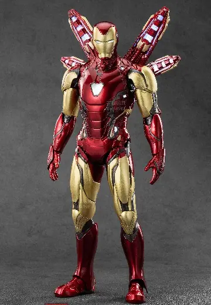 | **[《复仇者联盟4》钢铁侠MK85](https://www.hpoi.net/hobby/140265)** 《复仇者联盟4》钢铁侠MK85 中动玩具 · 漫威、复仇者联盟4：终局之战 · 钢铁侠 比例人形 | 399 元 | 2026-09 |
| 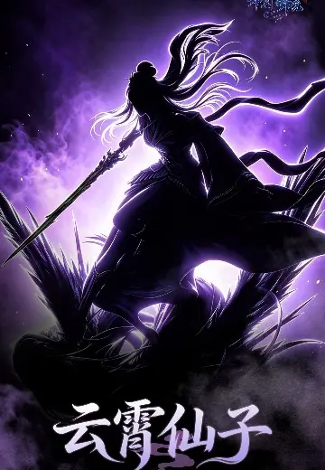 | **[天玑系列 师兄啊师兄 云霄仙子](https://www.hpoi.net/hobby/140264)** 天玑系列 师兄啊师兄 云霄仙子 1/4收藏级雕像 光年工作室 比例人形 · 1/4 | — | 未知 |
| 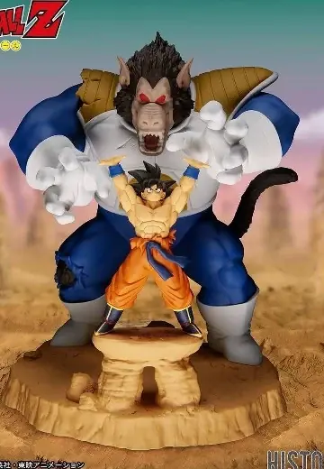 | **[龙珠Z History Box 孙悟空&amp;大猿(贝吉塔)](https://www.hpoi.net/hobby/140404)** ドラゴンボールZ History Box 孫悟空&amp;大猿(ベジータ) 比例人形 | — | 未知 |
| 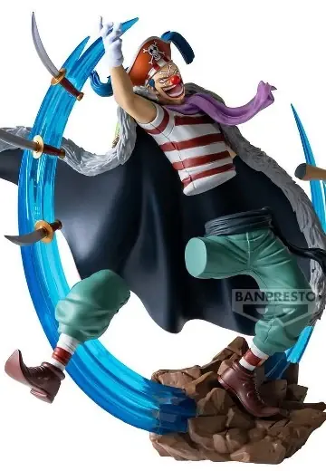 | **[THEORAMA SOUL 航海王 巴基](https://www.hpoi.net/hobby/140403)** ワンピース THEORAMA SOUL-BUGGY- 眼镜厂 · 航海王 · 巴基 比例人形 · THEORAMA SOUL | — | 2027-06 |
| 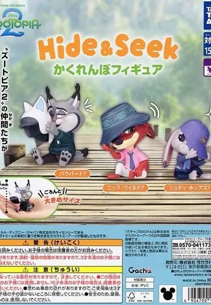 | **[疯狂动物城2 捉迷藏 扭蛋](https://www.hpoi.net/hobby/140400)** ズートピア2 Hide&amp;Seek かくれんぼフィギュア Takara Tomy A.R.T.S · 尼克·王尔德、朱迪·霍普斯、宝伯特·林雪猁 盒蛋/扭蛋 | 400 日元 含税，16元 | 2026-11 |
| 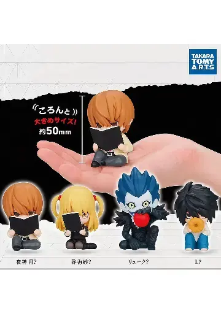 | **[死亡笔记 捉迷藏 扭蛋](https://www.hpoi.net/hobby/140399)** DEATH NOTE Hide&amp;Seek かくれんぼフィギュア Takara Tomy A.R.T.S · 死亡笔记 · L、琉克、夜神月、弥海砂 盒蛋/扭蛋 | 400 日元 含税，16元 | 2027-01 |
| 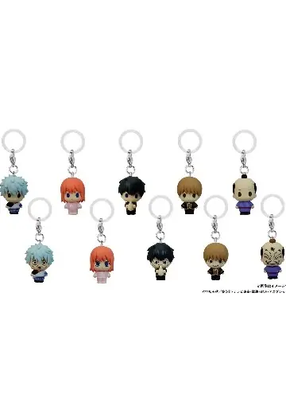 | **[银魂 标记装饰挂件 第四弹～表情展现出个性~](https://www.hpoi.net/hobby/140398)** 銀魂 めじるしアクセサリー4 ～表情で個性を出していけ～ 万代 · 银魂 · 土方十四郎、冲田总悟、坂田银时、神乐、德川茂茂 盒蛋/扭蛋 | 300 日元 含税，12元 | 2027-03 |
| 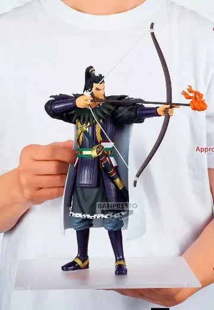 | **[Grandista 王者天下 桓骑 Ⅱ](https://www.hpoi.net/hobby/140390)** キングダム Grandista 桓騎 Ⅱ 眼镜厂 · 王者天下 · 桓骑 比例人形 · Grandista | — | 2027-06 |
| 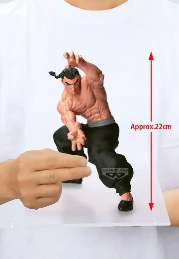 | **[刃牙 Grandista 烈海王](https://www.hpoi.net/hobby/140389)** 刃牙 Grandista 烈海王 眼镜厂 · 刃牙 · 烈海王 比例人形 · Grandista | — | 2027-06 |
| 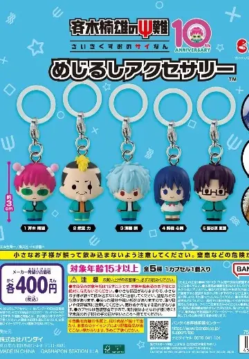 | **[齐木楠雄的灾难 标记造型挂件](https://www.hpoi.net/hobby/140386)** 【再販】斉木楠雄のΨ難 めじるしアクセサリー 万代 · 齐木楠雄的灾难 盒蛋/扭蛋 | 400 日元 | 2027-04 |
| 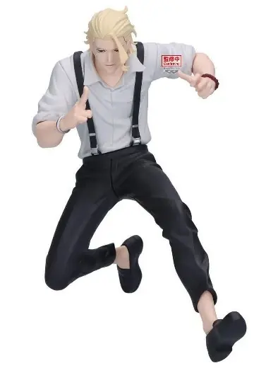 | **[VIBRATION STARS-神乐钵 柴登吾](https://www.hpoi.net/hobby/140384)** TVアニメ『カグラバチ』 VIBRATION STARS-柴登吾- 眼镜厂 · 神乐钵（动画）、神乐钵（漫画） · 柴登吾 比例人形 · VIBRATION STARS | — | 2027-05 |
| 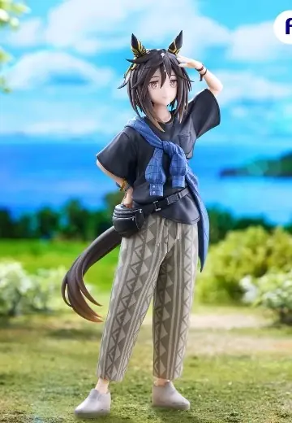 | **[Trio-Try-iT 赛马娘 黄金旅程](https://www.hpoi.net/hobby/140383)** ウマ娘 プリティーダービー Trio-Try-iT Figureー ステイゴールド FuRyu · 赛马娘Pretty Derby · 黄金旅程 比例人形 · Trio-Try-iT | — | 2027-06 |
| 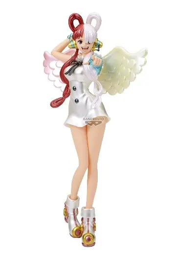 | **[独特魅力 航海王 乌塔 SPECIAL](https://www.hpoi.net/hobby/140382)** 『ONE PIECE FILM RED』GLITTER&amp;GLAMOURS-UTA-SPECIAL ver. 眼镜厂 · 航海王：红发歌姬 · 乌塔、乌塔 比例人形 · GLITTER＆GLAMOURS | — | 2027-05 |
| 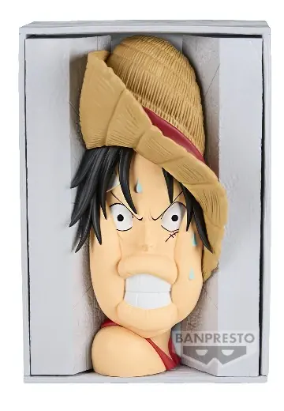 | **[HYOKOFIG-航海王 蒙奇・D・路飞](https://www.hpoi.net/hobby/140381)** ワンピース HYOKOFIG-モンキー・D・ルフィ- 眼镜厂 · 航海王(海贼王动画)、航海王 · 蒙奇·D·路飞 比例人形 · HYOKOFIG | — | 2027-05 |
| 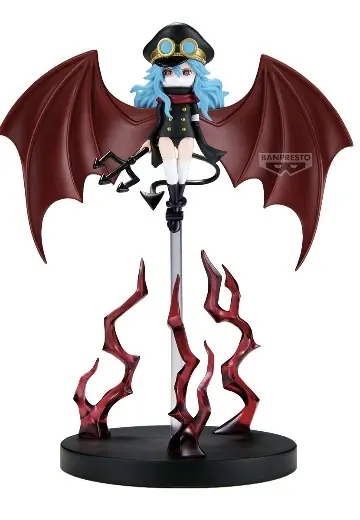 | **[WCF SPECIAL 航海王 军子宫Ⅱ](https://www.hpoi.net/hobby/140380)** ワンピース ワールドコレクタブルフィギュア SPECIAL 軍子宮Ⅱ 眼镜厂 · 航海王(海贼王动画)、航海王 · 曼麦亚·军子宫 比例人形 · WCF | — | 2027-05 |
| 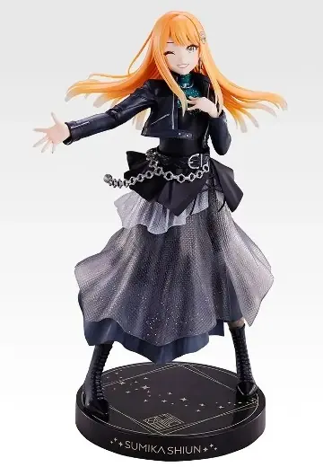 | **[一番赏 学园偶像大师 Part7 最终奖 紫云清夏 Gracemaster 最终奖版本](https://www.hpoi.net/hobby/140379)** 一番くじ 学園アイドルマスター Part7 ラストワン賞 紫雲清夏 フィギュア 1/7 Gracemaster ラストワンVer. BANDAI SPIRITS · 学园偶像大师 · 紫云清夏 比例人形 · 一番赏、Gracemaster、一番赏 学园偶像大师 Part7 | — | 2026-12 |
| 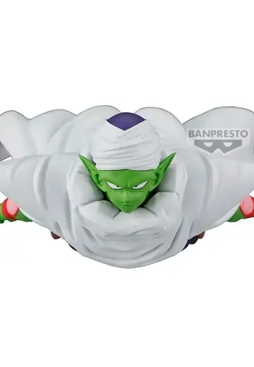 | **[SOLID EDGE WORKS-出阵系列-龙珠Z 比克Ⅱ](https://www.hpoi.net/hobby/140378)** ドラゴンボールZ SOLID EDGE WORKS-THE出陣-ピッコロⅡ 眼镜厂 · 龙珠Z · 比克 比例人形 · SOLID EDGE WORKS-THE出阵- | — | 2027-05 |
| 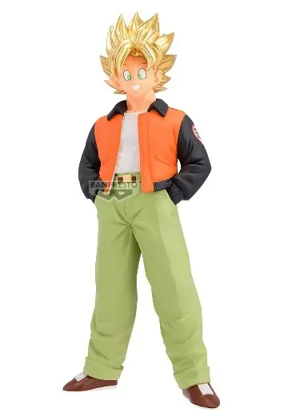 | **[赛亚人血统 龙珠Z 超级赛亚人孙悟空-Ⅳ](https://www.hpoi.net/hobby/140377)** ドラゴンボールZ BLOOD OF SAIYANS-超サイヤ人孫悟空-Ⅳ 眼镜厂 · 龙珠Z · 孙悟空 比例人形 · 赛亚人血统 | — | 2027-05 |
| 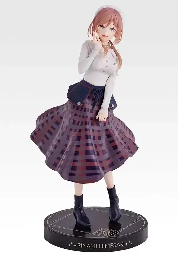 | **[一番赏 学园偶像大师 Part7 C奖 姬崎莉波 Gracemaster](https://www.hpoi.net/hobby/140376)** 一番くじ 学園アイドルマスター Part7 C賞 姫崎莉波 フィギュア 1/7 Gracemaster BANDAI SPIRITS · 学园偶像大师 · 姬崎莉波 比例人形 · Gracemaster、一番赏、一番赏 学园偶像大师 Part7 · 1/7 | — | 2026-12 |
| 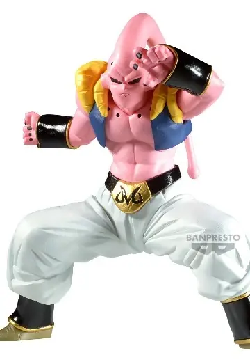 | **[MATCH MAKERS 龙珠Z 魔人布欧（VS终极悟饭）Ⅱ](https://www.hpoi.net/hobby/140375)** ドラゴンボールZ MATCH MAKERS 魔人ブウ（VSアルティメット悟飯）Ⅱ 眼镜厂 · 龙珠Z · 魔人布欧 比例人形 · MATCH MAKERS | — | 2027-05 |
| 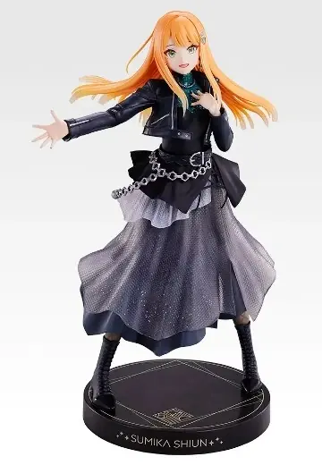 | **[一番赏 学园偶像大师 Part7 B奖 紫云清夏 Gracemaster](https://www.hpoi.net/hobby/140374)** 一番くじ 学園アイドルマスター Part7 B賞 紫雲清夏 フィギュア 1/7 Gracemaster BANDAI SPIRITS · 学园偶像大师 · 紫云清夏 比例人形 · 一番赏、Gracemaster、一番赏 学园偶像大师 Part7 · 1/7 | — | 2026-12 |
| 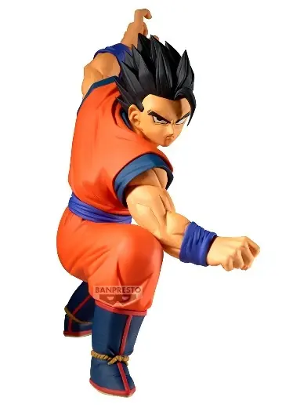 | **[MATCH MAKERS 龙珠Z 终极悟饭（VS魔人布欧）Ⅱ](https://www.hpoi.net/hobby/140373)** ドラゴンボールZ MATCH MAKERS アルティメット悟飯（VS魔人ブウ）Ⅱ 眼镜厂 · 龙珠Z · 孙悟饭 比例人形 · MATCH MAKERS | — | 2027-05 |
| 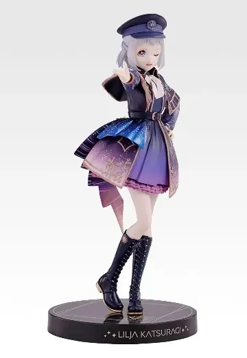 | **[一番赏 学园偶像大师 Part7 A奖 葛城莉莉娅 Gracemaster](https://www.hpoi.net/hobby/140372)** 一番くじ 学園アイドルマスター Part7 A賞 葛城リーリヤ フィギュア 1/7 Gracemaster BANDAI SPIRITS · 学园偶像大师 · 葛城莉莉娅 比例人形 · 一番赏、Gracemaster、一番赏 学园偶像大师 Part7 · 1/7 | — | 2026-12 |
| 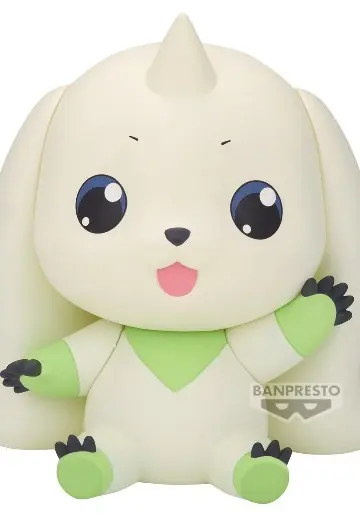 | **[SOFVIMATES～数码宝贝 梗犬兽](https://www.hpoi.net/hobby/140371)** デジモンテイマーズ SOFVIMATES～テリアモン～ 眼镜厂 · 数码宝贝03 驯兽师之王 比例人形 · SOFVIMATES | — | 2027-05 |
| 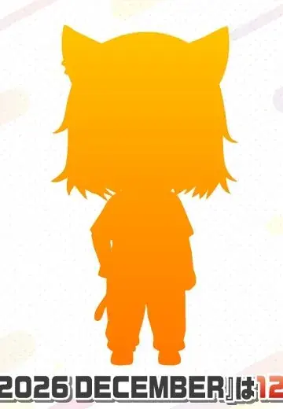 | **[粘土人 尼古喵喵 尼古喵喵](https://www.hpoi.net/hobby/140370)** ねんどろいど ヤニねこ ヤニねこ 良笑 · 尼古喵喵 · 尼古喵喵 Q版人形 · 粘土人 | — | 未知 |
| 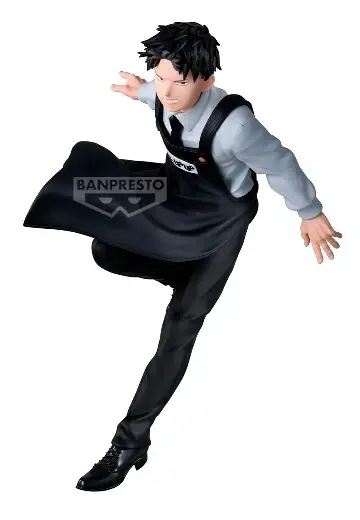 | **[VIBRATION STARS-幼儿园WARS 道格](https://www.hpoi.net/hobby/140369)** 幼稚園WARS VIBRATION STARS-ダグ- 眼镜厂 · 幼儿园WARS · 道格 比例人形 · VIBRATION STARS | — | 2027-05 |
| 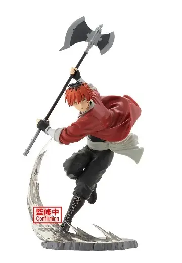 | **[MAXIMATIC 葬送的芙莉莲 休塔尔克 SPECIAL EFFECT](https://www.hpoi.net/hobby/140368)** 葬送のフリーレン MAXIMATIC STARK SPECIAL EFFECT ver. 眼镜厂 · 葬送的芙莉莲 · 休塔尔克 比例人形 · MAXIMATIC | — | 2027-05 |
| 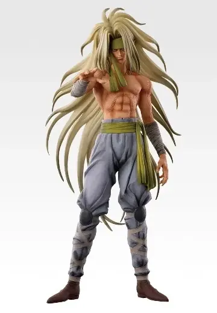 | **[一番赏 幽游白书 魔界统一锦标赛篇 最终奖 雷禅 MASTERLISE EXTRA](https://www.hpoi.net/hobby/140367)** 一番くじ 幽☆遊☆白書 魔界統一トーナメント編 ラストワン賞 雷禅 MASTERLISE EXTRA BANDAI SPIRITS · 幽游白书 · 雷禅 比例人形 · 一番赏、MASTERLISE EXTRA、一番赏 幽游白书 魔界统一锦标赛篇 | — | 2027-01 |
| 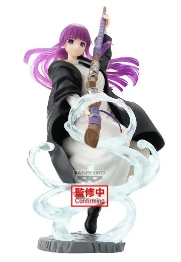 | **[MAXIMATIC 葬送的芙莉莲 菲伦 SPECIAL EFFECT](https://www.hpoi.net/hobby/140366)** 葬送のフリーレン MAXIMATIC FERN SPECIAL EFFECT ver. 眼镜厂 · 葬送的芙莉莲 · 菲伦 比例人形 · MAXIMATIC | — | 2027-05 |
| 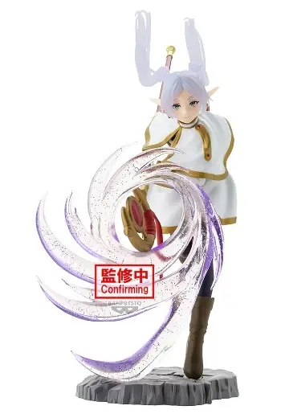 | **[MAXIMATIC 葬送的芙莉莲 芙莉莲 SPECIAL EFFECT](https://www.hpoi.net/hobby/140365)** 葬送のフリーレン MAXIMATIC FRIEREN SPECIAL EFFECT ver. 眼镜厂 · 葬送的芙莉莲 · 芙莉莲 比例人形 · MAXIMATIC | — | 2027-05 |
| 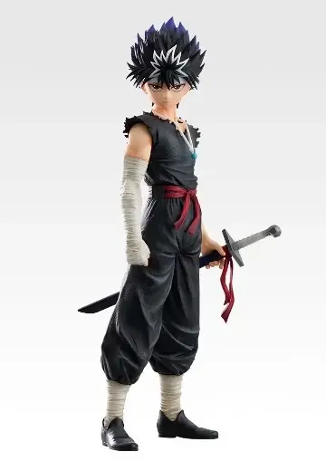 | **[一番赏 幽游白书 魔界统一锦标赛篇 E奖 飞影 MASTERLISE](https://www.hpoi.net/hobby/140364)** 一番くじ 幽☆遊☆白書 魔界統一トーナメント編 E賞 飛影 MASTERLISE BANDAI SPIRITS · 幽游白书 · 飞影 比例人形 · 一番赏、MASTERLISE、一番赏 幽游白书 魔界统一锦标赛篇 | — | 2027-04 |
| 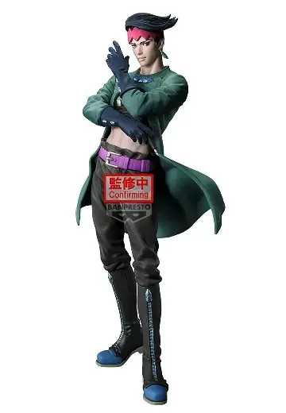 | **[Mometria JOJO的奇妙冒险 不灭钻石 岸边露伴](https://www.hpoi.net/hobby/140363)** ジョジョの奇妙な冒険 ダイヤモンドは砕けない Mometria 岸辺露伴 眼镜厂 · JOJO的奇妙冒险 第四部 不灭钻石 · 岸边露伴 比例人形 · Mometria | — | 2027-05 |
| 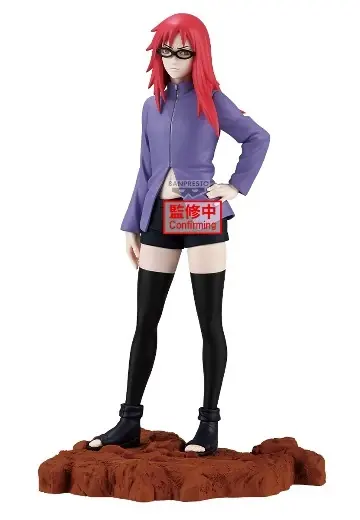 | **[火影忍者疾风传 香燐～“蛇”小队](https://www.hpoi.net/hobby/140362)** NARUTO-ナルト- 疾風伝 香燐フィギュア～“蛇”結成～ 眼镜厂 · 火影忍者 疾风传 · 香燐 比例人形 | — | 2027-05 |
| 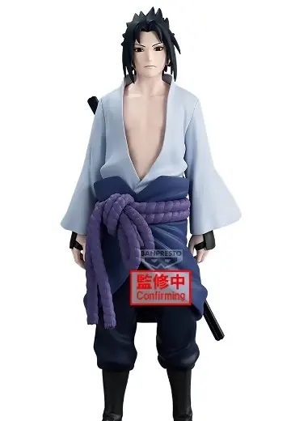 | **[火影忍者疾风传 宇智波佐助 ～“蛇”小队～](https://www.hpoi.net/hobby/140361)** NARUTO-ナルト- 疾風伝 うちはサスケフィギュア～“蛇”結成～ 眼镜厂 · 火影忍者 疾风传 · 宇智波佐助 比例人形 | — | 2027-05 |
| 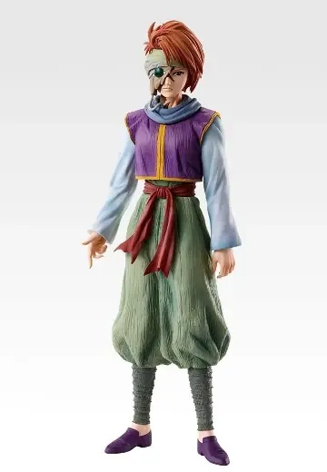 | **[一番赏 幽游白书 魔界统一锦标赛篇 A奖 浦饭幽助 MASTERLISE](https://www.hpoi.net/hobby/140360)** 一番くじ 幽☆遊☆白書 魔界統一トーナメント編 D賞 軀 MASTERLISE BANDAI SPIRITS · 幽游白书 · 躯 比例人形 · 一番赏、MASTERLISE、一番赏 幽游白书 魔界统一锦标赛篇 | — | 2027-04 |

旧品补录 7 件：HPOI 新收录、但早已发售的老商品

| 图 | 商品 | 价格 | 发售 |
|---|---|---|---|
| 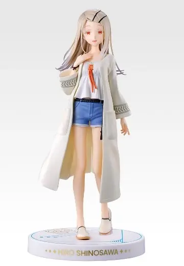 | **[一番赏 学园偶像大师 Part3 最终奖 筱泽广 Gracemaster 最终奖版本](https://www.hpoi.net/hobby/140395)** 一番くじ 学園アイドルマスター Part3 ラストワン賞 篠澤 広 フィギュア 1/7 Gracemaster ラストワンVer. BANDAI SPIRITS · 学园偶像大师 · 筱泽广 比例人形 · 一番赏、Gracemaster、一番赏 学园偶像大师 Part3 · 1/7 · 旧品补录 | — | 2025-10 |
| 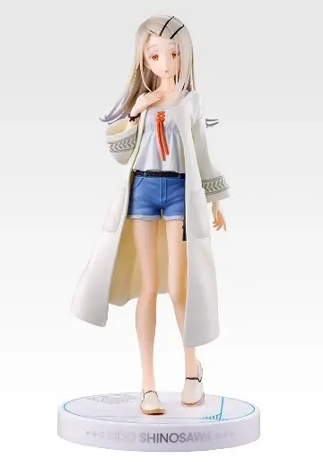 | **[一番赏 学园偶像大师 Part3 C奖 筱泽广 Gracemaster](https://www.hpoi.net/hobby/140394)** 一番くじ 学園アイドルマスター Part3 C賞 篠澤 広 フィギュア 1/7 Gracemaster BANDAI SPIRITS · 学园偶像大师 · 筱泽广 比例人形 · 一番赏、Gracemaster、一番赏 学园偶像大师 Part3 · 1/7 · 旧品补录 | — | 2025-10 |
| 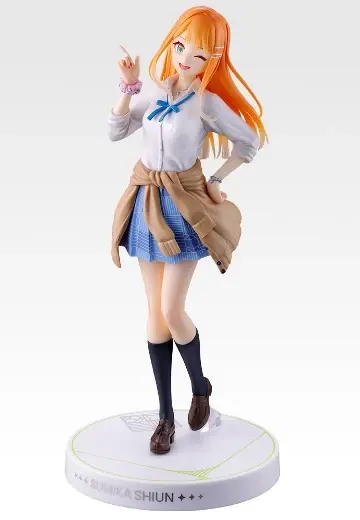 | **[一番赏 学园偶像大师 Part3 B奖 紫云清夏 Gracemaster](https://www.hpoi.net/hobby/140393)** 一番くじ 学園アイドルマスター Part3 B賞 紫雲清夏 フィギュア 1/7 Gracemaster BANDAI SPIRITS · 学园偶像大师 · 紫云清夏 比例人形 · Gracemaster、一番赏、一番赏 学园偶像大师 Part3 · 1/7 · 旧品补录 | — | 2025-10 |
| 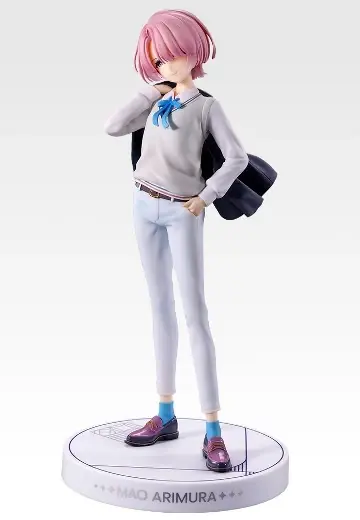 | **[一番赏 学园偶像大师 Part3 A奖 有村麻央 Gracemaster](https://www.hpoi.net/hobby/140392)** 一番くじ 学園アイドルマスター Part3 A賞 有村麻央 フィギュア 1/7 Gracemaster BANDAI SPIRITS · 学园偶像大师 · 有村麻央 比例人形 · 一番赏、Gracemaster、一番赏 学园偶像大师 Part3 · 1/7 · 旧品补录 | — | 2025-10 |
| 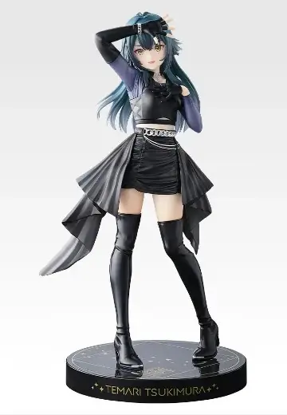 | **[一番赏 学园偶像大师 Part5 最终奖 月村手毬 Gracemaster 最终奖版本](https://www.hpoi.net/hobby/140388)** 一番くじ 学園アイドルマスター Part5 ラストワン賞 月村手毬 フィギュア 1/7 Gracemaster ラストワンVer. BANDAI SPIRITS · 学园偶像大师 · 月村手毬 比例人形 · 一番赏、Gracemaster、一番赏 学园偶像大师 Part5 · 1/7 · 旧品补录 | — | 2026-06 |
| 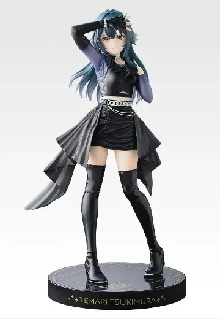 | **[一番赏 学园偶像大师 Part5 B奖 月村手毬 Gracemaster](https://www.hpoi.net/hobby/140387)** 一番くじ 学園アイドルマスター Part5 B賞 月村手毬 フィギュア 1/7 Gracemaster BANDAI SPIRITS · 学园偶像大师 · 月村手毬 比例人形 · 一番赏、Gracemaster、一番赏 学园偶像大师 Part5 · 1/7 · 旧品补录 | — | 2026-06 |
| 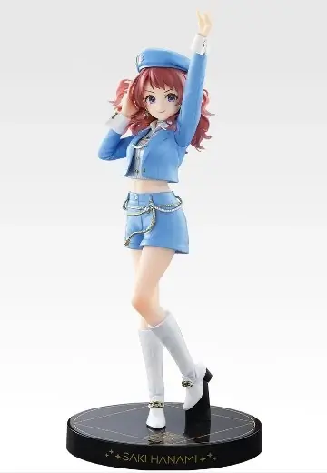 | **[一番赏 学园偶像大师 Part5 A奖 花海咲季 Gracemaster](https://www.hpoi.net/hobby/140385)** 一番くじ 学園アイドルマスター Part5 A賞 花海咲季 フィギュア 1/7 Gracemaster BANDAI SPIRITS · 学园偶像大师 · 花海咲季 比例人形 · 一番赏、Gracemaster、一番赏 学园偶像大师 Part5 · 1/7 · 旧品补录 | — | 2026-06 |

## Good Smile 官网（23）

| 图 | 商品 | 价格 | 发售 |
|---|---|---|---|
|  | **[ねんどろいど 初音ミク 気まぐれメルシィVer.](https://www.goodsmile.com/ja/product/1144443)** グッドスマイルカンパニー · キャラクター・ボーカル・シリーズ01 初音ミク ねんどろいど · ノンスケール · 预订中 · 附特典 | 7,800 日元 | 未定 截订 2027-01-06 |
| 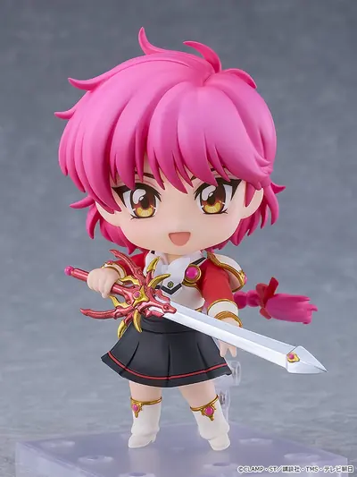 | **[ねんどろいど 獅堂 光](https://www.goodsmile.com/ja/product/1137451)** グッドスマイルカンパニー · TVアニメ「魔法騎士レイアース」 ねんどろいど · ノンスケール · 预订中 · 附特典 | 7,500 日元 | 未定 截订 2027-01-06 |
| 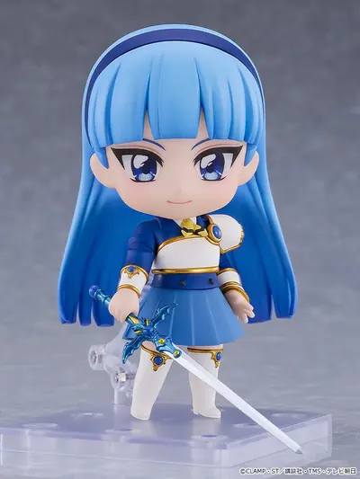 | **[ねんどろいど 龍咲 海](https://www.goodsmile.com/ja/product/1140462)** グッドスマイルカンパニー · TVアニメ「魔法騎士レイアース」 ねんどろいど · ノンスケール · 预订中 · 附特典 | 7,500 日元 | 未定 截订 2027-01-06 |
|  | **[ねんどろいど 鳳凰寺 風](https://www.goodsmile.com/ja/product/1140463)** グッドスマイルカンパニー · TVアニメ「魔法騎士レイアース」 ねんどろいど · ノンスケール · 预订中 · 附特典 | 7,500 日元 | 未定 截订 2027-01-06 |
|  | **[ねんどろいど プラナ](https://www.goodsmile.com/ja/product/60275)** グッドスマイルカンパニー · ブルーアーカイブ -Blue Archive- ねんどろいど · ノンスケール · 预订中 · 再贩 · 附特典 | 6,700 日元 | 2027-04 截订 2027-01-06 |
|  | **[ねんどろいど 鹿目まどか 〈ワルプルギスの廻天〉Ver. べーしっく](https://www.goodsmile.com/ja/product/1139201)** グッドスマイルカンパニー · 劇場版 魔法少女まどか☆マギカ〈ワルプルギスの廻天〉 ねんどろいどシリーズ · ノンスケール · 预订中 · 再贩 · 附特典 | 3,900 日元 | 2027-06 截订 2027-01-13 |
|  | **[ねんどろいど 暁美ほむら 〈ワルプルギスの廻天〉Ver. べーしっく](https://www.goodsmile.com/ja/product/1139202)** グッドスマイルカンパニー · 劇場版 魔法少女まどか☆マギカ〈ワルプルギスの廻天〉 ねんどろいど · ノンスケール · 预订中 · 再贩 · 附特典 | 3,900 日元 | 2027-06 截订 2027-01-13 |
|  | **[Infinity Studio X Blizzard &lt;World of Warcraft&gt; グロマッシュ・ヘルスクリーム 1/3バストモデル](https://www.goodsmile.com/ja/product/1147696)** Infinity Studio · World of Warcraft その他フィギュア · 1/3 · 预订中 | 87,500 日元 | 未定 截订 2027-01-06 |
|  | **[ねんどろいど かぐや](https://www.goodsmile.com/ja/product/1143934)** グッドスマイルカンパニー · 超かぐや姫！ ねんどろいど · ノンスケール · 预订中 · 附特典 | 7,800 日元 | 未定 截订 2027-01-06 |
|  | **[ねんどろいど 酒寄彩葉](https://www.goodsmile.com/ja/product/1143936)** グッドスマイルカンパニー · 超かぐや姫！ ねんどろいど · ノンスケール · 预订中 · 附特典 | 7,800 日元 | 未定 截订 2027-01-06 |
|  | **[ねんどろいど 月見ヤチヨ](https://www.goodsmile.com/ja/product/1143942)** グッドスマイルカンパニー · 超かぐや姫！ ねんどろいど · ノンスケール · 预订中 · 附特典 | 7,800 日元 | 未定 截订 2027-01-06 |
|  | **[ねんどろいど 超かぐや姫！ コンプリートセット](https://www.goodsmile.com/ja/product/1146616)** グッドスマイルカンパニー · 超かぐや姫！ ねんどろいど · ノンスケール · 预订中 · 限定商品 | 23,400 日元 | 未定 截订 2027-01-06 |
|  | **[POP UP PARADE SP 暁美ほむら 〈ワルプルギスの廻天〉Ver.](https://www.goodsmile.com/ja/product/1141582)** グッドスマイルカンパニー · 劇場版 魔法少女まどか☆マギカ〈ワルプルギスの廻天〉 POP UP PARADE · ノンスケール · 预订中 | 7,500 日元 | 未定 截订 2026-12-23 |
|  | **[POP UP PARADE SP アストロ](https://www.goodsmile.com/ja/product/1139517)** グッドスマイルカンパニー · アストロボット POP UP PARADE SP · ノンスケール · 预订中 | 9,600 日元 | 未定 截订 2026-12-23 |
|  | **[POP UP PARADE 水篠旬 ハンターVer. L size](https://www.goodsmile.com/ja/product/1145858)** グッドスマイルカンパニー · TVアニメ『俺だけレベルアップな件』 POP UP PARADE · ノンスケール · 预订中 | 8,800 日元 | 未定 截订 2027-01-06 |
|  | **[POP UP PARADE 乙骨憂太 L size](https://www.goodsmile.com/ja/product/1141336)** グッドスマイルカンパニー · TVアニメ『呪術廻戦』 POP UP PARADE · ノンスケール · 预订中 | 8,800 日元 | 未定 截订 2026-12-23 |
|  | **[POP UP PARADE フワワ・アビスガード](https://www.goodsmile.com/ja/product/1137610)** グッドスマイルカンパニー · ホロライブプロダクション POP UP PARADE · ノンスケール · 预订中 | 7,500 日元 | 未定 截订 2026-12-23 |
|  | **[POP UP PARADE モココ・アビスガード](https://www.goodsmile.com/ja/product/1137611)** グッドスマイルカンパニー · ホロライブプロダクション POP UP PARADE · ノンスケール · 预订中 | 7,500 日元 | 未定 截订 2026-12-23 |
|  | **[figma ヴァッシュ・ザ・スタンピード STAMPEDE ver.](https://www.goodsmile.com/ja/product/1137491)** グッドスマイルカンパニー · TRIGUN STARGAZE figma · 预订中 | 11,800 日元 | 未定 截订 2027-01-06 |
|  | **[figma フリューテッドアーマー（PS5）](https://www.goodsmile.com/ja/product/11268)** グッドスマイルカンパニー · Demon’s Souls（PS5） figma · ノンスケール · 预订中 · 再贩 · 附特典 | 15,800 日元 | 2027-07 截订 2027-01-06 |
|  | **[きぐるみマスコット 猫猫／壬氏](https://www.goodsmile.com/ja/product/1144348)** グッドスマイルカンパニー · 薬屋のひとりごと その他 · 预订中 | 2,990 日元 | 未定 截订 2027-01-06 |
|  | **[ねんどろいど ディエゴ・ブランドー DX](https://www.goodsmile.com/ja/product/1147727)** メディコス・エンタテインメント · アニメ『スティール・ボール・ラン ジョジョの奇妙な冒険』 ねんどろいど · ノンスケール · 预订中 · 附特典 | 8,800 日元 | 未定 截订 2027-02-17 |
|  | **[ねんどろいど ディエゴ・ブランドー](https://www.goodsmile.com/ja/product/1141569)** メディコス・エンタテインメント · アニメ『スティール・ボール・ラン ジョジョの奇妙な冒険』 ねんどろいど · ノンスケール · 预订中 · 附特典 | 6,930 日元 | 未定 截订 2027-02-17 |

## Native 官网（24）

| 图 | 商品 | 价格 | 发售 |
|---|---|---|---|
|  | **[冬風冷奈 巫女Ver.](https://www.native-web.jp/creators/55130/)** CAMELOT · あれっくす氏オリジナルキャラクター 1/8 · 预订中 · 官网限定 · 附特典 · 成人向 | 9,900 日元 | 2027-08 截订 2027-01-20 |
|  | **[母乳ちゃん／桜沢ともみ バニーVer.](https://www.native-web.jp/creators/55092/)** BINDing · 母乳ちゃんは射（だ）したい。 1/4 · 预订中 · 官网限定 · 成人向 | 44,000 日元 | 2027-05 截订 2027-01-20 |
|  | **[未来ちゃん](https://www.native-web.jp/creators/54794/)** BINDing · 教室コッソリクス 1/6 · 预订中 · 官网限定 · 附特典 · 成人向 | 33,000 日元 | 2027-04 截订 2027-01-06 |
|  | **[ミヤちゃん＆つみきちゃん サキュチアコスチューム豪華版](https://www.native-web.jp/creators/54856/)** のくちゅるぬ · かえぬこ氏オリジナルキャラクター 1/5 · 预订中 · 官网限定 · 附特典 · 成人向 | 85,800 日元 | 2027-05 截订 2027-01-08 |
|  | **[ミヤちゃん サキュチアコスチュームVer.](https://www.native-web.jp/creators/54855/)** のくちゅるぬ · かえぬこ氏オリジナルキャラクター 1/5 · 预订中 · 官网限定 · 附特典 · 成人向 | 41,800 日元 | 2027-05 截订 2027-01-08 |
|  | **[つみきちゃん サキュチアコスチュームVer.](https://www.native-web.jp/creators/54854/)** のくちゅるぬ · かえぬこ氏オリジナルキャラクター 1/5 · 预订中 · 官网限定 · 附特典 · 成人向 | 41,800 日元 | 2027-05 截订 2027-01-08 |
|  | **[Blossom Bunny Wedding Ver.](https://www.native-web.jp/creators/54699/)** Pink-Cat · LOVECACAO氏オリジナルイラスト 1/6 · 预订中 · 官网限定 · 附特典 · 成人向 | 32,800 日元 | 2027-04 截订 2026-12-16 |
|  | **[女月かえで メイドバニーVer.](https://www.native-web.jp/creators/54645/)** BINDing · BINDing クリエイターズ オピニオン 1/4 · 预订中 · 官网限定 · 附特典 · 成人向 | 39,600 日元 | 2027-07 截订 2026-12-23 |
|  | **[チアリーダー ユナちゃん](https://www.native-web.jp/creators/54534/)** HOTVENUS · Biya氏オリジナルイラスト 1/6 · 预订中 · 官网限定 · 附特典 · 成人向 | 39,600 日元 | 2027-08 截订 2026-12-23 |
|  | **[黒田光 illustrator：まんの](https://www.native-web.jp/creators/54462/)** のくちゅるぬ · 入り浸りギャルにま〇こ使わせて貰う話 1/5 · 预订中 · 官网限定 · 附特典 · 成人向 | 41,800 日元 | 2027-03 截订 2026-11-30 |
|  | **[黒羽さき ダイナーVer.](https://www.native-web.jp/creators/54407/)** BINDing · 『黒ギャルバニー先輩』シリーズ 1/4 · 预订中 · 官网限定 · 附特典 · 成人向 | 39,600 日元 | 2027-06 截订 2026-12-16 |
|  | **[一夜ちゃん 水着Ver.](https://www.native-web.jp/creators/54057/)** CAMELOT · ぼに～氏オリジナルキャラクター 1/8 · 官网限定 · 附特典 · 成人向 | 9,900 日元 | 2027-06 截订 2026-11-25 |
|  | **[聖娼年ジャンヌくん](https://www.native-web.jp/characters/54317/)** ネイティブ · 娼年ジャンヌ 1/6 · 预订中 · 官网限定 · 附特典 · 成人向 | 38,500 日元 | 2027-10 截订 2026-12-16 |
|  | **[comicアンスリウムVol.131 カバーガール『性活週間』日奈森 絢夏 illustration by みちきんぐ](https://www.native-web.jp/characters/54136/)** 株式会社デジタルコマース · 『性活週間』 1/4 · 官网限定 · 附特典 · 成人向 | 44,000 日元 | 2027-02 截订 2026-10-28 |
|  | **[comicアンスリウムVol.132 カバーガール『姉体験女学寮』 桜家 真昼 illustration by みちきんぐ](https://www.native-web.jp/characters/54183/)** 株式会社デジタルコマース · 『姉体験女学寮』 1/4 · 官网限定 · 附特典 · 成人向 | 44,000 日元 | 2027-02 截订 2026-10-28 |
|  | **[【幻影の対魔忍】水城不知火](https://www.native-web.jp/characters/53879/)** BINDing · 対魔忍RPGX 1/4 · 官网限定 · 附特典 · 成人向 | 55,000 日元 | 2027-03 截订 2026-11-12 |
|  | **[辻中みほ 純心ver.](https://www.native-web.jp/characters/52322/)** のくちゅるぬ · この恋に気づいて 1/6 · 再贩 · 官网限定 · 附特典 · 成人向 | 29,700 日元 | 2026-09 截订 2026-07-22 |
|  | **[メリー・サルバトール](https://www.native-web.jp/characters/52185/)** ネイティブ · S家に嫁いだM嬢の日常 1/6 · 官网限定 · 附特典 · 成人向 | 36,300 日元 | 2027-02 截订 2026-08-17 |
|  | **[ヴラドくん](https://www.native-web.jp/characters/52052/)** HOTVENUS · 娼年ドラキュラ 1/7 · 官网限定 · 附特典 · 成人向 | 44,000 日元 | 2027-05 截订 2026-07-28 |
|  | **[『僕は梅田さんに逆らえない』梅田 あすか](https://www.native-web.jp/characters/51810/)** 株式会社デジタルコマース · 僕は梅田さんに逆らえない 1/4 · 官网限定 · 附特典 · 成人向 | 44,000 日元 | 2026-12 截订 2026-07-15 |
|  | **[朝比奈あかり 地雷系ピンクver.](https://www.native-web.jp/characters/51605/)** のくちゅるぬ · 愛聖天使ラブメアリー ～悪性受胎～ 1/6 · 官网限定 · 成人向 | 25,850 日元 | 2026-09 截订 2026-06-12 |
|  | **[高梨天羽 illustrator Blue\_Gk](https://www.native-web.jp/characters/51530/)** のくちゅるぬ · ラブメイド 1/6 · 官网限定 · 附特典 · 成人向 | 44,000 日元 | 2026-09 截订 2026-06-12 |
|  | **[花嫁心美](https://www.native-web.jp/characters/51454/)** HOTVENUS · 夢見心美 夢の寝取られ 1/6 · 官网限定 · 附特典 · 成人向 | 31,900 日元 | 2027-01 截订 2026-06-24 |
|  | **[椎名千鶴 褐色DXver.](https://www.native-web.jp/characters/51269/)** のくちゅるぬ · 千鶴ちゃん開発日記 1/5 · 官网限定 · 附特典 · 成人向 | 30,800 日元 | 2026-09 截订 2026-06-10 |

## MegaHouse 官网（11）

| 图 | 商品 | 价格 | 发售 |
|---|---|---|---|
|  | **[るかっぷ 崩壊：スターレイル カフカ](https://www.megahobby.jp/products/item/6184/)** MegaHouse · 崩壊：スターレイル デフォルメフィギュア · るかっぷ · 预订中 | 6,490 日元 | 2027-09 |
|  | **[るかっぷ 崩壊：スターレイル マダム・ヘルタ](https://www.megahobby.jp/products/item/6183/)** MegaHouse · 崩壊：スターレイル デフォルメフィギュア · るかっぷ · 预订中 | 6,490 日元 | 2027-09 |
|  | **[VAKIT 機動戦士ガンダム ジオンの再興 ドワッジG型](https://www.megahobby.jp/products/item/6193/)** MegaHouse · 機動戦士ガンダム ジオンの再興 その他 ホビー商品 · 预订中 | 8,800 日元 | 2027-07 |
|  | **[るかっぷ 新テニスの王子様 越前リョーマ 日本代表Ver.](https://www.megahobby.jp/products/item/6181/)** MegaHouse デフォルメフィギュア · るかっぷ · 预订中 | 4,620 日元 | 2027-07 |
|  | **[るかっぷ 刀剣乱舞ONLINE 燭台切光忠](https://www.megahobby.jp/products/item/6180/)** MegaHouse デフォルメフィギュア · るかっぷ · 预订中 | 5,060 日元 | 2027-07 |
|  | **[るかっぷ 刀剣乱舞ONLINE 鶴丸国永](https://www.megahobby.jp/products/item/6179/)** MegaHouse デフォルメフィギュア · るかっぷ · 预订中 | 5,060 日元 | 2027-07 |
|  | **[MEGA CAT PROJECT 薬屋のひとりごと 瓶の中の薬屋にゃんこ](https://www.megahobby.jp/products/item/6178/)** MegaHouse · 薬屋のひとりごと デフォルメフィギュア · MEGA CAT PROJECT | 1,760 日元 | 2027-07 |
|  | **[るかっぷ NARUTO-ナルト- 疾風伝 サソリ【再販】](https://www.megahobby.jp/products/item/6167/)** MegaHouse デフォルメフィギュア · るかっぷ · 再贩 | 4,400 日元 | 2027-07 |
|  | **[るかっぷ 犬夜叉 犬夜叉【再販】](https://www.megahobby.jp/products/item/6164/)** MegaHouse デフォルメフィギュア · るかっぷ · 再贩 | 4,620 日元 | 2027-07 |
|  | **[るかっぷ 犬夜叉 殺生丸【再販】](https://www.megahobby.jp/products/item/6163/)** MegaHouse デフォルメフィギュア · るかっぷ · 再贩 | 4,620 日元 | 2027-07 |
|  | **[るかっぷ ダンガンロンパ 希望の学園と絶望の高校生 苗木誠](https://www.megahobby.jp/products/item/6188/)** MegaHouse · ダンガンロンパ 希望の学園と絶望の高校生 デフォルメフィギュア · るかっぷ · 预订中 | 4,950 日元 | 2027-06 |

## KDcolle 官网（20）

| 图 | 商品 | 价格 | 发售 |
|---|---|---|---|
|  | **[矢澤にこ 僕たちはひとつの光ver. ノンスケールフィギュア](https://kdcolle.kadokawa.co.jp/product/ll/4550687016352.html)** KADOKAWA · ラブライブ！ ノンスケールフィギュア · ノンスケール · 预订中 · 官网限定 · 附特典 | 11,000 日元 | 2027-08 |
|  | **[東條 希 僕たちはひとつの光ver. ノンスケールフィギュア](https://kdcolle.kadokawa.co.jp/product/ll/entry-4550687016345.html)** KADOKAWA · ラブライブ！ ノンスケールフィギュア · ノンスケール · 预订中 · 官网限定 · 附特典 | 11,000 日元 | 2027-08 |
|  | **[絢瀬絵里 僕たちはひとつの光ver. ノンスケールフィギュア](https://kdcolle.kadokawa.co.jp/product/ll/4550687016338.html)** KADOKAWA · ラブライブ！ ノンスケールフィギュア · ノンスケール · 预订中 · 官网限定 | 11,000 日元 | 2027-08 |
|  | **[ホロ 原作版 ノンスケールフィギュア](https://kdcolle.kadokawa.co.jp/product/otk/4550687088465.html)** KADOKAWA · 狼と香辛料 MERCHANT MEETS THE WISE WOLF ノンスケールフィギュア · ノンスケール · 预订中 | 13,200 日元 | 2027-03 |
|  | **[涼宮ハルヒ めぐみんver.](https://kdcolle.kadokawa.co.jp/product/haruhi/4550687180664.html)** KADOKAWA · 涼宮ハルヒシリーズ／この素晴らしい世界に祝福を！ 1/7スケールフィギュア · 1/7 · 预订中 | 26,950 日元 | 2027-03 |
|  | **[涼宮ハルヒ めぐみんver. KADOKAWAスペシャルセット](https://kdcolle.kadokawa.co.jp/product/haruhi/4550687180671.html)** KADOKAWA · 涼宮ハルヒシリーズ／この素晴らしい世界に祝福を！ 1/7スケールフィギュア · 1/7 · 预订中 · 官网限定 | 29,150 日元 | 2027-03 |
|  | **[原作版 リアス・グレモリー 15th Anniversary ver. 【リニューアルパッケージ】](https://kdcolle.kadokawa.co.jp/product/dd/4550687225570.html)** ＫＡＤＯＫＡＷＡ · ハイスクールD×D 1/6.5スケールフィギュア · 1/6 · 预订中 | 36,850 日元 | 2027-02 |
|  | **[原作版 姫島朱乃 15th Anniversary ver. 【リニューアルパッケージ】](https://kdcolle.kadokawa.co.jp/product/dd/4550687225587.html)** ＫＡＤＯＫＡＷＡ · ハイスクールD×D 1/6.5スケールフィギュア · 1/6 · 预订中 | 36,850 日元 | 2027-02 |
|  | **[ルイズ 20th Anniversary non scale model](https://kdcolle.kadokawa.co.jp/product/zero-t/4550687084382.html)** KADOKAWA · ゼロの使い魔 ノンスケールフィギュア · ノンスケール · 预订中 | 14,850 日元 | 2027-02 |
|  | **[ルイズ 20th Anniversary non scale model KADOKAWAスペシャルセット](https://kdcolle.kadokawa.co.jp/product/zero-t/4550687084399.html)** KADOKAWA · ゼロの使い魔 ノンスケールフィギュア · ノンスケール · 预订中 · 官网限定 | 17,050 日元 | 2027-02 |
|  | **[千夜 1/6スケールフィギュア](https://kdcolle.kadokawa.co.jp/product/anenarumono/4550687055528.html)** KADOKAWA · 姉なるもの 1/6スケールフィギュア · 1/6 · 预订中 | 30,800 日元 | 2027-02 |
|  | **[シャナ 原作版 ノンスケールフィギュア](https://kdcolle.kadokawa.co.jp/product/shana/4550687109122.html)** KADOKAWA · 灼眼のシャナ ノンスケールフィギュア · ノンスケール · 预订中 | 12,100 日元 | 2027-02 |
|  | **[原作版 リナ＝インバース ノンスケールフィギュア](https://kdcolle.kadokawa.co.jp/product/slayers/4550687019797.html)** KADOKAWA · スレイヤーズ ノンスケールフィギュア · ノンスケール · 预订中 | 13,200 日元 | 2027-02 |
|  | **[朝凪 海](https://kdcolle.kadokawa.co.jp/product/kuranika/4550687068429.html)** KADOKAWA · クラスで2番目に可愛い女の子と友だちになった 1/7スケールフィギュア · 1/7 · 预订中 | 23,100 日元 | 2027-02 |
|  | **[朝凪 海 KADOKAWAスペシャルセット](https://kdcolle.kadokawa.co.jp/product/kuranika/4550687068436.html)** KADOKAWA · クラスで2番目に可愛い女の子と友だちになった 1/7スケールフィギュア · 1/7 · 预订中 · 官网限定 | 25,850 日元 | 2027-02 |
|  | **[ライザ（ライザリン・シュタウト）](https://kdcolle.kadokawa.co.jp/product/raiza/4935228858309.html)** KADOKAWA · ライザのアトリエ３ ～終わりの錬金術士と秘密の鍵～ 1/7スケールフィギュア · 1/7 · 预订中 | 33,000 日元 | 2027-02 |
|  | **[城ヶ峰亜希](https://kdcolle.kadokawa.co.jp/product/yukuzu/4550687102017.html)** KADOKAWA · 勇者のクズ 1/7スケールフィギュア · 1/7 · 预订中 | 22,000 日元 | 2027-02 |
|  | **[城ヶ峰亜希 KADOKAWAスペシャルセット](https://kdcolle.kadokawa.co.jp/product/yukuzu/4550687102024.html)** KADOKAWA · 勇者のクズ 1/7スケールフィギュア · 1/7 · 预订中 · 官网限定 | 24,750 日元 | 2027-02 |
|  | **[涼宮ハルヒ アニメ20周年記念ver.](https://kdcolle.kadokawa.co.jp/product/haruhi/4550687014440.html)** KADOKAWA · 涼宮ハルヒの憂鬱 1/7スケールフィギュア · 1/7 · 预订中 | 22,990 日元 | 2027-02 |
|  | **[涼宮ハルヒ アニメ20周年記念ver. KADOKAWAスペシャルセット](https://kdcolle.kadokawa.co.jp/product/haruhi/4550687014457.html)** KADOKAWA · 涼宮ハルヒの憂鬱 1/7スケールフィギュア · 1/7 · 预订中 · 官网限定 | 25,740 日元 | 2027-02 |

## Tokyo Figure（20）

| 图 | 商品 | 价格 | 发售 |
|---|---|---|---|
|  | **[コンセプトマスターライン サイバーパンク：エッジランナーズ レベッカ "Concept by Studio TRIGGER"](https://tokyofigure.jp/products/detail/1776)** 株式会社プライム１スタジオ · サイバーパンク：エッジランナーズ 大型スタチューシリーズ · 1/5 · 预订中 | 153,890 日元 | 2028-07 截订 2027-01-12 |
|  | **[ライフスケールマスターライン ノーゲーム・ノーライフ 白](https://tokyofigure.jp/products/detail/1775)** 株式会社プライム１スタジオ · ノーゲーム・ノーライフ 大型スタチューシリーズ · 1/1 · 预订中 | 1,320,000 日元 | 2028-06 截订 2027-01-06 |
|  | **[リアルエリートマスターライン TEKKEN 8 ニーナ・ウィリアムズ DX版](https://tokyofigure.jp/products/detail/1769)** 株式会社プライム１スタジオ · TEKKEN 8 美少女系 · 1/4 · 预订中 | 238,590 日元 | 2028-06 截订 2026-12-29 |
|  | **[リアルエリートマスターライン TEKKEN 8 ニーナ・ウィリアムズ](https://tokyofigure.jp/products/detail/1768)** 株式会社プライム１スタジオ · TEKKEN 8 美少女系 · 1/4 · 预订中 | 187,990 日元 | 2028-06 截订 2026-12-29 |
|  | **[コンセプトマスターライン サイバーパンク：エッジランナーズ ルーシー "Concept by Studio TRIGGER"](https://tokyofigure.jp/products/detail/1767)** 株式会社プライム１スタジオ · サイバーパンク：エッジランナーズ 美少女系 · 1/5 · 预订中 | 153,890 日元 | 2028-06 截订 2026-12-28 |
|  | **[ライフスケールマスターライン TVアニメ『その着せ替え人形は恋をする』 喜多川海夢](https://tokyofigure.jp/products/detail/1765)** 株式会社プライム１スタジオ · その着せ替え人形は恋をする 美少女系 · 1/1 · 预订中 | 1,320,000 日元 | 2028-06 截订 2026-12-23 |
|  | **[アルティメットプレミアムマスターライン 『NINJA GAIDEN 4』 リュウ・ハヤブサ DX版](https://tokyofigure.jp/products/detail/1755)** 株式会社プライム１スタジオ · NINJA GAIDEN 大型スタチューシリーズ · 1/4 · 预订中 | 306,790 日元 | 2028-06 截订 2026-12-21 |
|  | **[アルティメットプレミアムマスターライン 『NINJA GAIDEN 4』 リュウ・ハヤブサ](https://tokyofigure.jp/products/detail/1754)** 株式会社プライム１スタジオ · NINJA GAIDEN 大型スタチューシリーズ · 1/4 · 预订中 | 272,690 日元 | 2028-06 截订 2026-12-21 |
|  | **[アルティメットプレミアムマスターライン バットマン（コミック） バットマン VS クレイフェイス](https://tokyofigure.jp/products/detail/1753)** 株式会社プライム１スタジオ · バットマン（コミック） 大型スタチューシリーズ · 1/4 · 预订中 | 340,890 日元 | 2028-06 截订 2026-12-15 |
|  | **[レガシーミュージアムコレクション ジュラシック・パークⅢ スピノサウルス 1/6 scale](https://tokyofigure.jp/products/detail/1752)** 株式会社プライム１スタジオ · ジュラシック・パーク 大型スタチューシリーズ · 1/6 · 预订中 | 460,790 日元 | 2028-06 截订 2026-12-14 |
|  | **[リアルエリートマスターライン バットマン（コミック） Mr.フリーズ ハート・オブ・アイス (Design by Carlos D'Anda)](https://tokyofigure.jp/products/detail/1751)** 株式会社プライム１スタジオ · バットマン（コミック） 大型スタチューシリーズ · 1/3 · 预订中 | 477,290 日元 | 2028-05 截订 2026-11-30 |
|  | **[アルティメットプレミアムマスターライン 劇場版『チェンソーマン レゼ篇』 レゼ／ボム DX版](https://tokyofigure.jp/products/detail/1740)** 株式会社プライム１スタジオ · チェンソーマン 大型スタチューシリーズ · 1/4 · 预订中 | 238,590 日元 | 2028-05 截订 2026-12-08 |
|  | **[アルティメットプレミアムマスターライン 劇場版『チェンソーマン レゼ篇』 レゼ／ボム](https://tokyofigure.jp/products/detail/1739)** 株式会社プライム１スタジオ · チェンソーマン 大型スタチューシリーズ · 1/4 · 预订中 | 187,990 日元 | 2028-05 截订 2026-12-08 |
|  | **[レガシーアート“三浦 建太郎” ベルセルク グリフィス 1/4 スケール](https://tokyofigure.jp/products/detail/1736)** 株式会社プライム１スタジオ · ベルセルク 大型スタチューシリーズ · 1/4 · 预订中 | 208,890 日元 | 2028-05 截订 2026-12-07 |
|  | **[レガシーアート“三浦 建太郎” ベルセルク ガッツ 1/4 スケール](https://tokyofigure.jp/products/detail/1735)** 株式会社プライム１スタジオ · ベルセルク 大型スタチューシリーズ · 1/4 · 预订中 | 208,890 日元 | 2028-05 截订 2026-12-07 |
|  | **[ザ・レジェンド・オブ・ビューティ・アンド・ビースト タイキ氏オリジナルイラスト 鵺](https://tokyofigure.jp/products/detail/1734)** 株式会社プライム１スタジオ · オリジナル 大型スタチューシリーズ · 1/5 · 预订中 | 260,590 日元 | 2028-05 截订 2026-12-01 |
|  | **[コンセプトマスターライン Flower Imitation. N/DOLL](https://tokyofigure.jp/products/detail/1733)** 株式会社プライム１スタジオ · オリジナル 美少女系 · 1/2 · 预订中 | 170,390 日元 | 2028-05 截订 2026-11-30 |
|  | **[コンセプトマスターライン 劇場版『チェンソーマン レゼ篇』 チェンソーマン＆ビーム](https://tokyofigure.jp/products/detail/1732)** 株式会社プライム１スタジオ · チェンソーマン 大型スタチューシリーズ · 1/6 · 预订已满 | 278,190 日元 | 2028-05 截订 2026-11-17 |
|  | **[PRISMA WING Re:ゼロから始める異世界生活 エミリア グラス エディション 1/7スケール 完成品フィギュア](https://tokyofigure.jp/products/detail/1731)** 株式会社プライム１スタジオ · Re:ゼロから始める異世界生活 美少女系 · 1/7 · 预订已满 | 32,890 日元 | 2028-05 截订 2026-11-25 |
|  | **[アルティメットプレミアムマスターライン ベルセルク スラン 胎海の娼姫](https://tokyofigure.jp/products/detail/1730)** 株式会社プライム１スタジオ · ベルセルク 大型スタチューシリーズ · 1/4 · 预订已满 | 244,090 日元 | 2028-05 截订 2026-11-25 |

## Sofmap（13）

| 图 | 商品 | 价格 | 发售 |
|---|---|---|---|
|  | **[CHILLfigg Relax To LOVEる-とらぶる-ダークネス Harem Gold ver.【単品】](https://a.sofmap.com/product_detail.aspx?sku=102451336)** VISION コレクション・ミニフィギュア · 预订中 | 3,000 日元 | 2027-04 |
|  | **[Mini Memory 葬送のフリーレン フェルン＆シュタルク](https://a.sofmap.com/product_detail.aspx?sku=102451345)** グッドスマイルカンパニー 预订中 | 6,800 日元 | 未定 |
|  | **[POP UP PARADE BEACH QUEENS わたしが恋人になれるわけないじゃん、ムリムリ！（※ムリじゃなかった！？） 瀬名紫陽花 L size](https://a.sofmap.com/product_detail.aspx?sku=102451333)** グッドスマイルカンパニー 预订中 | 8,800 日元 | 未定 |
|  | **[POP UP PARADE BEACH QUEENS わたしが恋人になれるわけないじゃん、ムリムリ！（※ムリじゃなかった！？） 王塚真唯 L size](https://a.sofmap.com/product_detail.aspx?sku=102451331)** グッドスマイルカンパニー 预订中 | 8,800 日元 | 未定 |
|  | **[POP UP PARADE BEACH QUEENS わたしが恋人になれるわけないじゃん、ムリムリ！（※ムリじゃなかった！？） 甘織れな子 L size](https://a.sofmap.com/product_detail.aspx?sku=102451384)** グッドスマイルカンパニー 预订中 | 8,800 日元 | 未定 |
|  | **[POP UP PARADE BEACH QUEENS 小林さんちのメイドラゴン カンナ Lsize](https://a.sofmap.com/product_detail.aspx?sku=102451372)** グッドスマイルカンパニー 预订中 | 8,800 日元 | 未定 |
|  | **[POP UP PARADE BEACH QUEENS 小林さんちのメイドラゴン トール Lsize](https://a.sofmap.com/product_detail.aspx?sku=102451369)** グッドスマイルカンパニー 预订中 | 8,800 日元 | 未定 |
|  | **[POP UP PARADE MiSide ： ミサイド ミタ L size](https://a.sofmap.com/product_detail.aspx?sku=102451366)** グッドスマイルカンパニー 预订中 | 8,800 日元 | 未定 |
|  | **[PalVerse（パルバース） 鋼の錬金術師 FULLMETAL ALCHEMIST【単品】](https://a.sofmap.com/product_detail.aspx?sku=102451360)** ブシロードクリエイティブ コレクション・ミニフィギュア · 预订中 | 1,210 日元 | 2027-05 |
|  | **[nazoQ ぬーどるストッパーフィギュア 桜ミク【単品】](https://a.sofmap.com/product_detail.aspx?sku=102451387)** FuRyu(フリュー) コレクション・ミニフィギュア · 预订中 | 1,430 日元 | 2027-05 |
|  | **[【二次再販】ねんどろいどさぷらいず ハイキュー！！全国大会編【単品】](https://a.sofmap.com/product_detail.aspx?sku=102451319)** オランジュルージュ 预订中 · 再贩 | 1,800 日元 | 未定 |
|  | **[【再販】ねんどろいど 遊☆戯☆王デュエルモンスターズ 海馬瀬人](https://a.sofmap.com/product_detail.aspx?sku=102451361)** グッドスマイルカンパニー 预订中 · 再贩 | 7,400 日元 | 未定 |
|  | **[【再販】塗装済み完成品 1/7 G.S.Collection プロジェクトセカイ カラフルステージ！ feat. 初音ミク Rose Cage Ver.](https://a.sofmap.com/product_detail.aspx?sku=102451340)** グッドスマイルカンパニー 1/7 · 预订中 · 再贩 | 32,800 日元 | 未定 |

## HLJ（20）

| 图 | 商品 | 价格 | 发售 |
|---|---|---|---|
|  | **[1/6 Louise Negligee Ver. (The Familiar of Zero F)](https://www.hlj.com/1-6-scale-louise-negligee-ver-the-familiar-of-zero-f-kbypv-469)** Kotobukiya · Zero no Tsukaima 1/6 · 预订中 | 18,000 日元 | 2027-06 |
|  | **[1/3 Infinity Studio x Blizzard (World of Warcraft) Grommash Hellscream Bust Model](https://www.hlj.com/1-3-scale-infinity-studio-x-blizzard-world-of-warcraft-grommash-hellscream-bust-model-iso32312)** Infinity Studio · World of Warcraft 1/3 · 预订中 | 79,545 日元 | 2027-11 |
|  | **[1/4 Fate/kaleid liner PRISMA ILLYA Licht Nameless Girl: Re Dress Chloe von Einzbern Sweet Devil Ver.](https://www.hlj.com/1-4-scale-fate-kaleid-liner-prisma-illya-licht-nameless-girl-re-dress-chloe-von-einzbern-sweet-devil-ver-mdc85992)** Medicos · Fate/kaleid liner Prisma Illya 1/4 · 预订中 | 24,500 日元 | 2027-08 |
|  | **[1/7 Shimizu Hinako OSHI WORKS (SILENT HILL f)](https://www.hlj.com/1-7-scale-shimizu-hinako-oshi-works-silent-hill-f-kbygp-056)** Kotobukiya · Silent Hill 1/7 · 预订中 | 8,500 日元 | 2027-06 |
|  | **[1/7 Kaguya (Cosmic Princess Kaguya!)](https://www.hlj.com/1-7-scale-kaguya-cosmic-princess-kaguya-kbypv-475)** Kotobukiya · Cosmic Princess Kaguya! 1/7 · 预订中 | 24,000 日元 | 2027-10 |
|  | **[POP UP PARADE Sung Jinwoo: Hunter Ver. L Size (Solo Leveling)](https://www.hlj.com/pop-up-parade-sung-jinwoo-hunter-ver-l-size-solo-leveling-gsc59185)** Good Smile Company · Solo Leveling 预订中 | 8,000 日元 | 2027-06 |
|  | **[POP UP PARADE Mococo Abyssgard (hololive production)](https://www.hlj.com/pop-up-parade-mococo-abyssgard-hololive-production-gsc67580)** Good Smile Company · hololive production 预订中 | 6,818 日元 | 2027-06 |
|  | **[Dragon Quest Crystal Monsters Gallery: Bubble Slime](https://www.hlj.com/dragon-quest-crystal-monsters-gallery-bubble-slime-enx80381)** Square Enix · Dragon Quest (Dragon Warrior) 预订中 | 1,900 日元 | 2027-04 |
|  | **[Dragon Quest Crystal Monsters Gallery: Liquid Metal Slime](https://www.hlj.com/dragon-quest-crystal-monsters-gallery-liquid-metal-slime-enx80382)** Square Enix · Dragon Quest (Dragon Warrior) 预订中 | 1,900 日元 | 2027-04 |
|  | **[Dragon Quest Crystal Monsters Gallery: King Slime](https://www.hlj.com/dragon-quest-crystal-monsters-gallery-king-slime-enx80378)** Square Enix · Dragon Quest (Dragon Warrior) 预订中 | 2,300 日元 | 2027-04 |
|  | **[1/7 Umamusume: Pretty Derby: Orfevre](https://www.hlj.com/1-7-scale-umamusume-pretty-derby-orfevre-alt20837)** Alter · Uma Musume Pretty Derby 1/7 · 预订中 | 26,800 日元 | 2028-01 |
|  | **[Dragon Quest Crystal Monsters Gallery: Slime Behomazun](https://www.hlj.com/dragon-quest-crystal-monsters-gallery-slime-behomazun-enx80379)** Square Enix · Dragon Quest (Dragon Warrior) 预订中 | 2,300 日元 | 2027-04 |
|  | **[POP UP PARADE Fuwawa Abyssgard (hololive production)](https://www.hlj.com/pop-up-parade-fuwawa-abyssgard-hololive-production-gsc67579)** Good Smile Company · hololive production 预订中 | 6,818 日元 | 2027-06 |
|  | **[1/4 ONIMAI: I'm Now Your Sister!: Re Dress Mahiro Oyama One-Piece Ver. -Trying Out Adult Lingerie!-](https://www.hlj.com/1-4-scale-onimai-i-m-now-your-sister-re-dress-mahiro-oyama-one-piece-ver-trying-out-adult-lingerie-mdc85990)** Medicos · ONIMAI: I'm Now Your Sister! 1/4 · 预订中 | 23,000 日元 | 2027-06 |
|  | **[Hdge technical statue No.12 Ca Calra (Calne Ca Shuujin to Kamihikouki ver) (Reissue)](https://www.hlj.com/hdge-technical-statue-no-12-ca-calra-calne-ca-shuujin-to-kamihikouki-ver-reissue-unc71851)** Union Creative · Vocaloid 预订中 · 再贩 | 20,800 日元 | 2027-07 |
|  | **[Dragon Quest Crystal Monsters Gallery: Metal King](https://www.hlj.com/dragon-quest-crystal-monsters-gallery-metal-king-enx80380)** Square Enix · Dragon Quest (Dragon Warrior) 预订中 | 2,300 日元 | 2027-04 |
|  | **[POP UP PARADE SP Homura Akemi -Walpurgisnacht: Rising- Ver. (Puella Magi Madoka Magica the Movie -Walpurgisnacht: Rising-)](https://www.hlj.com/pop-up-parade-sp-homura-akemi-walpurgisnacht-rising-ver-puella-magi-madoka-magica-the-movie-walpurgisnacht-rising-gsc59163)** Good Smile Company · Puella Magi Madoka Magica 预订中 | 6,818 日元 | 2027-04 |
|  | **[POP UP PARADE Yuta Okkotsu L Size (Jujutsu Kaisen)](https://www.hlj.com/pop-up-parade-yuta-okkotsu-l-size-jujutsu-kaisen-gsc59608)** Good Smile Company · Jujutsu Kaisen 预订中 | 8,000 日元 | 2027-07 |
|  | **[Hdge technical statue No.13 Shiemi Ishibai Ca Sailor Uniform ver (Reissue)](https://www.hlj.com/hdge-technical-statue-no-13-shiemi-ishibai-ca-sailor-uniform-ver-reissue-unc71852)** Union Creative · Vocaloid 预订中 · 再贩 | 20,000 日元 | 2027-08 |
|  | **[Puella Magi Madoka Magica the Movie -Walpurgisnacht: Rising-: Wasu](https://www.hlj.com/puella-magi-madoka-magica-the-movie-walpurgisnacht-rising-wasu-cln94405)** Claynel · Puella Magi Madoka Magica 预订中 | 8,000 日元 | 2027-11 |

## Nin-Nin-Game（20）

| 图 | 商品 | 价格 | 发售 |
|---|---|---|---|
|  | **[Spider-Man Brand New Day: Spider-Man - Marvel Heroes (CC18) (Reissue) \[Blokees\]](https://www.nin-nin-game.com/en/blokees/271882-spider-man-brand-new-day-spider-man-marvel-heroes-cc18-reissue-blokees-.html)** Blokees · Marvel Comics · Spider-Man 预订中 · 再贩 | 18 美元 | 2026-12 |
|  | **[Vampirella 1/8 - José Gonzålez Edition Plastic Model \[X-PLUS\]](https://www.nin-nin-game.com/en/plastic-models/271879-vampirella-18-jose-gonzalez-edition-plastic-model-x-plus-.html)** X Plus · Vampirella 1/8 · 预订中 | 30 美元 | 2027-02 |
|  | **[Tian Wei: Zephyros 1/144 - Plastic Model \[ZEN Of Collectible\]](https://www.nin-nin-game.com/en/mecha-sci-fi/271878-tian-wei-zephyros-1144-plastic-model-zen-of-collectible-.html)** ZEN Of Collectible 1/144 · 预订中 | 18 美元 | 2027-02 |
|  | **[Sonic the Hedgehog: Touma Edition - Soft Vinyl Figure Collection (Set of 10) (Limited + Bonus) \[KDColle\]](https://www.nin-nin-game.com/en/sonic-the-hedgehog-series/271848-sonic-the-hedgehog-touma-edition-soft-vinyl-figure-collection-set-of-10-limited-bonus-kdcolle-.html)** Kadokawa · Sonic The Hedgehog Series 预订中 · 官网限定 · 附特典 | 143 美元 | 2026-12 |
|  | **[Shokugan: Sanrio - Cupcake Cake Gummy (10 Packs Box) \[Bandai\]](https://www.nin-nin-game.com/en/shokugan/271834-shokugan-sanrio-cupcake-cake-gummy-10-packs-box-bandai-.html)** Bandai · Sanrio Characters 预订中 | 28 美元 | 2027-06 |
|  | **[Nikkan Shoujo: Chisato Yukihira 1/6 - In the Classroom... \[Insight\]](https://www.nin-nin-game.com/en/plus18-figures/271763-nikkan-shoujo-chisato-yukihira-16-in-the-classroom-insight-.html)** Insight 1/6 · 预订中 · 成人向 | 140 美元 | 2027-05 |
|  | **[BE@RBRICK / BEARBRICK Series 53 (24 Pack Box) \[Medicom Toy\]](https://www.nin-nin-game.com/en/berbrick-bearbrick/271741-berbrick-bearbrick-series-53-24-pack-box-medicom-toy-.html)** Medicom Toy 预订中 | 98 美元 | 2026-12 |
|  | **[Yu-Gi-Oh! Duel Monsters: Millenium Puzzle - Complete Edition (Limited Edition) \[Bandai\]](https://www.nin-nin-game.com/en/bandai/271713-yu-gi-oh-duel-monsters-millenium-puzzle-complete-edition-limited-edition-bandai-.html)** Bandai · Yu-Gi-Oh! 预订中 · 官网限定 | 71 美元 | 2027-05 |
|  | **[Yu-Gi-Oh! Duel Monsters: Millenium Eye - Complete Edition \[Bandai\]](https://www.nin-nin-game.com/en/bandai/271712-yu-gi-oh-duel-monsters-millenium-eye-complete-edition-bandai-.html)** Bandai · Yu-Gi-Oh! 预订中 | 44 美元 | 2027-05 |
|  | **[SMP: Gekisou Sentai Carranger / Power Rangers Turbo - Victory Trailer (Limited Edition) \[Bandai\]](https://www.nin-nin-game.com/en/smp-shokugan-modeling-project/271709-smp-gekisou-sentai-carranger-power-rangers-turbo-victory-trailer-limited-edition-bandai-.html)** Bandai · Power Rangers / Super Sentai Gekisou Sentai Carranger · Victory Trailer 预订中 · 官网限定 | 115 美元 | 2027-07 |
|  | **[Nendoroid: Cosmic Princess Kaguya! - Kaguya &amp; Iroha Sakayori &amp; Yachiyo Runami (Set of 3) (Limited + Bonus) \[Good Smile Company\]](https://www.nin-nin-game.com/en/nendoroid/271703-nendoroid-cosmic-princess-kaguya-kaguya-iroha-sakayori-yachiyo-runami-set-of-3-limited-bonus-good-smile-company-.html)** Good Smile Company · Cosmic Princess Kaguya! 预订中 · 官网限定 · 附特典 | 169 美元 | 2027-05 |
|  | **[Transformers Shattered Glass: Ultra Magnus - Kuro Kara Kuri Action Figure (Limited Edition) \[Flame Toys\]](https://www.nin-nin-game.com/en/transformers/271697-blue-archive-kanna-17-limited-edition-wing-.html)** Flame Toys · Transformers · Ultra Magnus 预订中 · 官网限定 | 499 美元 | 2027-03 |
|  | **[Uma Musume Pretty Derby: Orfevre 1/7 \[Alter\]](https://www.nin-nin-game.com/en/alter/271696-uma-musume-pretty-derby-orfevre-17-alter-.html)** Alter · Uma Musume · Orfevre 1/7 · 预订中 | 181 美元 | 2028-01 |
|  | **[Nendoroid 3266DX: Jojo's Bizarre Adventure Steel Ball Run - Diego Brando (Limited + Bonus) \[Medicos Entertainment\]](https://www.nin-nin-game.com/en/nendoroid/271686-nendoroid-3266dx-jojo-s-bizarre-adventure-steel-ball-run-diego-brando-limited-bonus-medicos-entertainment-.html)** Medicos Entertainment · JoJo's Bizarre Adventure · Diego Brando 预订中 · 官网限定 · 附特典 | 63 美元 | 2027-08 |
|  | **[Nendoroid 3266: Jojo's Bizarre Adventure Steel Ball Run - Diego Brando (Limited + Bonus) \[Medicos Entertainment\]](https://www.nin-nin-game.com/en/nendoroid/271685-nendoroid-3266-jojo-s-bizarre-adventure-steel-ball-run-diego-brando-limited-bonus-medicos-entertainment-.html)** Medicos Entertainment · JoJo's Bizarre Adventure · Diego Brando 预订中 · 官网限定 · 附特典 | 50 美元 | 2027-08 |
|  | **[The Dark Knight: Batman Cowl 1/1 - Life-Size Replica \[Pure Arts\]](https://www.nin-nin-game.com/en/movie-characters-live-action/271676-the-dark-knight-batman-cowl-11-life-size-replica-pure-arts-.html)** Pure Arts · Batman DC Comics · Batman 1/1 · 预订中 | 1,209 美元 | 2028-01 |
|  | **[POP UP PARADE SP: Astro Bot - Astro \[Good Smile Company\]](https://www.nin-nin-game.com/en/pop-up-parade/271670-pop-up-parade-sp-astro-bot-astro-good-smile-company-.html)** Good Smile Company · Astro Bot 预订中 | 52 美元 | 2027-06 |
|  | **[POP UP PARADE SP: Puella Magi Madoka Magica - Homura Akemi (Walpurgisnacht Ver.) \[Good Smile Company\]](https://www.nin-nin-game.com/en/pop-up-parade/271669-pop-up-parade-sp-puella-magi-madoka-magica-homura-akemi-walpurgisnacht-ver-good-smile-company-.html)** Good Smile Company · Puella Magi Madoka Magica · Homura Akemi 预订中 | 40 美元 | 2027-04 |
|  | **[POP UP PARADE: Solo Leveling - Sung Jin-Woo (Hunter Ver.) (L Size) \[Good Smile Company\]](https://www.nin-nin-game.com/en/pop-up-parade/271668-pop-up-parade-solo-leveling-sung-jin-woo-hunter-ver-l-size-good-smile-company-.html)** Good Smile Company · Solo Leveling · Sung Jin-Woo 预订中 | 47 美元 | 2027-06 |
|  | **[POP UP PARADE: Jujutsu Kaisen - Yuta Okkotsu (L Size) \[Good Smile Company\]](https://www.nin-nin-game.com/en/pop-up-parade/271667-pop-up-parade-jujutsu-kaisen-yuta-okkotsu-l-size-good-smile-company-.html)** Good Smile Company · Jujutsu Kaisen · Yuta Okkotsu 预订中 | 47 美元 | 2027-07 |

## Solaris Japan（45）

| 图 | 商品 | 价格 | 发售 |
|---|---|---|---|
|  | **[Piapro Characters - Megurine Luka - 4.5 Chan - Umi no Majo Ver. (FuRyu)](https://solarisjapan.com/products/piapro-characters-megurine-luka-4-5-chan-umi-no-majo-ver-furyu)** FURYU · Hatsune Miku Vocaloid · Megurine Luka 预订中 | 18 美元 | 2027-05 |
|  | **[Chou Kaguya-hime! - Kaguya - 1/7 (Kotobukiya)](https://solarisjapan.com/products/chou-kaguya-hime-kaguya-1-7-kotobukiya)** Kotobukiya · Chou Kaguya-hime! · Kaguya 1/7 · 预订中 | 147 美元 | 2027-10 |
|  | **[Zero no Tsukaima - Louise Françoise Le Blanc de la Vallière - 1/6 - Negligee Ver. (Kotobukiya)](https://solarisjapan.com/products/zero-no-tsukaima-louise-francoise-le-blanc-de-la-valliere-1-6-negligee-ver-kotobukiya)** Kotobukiya · Zero no Tsukaima · Louise Francoise Le Blanc de La Valliere 1/6 · 预订中 | 110 美元 | 2027-06 |
|  | **[Silent Hill f - Shimizu Hinako - Oshi Works - 1/7 (Kotobukiya)](https://solarisjapan.com/products/silent-hill-f-shimizu-hinako-oshi-works-1-7-kotobukiya)** Kotobukiya · Silent Hill f · Hinako Shimizu 1/7 · 预订中 | 52 美元 | 2027-06 |
|  | **[Gekijouban Fate/kaleid Liner Prisma ☆ Illya: Licht - Namae no Nai Shoujo - Chloe von Einzbern - Re▼Dress - 1/4 - Sweet Devil Ver. (Medicos Entertainment)](https://solarisjapan.com/products/gekijouban-fate-kaleid-liner-prisma-illya-licht-namae-no-nai-shoujo-chloe-von-einzbern-re-dress-1-4-sweet-devil-ver-medicos-entertainment)** Medicos Entertainment · Gekijouban Fate/kaleid Liner Prisma ☆ Illya: Licht · Chloe Von Einzbern(Kuro/Archer/Avenger) 1/4 · 预订中 · 成人向 | 150 美元 | 2027-08 |
|  | **[Sokuhame Dekichau JK Miya-chan no Ichinichi - Kojou Miyako - 1/6 - Deluxe Edition (PinkMango)](https://solarisjapan.com/products/sokuhame-dekichau-jk-miya-chan-no-ichinichi-kojou-miyako-1-6-deluxe-edition-pinkmango)** PinkMango · Sokuhame Dekichau JK Miya-chan no Ichinichi · Kojou Miyako 1/6 · 预订中 · 成人向 | 194 美元 | 2027-11 |
|  | **[Sokuhame Dekichau JK Miya-chan no Ichinichi - Kojou Miyako - 1/6 (PinkMango)](https://solarisjapan.com/products/sokuhame-dekichau-jk-miya-chan-no-ichinichi-kojou-miyako-1-6-pinkmango)** PinkMango · Sokuhame Dekichau JK Miya-chan no Ichinichi · Kojou Miyako 1/6 · 预订中 · 成人向 | 168 美元 | 2027-11 |
|  | **[Original - Ramaja Lulu - 1/6 (Insight)](https://solarisjapan.com/products/original-ramaja-lulu-1-6-insight)** Insight · Original 1/6 · 预订中 · 成人向 | 133 美元 | 2027-05 |
|  | **[Original - Isekai no Dorei Ichi - Item No. 09 - Medusa - 1/6 (Insight)](https://solarisjapan.com/products/original-isekai-no-dorei-ichi-item-no-09-medusa-1-6-insight)** Insight · Original 1/6 · 预订中 · 成人向 | 133 美元 | 2027-05 |
|  | **[Vocaloid - Hatsune Miku - Nendoroid (#3181) - Kimagure Mercy Ver. (Good Smile Company)](https://solarisjapan.com/products/vocaloid-hatsune-miku-nendoroid-3181-kimagure-mercy-ver-good-smile-company)** Good Smile Company · Hatsune Miku Vocaloid · Hatsune Miku Nendoroid · 预订中 | 43 美元 | 2027-06 |
|  | **[Magic Knight Rayearth - Ryuuzaki Umi - Nendoroid (#3161) (Good Smile Company)](https://solarisjapan.com/products/magic-knight-rayearth-ryuuzaki-umi-nendoroid-3161-good-smile-company)** Good Smile Company · Magic Knight Rayearth · Ryuuzaki Umi Nendoroid · 预订中 | 42 美元 | 2027-04 |
|  | **[Magic Knight Rayearth - Mokona - Shidou Hikaru - Nendoroid (#3160) (Good Smile Company)](https://solarisjapan.com/products/magic-knight-rayearth-mokona-shidou-hikaru-nendoroid-3160-good-smile-company)** Good Smile Company · Magic Knight Rayearth · Mokona Shidou Hikaru Nendoroid · 预订中 | 42 美元 | 2027-04 |
|  | **[Magic Knight Rayearth - Hououji Fuu - Nendoroid (#3162) (Good Smile Company)](https://solarisjapan.com/products/magic-knight-rayearth-hououji-fuu-nendoroid-3162-good-smile-company)** Good Smile Company · Magic Knight Rayearth · Hououji Fuu Nendoroid · 预订中 | 42 美元 | 2027-04 |
|  | **[Blue Archive - Plana - Nendoroid (#2603) - 2027 Re-release (Good Smile Company)](https://solarisjapan.com/products/blue-archive-plana-nendoroid-2603-2027-re-release-good-smile-company)** Good Smile Company · Blue Archive · Plana Nendoroid · 预订中 | 37 美元 | 2027-04 |
|  | **[Gekijouban Mahou Shoujo Madoka☆Magica Walpurgis no Kaiten - Kaname Madoka - Nendoroid (#2920) - Nendoroid Basic - Walpurgisnacht: Rising Ver. - 2027 Re-release (Good Smile Company)](https://solarisjapan.com/products/gekijouban-mahou-shoujo-madoka-magica-walpurgis-no-kaiten-kaname-madoka-nendoroid-2920-nendoroid-basic-walpurgisnacht-rising-ver-2027-re-release-good-smile-company)** Good Smile Company · Madoka Magica · Kaname Madoka Nendoroid · 预订中 | 22 美元 | 2027-06 |
|  | **[Gekijouban Mahou Shoujo Madoka☆Magica Walpurgis no Kaiten - Akemi Homura - Nendoroid (#3001) - Nendoroid Basic - 2027 Re-release (Good Smile Company)](https://solarisjapan.com/products/gekijouban-mahou-shoujo-madoka-magica-walpurgis-no-kaiten-akemi-homura-nendoroid-3001-nendoroid-basic-2027-re-release-good-smile-company)** Good Smile Company · Madoka Magica · Akemi Homura Nendoroid · 预订中 | 22 美元 | 2027-06 |
|  | **[Piapro Characters - Hatsune Miku - nazoQ Sakura Miku Series - Noodle Stopper Figure (FuRyu)](https://solarisjapan.com/products/piapro-characters-hatsune-miku-nazoq-sakura-miku-series-noodle-stopper-figure-furyu)** FuRyu · Hatsune Miku Vocaloid · Hatsune Miku 预订中 | 44 美元 | 2027-05 |
|  | **[Rinrin Shimono - 1/5 (Nebula Toys)](https://solarisjapan.com/products/rinrin-shimono-1-5-nebula-toys)** Nebula Toys · Rinrin Shimono · Rinrin Shimono 1/5 · 预订中 · 成人向 | 177 美元 | 2027-10 |
|  | **[Hololive - Mococo Abyssgard - Pop Up Parade (Good Smile Company)](https://solarisjapan.com/products/hololive-mococo-abyssgard-pop-up-parade-good-smile-company)** Good Smile Company · Hololive · Mococo Abyssgard 预订中 | 38 美元 | 2027-06 |
|  | **[Hololive - Fuwawa Abyssgard - Pop Up Parade (Good Smile Company)](https://solarisjapan.com/products/hololive-fuwawa-abyssgard-pop-up-parade-good-smile-company)** Good Smile Company · Hololive · Fuwawa Abyssgard 预订中 | 38 美元 | 2027-06 |
|  | **[Solo Leveling - Sung Jinwoo - Pop Up Parade - Hunter Ver., L (Good Smile Company)](https://solarisjapan.com/products/solo-leveling-sung-jinwoo-pop-up-parade-hunter-ver-l-good-smile-company)** Good Smile Company · Solo Leveling · Sung Jinwoo 预订中 | 45 美元 | 2027-06 |
|  | **[Jujutsu Kaisen - Okkotsu Yuta - Pop Up Parade - L (Good Smile Company)](https://solarisjapan.com/products/jujutsu-kaisen-okkotsu-yuta-pop-up-parade-l-good-smile-company)** Good Smile Company · Jujutsu Kaisen · Okkotsu Yuta 预订中 | 45 美元 | 2027-07 |
|  | **[Gekijouban Mahou Shoujo Madoka☆Magica Walpurgis no Kaiten - Akemi Homura - Pop Up Parade - Walpurgisnacht: Rising Ver., SP (Good Smile Company)](https://solarisjapan.com/products/gekijouban-mahou-shoujo-madoka-magica-walpurgis-no-kaiten-akemi-homura-pop-up-parade-walpurgisnacht-rising-ver-sp-good-smile-company)** Good Smile Company · Madoka Magica · Akemi Homura 预订中 | 38 美元 | 2027-04 |
|  | **[Astro Bot - Astro - Pop Up Parade - SP (Good Smile Company)](https://solarisjapan.com/products/astro-bot-astro-pop-up-parade-sp-good-smile-company)** Good Smile Company · Astro Bot · Astro 预订中 | 49 美元 | 2027-06 |
|  | **[Trigun Stargaze - Vash the Stampede - Figma (#714) - Stampede Ver. (Good Smile Company)](https://solarisjapan.com/products/trigun-stargaze-vash-the-stampede-figma-714-stampede-ver-good-smile-company)** Good Smile Company · Trigun Stargaze · Vash the Stampede Figma · 预订中 | 60 美元 | 2027-08 |
|  | **[Demon's Souls - Figma (#590) - Fluted Armor - PS5 - 2027 Re-release (Max Factory)](https://solarisjapan.com/products/demons-souls-figma-590-fluted-armor-ps5-2027-re-release-max-factory)** Max Factory · Demon's Souls · Fluted Armor Figma · 预订中 | 81 美元 | 2027-07 |
|  | **[Chou Kaguya-hime! - Fushi - Runami Yachiyo - Nendoroid (#3204) (Good Smile Company)](https://solarisjapan.com/products/chou-kaguya-hime-fushi-runami-yachiyo-nendoroid-3204-good-smile-company)** Good Smile Company · Chou Kaguya-hime! · Runami Yachiyo Nendoroid · 预订中 | 40 美元 | 2027-05 |
|  | **[Chou Kaguya-hime! - Inudoge - Kaguya - Nendoroid (#3202) (Good Smile Company)](https://solarisjapan.com/products/chou-kaguya-hime-inudoge-kaguya-nendoroid-3202-good-smile-company)** Good Smile Company · Chou Kaguya-hime! · Inudoge Kaguya Nendoroid · 预订中 | 40 美元 | 2027-05 |
|  | **[Chou Kaguya-hime! - Sakayori Iroha - Nendoroid (#3203) (Good Smile Company)](https://solarisjapan.com/products/chou-kaguya-hime-sakayori-iroha-nendoroid-3203-good-smile-company)** Good Smile Company · Chou Kaguya-hime! · Sakayori Iroha Nendoroid · 预订中 | 40 美元 | 2027-05 |
|  | **[Jojo no Kimyou na Bouken - Steel Ball Run - Diego Brando - Nendoroid (#3266) (Good Smile Company, Medicos Entertainment)](https://solarisjapan.com/products/jojo-no-kimyou-na-bouken-steel-ball-run-diego-brando-nendoroid-3266-good-smile-company-medicos-entertainment)** Good Smile Company · Jojo's Bizarre Adventure · Diego Brando Nendoroid · 预订中 | 35 美元 | 2027-08 |
|  | **[Jojo no Kimyou na Bouken - Steel Ball Run - Diego Brando - Silver Bullet - Nendoroid (#3266-DX) - DX (Good Smile Company, Medicos Entertainment)](https://solarisjapan.com/products/jojo-no-kimyou-na-bouken-steel-ball-run-diego-brando-silver-bullet-nendoroid-3266-dx-dx-good-smile-company-medicos-entertainment)** Good Smile Company · Jojo's Bizarre Adventure · Diego Brando Nendoroid · 预订中 | 45 美元 | 2027-08 |
|  | **[Date A Live V - Hoshimiya Mukuro - Summer Dress, 12 Shuunen Kinen (FuRyu)](https://solarisjapan.com/products/date-a-live-v-hoshimiya-mukuro-summer-dress-12-shuunen-kinen-furyu)** FuRyu · Date A Live V Prize | 0 美元 | 2026-12 |
|  | **[Goddess of Victory: Nikke - Helm - Noodle Stopper Figure - Post-Shower Moment (FuRyu)](https://solarisjapan.com/products/goddess-of-victory-nikke-helm-noodle-stopper-figure-post-shower-moment-furyu)** FuRyu · Goddess of Victory: Nikke Prize | 0 美元 | 2026-12 |
|  | **[K-ON! - Akiyama Mio - BiCute Dark (FuRyu)](https://solarisjapan.com/products/k-on-akiyama-mio-bicute-dark-furyu)** FuRyu · K-ON! Prize · 现货 | 34 美元 | 2026-12 |
|  | **[Umamusume: Pretty Derby - Lucky Lilac - Noodle Stopper Figure (FuRyu)](https://solarisjapan.com/products/umamusume-pretty-derby-lucky-lilac-noodle-stopper-figure-furyu)** FuRyu · Umamusume: Pretty Derby Prize · 现货 | 34 美元 | 2026-12 |
|  | **[Marriage Toxin - Kinosaki Mei - Glitter &amp; Glamours - Special Color Ver. (Bandai Spirits)](https://solarisjapan.com/products/marriage-toxin-kinosaki-mei-glitter-glamours-special-color-ver-bandai-spirits)** Bandai Spirits · Marriage Toxin Limited Editions | 0 美元 | 2026-12 |
|  | **[Shimura Ken (Banpresto)](https://solarisjapan.com/products/shimura-ken-banpresto)** Banpresto Prize · 现货 | 26 美元 | 2026-12 |
|  | **[Naruto Shippuuden - Uzumaki Naruto - Vibration Stars - VII (Bandai Spirits)](https://solarisjapan.com/products/naruto-shippuuden-uzumaki-naruto-vibration-stars-vii-bandai-spirits)** Bandai Spirits · Naruto Shippuuden Prize | 0 美元 | 2026-12 |
|  | **[Ranma 1/2 - P-Chan - Saotome Ranma - Relax Time (Bandai Spirits)](https://solarisjapan.com/products/ranma-1-2-p-chan-saotome-ranma-relax-time-bandai-spirits)** Bandai Spirits · Ranma 1/2 Prize · 1/2 | 0 美元 | 2026-12 |
|  | **[Monogatari Series - Ononoki Yotsugi - BiCute Bunnies (FuRyu)](https://solarisjapan.com/products/monogatari-series-ononoki-yotsugi-bicute-bunnies-furyu)** FuRyu · Monogatari Series Prize | 0 美元 | 2026-12 |
|  | **[Kuppi Ramune - Piapro Characters - Hatsune Miku - Hatsune Miku x Kuppi Ramune - Muchute (FuRyu)](https://solarisjapan.com/products/kuppi-ramune-piapro-characters-hatsune-miku-hatsune-miku-x-kuppi-ramune-muchute-furyu)** FuRyu · Kuppi Ramune Prize | 0 美元 | 2026-12 |
|  | **[Hunter × Hunter - Pakunoda - Noodle Stopper Figure (FuRyu)](https://solarisjapan.com/products/hunter-x-hunter-pakunoda-noodle-stopper-figure-furyu)** FuRyu · Hunter × Hunter Prize | 0 美元 | 2026-12 |
|  | **[Hunter × Hunter - Kuroro Lucilfer - Noodle Stopper Figure - Vol.2 (FuRyu)](https://solarisjapan.com/products/hunter-x-hunter-kuroro-lucilfer-noodle-stopper-figure-vol-2-furyu)** FuRyu · Hunter × Hunter Prize | 0 美元 | 2026-12 |
|  | **[To LOVEru Darkness - Lala Satalin Deviluke - BiCute Bunnies (FuRyu)](https://solarisjapan.com/products/to-loveru-darkness-lala-satalin-deviluke-bicute-bunnies-furyu)** FuRyu · To LOVEru Darkness Prize | 0 美元 | 2026-11 |
|  | **[Konjiki no Gash Bell!! - Kyanchome - Muchute (FuRyu)](https://solarisjapan.com/products/konjiki-no-gash-bell-kyanchome-muchute-furyu)** FuRyu · Konjiki no Gash Bell!! Prize | 0 美元 | 2026-12 |
