# 2026-11-28 手办新品

共 31 件（HPOI 25 · Sofmap 5 · Nin-Nin-Game 1）。点名称打开原页面。

## HPOI（25）

| 图 | 商品 | 价格 | 发售 |
|---|---|---|---|
| 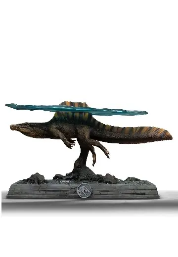 | **[Icons系列 《侏罗纪世界：重生》 棘龙雕像](https://www.hpoi.net/hobby/140444)** Statue Spinosaurus - Jurassic World: Rebirth - Icons - Iron Studios · 侏罗纪世界4：重生 自然生物 · ICONS | 249 美元 | 2026年第二季度 |
|  | **[那个女孩的秘密 琉璃](https://www.hpoi.net/hobby/140443)** あの娘の秘密 るり MilkY 比例人形 · 1/6 · 成人向 | 1,098 元 | 2027-09 |
| 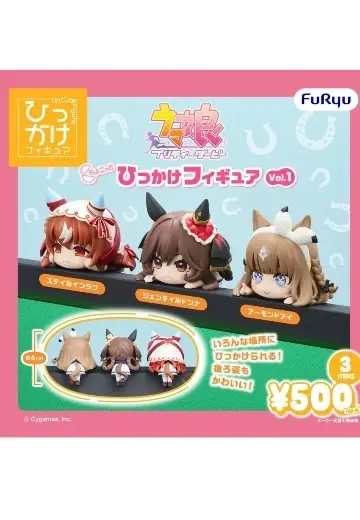 | **[赛马娘 Pretty Derby 小巧趴趴挂壁手办 Vol.1](https://www.hpoi.net/hobby/140442)** ウマ娘 プリティーダービー ちょこっとひっかけフィギュア Vol.1 FuRyu · 赛马娘Pretty Derby · 爱如往昔、杏目、贵妇人 盒蛋/扭蛋 | 500 日元 20元 | 2027-03 |
|  | **[肉感少女 在教室里… 雪平千圣](https://www.hpoi.net/hobby/140437)** 肉感少女 教室で… 雪平ちさと Insight 比例人形 · 1/6 · 成人向 | 23,980 日元 含税，1000元 | 2027-05 |
| 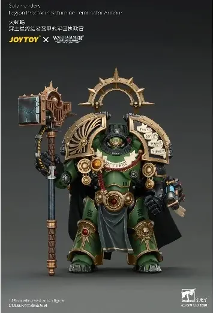 | **[火蜥蜴 穿土星终结者盔甲的执政官](https://www.hpoi.net/hobby/140436)** 火蜥蜴土星 比例人形 · 1/18 | 259 元 | 未知 |
| 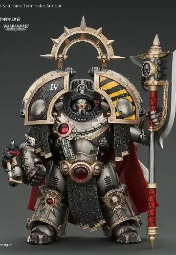 | **[钢铁勇士 穿土星终结者盔甲的执政官](https://www.hpoi.net/hobby/140435)** 钢铁勇士土星 比例人形 · 1/18 | 259 元 | 未知 |
|  | **[手办初代洛天依](https://www.hpoi.net/hobby/140434)** ds3v洛天依 Vsinger · 洛天依 Q版人形 | — | 未知 |
|  | **[手办ds3v洛天依](https://www.hpoi.net/hobby/140432)** 手办ds3v洛天依 Vsinger · 洛天依 Q版人形 | 862 | 未知 |
|  | **[肉感少女 扶她部族 拉玛贾・露露](https://www.hpoi.net/hobby/140428)** 肉感少女 ふたなり部族 ラマジャ・ルル Insight 比例人形 · 1/6 · 成人向 | 23,980 日元 含税，1000元 | 2027-05 |
| 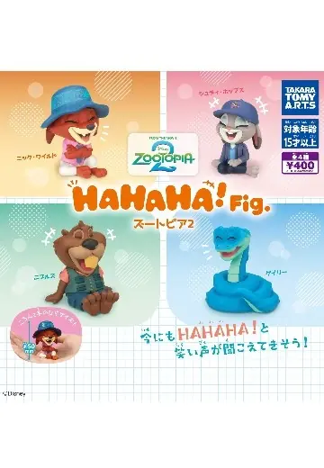 | **[哈哈笑扭蛋 疯狂动物城2](https://www.hpoi.net/hobby/140419)** HAHAHA!Fig. ズートピア2 疯狂动物城2 · 尼克·王尔德、朱迪·霍普斯、蛇盖瑞/盖瑞一条蛇、狸宝·梅普迪 盒蛋/扭蛋 | 400 日元 含税，16元 | 2026-09 |
| 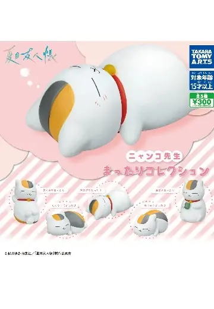 | **[夏目友人帐 猫咪老师 收藏扭蛋](https://www.hpoi.net/hobby/140418)** 夏目友人帳 ニャンコ先生まったりコレクション Takara Tomy A.R.T.S · 夏目友人帐 · 猫咪老师 / 斑 盒蛋/扭蛋 | 300 日元 含税，12元 | 2026-09 |
| 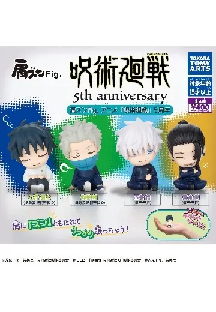 | **[肩靠肩扭蛋 咒术回战 5周年 第一弹](https://www.hpoi.net/hobby/140414)** 肩ズンFig. アニメ『呪術廻戦』5周年 咒术回战 第二季、咒术回战 · 五条悟、夏油杰、狗卷棘、乙骨忧太 盒蛋/扭蛋 | 400 日元 含税，16元 | 2026-09 |
| 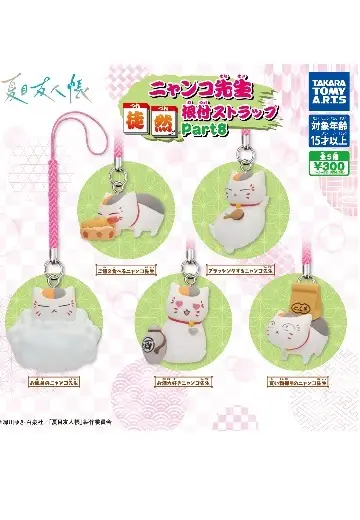 | **[夏目友人帐 猫咪老师 挂绳扭蛋 Part8](https://www.hpoi.net/hobby/140413)** 夏目友人帳 ニャンコ先生 徒然根付ストラップ Part8 Takara Tomy A.R.T.S · 夏目友人帐 · 猫咪老师 / 斑 盒蛋/扭蛋 | 300 日元 含税，12元 | 2026-10 |
|  | **[肩靠肩扭蛋 咒术回战 5周年 第二弹](https://www.hpoi.net/hobby/140411)** 肩ズンFig. アニメ『呪術廻戦』5周年 -弍- Takara Tomy A.R.T.S · 咒术回战 · 五条悟、伏黑惠、虎杖悠仁、钉崎野蔷薇 盒蛋/扭蛋 | 400 日元 含税，16元 | 2026-10 |
| 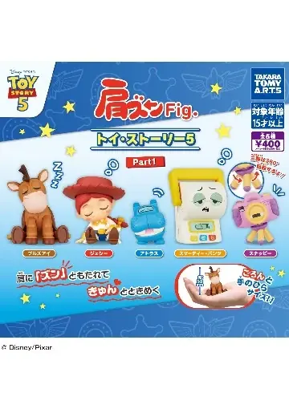 | **[肩靠肩扭蛋 玩具总动员5 Part.1](https://www.hpoi.net/hobby/140410)** 肩ズンFig. トイ・ストーリー5 Part.1 Takara Tomy A.R.T.S · 玩具总动员、玩具总动员5 盒蛋/扭蛋 · 肩靠肩扭蛋 | 400 日元 含税，16元 | 2026-10 |
| 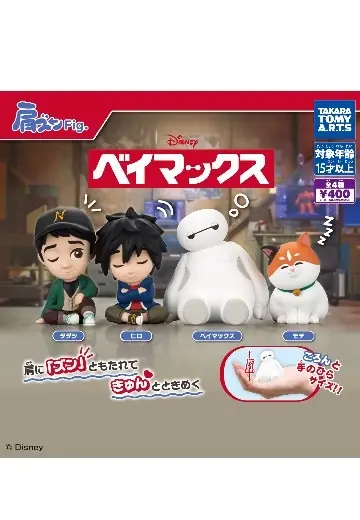 | **[肩靠肩扭蛋 超能陆战队](https://www.hpoi.net/hobby/140409)** 肩ズンFig. ベイマックス Takara Tomy A.R.T.S · 超能陆战队 盒蛋/扭蛋 · 肩靠肩扭蛋 | 400 日元 含税，16元 | 2026-10 |

旧品补录 9 件：HPOI 新收录、但早已发售的老商品

| 图 | 商品 | 价格 | 发售 |
|---|---|---|---|
| 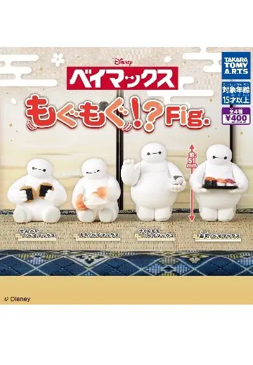 | **[超能陆战队 大白吃东西扭蛋](https://www.hpoi.net/hobby/140440)** ベイマックス もぐもぐ!?Fig. Takara Tomy A.R.T.S · 超能陆战队 · 大白 盒蛋/扭蛋 · 旧品补录 | 400 日元 含税，16元 | 2026-06 |
| 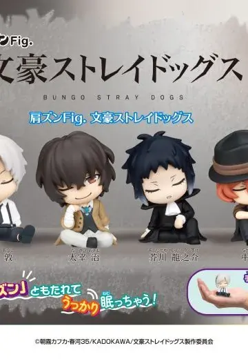 | **[肩靠肩扭蛋 文豪野犬](https://www.hpoi.net/hobby/140439)** 肩ズンFig. 文豪ストレイドッグス Takara Tomy A.R.T.S · 文豪野犬 · 中岛敦、太宰治、中原中也、芥川龙之介 盒蛋/扭蛋 · 肩靠肩扭蛋 · 旧品补录 | 400 日元 含税，16元 | 2026-06 |
|  | **[学习时间扭蛋 排球少年!!](https://www.hpoi.net/hobby/140431)** お勉強タイムFig. ハイキュー!! Takara Tomy A.R.T.S · 排球少年!! · 孤爪研磨、日向翔阳、影山飞雄、黑尾铁朗 盒蛋/扭蛋 · 旧品补录 | 500 日元 含税，20元 | 2026-07 |
|  | **[DC哥谭市系列](https://www.hpoi.net/hobby/140430)** DC哥谭市系列 泡泡玛特 · DC · 蝙蝠侠、蝙蝠女、红罗宾、红头罩、猫女、哈莉·奎茵、毒藤女、谜语人、小丑 Q版人形 · 旧品补录 | 69 元 | 2023-05 |
| 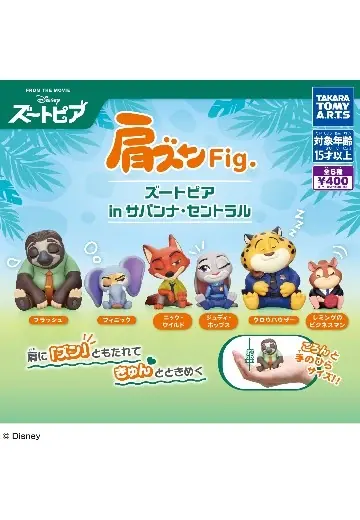 | **[肩靠肩扭蛋 疯狂动物城 in Savanna Central](https://www.hpoi.net/hobby/140429)** 肩ズンFig. ズートピア in サバンナ・セントラル Takara Tomy A.R.T.S · 疯狂动物城 · 本杰明·爪霍瑟、朱迪·霍普斯、尼克·王尔德、闪电 盒蛋/扭蛋 · 肩靠肩扭蛋 · 旧品补录 | 400 日元 含税，16元 | 2026-08 |
|  | **[肩靠肩扭蛋 迪士尼公主](https://www.hpoi.net/hobby/140423)** 肩ズンFig. ディズニープリンセス 阿拉丁动画（1992）、小美人鱼、魔发奇缘、海洋奇缘、美女与野兽 · 莫阿娜、爱丽儿、乐佩、贝儿、茉莉公主佳斯敏 比例人形 · 旧品补录 | 400 日元 含税，16元 | 2026-08 |
| 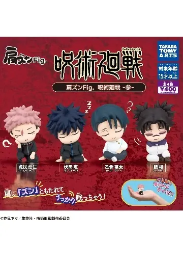 | **[肩靠肩扭蛋 咒术回战 死灭回游](https://www.hpoi.net/hobby/140422)** 肩ズンFig 呪術廻戦 -参- Takara Tomy A.R.T.S · 咒术回战 死灭回游 前篇、咒术回战 第三季、咒术回战 · 虎杖悠仁、伏黑惠、乙骨忧太、胀相 盒蛋/扭蛋 · 旧品补录 | 400 日元 含税，16元 | 2026-08 |
|  | **[肩靠肩扭蛋 无敌破坏王](https://www.hpoi.net/hobby/140421)** 肩ズンFig. シュガー・ラッシュ Takara Tomy A.R.T.S · 无敌破坏王2：大闹互联网、无敌破坏王 盒蛋/扭蛋 · 肩靠肩扭蛋 · 旧品补录 | 400 日元 含税，16元 | 2026-08 |
|  | **[肩靠肩扭蛋 赛车总动员 电影上映20周年](https://www.hpoi.net/hobby/140420)** 肩ズンFig. カーズ 劇場公開20周年！ Takara Tomy A.R.T.S · 赛车总动员 比例人形 · 肩靠肩扭蛋 · 旧品补录 | 400 日元 含税，16元 | 2026-08 |

## Sofmap（5）

| 图 | 商品 | 价格 | 发售 |
|---|---|---|---|
|  | **[【再販】塗装済み完成品 1/7 しゅごキャラ！ 日奈森あむ 制服ver.](https://a.sofmap.com/product_detail.aspx?sku=101939420)** コトブキヤ スケールフィギュア · 1/7 · 预订中 · 再贩 | 22,000 日元 | 2027-06 |
|  | **[ねんどろいど Baldur’s Gate III キャンプ衣装Ver. べーしっく アスタリオン](https://a.sofmap.com/product_detail.aspx?sku=102451381)** グッドスマイルカンパニー 预订中 | 3,900 日元 | 未定 |
|  | **[ねんどろいど Baldur’s Gate III セルーネイVer. べーしっく シャドウハート](https://a.sofmap.com/product_detail.aspx?sku=102451393)** グッドスマイルカンパニー 预订中 | 3,900 日元 | 未定 |
| 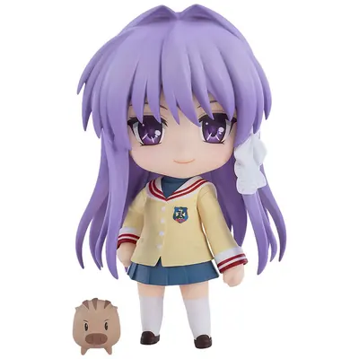 | **[ねんどろいど CLANNAD 藤林杏](https://a.sofmap.com/product_detail.aspx?sku=102451316)** グッドスマイルカンパニー 预订中 | 6,800 日元 | 未定 |
|  | **[ねんどろいど Duolingo デュオ](https://a.sofmap.com/product_detail.aspx?sku=102451334)** グッドスマイルアーツ上海 预订中 | 6,800 日元 | 未定 |

## Nin-Nin-Game（1）

| 图 | 商品 | 价格 | 发售 |
|---|---|---|---|
|  | **[Stellar Blade: SAC Chibi Figure Collection (8 Pack Box) (With Bonus) \[Hobby Sakura\]](https://www.nin-nin-game.com/en/chibi-minifigures/271877-stellar-blade-sac-chibi-figure-collection-8-pack-box-with-bonus-hobby-sakura-.html)** Hobby Sakura · Stellar Blade 预订中 · 附特典 | 141 美元 | 2027-08 |
