# 2026-11-28 手办新品

共 68 件（HPOI 35 · Sofmap 5 · Hobby-Genki 7 · Nin-Nin-Game 21）。点名称打开原页面。

## HPOI（35）

| 图 | 商品 | 价格 | 发售 |
|---|---|---|---|
|  | **[Icons系列 《侏罗纪世界：重生》 棘龙雕像](https://www.hpoi.net/hobby/140444)** Statue Spinosaurus - Jurassic World: Rebirth - Icons - Iron Studios · 侏罗纪世界4：重生 自然生物 · ICONS | 249 美元 | 2026年第二季度 |
|  | **[那个女孩的秘密 琉璃](https://www.hpoi.net/hobby/140443)** あの娘の秘密 るり MilkY 比例人形 · 1/6 · 成人向 | 1,098 元 | 2027-09 |
|  | **[赛马娘 Pretty Derby 小巧趴趴挂壁手办 Vol.1](https://www.hpoi.net/hobby/140442)** ウマ娘 プリティーダービー ちょこっとひっかけフィギュア Vol.1 FuRyu · 赛马娘Pretty Derby · 爱如往昔、杏目、贵妇人 盒蛋/扭蛋 | 500 日元 20元 | 2027-03 |
|  | **[肉感少女 在教室里… 雪平千圣](https://www.hpoi.net/hobby/140437)** 肉感少女 教室で… 雪平ちさと Insight 比例人形 · 1/6 · 成人向 | 23,980 日元 含税，1000元 | 2027-05 |
|  | **[火蜥蜴 穿土星终结者盔甲的执政官](https://www.hpoi.net/hobby/140436)** 火蜥蜴土星 比例人形 · 1/18 | 259 元 | 未知 |
|  | **[钢铁勇士 穿土星终结者盔甲的执政官](https://www.hpoi.net/hobby/140435)** 钢铁勇士土星 比例人形 · 1/18 | 259 元 | 未知 |
|  | **[手办初代洛天依](https://www.hpoi.net/hobby/140434)** ds3v洛天依 Vsinger · 洛天依 Q版人形 | — | 未知 |
|  | **[手办ds3v洛天依](https://www.hpoi.net/hobby/140432)** 手办ds3v洛天依 Vsinger · 洛天依 Q版人形 | 862 | 未知 |
| 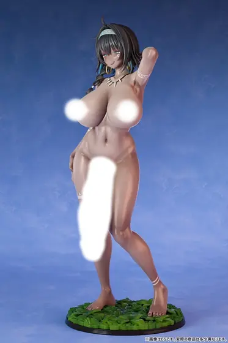 | **[肉感少女 扶她部族 拉玛贾・露露](https://www.hpoi.net/hobby/140428)** 肉感少女 ふたなり部族 ラマジャ・ルル Insight 比例人形 · 1/6 · 成人向 | 23,980 日元 含税，1000元 | 2027-05 |
|  | **[哈哈笑扭蛋 疯狂动物城2](https://www.hpoi.net/hobby/140419)** HAHAHA!Fig. ズートピア2 疯狂动物城2 · 尼克·王尔德、朱迪·霍普斯、蛇盖瑞/盖瑞一条蛇、狸宝·梅普迪 盒蛋/扭蛋 | 400 日元 含税，16元 | 2026-09 |
|  | **[夏目友人帐 猫咪老师 收藏扭蛋](https://www.hpoi.net/hobby/140418)** 夏目友人帳 ニャンコ先生まったりコレクション Takara Tomy A.R.T.S · 夏目友人帐 · 猫咪老师 / 斑 盒蛋/扭蛋 | 300 日元 含税，12元 | 2026-09 |
|  | **[肩靠肩扭蛋 咒术回战 5周年 第一弹](https://www.hpoi.net/hobby/140414)** 肩ズンFig. アニメ『呪術廻戦』5周年 咒术回战 第二季、咒术回战 · 五条悟、夏油杰、狗卷棘、乙骨忧太 盒蛋/扭蛋 | 400 日元 含税，16元 | 2026-09 |
|  | **[夏目友人帐 猫咪老师 挂绳扭蛋 Part8](https://www.hpoi.net/hobby/140413)** 夏目友人帳 ニャンコ先生 徒然根付ストラップ Part8 Takara Tomy A.R.T.S · 夏目友人帐 · 猫咪老师 / 斑 盒蛋/扭蛋 | 300 日元 含税，12元 | 2026-10 |
| 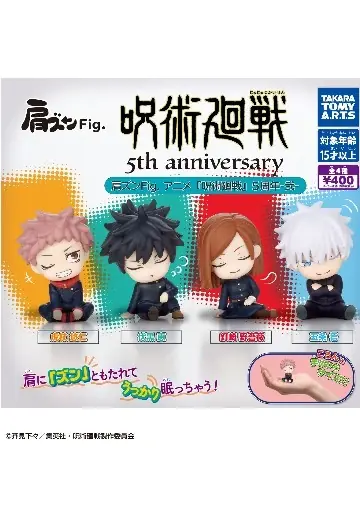 | **[肩靠肩扭蛋 咒术回战 5周年 第二弹](https://www.hpoi.net/hobby/140411)** 肩ズンFig. アニメ『呪術廻戦』5周年 -弍- Takara Tomy A.R.T.S · 咒术回战 · 五条悟、伏黑惠、虎杖悠仁、钉崎野蔷薇 盒蛋/扭蛋 | 400 日元 含税，16元 | 2026-10 |
|  | **[肩靠肩扭蛋 玩具总动员5 Part.1](https://www.hpoi.net/hobby/140410)** 肩ズンFig. トイ・ストーリー5 Part.1 Takara Tomy A.R.T.S · 玩具总动员、玩具总动员5 盒蛋/扭蛋 · 肩靠肩扭蛋 | 400 日元 含税，16元 | 2026-10 |
|  | **[肩靠肩扭蛋 超能陆战队](https://www.hpoi.net/hobby/140409)** 肩ズンFig. ベイマックス Takara Tomy A.R.T.S · 超能陆战队 盒蛋/扭蛋 · 肩靠肩扭蛋 | 400 日元 含税，16元 | 2026-10 |
| 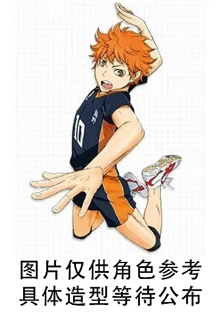 | **[Grandista 排球少年 日向翔阳](https://www.hpoi.net/hobby/140459)** Grandista 排球少年 日向翔阳 眼镜厂 · 排球少年!! · 日向翔阳 比例人形 · Grandista | — | 2027-06 |
| 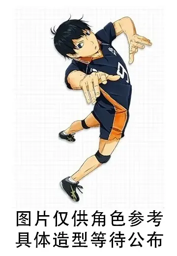 | **[Grandista 排球少年 影山飞雄](https://www.hpoi.net/hobby/140458)** Grandista 排球少年 影山飞雄 眼镜厂 · 排球少年!! · 影山飞雄 比例人形 · Grandista | — | 2027-06 |
| 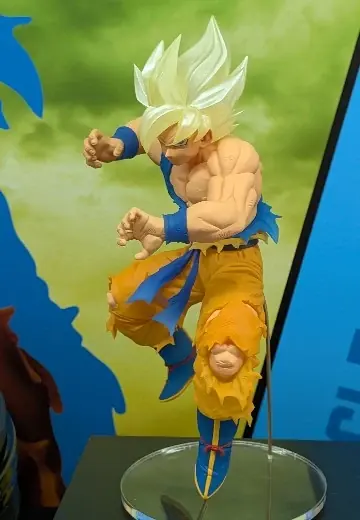 | **[CLEARISE 龙珠Z 超级赛亚人悟空](https://www.hpoi.net/hobby/140457)** ドラゴンボールZ CLEARISE 超サイヤ人孫悟空Ⅱ 眼镜厂 · 龙珠Z · 孙悟空 比例人形 · CLEARISE | — | 未知 |
| 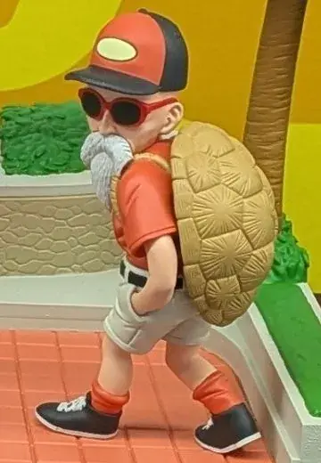 | **[龙珠 History Box 龟仙人](https://www.hpoi.net/hobby/140456)** ドラゴンボール History Box 亀仙人 Ⅱ 眼镜厂 · 龙珠 · 龟仙人 比例人形 · History Box | — | 未知 |
|  | **[History Box 龙珠 克林 Ⅱ](https://www.hpoi.net/hobby/140455)** ドラゴンボール History Box クリリン Ⅱ 眼镜厂 · 龙珠 · 库林 比例人形 · History Box | — | 未知 |
| 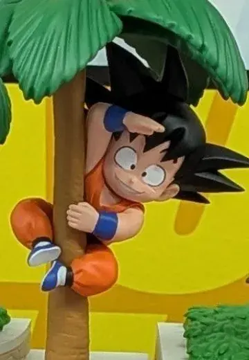 | **[History Box 龙珠 孙悟空 Ⅱ](https://www.hpoi.net/hobby/140454)** ドラゴンボール History Box 孫悟空 Ⅱ 眼镜厂 · 龙珠 · 孙悟空 比例人形 · History Box | — | 未知 |
| 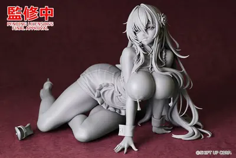 | **[胜利女神：新的希望 薇尔维特](https://www.hpoi.net/hobby/140453)** 勝利の女神：NIKKE ベルベット Max Factory · 胜利女神：新的希望 · 薇尔维特 比例人形 · 成人向 | — | 未知 |
|  | **[《星球大战》头盔夜灯系列 曼达洛人](https://www.hpoi.net/hobby/140449)** 《星球大战》头盔夜灯系列 曼达洛人 中动玩具 · 星球大战、曼达洛人 · 曼达洛人（丁·贾林） 比例人形 | — | 2026-09 |
|  | **[《星球大战》头盔夜灯系列 暴风兵](https://www.hpoi.net/hobby/140448)** 《星球大战》头盔夜灯系列 暴风兵 中动玩具 · 星球大战 · 帝国冲锋队员 比例人形 | — | 2026-09 |
| 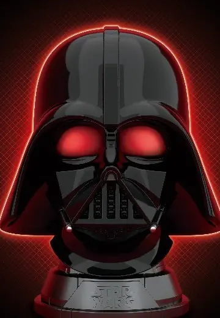 | **[《星球大战》头盔夜灯系列 达斯·维达](https://www.hpoi.net/hobby/140447)** 《星球大战》头盔夜灯系列 达斯·维达 中动玩具 · 星球大战 · 安纳金·天行者 / 达斯·维德 比例人形 | — | 2026-09 |

旧品补录 9 件：HPOI 新收录、但早已发售的老商品

| 图 | 商品 | 价格 | 发售 |
|---|---|---|---|
|  | **[超能陆战队 大白吃东西扭蛋](https://www.hpoi.net/hobby/140440)** ベイマックス もぐもぐ!?Fig. Takara Tomy A.R.T.S · 超能陆战队 · 大白 盒蛋/扭蛋 · 旧品补录 | 400 日元 含税，16元 | 2026-06 |
|  | **[肩靠肩扭蛋 文豪野犬](https://www.hpoi.net/hobby/140439)** 肩ズンFig. 文豪ストレイドッグス Takara Tomy A.R.T.S · 文豪野犬 · 中岛敦、太宰治、中原中也、芥川龙之介 盒蛋/扭蛋 · 肩靠肩扭蛋 · 旧品补录 | 400 日元 含税，16元 | 2026-06 |
| 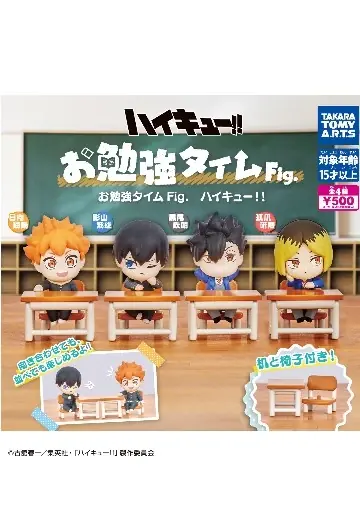 | **[学习时间扭蛋 排球少年!!](https://www.hpoi.net/hobby/140431)** お勉強タイムFig. ハイキュー!! Takara Tomy A.R.T.S · 排球少年!! · 孤爪研磨、日向翔阳、影山飞雄、黑尾铁朗 盒蛋/扭蛋 · 旧品补录 | 500 日元 含税，20元 | 2026-07 |
| 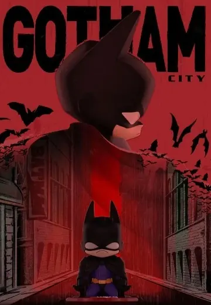 | **[DC哥谭市系列](https://www.hpoi.net/hobby/140430)** DC哥谭市系列 泡泡玛特 · DC · 蝙蝠侠、蝙蝠女、红罗宾、红头罩、猫女、哈莉·奎茵、毒藤女、谜语人、小丑 Q版人形 · 旧品补录 | 69 元 | 2023-05 |
|  | **[肩靠肩扭蛋 疯狂动物城 in Savanna Central](https://www.hpoi.net/hobby/140429)** 肩ズンFig. ズートピア in サバンナ・セントラル Takara Tomy A.R.T.S · 疯狂动物城 · 本杰明·爪霍瑟、朱迪·霍普斯、尼克·王尔德、闪电 盒蛋/扭蛋 · 肩靠肩扭蛋 · 旧品补录 | 400 日元 含税，16元 | 2026-08 |
|  | **[肩靠肩扭蛋 迪士尼公主](https://www.hpoi.net/hobby/140423)** 肩ズンFig. ディズニープリンセス 阿拉丁动画（1992）、小美人鱼、魔发奇缘、海洋奇缘、美女与野兽 · 莫阿娜、爱丽儿、乐佩、贝儿、茉莉公主佳斯敏 比例人形 · 旧品补录 | 400 日元 含税，16元 | 2026-08 |
|  | **[肩靠肩扭蛋 咒术回战 死灭回游](https://www.hpoi.net/hobby/140422)** 肩ズンFig 呪術廻戦 -参- Takara Tomy A.R.T.S · 咒术回战 死灭回游 前篇、咒术回战 第三季、咒术回战 · 虎杖悠仁、伏黑惠、乙骨忧太、胀相 盒蛋/扭蛋 · 旧品补录 | 400 日元 含税，16元 | 2026-08 |
|  | **[肩靠肩扭蛋 无敌破坏王](https://www.hpoi.net/hobby/140421)** 肩ズンFig. シュガー・ラッシュ Takara Tomy A.R.T.S · 无敌破坏王2：大闹互联网、无敌破坏王 盒蛋/扭蛋 · 肩靠肩扭蛋 · 旧品补录 | 400 日元 含税，16元 | 2026-08 |
|  | **[肩靠肩扭蛋 赛车总动员 电影上映20周年](https://www.hpoi.net/hobby/140420)** 肩ズンFig. カーズ 劇場公開20周年！ Takara Tomy A.R.T.S · 赛车总动员 比例人形 · 肩靠肩扭蛋 · 旧品补录 | 400 日元 含税，16元 | 2026-08 |

## Sofmap（5）

| 图 | 商品 | 价格 | 发售 |
|---|---|---|---|
| 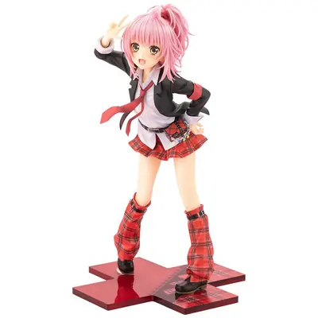 | **[【再販】塗装済み完成品 1/7 しゅごキャラ！ 日奈森あむ 制服ver.](https://a.sofmap.com/product_detail.aspx?sku=101939420)** コトブキヤ スケールフィギュア · 1/7 · 预订中 · 再贩 | 22,000 日元 | 2027-06 |
|  | **[ねんどろいど Baldur’s Gate III キャンプ衣装Ver. べーしっく アスタリオン](https://a.sofmap.com/product_detail.aspx?sku=102451381)** グッドスマイルカンパニー 预订中 | 3,900 日元 | 未定 |
| 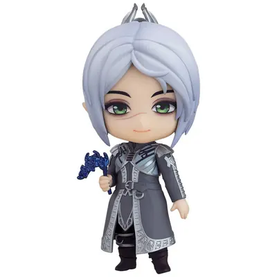 | **[ねんどろいど Baldur’s Gate III セルーネイVer. べーしっく シャドウハート](https://a.sofmap.com/product_detail.aspx?sku=102451393)** グッドスマイルカンパニー 预订中 | 3,900 日元 | 未定 |
|  | **[ねんどろいど CLANNAD 藤林杏](https://a.sofmap.com/product_detail.aspx?sku=102451316)** グッドスマイルカンパニー 预订中 | 6,800 日元 | 未定 |
|  | **[ねんどろいど Duolingo デュオ](https://a.sofmap.com/product_detail.aspx?sku=102451334)** グッドスマイルアーツ上海 预订中 | 6,800 日元 | 未定 |

## Hobby-Genki（7）

| 图 | 商品 | 价格 | 发售 |
|---|---|---|---|
| 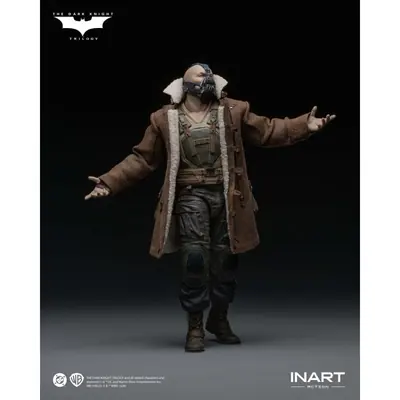 | **[INART Action Bane The Dark Knight Rises Action Figure Deluxe Ver.](https://hobby-genki.com/en/inart/106660-inart-action-bane-the-dark-knight-rises-action-figure-deluxe-ver-6972662533261.html)** INART 预订中 | 18,112 日元 | 2027-03 |
| 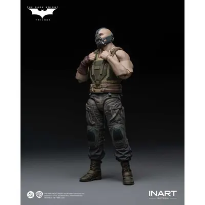 | **[INART Action Bane The Dark Knight Rises Action Figure Standard Ver.](https://hobby-genki.com/en/inart/106659-inart-action-bane-the-dark-knight-rises-action-figure-standard-ver-6972662532943.html)** INART 预订中 | 15,664 日元 | 2027-03 |
| 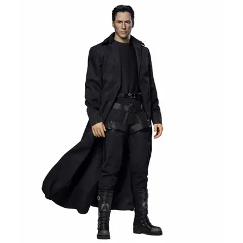 | **[INART Neo The Matrix 1/6 Scale Action Figure](https://hobby-genki.com/en/inart/106658-inart-neo-the-matrix-16-scale-action-figure-6972662533384.html)** INART 1/6 · 预订中 | 76,824 日元 | 2027-10 |
| 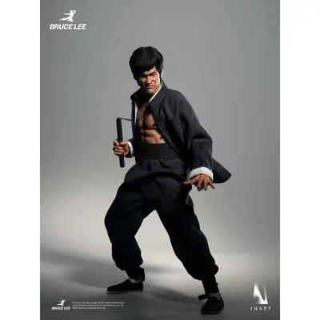 | **[INART Bruce Lee (Kung Fu Outfit Ver.) 1/6 Scale Action Figure](https://hobby-genki.com/en/inart/106657-inart-bruce-lee-kung-fu-outfit-ver-16-scale-action-figure-6972662533377.html)** INART 1/6 · 预订中 | 80,025 日元 | 2027-10 |
| 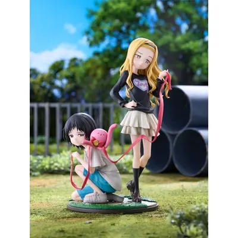 | **[Shizuka Kuze &amp; Marina Kirarazaka Takopi's Original Sin 1/7 Scale Figure Limited Bonus Set](https://hobby-genki.com/en/furyu-fnex/106656-shizuka-kuze-marina-kirarazaka-takopi-s-original-sin-17-scale-figure-limited-bonus-set-4571623518877.html)** FuRyu - F:NEX 1/7 · 预订中 · 官网限定 · 附特典 | 28,150 日元 | 2027-08 |
| 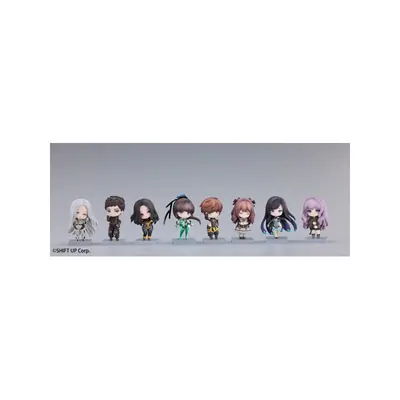 | **[SAC Series Stellar Blade Chibi Figure 8Pack Box](https://hobby-genki.com/en/hobby-sakura/106655-goddess-of-victory-nikke-sac-series-vol3-chibi-figure-complete-box-6979272330303.html)** Hobby Sakura 预订中 | 21,278 日元 | 2027-08 |
| 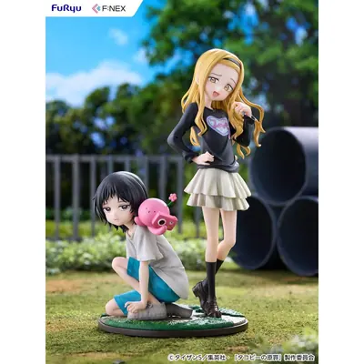 | **[Shizuka Kuze &amp; Marina Kirarazaka Takopi's Original Sin 1/7 Scale Figure](https://hobby-genki.com/en/furyu-fnex/106654-shizuka-kuze-marina-kirarazaka-takopi-s-original-sin-17-scale-figure-4571623518877.html)** FuRyu - F:NEX 1/7 · 预订中 | 22,770 日元 | 2027-08 |

## Nin-Nin-Game（21）

| 图 | 商品 | 价格 | 发售 |
|---|---|---|---|
|  | **[Stellar Blade: SAC Chibi Figure Collection (8 Pack Box) (With Bonus) \[Hobby Sakura\]](https://www.nin-nin-game.com/en/chibi-minifigures/271877-stellar-blade-sac-chibi-figure-collection-8-pack-box-with-bonus-hobby-sakura-.html)** Hobby Sakura · Stellar Blade 预订中 · 附特典 | 141 美元 | 2027-08 |
| 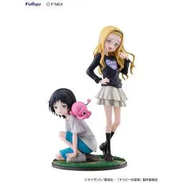 | **[Takopi's Original Sin: Shizuka Kuze &amp; Marina Kirazaka 1/7 - F:NEX Figure \[FuRyu\]](https://www.nin-nin-game.com/en/fnex/271891-takopi-s-original-sin-shizuka-kuze-marina-kirazaka-17-fnex-figure-furyu-.html)** FuRyu · Takopi's Original Sin · Shizuka Kuze Marina Kirazaka 1/7 · 预订中 | 160 美元 | 2027-08 |
|  | **[CJ Sexy Card Series Vol.145: Hikari Aozora / Tokimeki no Aoi Sora - Official Card Collection (12 Pack Box) \[Jyutoku\]](https://www.nin-nin-game.com/en/tcg-trading-cards/271560-cj-sexy-card-series-vol145-hikari-aozora-tokimeki-no-aoi-sora-official-card-collection-12-pack-box-jyutoku-.html)** Jyutoku · CJ Sexy Card 预订中 · 官网限定 · 成人向 | 48 美元 | 2027-03 |
|  | **[Nikkan Shoujo: Tsubaki 1/6 - Exhibitionist Girl Next Door (2nd Batch) \[Insight\]](https://www.nin-nin-game.com/en/plus18-figures/271488-nikkan-shoujo-tsubaki-16-exhibitionist-girl-next-door-2nd-batch-insight-.html)** Insight · Nikkan Shoujo 1/6 · 预订中 · 成人向 | 140 美元 | 2027-05 |
|  | **[Nikkan Shoujo: Kasumi 1/6 - Exhibitionist Girl Next Door (2nd Batch) \[Insight\]](https://www.nin-nin-game.com/en/plus18-figures/271487-nikkan-shoujo-kasumi-16-exhibitionist-girl-next-door-2nd-batch-insight-.html)** Insight 1/6 · 预订中 · 成人向 | 140 美元 | 2027-05 |
|  | **[Nikkan Shoujo: Ramaja Lulu 1/6 - Futanari Tribe \[Insight\]](https://www.nin-nin-game.com/en/plus18-figures/271485-nikkan-shoujo-ramaja-lulu-16-futanari-tribe-16-insight-.html)** Insight · Nikkan Shoujo 1/6 · 预订中 · 成人向 | 140 美元 | 2027-05 |
|  | **[Fate / kaleid liner Prisma☆Illya: Chloe von Einzbern 1/4 - Sweet Devil Ver. Re▼Dress (Limited + Bonus) \[Medicos Entertainment\]](https://www.nin-nin-game.com/en/plus18-figures/271477-fate-kaleid-liner-prismaillya-chloe-von-einzbern-14-sweet-devil-ver-redress-limited-bonus-medicos-entertainment-.html)** Medicos Entertainment · Fate/kaleid Liner Prisma ☆ Illya · Chloe von Einzbern 1/4 · 预订中 · 官网限定 · 附特典 · 成人向 | 194 美元 | 2027-08 |
| 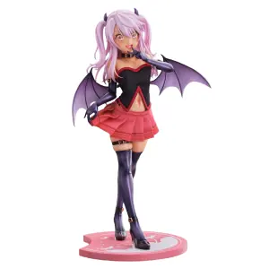 | **[Fate / kaleid liner Prisma☆Illya: Chloe von Einzbern 1/4 - Sweet Devil Ver. Re▼Dress \[Medicos Entertainment\]](https://www.nin-nin-game.com/en/plus18-figures/271476-fate-kaleid-liner-prismaillya-chloe-von-einzbern-14-sweet-devil-ver-redress-medicos-entertainment-.html)** Medicos Entertainment · Fate/kaleid Liner Prisma ☆ Illya · Chloe von Einzbern 1/4 · 预订中 · 官网限定 · 成人向 | 157 美元 | 2027-08 |
|  | **[Original Character by Beruru: Rinrin Shimono 1/5 (Cast-Off) \[Nebula Toys\]](https://www.nin-nin-game.com/en/plus18-figures/271318-original-character-by-beruru-rinrin-shimono-15-cast-off-nebula-toys-.html)** Nebula Toys 1/5 · 预订中 · 成人向 | 185 美元 | 2027-10 |
|  | **[Nikkan Shoujo: Medusa Tribe 1/6 - Isekai Slave Market Item No.09 \[Insight\]](https://www.nin-nin-game.com/en/plus18-figures/271228-nikkan-shoujo-medusa-tribe-16-isekai-slave-market-item-no09-insight-.html)** Insight 1/6 · 预订中 · 成人向 | 140 美元 | 2027-05 |
|  | **[Nikkan Shoujo: Tiroir 1/7 (Nude Ver.) \[Insight\]](https://www.nin-nin-game.com/en/insight/270961-nikkan-shoujo-tiroir-17-nude-ver-insight-.html)** Insight 1/7 · 预订中 · 成人向 | 63 美元 | 2027-04 |
| 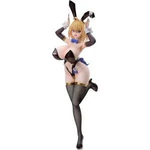 | **[B-Style: Bunny Suit Planning - Sophia F. Shirring 1/4 (Bunny Girl Ver. No.4) (Cast-Off) \[FREEing\]](https://www.nin-nin-game.com/en/plus18-figures/270831-b-style-bunny-suit-planning-sophia-f-shirring-14-bunny-girl-ver-no4-cast-off-freeing-.html)** FREEing · Bunny Suit Planning · Sophia F. Shirring 1/4 · 预订中 · 成人向 | 257 美元 | 2027-05 |
|  | **[Nikkan Shoujo: Nurse Takesato-san 1/6 \[Insight\]](https://www.nin-nin-game.com/en/plus18-figures/270456-nikkan-shoujo-nurse-takesato-san-16-insight-.html)** Insight · Nikkan Shoujo 1/6 · 预订中 · 成人向 | 140 美元 | 2027-05 |
| 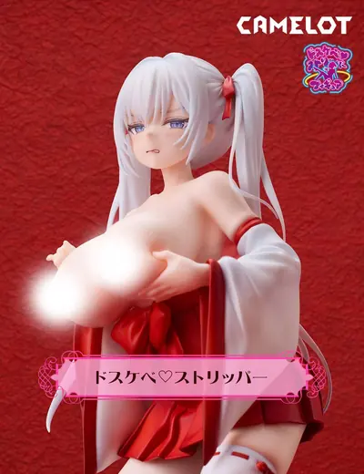 | **[Original Character by Alex: Rena Fuyukaze 1/8 - Shrine Maiden Ver. Dosukebe♡Stripper Figure (Limited + Bonus) \[Native / Camelot\]](https://www.nin-nin-game.com/en/plus18-figures/270439-original-character-by-alex-rena-fuyukaze-18-shrine-maiden-ver-dosukebestripper-figure-limited-bonus-native-camelot-.html)** Native 1/8 · 预订中 · 官网限定 · 附特典 · 成人向 | 71 美元 | 2027-08 |
| 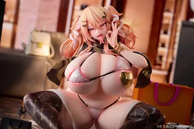 | **[Original Character by Kaenuko: Miya-chan 1/6 - DX Ver. (Cast-Off With Bonus) \[PinkMango\]](https://www.nin-nin-game.com/en/plus18-figures/270356-original-character-by-kaenuko-miya-chan-16-dx-ver-cast-off-with-bonus-pinkmango-.html)** PinkMango · Original 1/6 · 预订中 · 附特典 · 成人向 | 203 美元 | 2027-11 |
| 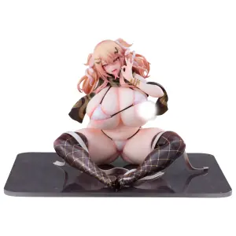 | **[Original Character by Kaenuko: Miya-chan 1/6 (Cast-Off With Bonus) \[PinkMango\]](https://www.nin-nin-game.com/en/plus18-figures/270355-original-character-by-kaenuko-miya-chan-16-cast-off-with-bonus-pinkmango-.html)** PinkMango · Original 1/6 · 预订中 · 附特典 · 成人向 | 176 美元 | 2027-11 |
|  | **[Nikkan Shoujo: Iori Miyama 1/6 - Ballet Club Secret Training (2nd Batch) \[Insight\]](https://www.nin-nin-game.com/en/insight/270275-nikkan-shoujo-ballet-club-secret-training-iori-miyama-16-2nd-batch-insight-.html)** Insight 1/6 · 预订中 · 成人向 | 140 美元 | 2027-05 |
|  | **[Nikkan Shoujo: Busty Housewife Chuhon 1/6 - Secret Swimming Class \[Insight\]](https://www.nin-nin-game.com/en/plus18-figures/270039-nikkan-shoujo-busty-housewife-chuhon-16-secret-swimming-class-insight-.html)** Insight · Nikkan Shoujo 1/6 · 预订中 · 成人向 | 140 美元 | 2027-05 |
| 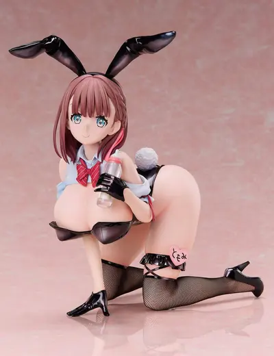 | **[Original Character by Takako Hitsuji: Bonyu-chan / Tomomi 1/4 - Bunny Ver. (Cast-Off) (Limited Edition) \[Native / BINDing\]](https://www.nin-nin-game.com/en/binding/269974-original-character-by-takako-hitsuji-bonyu-chan-tomomi-14-bunny-ver-cast-off-limited-edition-native-binding-.html)** Native 1/4 · 预订中 · 官网限定 · 成人向 | 317 美元 | 2027-05 |
|  | **[Original Character by Sato Kuuki: Rua Hoshizaki 1/4 (Cast-Off) \[PURE\]](https://www.nin-nin-game.com/en/plus18-figures/269929-original-character-by-sato-kuuki-rua-hoshizaki-14-cast-off-pure-.html)** PURE · Original 1/4 · 预订中 · 成人向 | 267 美元 | 2028-02 |
| 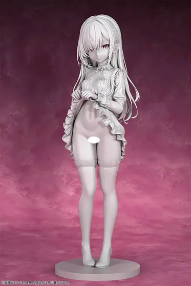 | **[Nikkan Shoujo: Melvt 1/6 - Garage Kit \[Insight\]](https://www.nin-nin-game.com/en/insight/269727-nikkan-shoujo-melvt-16-garage-kit-insight-.html)** Insight 1/6 · 预订中 · 成人向 | 26 美元 | 2027-02 |
